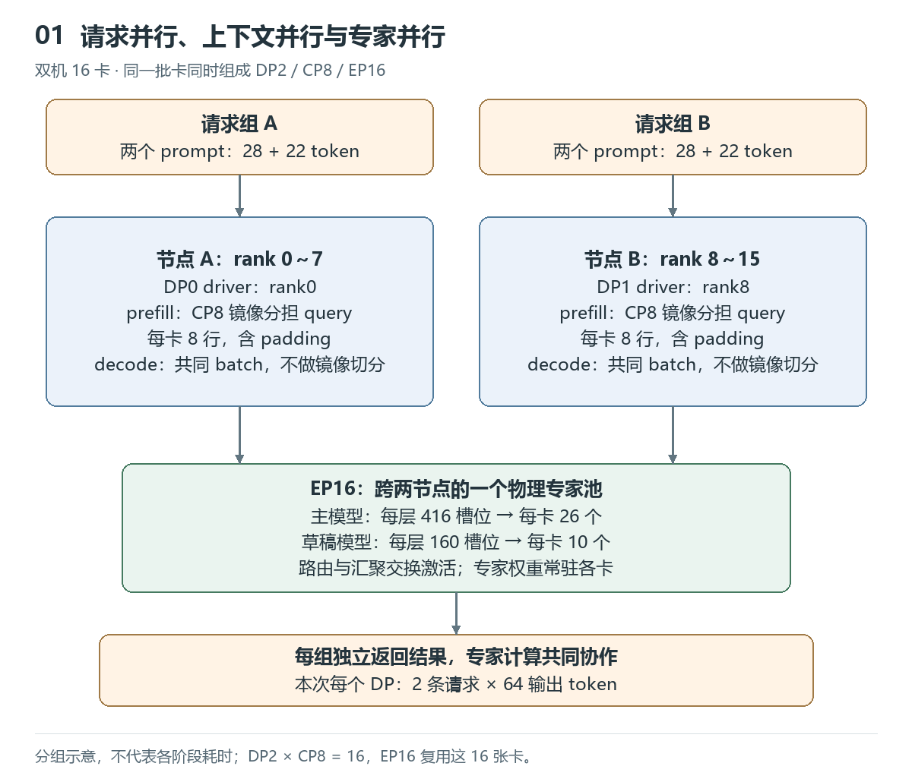
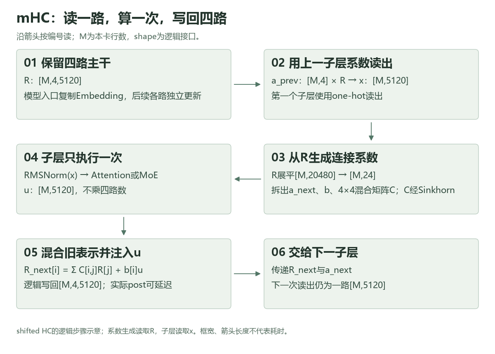
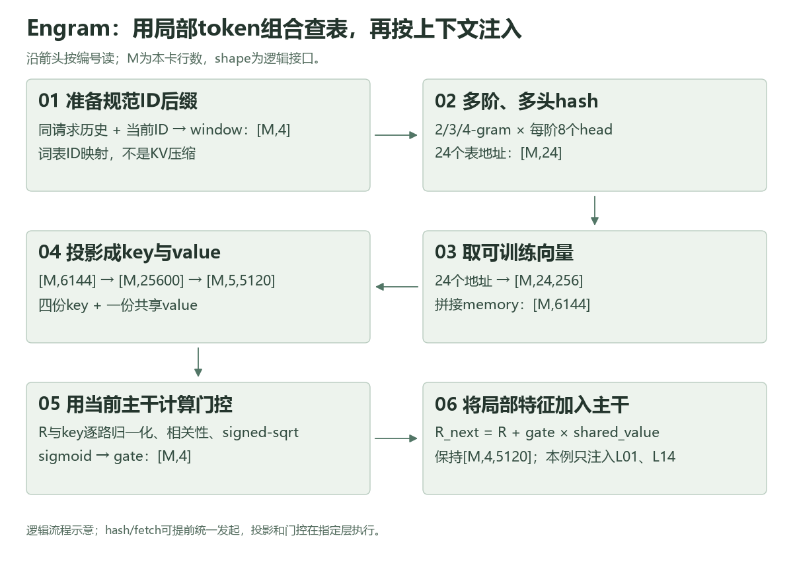
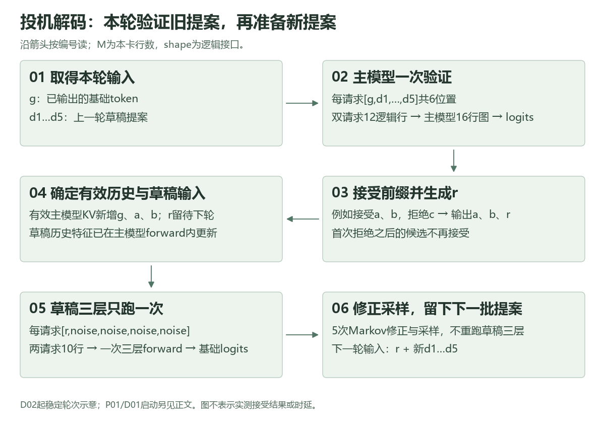
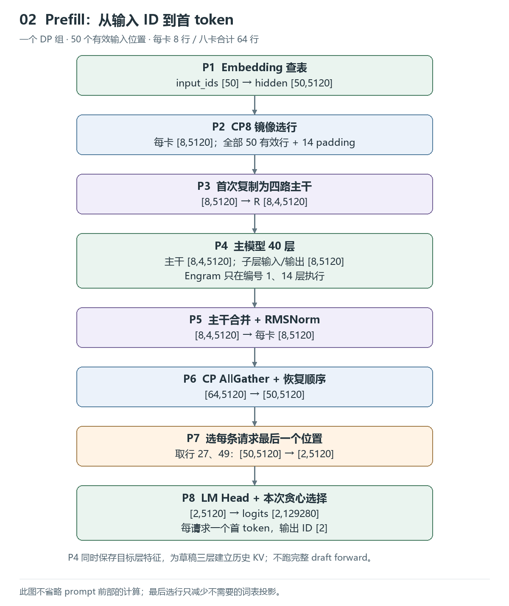
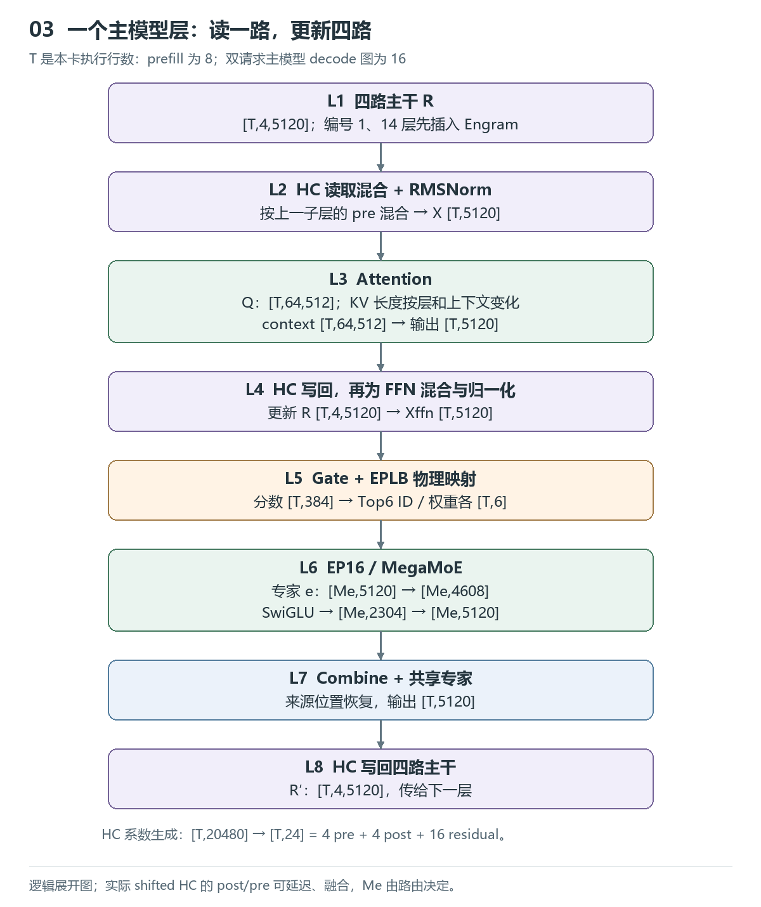
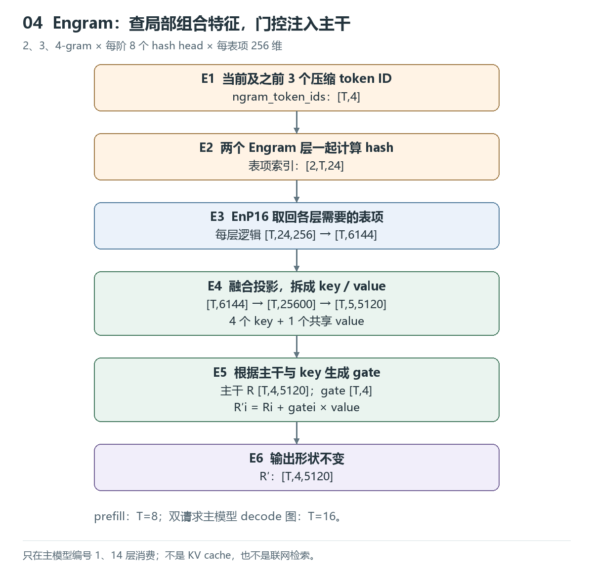
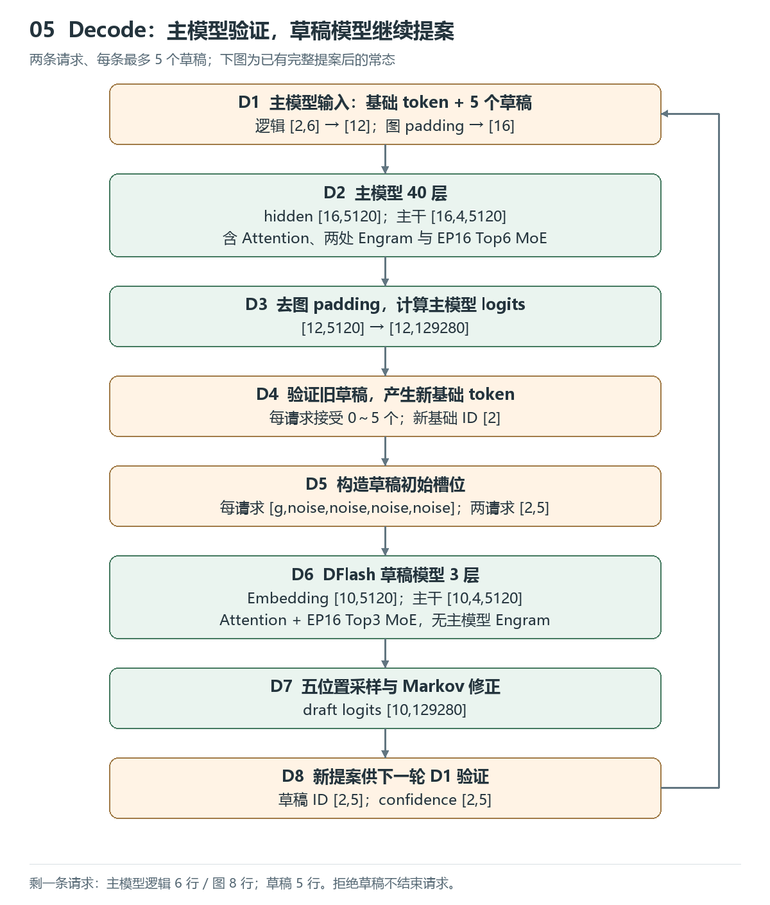
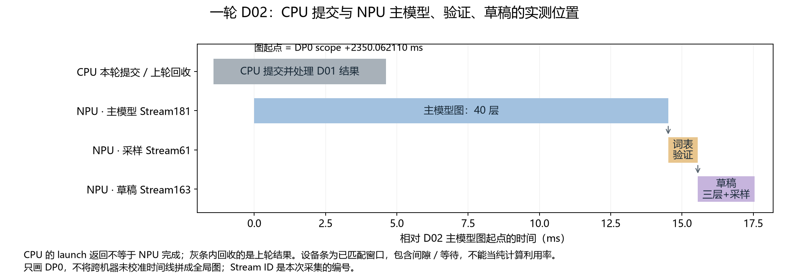
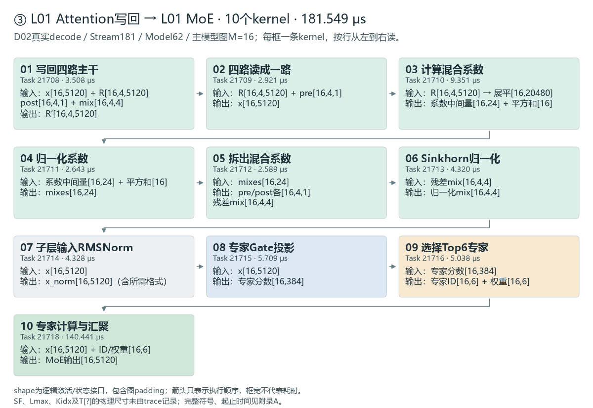

# 从一句话到一句话：DeepInfer 推理全流程与 Trace 图解

面向熟悉 MegaMoE、但较少接触推理引擎的同事。我们从两条真实输入出发，先跟到首个输出 token，再跟一轮主模型与草稿的合作，最后放大到一层里的 kernel。读完后，应能沿着输入复述计算顺序，并在同一份 trace 中找到对应位置。

**建议分两遍读。** 第一遍按第1～7章顺序：先看全貌、补四个概念，再沿着“输入 → 首 token → 模型层 → 后续 token → 引擎调度”读下去；标为“选读”的推导可先跳过。第二遍用第8章做三个 trace 小核对，再用第9章核算次数和 MegaMoE 负载。完整 kernel 名称和逐事件时间放在附录，正文不用背编号。

本文固定讨论 **2026-10-27采集的固定模型配置（40层、H=5120）**。耗时和 kernel 次数来自 trace，shape 由对应源码和执行图重建，未逐张量导出；版本与证据入口见文末。

**模型名称校正（2026-11-04）：** 早期记录简称“V4 Flash”；本文40层、H=5120、384个路由专家、L01/L14 Engram的结构与官方V4.1-Flash配置一致，不能套用官方V4-Flash的43层、H=4096配置。本文保留原采集数据与固定代码作为依据。[V4.1-Flash配置](https://huggingface.co/deepseek-ai/DeepSeek-V4.1-Flash/blob/main/config.json)、[V4-Flash配置](https://huggingface.co/deepseek-ai/DeepSeek-V4-Flash/blob/main/config.json)

## 第一章：先看到全貌——推理引擎怎样生成一句话

### 1.1 一次生成，从文字到文字

先分清两个角色：**模型负责给出下一个 token 的分布；推理引擎负责安排请求、准备输入、维护缓存、调用模型，再将结果交还用户。** 本文的主模型决定最终输出，较小的草稿模型提前提出候选，帮助减少主模型的调用次数。

token 是分词后的编号，不一定对应一个汉字。对用户而言的一次问答，在引擎中会变成以下计算：

```text
输入文字 → tokenizer → token ID → 请求队列与调度
    → prefill：主模型处理输入，建立KV缓存
    → LM Head（词表投影）与采样：得到第一个答案token
    → 首轮decode初始化 → 后续decode：验证旧提案、准备新提案
    → 回收结果、检查停止条件 → 反分词 → 输出文字
```

prefill处理已有的整段输入，decode在此基础上继续生成。两者都运行模型，主要区别是本轮处理的位置和可复用的历史。模型预测下一个 token 的分布，整句话的概率可写成：

$$
P(y_{1:T}\mid x)=\prod_{t=1}^{T}P(y_t\mid x,y_{<t}).
$$

其中x是输入，y是输出，y_<t是已经生成的前缀。投机生成允许一轮新增多个 token，但后面的候选只有在前面都被接受时才能保留。先记住这条规则，第6章再展开它怎样实现。

### 1.2 请求、模型调用、kernel：三个不同层次

| 层次 | 发生什么 | 应该怎样计数 |
| --- | --- | --- |
| 请求 | 一份输入，最终得到一串答案token | 几条请求、各输入/输出多长 |
| batch forward | 一批输入位置完整经过一个模型一次 | 主模型/草稿各跑几次，属于prefill还是decode |
| kernel | NPU上的一项实际任务，如投影、Norm、Attention、MegaMoE | 哪个Stream、执行顺序、Duration、输入输出 |

batch是这一轮合在一起计算的输入；forward指这些输入完整经过模型一次。一个batch可以同时服务两条请求，一次投机轮又可能产生多个输出token。因此，**请求数、模型调用数、输出token数要分别计数**。

再往下看，一个模型有很多层，一层包含多个子层，一个子层又会启动多条kernel。例如Attention包含投影、缓存处理、核心计算和输出投影；MegaMoE则把多项内部工作融合为一个可见kernel。后文按“请求 → 一轮forward → 一层 → kernel”逐级放大。

### 1.3 贯穿全文的实验

实验使用16张NPU，分成两个数据并行组（DP），每组8卡。两个组重复处理下表，因此共有4条请求执行、256个输出token，独立输入文本只有两份。

| 请求 | 实际输入 | 输入token | 输出token |
| --- | --- | ---: | ---: |
| A | 请逐步解释大型语言模型推理中 prefill 和 decode 阶段分别计算什么，KV cache 如何参与。答案： | 28 | 64 |
| B | 请用具体例子解释混合专家模型的路由、专家并行、dispatch 和 combine。答案： | 22 | 64 |

主模型40层、隐藏宽度5120；DFlash草稿3层，每轮最多提出5个候选。请求采样温度设为0，代码以很小的正温度实现近似贪心。输出长度受64 token预算限制，因此答案可能在解释中途截断。

最终返回的是输出ID序列经反分词得到的文本。采集里A的文本以“Prefill 阶段一次性处理完整 prompt，计算所有 token 的 Q/K/V 和注意力……”开头；B以“混合专家模型（MoE）的路由、专家并行、dispatch 和 combine 是四个关键机制……”开头。它们是模型实际输出的片段，内容本身不作为解释本实现的技术依据。

这16卡同时承担三种分工，后文遇到并行通信时可回看：

| 名称 | 本次分工 | 范围 |
| --- | --- | --- |
| DP：数据并行 | 组织两组请求 | rank0～7为DP0，rank8～15为DP1 |
| CP：上下文并行 | prefill时分配输入位置，交换所需上下文 | 每个DP组内8卡 |
| EP：专家并行 | 将MoE专家分布到不同卡 | 全部16卡 |



它们复用同一批16卡，不能相乘计算卡数。rank是参与分布式执行的编号；下文主要观察 **DP0的driver rank0**，另一份采集来自DP1的driver rank8。其余rank没有单独采集。

### 1.4 同一轮计算的四个坐标

讲解时最容易混淆的，是在一句话中切换了计数对象。可以始终用四个坐标描述当前工作：

| 坐标 | 本例中怎样回答 | 它不等于什么 |
| --- | --- | --- |
| 哪轮、哪条请求 | P01是A/B共同prefill；D02是双请求decode | 两条请求不等于两次batch forward |
| 本轮哪些位置 | P01有50个输入位置；D02每请求g＋5候选，共12个逻辑位置 | 输入位置数不等于新增输出token数 |
| 模型哪一层 | 主模型L00～L39；草稿共3层 | 四路mHC不等于四个独立模型 |
| 哪个设备队列 | D02主模型Stream181，验证Stream61，草稿Stream163 | 三个Stream不等于三条请求 |

后面看到`[16,5120]`时，先想“这是D02主模型图的16行，其中12行来自两个请求，4行是padding”；看到MegaMoE时，再问“哪个模型、哪一层、哪个rank”。这样可以从全局连续缩放到一个kernel，而不更换口径。

<a id="concepts"></a>

## 第二章：先补四个概念——RMSNorm、mHC、n-gram/Engram与投机解码

上一章回答了引擎“整体在做什么”。这一章先解释四项技术为什么存在，再看它们如何改变计算。RMSNorm调整单个位置的特征尺度，mHC管理多路残差表示，Engram补充局部组合特征，投机解码组织多轮生成；四者处在不同层次。

本章M表示本卡本轮处理的位置数，H＝5120，r＝4表示四路主干。图是运算关系示意，不表示真实时延；伪代码省略量化、分布式通信和图padding，具体执行以后续trace章节为准。

<a id="rmsnorm"></a>

### 2.1 RMSNorm：进入子层前，怎样调整特征的尺度

#### 背景：每层都在变换特征，数值尺度也会变化

一个token进入模型后是一行特征。经过投影、激活和残差更新，这行数的整体大小可能改变；归一化为后续子层提供更受控的输入尺度，也有助于训练稳定。推理时仍要执行训练好的模型中的归一化。

LayerNorm先减去这一行的均值，再按标准差缩放。RMSNorm（Root Mean Square Normalization，均方根归一化）保留尺度调整，省去减均值及围绕均值计算方差的步骤，计算更简单；它不会强制输出均值为0。[RMSNorm原论文](https://proceedings.neurips.cc/paper/2019/file/1e8a19426224ca89e83cef47f1e7f53b-Paper.pdf)

#### 解决步骤与公式：每行求一个尺度，再逐元素缩放

设输入X为`[M,D]`，D是本次归一化的最后一维，未必总等于H。对第t行：

$$
v_t=\frac{1}{D}\sum_{j=1}^{D}X_{t,j}^{2},\qquad
s_t=\frac{1}{\sqrt{v_t+\epsilon}},\qquad
Y_{t,j}=\gamma_j X_{t,j}s_t.
$$

γ是训练得到的`[D]`权重，各行共用；ε防止零附近的数值问题，取模型配置。这里没有减均值，也没有加偏置。**每一行独立计算，不把不同token混在一起；输入输出都是`[M,D]`，不改变token数或特征维度。**

```text
输入 X[M,D] ──逐元素平方、沿D求均值──→ v[M,1]
      │                                    │
      │                              加ε、开方取倒数
      │                                    ↓
      └────────────── × s[M,1] × γ[D] ──→ Y[M,D]
```

例如只为算清概念，令一行x＝[3,4]，γ＝[1,1]，暂忽略ε：

$$
\operatorname{RMS}(x)=\sqrt{(3^2+4^2)/2}=\sqrt{12.5},\qquad
y\approx[0.849,1.131].
$$

此时y的均方根为1，但均值不为0；再乘可学习γ后，均方根也不必为1。它也不是Softmax：不把特征变成和为1的概率。

#### 伪代码：归约发生在最后一维

```python
def rms_norm(x, gamma, eps):
    # 概念实现：先用FP32统计，省略融合与量化格式。
    u = x.float()                         # [M,D]
    mean_square = (u * u).mean(-1, keepdim=True)  # [M,1]
    inv_rms = (mean_square + eps).rsqrt()         # [M,1]
    y = u * inv_rms * gamma.float()       # 广播为[M,D]
    return y.to(x.dtype)
```

**接回本模型：** mHC先将`[M,4,5120]`读成`[M,5120]`，再做子层输入RMSNorm；mHC系数生成还有自己的归一化，二者不要混为一步。Attention内部的Q_a使用`[M,1280]`归一化；模型末端在四路合并之后也有输出RMSNorm。都是同类尺度调整，但位置、D和权重不同。RMSNorm不负责跨token读取历史，Attention才负责这件事。

#### 去trace核对：同一个名称，两个不同位置

打开`continuous-dp0.json`，以`capture:real_requests_prefill_through_completion`起点为+0；定位D02的**Stream181 / Model ID62**，搜索完整名称`_norm_kernel`，再核对Task和时间：

| Task | scope相对起止ms | 耗时 | 逻辑输入→输出 | 正在做什么 |
| --- | --- | ---: | --- | --- |
| 21683 | +2351.523218～2351.528980 | 5.762 μs | `[16,5120] → [16,5120]` | L00 MoE前的子层输入归一化 |
| 21699 | +2351.875376～2351.880129 | 4.753 μs | `[16,1280] → [16,1280]` | L01 Attention的Q_a投影后归一化 |

这16行含图padding。shape描述逻辑特征；实现可融合FP8转换并额外输出scale，表中耗时是整个kernel的耗时，不能当作纯RMS计算耗时。其他归一化还可能融合在更大的kernel中，因此搜索`_norm_kernel`的次数不等于模型全部RMSNorm次数。[固定实现：RMSNorm接口](https://github.com/deepseek-ai/DeepInfer/blob/553741557a57df44a46fb3ab72b6aafeaf945337/deepinfer/model_executor/layers/layernorm.py)、[归一化与量化kernel](https://github.com/deepseek-ai/DeepInfer/blob/553741557a57df44a46fb3ab72b6aafeaf945337/deepinfer/model_executor/layers/tilelang_ops/norm.py)

记住一句话：**RMSNorm逐行调整特征尺度，保持逻辑shape；后面的Attention或MoE再使用这些特征计算。**

### 2.2 mHC：为什么要把一条残差主干扩成四路

#### 背景：先保留残差的优点，再增加信息交互

普通pre-norm Transformer的一个子层可简写为：

$$
x^{+}=x+F(\operatorname{RMSNorm}(x)).
$$

旧表示沿残差支路直接传下去，Attention或MoE只贡献一次更新。Hyper-Connections（HC）进一步把这条主干扩成多路，学习怎样读、混合、写回，让表示之间有更丰富的交互。但如果每个子层都任意放大、缩小残差，很多层连乘后会破坏信号传播的稳定性。mHC（Manifold-Constrained Hyper-Connections）的关键是：在多路连接上加入约束，而不只增加分支。[mHC论文](https://arxiv.org/html/2512.24880v2#S4)

#### 解决步骤：读一路、算一次、写回四路

1. **保留四路主干。** 每个位置保存R，shape为`[M,4,H]`；模型入口先将Embedding复制成四路，之后各路会逐渐不同。
2. **读出一路。** 用4个系数将四路加权成`[M,H]`，归一化后交给子层。
3. **生成连接系数。** 从四路主干生成24个数：4个下一次读出系数、4个写回系数、16个旧主干混合分数。后16个组成4×4矩阵，经Sinkhorn处理。
4. **执行一次子层。** Attention或MoE只处理`[M,H]`，没有因为四路而执行四遍。
5. **更新主干。** 先混合四路旧表示，再把这次子层结果按比例写入各路，得到新的`[M,4,H]`。



图对应本例的shifted HC：当前读出使用上一子层留下的a_prev，当前生成的a_next留给下一子层。图中的写回是逻辑步骤，实际可延迟到下一子层入口，所以trace经常从上一子层的`mhc_post`开始。

#### 数学关系：a负责读，b负责写，C负责旧表示混合

省略位置下标，对单个位置写成：

$$
u=F\!\left(\operatorname{RMSNorm}\!\left(\sum_{j=1}^{r}a^{prev}_jR_j\right)\right),\qquad
R_i^{+}=\sum_{j=1}^{r}C_{ij}R_j+b_i u.
$$

这里C的行i对应输出路i，列j对应旧路j。mHC约束的重点是残差混合C：非负，行和、列和均接近1，即“双随机矩阵”。它让旧主干的混合有约束；不表示a、b也都必须归一化，更不表示整个含F的网络自动满足所有稳定性条件。

$$
C_{ij}\ge0,\quad \sum_jC_{ij}\approx1,\quad \sum_iC_{ij}\approx1;\qquad
C^{(k+1)}=\mathcal N_{col}(\mathcal N_{row}(C^{(k)})).
$$

Sinkhorn反复按行、列归一化正值矩阵，有限迭代及数值保护下只能近似满足约束。系数投影及其缩放、偏置见后面的mHC实现小节。[固定实现：HC读写](https://github.com/deepseek-ai/DeepInfer/blob/553741557a57df44a46fb3ab72b6aafeaf945337/deepinfer/model_executor/models/v4_modules/hc.py)、[系数与Sinkhorn接口](https://github.com/deepseek-ai/DeepInfer/blob/553741557a57df44a46fb3ab72b6aafeaf945337/deepinfer/model_executor/models/v4_modules/mhc_ops.py)

#### 伪代码：先生成系数，再读出、计算和写回

参数按行向量右乘约定书写；实际Linear可能转置存储。下面的`rms_norm`使用2.1节定义，`F`只表示Attention或MoE主体，输入Norm在调用前显式执行。

| 连接参数 | shape（r=4、H=5120） |
| --- | --- |
| Wmix，已吸收连接系数RMSNorm的增益 | `[rH,2r+r²] = [20480,24]` |
| base偏置 | `[24]` |
| scale，pre/post/res三组缩放 | `[3]` |
| 子层输入Norm增益 input_gamma | `[H] = [5120]` |

```python
def sinkhorn(raw, iterations, eps):
    # raw: [M,r,r]；示意计算，省略实际kernel的精度与数值路径
    C = exp(raw - raw.amax((-2, -1), keepdim=True))
    for _ in range(iterations):
        C = C / (C.sum(-2, keepdim=True) + eps)  # 按列归一化
        C = C / (C.sum(-1, keepdim=True) + eps)  # 按行归一化
    return C                                  # [M,r,r]，近似双随机

def mhc_mixes(R, p):
    M, r, H = R.shape                         # [M,4,5120]
    flat = R.reshape(M, r * H)                # [M,20480]
    inv_rms = (flat.float().square().mean(-1, keepdim=True)
               + p.norm_eps).rsqrt()         # [M,1]
    raw = (flat.float() @ p.Wmix) * inv_rms   # [M,24]
    a_raw = raw[:, :r] * p.scale[0] + p.base[:r]
    b_raw = raw[:, r:2*r] * p.scale[1] + p.base[r:2*r]
    C_raw = raw[:, 2*r:] * p.scale[2] + p.base[2*r:]
    a = sigmoid(a_raw) + p.pre_eps            # [M,r]
    b = p.post_gain * sigmoid(b_raw)          # [M,r]，论文post_gain=2
    C = sinkhorn(C_raw.reshape(M, r, r), p.iters, p.sinkhorn_eps)
    return a, b, C

def mhc_sublayer(R, a_prev, F, p):
    # 本例是shifted：a_prev来自上一子层，a_next交给下一子层
    a_next, b, C = mhc_mixes(R, p)
    z = (a_prev[:, :, None] * R).sum(1)       # [M,r,H] -> [M,H]
    y = F(rms_norm(z, p.input_gamma, p.input_eps))  # [M,H]，F仅一次
    mixed = einsum("mij,mjh->mih", C, R)      # [M,r,H]
    R_next = mixed + b[:, :, None] * y[:, None, :]  # [M,r,H]
    return R_next, a_next

# 模型入口：R = copy_to_four_paths(embedding)，[M,H] -> [M,4,H]
# 第一个a_prev只读取第0路；最后还有四路到单路的末端读出。
# 标准非shifted mHC：当前读出使用本次生成的a，而不是a_prev。
# 实际实现会延迟post并融合kernel，不能按伪代码行数统计kernel。
```

<details markdown="1">
<summary>选读：HC与mHC共用怎样的读写流程？</summary>

HC与mHC都可写成`R_next = C @ R + b * F(a @ R)`。区别主要在系数生成：下列HC采用mHC论文§3回顾的参数化，按每一路H维归一化；mHC将全部rH维一起归一化，并约束C。

```python
def hc_mixes(R, p):
    # R [M,r,H]；Theta_a/Theta_b [1,H]；Theta_C [r,H]
    # beta_a/beta_b [r]；beta_C [r,r]；alpha为三个标量
    normalized = rms_norm(R, p.gamma, p.eps)  # gamma [H]，最后一维归一化
    a = p.alpha_a * tanh(normalized @ p.Theta_a.T).squeeze(-1) + p.beta_a
    b = p.alpha_b * tanh(normalized @ p.Theta_b.T).squeeze(-1) + p.beta_b
    C = p.alpha_C * tanh(einsum("ih,mjh->mij", p.Theta_C, normalized)) + p.beta_C
    return a, b, C                           # [M,r]、[M,r]、[M,r,r]
```

这里a、b、C是当前输入产生的动态系数；Theta/W、bias、scale才是推理时固定的训练参数。每个位置的四路对应同一个token ID，Attention/MoE不会因为四路而执行四遍。

</details>

**接回本文：** 每个主模型层有Attention、MoE两组mHC，40层共80组。第5章看物理kernel顺序，第8章看连续四段post边界；四路数不应乘到Attention或MegaMoE调用次数上。

### 2.3 从n-gram到Engram：哪些局部信息可以先查表

#### 背景：局部组合不一定都值得反复计算

n-gram就是连续n个token的组合。例如仅为解释概念，假设分词得到`[北京, 大学, 位于, 北京]`，在最后一个位置，2-gram为`[位于, 北京]`，3-gram为`[大学, 位于, 北京]`。实际切分仍以tokenizer为准。

许多实体名、短语和固定组合会反复出现。Engram希望将部分局部模式交给可训练查表，让模型仍用Attention和MoE处理随上下文变化的计算。它借用n-gram作为地址线索，但不是传统“只看前n个词预测下一个词”的n-gram语言模型。[Engram论文](https://arxiv.org/html/2601.07372v1#S2)

#### 解决步骤：取后缀、hash查表、按上下文决定注入多少

1. **规范化ID。** 将原token ID映射到Engram专用的规范ID，取每个请求内的后缀窗口。这里的“压缩词表”不是Attention的KV压缩。
2. **构造地址。** 本例取2、3、4-gram，每种用8个hash head，共24个地址。组合空间太大，不能为所有可能组合都分配完整词表；hash将它们映射到有限大小的表，多头用于缓解冲突。
3. **取向量。** 查出24个256维可训练表项，拼成6144维。表项是训练学到的向量，不是保存原文的文本记录。
4. **投影并门控。** 6144维投影为四份5120维key和一份共享value；四路主干分别与key比较，决定各路注入多少value。



为什么还要门控？同一个局部组合可能多义，hash也可能碰撞。查表只提供一份局部特征；当前hidden带有更大范围上下文，门控据此调节注入强度。多头hash不消除所有冲突，门控也不保证查到的特征总是正确。

#### 数学关系：ID决定查什么，hidden决定用多少

令c_t为规范化后的token ID，h为hash head，V_nh为该表大小：

$$
g_{t,n}=(c_{t-n+1},\ldots,c_t),\quad
z_{t,n,h}=\operatorname{hash}_{n,h}(g_{t,n})\bmod V_{n,h},\quad
e_t=\operatorname{Concat}_{n\in\{2,3,4\},\,h=1\ldots8}E_{n,h}[z_{t,n,h}].
$$

本实现再做`[M,6144] → [M,25600] → [M,5,5120]`。四份key各对应一路主干，共用一份value。按本例门控主线：

$$
s_{t,i}=\frac{\langle\operatorname{RMSNorm}_{w_R}(R_{t,i}),\operatorname{RMSNorm}_{w_k}(k_{t,i})\rangle}{\sqrt H},\quad
\alpha_{t,i}=\sigma(\operatorname{signed\_sqrt}(s_{t,i})),\quad
R_{t,i}^{+}=R_{t,i}+\alpha_{t,i}v_t.
$$

signed-sqrt保留符号，实际kernel还有clamp与数值保护。这里讲的是固定版本的查表、投影和注入路径，不将原论文其他组件直接算进这次trace。[固定实现：词表映射与hash元数据](https://github.com/deepseek-ai/DeepInfer/blob/553741557a57df44a46fb3ab72b6aafeaf945337/deepinfer/model_executor/models/v4_modules/engram_metadata.py)、[Engram投影与门控](https://github.com/deepseek-ai/DeepInfer/blob/553741557a57df44a46fb3ab72b6aafeaf945337/deepinfer/model_executor/models/v4_modules/engram.py)

#### 伪代码：共享查表，四路分别门控注入

`memory`是n-gram触发的已学习模式特征；它不是文本知识条目。Wkv将它转换为“匹配用的key”和“待注入的value”。当前hidden像query一样与key比较，得到的gate才代表注入强度。key和value都经过投影，查表结果本身还不是最终value。

```python
def engram(R, token_windows, tables, p):
    # R [M,4,H]，H=5120；token_windows [M,4]，int32
    # 窗口已经过ID规范化，顺序：[当前token, 前1个, 前2个, 前3个]
    # p.multipliers [4]，int64；由固定种子生成，不参与梯度训练
    M, r, H = R.shape
    mixed = zeros([M], dtype=int64)
    entries = []
    for j in range(4):
        mixed = bitwise_xor(mixed, token_windows[:, j].int64() * p.multipliers[j])
        if j >= 1:                           # 依次构成2、3、4-gram
            n = j + 1
            for head in range(8):
                table = tables[n, head]       # [V_nh,256]，训练参数
                slot = mixed % table.num_rows # [M]，0 <= slot < V_nh
                entries.append(table[slot])  # 每次[M,256]

    memory = concat(entries, dim=-1)          # [M,24*256] = [M,6144]
    # Wkv [6144,(r+1)*H] = [6144,25600]，训练参数
    kv = (memory @ p.Wkv).reshape(M, r+1, H) # [M,5,H]
    keys, value = kv[:, :r, :], kv[:, r, :]   # [M,4,H]、[M,H]

    Rn = rms_norm(R, p.w_hidden, p.eps)       # [M,4,H]
    Kn = rms_norm(keys, p.w_key, p.eps)       # [M,4,H]
    score = (Rn * Kn).sum(-1) / sqrt(H)      # [M,4]
    gate = sigmoid(safe_signed_sqrt(score, p)) # 含clamp等数值保护
    return R + gate[:, :, None] * value[:, None, :]  # [M,4,H]
```

四路共享hash、查表和一次投影；各路用自己的hidden、对应key算门控，再注入同一个value。最长4-gram决定历史窗口长度，mHC的4路决定key数量，这两个“4”没有绑定关系。输入ID来自prompt或已有生成/候选token，层内只更新hidden，不会每层生成新的ID。

伪代码按独立子表索引书写；真实fetch使用`offset + slot`寻址打包大表。每层24个head，共享三个n-gram混合整数、分别对不同素数表长取模；一次hash kernel可同时生成L01/L14的`[2,M,24]`个int32地址。查表结果是`[M,24,256]`，拼接后才是`[M,6144]`。

```python
# 与mHC衔接的位置：上一子层写回之后，当前Attention读出之前
R = finish_previous_mhc_post(...)             # [M,4,H]
if layer_id in (1, 14):
    R = engram(R, token_windows, tables, params)
R_next, a_next = mhc_sublayer(R, a_prev, attention, mhc_params)
```

<details markdown="1">
<summary>选读：表容量与每次读取量</summary>

与本文结构一致的V4.1-Flash公开配置中，两层表分别为`[384006168,256]`、`[384016682,256]`；合计196613849600个参数，BF16纯表数据393.23 GB（366.22 GiB），FP8纯特征数据196.61 GB，量化scale、对齐与其他参数另计。每个有效token两层合计只读取48行，即12288个元素；BF16特征有效载荷24 KiB，不能直接当作实际通信字节数。大表容量与单次访问量要分开。[官方配置](https://huggingface.co/deepseek-ai/DeepSeek-V4.1-Flash/blob/main/config.json)

</details>

**接回本文：** Engram只在主模型L01、L14注入，草稿没有。由于地址由ID决定，可提前统一hash/fetch，到对应层才投影与门控；所以一次主模型forward看到1次hash、1次fetch、2次gate是合理的。它与KV cache的区别是：前者查训练得到的局部模式表，后者保存本次请求逐层算出的历史特征。

### 2.4 投机解码：为什么多算候选，反而可能更快

#### 背景：普通decode的主模型调用串在一起

普通自回归生成有一个依赖：先生成当前token，才知道下一轮输入是什么。若每轮新增一个token，生成许多token就要串行调用许多次大模型。投机解码让便宜的草稿先提出候选，主模型一次并行验证，接受连续前缀，再继续生成。[投机解码原始论文](https://proceedings.mlr.press/v202/leviathan23a.html)

它省的是每个有效输出摊到的主模型调用开销，不保证减少总算术量。草稿、额外验证位置和被拒绝候选都会增加工作；能否加速要看接受长度和实际耗时。

#### 解决步骤：提案可以提前算，验证必须按前缀接受

先设g为已经输出、但尚未作为本轮输入计算的基础token，d1～d5为草稿候选。稳定轮次中：

1. 主模型一次处理`[g,d1,d2,d3,d4,d5]`。处理g后的分布验证d1，处理d1后的分布验证d2，以此类推。因果mask阻止未来候选影响前面的验证。
2. 从d1开始连续接受，遇到首个拒绝就停，按拒绝采样规则得到替代token r；全部接受则可额外采样一个token。
3. 保留有效历史、返回新输出；用新的基础token和更新后的主模型特征准备下一批草稿。
4. 下一轮验证这批草稿。这里“主模型先、草稿后”是稳定循环的分界方式：本轮先验证上轮提案，再准备下一轮提案。



例如输入`g,a,b,c,d,e`，接受a、b，拒绝c并替换为r：新增输出是`a,b,r`；新增有效主模型KV对应`g,a,b`；r的主模型KV下一轮再算。一次处理6个位置与新增3个输出并不矛盾。

#### 数学关系：并行算分布，顺序做接受判断

令h为g之前已建立缓存的前缀。主模型提供：

$$
p_i(v)=P_{main}(v\mid h,g,d_{<i}),\qquad
A_i=\min\!\left(1,\frac{p_i(d_i)}{q_i(d_i)}\right),\qquad
\tilde p_i(v)=\frac{\max(p_i(v)-q_i(v),0)}{\sum_u\max(p_i(u)-q_i(u),0)}.
$$

q_i是生成候选d_i时的草稿分布。用A_i决定是否接受；首次拒绝时从残余分布取替代token，全部接受则从最后一个主模型分布取额外token。在理想算法的前提下，这种校正维持主模型采样分布；这是分布性质，不表示同一随机种子会得到逐字相同的结果。[原论文算法1](https://proceedings.mlr.press/v202/leviathan23a/leviathan23a.pdf)

本版DeepInfer还包含force-topk对齐、`max(p−αq,0)`残余权重及数值保护，其中α＝exp(−5×10⁻⁵)。下面伪代码解释理想验证规则；第6章再对照本实现，不能用它替代实际kernel的数值行为。

#### 伪代码：验证一批候选，随后准备下一批

```python
# d和Q来自上一轮；省略EOS、长度裁剪、批处理与启动D01的特殊初始化。
# P[i]验证d[i]；P[K]是在所有候选被接受时使用的额外分布。
def speculative_round(history, g, d, Q, caches):
    hidden = main_forward([g] + d, caches)                    # 主模型1次；内部更新草稿KV
    P = target_distributions(hidden)                          # K+1份分布
    accepted = 0
    for i in range(len(d)):
        if uniform_0_1() < min(1, P[i][d[i]] / Q[i][d[i]]):
            accepted += 1
        else:
            r = sample(normalize(maximum(P[i] - Q[i], 0)))
            break
    else:
        r = sample(P[len(d)])
    emitted = d[:accepted] + [r]
    history_next = history + [g] + d[:accepted]
    set_valid_cache_prefix(caches, history_next)              # 不沿用拒绝位置
    # 草稿历史由主模型forward内写入；这里按有效范围准备后续读取。
    d_next, Q_next = dflash_propose_once(r, caches)
    return emitted, history_next, r, d_next, Q_next
```

本例用DFlash一次生成多个候选，完整伪代码集中放在下一节，避免在不同片段间跳转。

可用“每个有效输出摊到多少时间”理解收益：

$$
t_{token}\approx\frac{T_{draft}+T_{main\_verify}+T_{sample/cache}}{\mathbb E[L_{accepted}]+1}.
$$

这是稳定阶段、未计停止裁剪的粗略摊销关系，三个时间项按不重复的口径计；不拿重叠窗口直接相加。分母变大有利，但草稿更慢、验证位置更多也会抬高分子。本次是否更快需要同负载的无投机对照，不能仅凭“开启投机”下结论。

**接回本文：** 本例完整草稿prefill为0，非占位decode阶段主模型和草稿各33次；五个候选不等于五次草稿forward。实际启动顺序、采样数值处理和请求收尾在第6、9章逐项核对。

四项技术现在可以分开记：

| 技术 | 主要处理什么问题 | 新增哪类工作 | 不应怎样理解 |
| --- | --- | --- | --- |
| RMSNorm | 调整每个位置的特征尺度 | 沿特征维归约、逐元素缩放 | 跨token求统计，或像Softmax一样生成概率 |
| mHC | 扩展多路残差的信息交互，并约束混合 | 读写主干、系数投影、Sinkhorn | 四路就运行四遍Attention/MoE |
| n-gram / Engram | 将部分局部组合特征交给可训练查表 | hash、fetch、投影、门控 | 只靠短窗口完成整句推理，或把它当KV cache |
| 投机解码 | 摊薄串行生成中的主模型调用开销 | 草稿、批量验证、接受与缓存管理 | 提了5个候选就一定输出5个，或一定加速 |

带着这四个概念回到真实请求：下一章从A、B的50个输入token开始，先走完首token路径。


<a id="dflash-pseudocode"></a>

### 2.5 DFlash：把上下文准备、一次草稿、验证和缓存串起来

普通自回归草稿需要反复forward才能提出多个候选；DFlash让草稿借助主模型特征，一次计算整块位置。本文实现使用3个草稿层、每轮5个候选，并在采样阶段加Markov修正；五次轻量修正与采样不等于五次草稿Transformer forward。[DFlash论文](https://arxiv.org/html/2602.06036v2#S4)、[固定版本DFlash实现](https://github.com/deepseek-ai/DeepInfer/blob/553741557a57df44a46fb3ab72b6aafeaf945337/deepinfer/model_executor/models/mtp/dflash.py)

**下面是一段连续的单请求逻辑伪代码。** 为使启动顺序与trace一致，prefill后先执行无有效候选的D01，再做第一次完整草稿；D02起验证上一轮提案。状态机不展开图padding、异步CPU提交和具体缓存slot，批处理时每条请求独立接受与停止。

| 名称 | 含义与shape |
| --- | --- |
| g | 已输出但尚未写入主模型有效KV的最新token，标量ID |
| d、Q | K=5个候选`[K]`及生成它们时的条件分布`[K,V]` |
| 主模型验证输入 | `[g]+d`，`[K+1]`；双请求合计12个逻辑位置，图可填充为16行 |
| 草稿输入 | `[g,NOISE,NOISE,NOISE,NOISE]`，`[K]`；双请求10行 |
| H、V | 5120、129280；以下M是单次主模型处理的行数 |

```python
# 数学/状态机伪代码：sample/normalize/缓存管理是具名接口，不是可直接运行的服务。
# 理想随机接受规则与2.4一致；实际force-topk和残余分布保护不在这里展开。
K, H, V, L = 5, 5120, 129280, 3
TARGET_LAYERS = (37, 38, 39)

def update_draft_context(features, positions, cache, p):
    # 每份特征由主模型对应Attention输入处的四路状态取均值而来：[M,H]
    fused = concat(features, dim=-1)           # [M,3H] = [M,15360]
    fused = rms_norm(fused @ p.W_fuse, p.fuse_gamma, p.eps)  # [M,H]
    # W_fuse [3H,H]；W_context [H,L*512]，均为训练参数
    context = (fused @ p.W_context).reshape(-1, L, 512)     # [M,3,512]
    for layer in range(L):
        cache.write_context(layer, context[:, layer], positions)
    # 层内还需Norm/RoPE和实际布局变换；这里只表达数据来源与shape。

def main_forward_and_context(ids, main_cache, draft_cache, p):
    # 贯穿40层；捕获L37/L38/L39特征，不另跑三次主模型
    hidden, features, pending_kv, positions = main.forward_collect(
        ids, main_cache, target_layers=TARGET_LAYERS
    )                                         # hidden [M,H]
    update_draft_context(features, positions, draft_cache, p)
    logits = main.lm_head(main.output_norm(hidden))         # [M,V]
    return logits, pending_kv

def draft_once(g, draft_cache, p):
    ids = [g] + [NOISE_TOKEN_ID] * (K - 1)     # [5]
    x = embedding(ids)                        # [5,H]，含各位置编码所需元数据
    residual = None
    for layer in draft.layers:                # 3层，各运行一次
        x, residual = layer.forward_drafts(x, residual, draft_cache)
    hidden = finish_mhc_and_readout(x, residual)  # [5,H]
    base = draft.output_norm(hidden) @ p.W_lm    # [5,V]

    d, Q, previous = [], [], g
    for i in range(K):                        # 没有重新执行三个草稿层
        markov = p.markov_embedding[previous] # [256]，表为[V,256]
        logits = base[i] + markov @ p.W_markov # [V]；W_markov [256,V]
        q = sampling_distribution(logits)    # [V]，保留实际提案分布
        token = sample(q)
        d.append(token)
        Q.append(q)
        previous = token
    return d, stack(Q)                        # [5]、[5,V]

def accept_prefix(d, Q, P):
    # P [K+1,V]：P[i]验证d[i]；P[K]给全接受时的额外token
    accepted = 0
    for i in range(K):
        if uniform_0_1() < min(1.0, P[i, d[i]] / Q[i, d[i]]):
            accepted += 1
        else:
            correction = sample(normalize(maximum(P[i] - Q[i], 0)))
            break
    else:
        correction = sample(P[K])
    return accepted, correction

def generate(prompt_ids, max_new_tokens, p):
    # stop_aware_append按EOS/预算裁剪并返回是否停止；避免多返回token。
    if max_new_tokens <= 0:
        return []
    main_cache, draft_cache = allocate_caches()
    output = []

    # P01：主模型prefill一次，同时准备草稿上下文；不跑完整草稿。
    logits, pending = main_forward_and_context(
        prompt_ids, main_cache, draft_cache, p
    )
    main_cache.commit_all(pending)
    g = sample(sampling_distribution(logits[-1]))
    if stop_aware_append(output, [g], max_new_tokens):
        return output

    # D01：尚无有效提案。逻辑上只消费g，实际图仍可能带初始化候选槽。
    logits, pending = main_forward_and_context([g], main_cache, draft_cache, p)
    main_cache.commit_prefix(pending, 1)
    draft_cache.align_valid_prefix(main_cache.valid_length)
    g = sample(sampling_distribution(logits[0]))
    if stop_aware_append(output, [g], max_new_tokens):
        return output
    d, Q = draft_once(g, draft_cache, p)       # 第一次完整草稿，3层一次

    while True:                              # D02及后续稳定轮次
        logits, pending = main_forward_and_context(
            [g] + d, main_cache, draft_cache, p
        )                                    # 主模型一次，输入6个位置
        P = sampling_distributions(logits)    # [6,V]，与提案分布支持集对齐
        accepted, new_g = accept_prefix(d, Q, P)
        emitted = d[:accepted] + [new_g]

        # 保留旧g与接受候选的KV；new_g尚未作为输入计算，其KV留到下一轮。
        main_cache.commit_prefix(pending, 1 + accepted)
        draft_cache.align_valid_prefix(main_cache.valid_length)
        # 草稿缓存允许提前写入，但后续读取必须屏蔽/覆盖拒绝位置。
        if stop_aware_append(output, emitted, max_new_tokens):
            return output
        g = new_g
        d, Q = draft_once(g, draft_cache, p)   # 为下一轮准备候选
```

读这段代码时，先只追`g → d → P → accepted → new_g`：候选接受a、b、拒绝c时，本轮追加`a,b,new_g`，有效主模型KV新增`旧g,a,b`。`new_g`已经输出，但要到下一轮才产生自己的主模型KV。主模型特征注入草稿上下文，也不等于完整执行一次草稿prefill。

这是固定实现的数据依赖教学版，不是原论文算法逐行复刻：本版五个草稿输入位置产出五个后续候选，含Markov修正；不能直接套用其他DFlash实现的block-size计数。实际引擎还有终止后的在途调用，因此本节“停止即返回”用于理解逻辑，真实调用次数仍按第9章trace统计。

## 第三章：输入怎样进入模型——token、batch与并行

### 3.1 分词与Embedding：编号变成向量

两条请求分词后保留各自边界，再按批次组织成50个输入位置。后文用H表示每个位置的特征宽度，本例H＝5120；`[M,H]`就是M个位置、每个位置5120个数。设词表大小V＝129280，Embedding表为E：

$$
X_i=E[\mathrm{token\_id}_i],\qquad E\in\mathbb R^{V\times H}.
$$

```text
A的28个ID + B的22个ID → ID[50] → X[50,5120]
```

这一步是查表，不是把ID当作数值送进GEMM。模型还需要每个位置在各自请求中的position、序列边界和mask；A不能通过普通因果Attention读到B的上下文。

### 3.2 调度器决定这一轮算什么

调度器选择本轮参加的请求、准备缓存位置和元数据，worker再准备实际张量。这里的KV cache保存历史位置在各层产生的Key/Value，下一轮可以直接读取；第4章会说明为什么能复用。

缓存按物理块组织时，`block_table`像一张地址表，把“某请求的第几个历史位置”映射到设备上的缓存slot。每条请求的历史不必连续存放。

trace的CPU名称直接记录本轮的请求槽位数N和逻辑输入位置数B：

| 完整名称 | 这次实验里的含义 |
| --- | --- |
| `deepinfer:launch_forward_N2_B50` | 2条请求、28＋22个输入位置，执行prefill |
| `deepinfer:launch_forward_N2_B12` | 2条请求，每条基础token＋5个候选槽，共12个位置 |
| `deepinfer:launch_forward_N1_B6` | 只剩1条请求，保留6个输入位置 |

B是本轮输入的位置数，不是输出长度。为复用固定shape的设备图，12行逻辑输入会补成16行；多出的4行叫padding，不应贡献用户结果。**后文shape中的M指本卡实际执行行数，因此此时M＝16，而B＝12。** 名字本身不包含阶段标志，占位等判断还要结合调度记录。

### 3.3 CP和EP：分别拆哪一部分工作

prefill先做Embedding，再按每条请求分别镜像切分。CP8将每条请求补齐到16个分块，每卡选前后对应两块。本例每条补成32个位置，两条共64个槽，每卡得到8行；rank0其中4行有效、4行padding。

```text
整批50个有效位置 → CP共64个槽 → 每卡X[8,5120]
```

镜像分块让靠前、靠后的query配对，缓和因果Attention的长度差异；不保证稀疏Attention和MoE的工作量严格均衡。每层所需的KV可在CP组内交换，MoE则通过EP16访问分散在各卡的专家。

本版本镜像选行只用于prefill。decode的本卡主模型图仍是16行或8行，**不能再除以CP8**。按源码判断，同CP组存在复制的Attention工作；本次只采rank0、rank8，没有同组8卡全部输入和时间线，不能把复制程度当作已逐卡实测的结论。

## 第四章：首token怎样产生——一次prefill的完整路径

### 4.1 输入上下文为什么要经过主模型

现在本卡已有`[8,5120]`输入。要预测首个答案token，主模型先让这些位置依次通过40层：每层结合已有上下文更新表示，并保存供后续读取的KV。模型一开始将每行向量复制成四路主干：

$$
R_{t,i,:}=X_{t,:},\qquad i=0,1,2,3.
$$

本卡shape从 `[8,5120]` 变成 `[8,4,5120]`，再依次经过40层。每层读出一路进行Attention，再读出一路进行MoE，更新同一份四路主干。两处Engram和草稿历史缓存更新也在这条路径中，下一章会展开。



这里先把40层看成一个整体，第5章再打开其中一层。只在末尾选每请求最后一行做词表投影，是因为首个输出只需要这些位置的分布；前面的输入仍完整经过模型。

### 4.2 KV cache：保存上下文，而不是保存答案

Attention用当前位置的Query（Q）与可见位置的Key（K）比较，得到权重，再对Value（V）加权。直观上，Q决定“当前要读什么”，K决定“各位置怎样匹配”，V是被汇聚的信息。其计算主线是：

$$
s_{t,h,j}=\gamma\langle q_{t,h},k_j\rangle,\qquad
c_{t,h}=\sum_{j\in\mathcal S_t} a_{t,h,j}v_j.
$$

这里t为当前输入位置，h为head，j为可读位置，γ＝1/√512。集合S由因果约束、滑动窗口和稀疏选择决定：不能读未来位置，也不一定读取全部历史。

<details markdown="1">
<summary>选读：本模型的sink怎样改变归一化</summary>

每个head带一个sink参数β，权重的归一化为：

$$
a_{t,h,j}=\frac{\exp(s_{t,h,j})}{\exp(\beta_h)+\sum_{u\in\mathcal S_t}\exp(s_{t,h,u})}.
$$

sink占据一部分归一化质量、但不贡献普通历史Value，所以历史位置的权重和可能小于1。这里只写运算含义，不表示实现分配完整稠密score矩阵。

</details>

prefill建立缓存；后续decode只为新输入位置计算表示，历史KV直接读取。被节省的是**旧位置的重复投影和逐层计算**，不是免去本轮Attention，也不是不再读取历史。模型允许跨层共享KV，压缩层与滑动窗口缓存又有不同布局，因此“KV cache”并不是只有一种 `[历史长度,head数,head_dim]` 张量。

### 4.3 末端读出、LM Head与采样

40层结束后，模型补齐最后一次写回，四路主干合并成一路、做输出RMSNorm（按均方根归一化特征），再通过CP汇聚和去padding恢复原50个有效位置。LM Head把最终特征投影到词表，为每个可能的下一个token给出分数，称为logits；采样再将分布变成一个ID：

```text
[8,4,5120] → [8,5120] → CP汇聚[64,5120] → 恢复[50,5120]
    → 选A/B最后位置[2,5120] → LM Head[2,129280] → token ID[2]
```

用行向量约定，所有投影统一写成右乘输入维×输出维矩阵；源码权重通常按转置存储。

$$
Z=H_{\mathrm{last}}W_{\mathrm{vocab}},\qquad
p(v)=\operatorname{softmax}(Z/\tau)_v.
$$

本例τ按近似贪心处理，选出的两个ID分别是A、B的首token。本配置force-topk保留4096个词表候选，但LM Head仍先产生129280维logits；“只保留4096项”不等于省去完整词表投影。采样还包含参数变换等任务。它们位于 `deepinfer:launch_sample` 路径中，CPU的 `launch_forward` 结束并不代表首token已经返回。

### 4.4 同时为草稿建立历史KV

主模型在L37、L38、L39（从0编号）的 **Attention输入处**，各提取四路主干的均值，得到三份5120维特征。注意不是这三层的最终输出。

$$
f_\ell=\tfrac14\sum_{i=0}^{3}R_{\ell,i},\qquad
F=[f_{37};f_{38};f_{39}],\qquad
U=\operatorname{RMSNorm}(FW_p),\quad K^{d}=UW_k.
$$

```text
三份[M,5120] → 拼接[M,15360] → [M,5120]
    → [M,1536] → view[M,3,512] → 三个草稿层的历史缓存
```

prefill的M是本卡8行，写缓存前还需恢复本组位置；双请求decode的M为16。**这是主模型forward内的一条缓存准备路径，尚未完整运行草稿三层。** 每次主模型decode也会更新它。

到这里，A、B各有了一个首token，主模型缓存和草稿历史缓存也已建立。接下来先看这40层里到底算了什么，再回到第6章继续生成答案。

### 4.5 输出token与KV写入为什么相差一轮

先用**不启用投机的概念例子**检查状态，以下g、r、s只是符号，不是本次采集的具体输出。设prompt为x：

| 时刻 | 本轮主模型输入 | 本轮结束后有效主模型KV | 新输出 | 下一轮输入 |
| --- | --- | --- | --- | --- |
| prefill结束 | x的所有位置 | x | g | g |
| 第一次decode结束 | g | x、g | r | r |
| 第二次decode结束 | r | x、g、r | s | s |

关键在于模型输出的是“下一位置”的分布：处理x的最后一个位置得到g，处理g得到r。**输出已经多了一个token，缓存可能还只到它前一个位置。** 不需要为了让表面长度相同，立即追加一次主模型forward。

实际投机decode将一列输入扩成`[g,d1,…,d5]`，仍遵守这个位置关系。第6.5节将它逐行展开；不要把“已采样”“已写过临时KV”“已成为有效历史”合成同一种状态。

## 第五章：放大一层——Attention、mHC、Engram与MegaMoE

### 5.1 mHC怎样读写四路主干

本章用M表示本卡实际激活行数：prefill为8，双请求decode主模型图为16，单请求图为8。H＝5120，四路数r＝4。



先看一层的主线：**从四路读出一路 → Attention → 写回；再读出一路 → Gate/MegaMoE → 写回。** L01、L14还会注入Engram特征。四路只是主干保存表示的方式，每个子层仍只执行一次。

mHC负责读写四路。a控制读出时如何混合旧主干，b控制新结果写入各路的比例，C控制旧主干在四路之间如何混合。用F代表Attention或MoE：

$$
x_t=\operatorname{RMSNorm}\!\left(\sum_i a^{\mathrm{prev}}_{t,i}R_{t,i}\right),\quad
u_t=F(x_t),\quad
R'_{t,i}=\sum_j C_{t,ij}R_{t,j}+b_{t,i}u_t.
$$

C的下标约定为“输出路i读取旧路j”。主干始终是`[M,4,5120]`，F的输入、输出均为`[M,5120]`。

<details markdown="1">
<summary>选读：为什么trace里还有系数GEMM和Sinkhorn</summary>

a、b、C也由当前主干计算。令r_t为四路展平后的20480维行向量，系数投影为：

$$
z_t=\frac{r_tW_{mix}}{\sqrt{\operatorname{mean}(r_t^2)+\epsilon}}
\in\mathbb R^{24}.
$$

24个数分成4个读出、4个写回、16个路间混合分数。实现用缩放与偏置、sigmoid，以及反复按行列归一化的Sinkhorn得到实际a、b、C；a不要求四项和为1。这个系数GEMM读取的是四路主干，不是已经读出的一路x。

</details>

本例还将读出系数错开使用，称为shifted HC：**读出用上一子层传来的a，当前生成的a留给下一子层**。b、C控制当前结果写回，写回可延迟到下一子层入口。因此trace常见顺序是：

```text
上一子层的mhc_post → 本子层pre_apply
    → 系数GEMM → reduce/RMSNorm → split → Sinkhorn → 输入Norm
    → Attention或MoE
```

这解释了为什么pre-apply在系数GEMM前面、为什么post像反复出现的边界。每层Attention和MoE各有一组mHC，40层共80组，不乘四路数。

### 5.2 Attention：投影、读取上下文、投影回来

本模型有64个query head，每head512维，KV特征共享512维，其中RoPE部分为64维。输入并不是一次直接投影出64份独立KV。

| 步骤 | 逻辑shape | 对应关系 |
| --- | --- | --- |
| 低秩Q＋SWA KV联合投影 | `[M,5120] → [M,1792]` | 拆成1280维Q_a、512维SWA KV |
| 低秩Q Norm | `[M,1280] → [M,1280]` | 稳定数值，准备下一次投影 |
| Q_b展开 | `[M,1280] → [M,64,512]` | 部分层还联合生成索引Q，见5.3 |
| Q/KV变换 | 特征维度不变 | 按分支做Norm、RoPE、量化与缓存写入 |
| Attention核心 | `Q＋可见KV → [M,64,512]` | 将选中上下文加权汇聚 |
| 输出RoPE与量化 | `[M,64,512] → FP8及SF` | 准备输出投影，SF是缩放因子 |
| 分组Wv | `[M,8,4096] → [M,8,1024]` | 64个head分成8组；reshape不另算kernel |
| Wo | `[M,8192] → [M,5120]` | 回到单路主干宽度 |

对应的投影关系如下。这里用O表示分组输出投影结果，避免与mHC的混合矩阵C混淆：

$$
Q_a=XW_{qa},\qquad
Q=\operatorname{reshape}(\operatorname{RMSNorm}(Q_a)W_{qb}),\qquad
O_{t,g}=\operatorname{reshape}(\mathrm{context}_t)_{g}W_{v,g},\qquad
Y=\operatorname{flatten}(O)W_o.
$$

RoPE将位置编码进旋转维度；量化改变数值表示，逻辑shape可以不变；SF布局重排则服务于GEMM读数。它们各有开销，但不能都算成一次新的Attention。

### 5.3 压缩和索引：不是每层都重新做一套

上一节的Attention核心需要先知道“读哪些KV”。滑动窗口保留近期上下文；压缩路径把更早的信息写成较紧凑的历史；稀疏索引再从这些历史中挑选要读取的位置。**选历史和真正读取历史，是两段计算。**

本配置所有层从0编号。L00、L01主要走非压缩滑动窗口路径；L02～L19采用C2压缩分支，L20～L39采用C1分支。主KV源层为L02、L08、L14、L20，其他层可复用源层KV；索引共享另有分组。于是，源层比复用层多出投影、压缩或索引任务，同样叫Attention的区间也会长短不同。

<details markdown="1">
<summary>选读：C2源层的压缩与索引shape、公式</summary>

用一个C2源层说明额外工作。输入先投影出score、latent和索引头权重：

```text
[M,5120] → [M,1056]
    → score[M,512]、latent[M,512]、index_weight[M,32]
```

对于压缩窗口内每个通道d，用score对latent加权：

$$
\bar k_d=\sum_{j\in\mathcal C}
\frac{\exp(s_{j,d})}{\sum_{u\in\mathcal C}\exp(s_{u,d})}\,\ell_{j,d}.
$$

压缩状态跨decode轮保存；未凑满压缩组时，不应把输出缓冲的每一行都当作新增有效历史KV。C1与C2的处理也不同。

索引Q为 `[M,32,128]`，索引K由主压缩KV的pre-RoPE特征512维投影到128维。其评分主线为：

$$
I_{t,j}=\sum_{h=1}^{32}\omega_{t,h}
\operatorname{ReLU}(\langle q^{idx}_{t,h},k^{idx}_j\rangle),\quad
\mathcal J_t=\operatorname{TopK}_{j}(I_{t,j}).
$$

式中省略实现的缩放、RoPE与量化细节；TopK考虑有效历史长度。输出逻辑索引 `[M,Kidx]` 经block_table变成缓存物理slot，再交给主Attention。

</details>

这里的TopK选的是历史位置；MoE的TopK选专家，采样路径的TopK选词表候选。读trace时先确认正在选择什么，再看kernel名称。

### 5.4 Gate与MegaMoE：从模型特征到专家负载

现在Attention已写回主干，mHC再读出一路X交给MoE。Gate先为每个位置选择专家，MegaMoE再完成分发、专家计算与汇聚。当前源码的评分函数为sqrtsoftplus：

$$
z=XW_g,\qquad s_e=\sqrt{\operatorname{softplus}(z_e)},\qquad
\mathcal E_t=\operatorname{Top6}(s_t+\mathrm{bias}).
$$

本配置路由权重用未加校正bias的原分数归一化，并乘模型缩放ρ＝1.5：

$$
w_{t,e}=\rho\frac{s_{t,e}}{\sum_{j\in\mathcal E_t}s_{t,j}},\qquad
y_t=F_{shared}(x_t)+\sum_{e\in\mathcal E_t}w_{t,e}F_e(x_t).
$$

这描述有效普通文本行的路由主线；padding mask和专家映射在实现中另行处理。主模型有384个逻辑路由专家，额外32个冗余副本槽，共416个物理槽，EP16下每卡每层26个；草稿是128＋32＝160个槽，每卡每层10个、Top3。逻辑专家表示选择哪组参数，物理槽表示由哪个副本承接计算。共享专家独立参与，不占TopK名额。

对于专家e实际收到的M_e个token副本：

```text
X_e[M_e,5120] → 合并Gate/Up GEMM[M_e,4608]
    → 拆成Gate与Up各[M_e,2304]
    → 带模型clamp的SwiGLU[M_e,2304]
    → Down GEMM[M_e,5120] → 加权Combine
```

SwiGLU主线为 `SiLU(gate) ⊙ up`，实际还应用模型配置的clamp。MegaMoE把Dispatch、两次专家GEMM、激活、Combine及共享专家路径融合；trace中的一条MegaMoE不能自然拆出内部每段的独立耗时。第9章再把M和M_e分清。

### 5.5 Engram：查局部token组合，再注入四路主干

Engram为主干补入局部token组合特征，只在L01、L14应用，草稿层没有。它把当前和前几个token经专用ID映射组成窗口，再对连续2、3、4个token的组合查表。这套ID映射与前文的KV压缩是两件事。



每个Engram层每位置有24个hash表项，每项256维：

```text
窗口[M,4] → hash → 表项[M,24,256]
    → [M,6144] → 投影[M,25600] → view[M,5,5120]
    → 四路key[M,4,5120] + 共享value[M,5120]
    → 门控更新主干R[M,4,5120]
```

四路key分别与四路主干比较，得到各路门控，再将共享value加回主干。因此它保持`[M,4,5120]`形状，并不增加一个新的模型层。

<details markdown="1">
<summary>选读：Engram门控的计算公式</summary>

每路先对主干和对应key归一化、计算相关性，经带数值保护的signed-sqrt（保留符号的开方）和sigmoid得到门控：

$$
z_i=\frac{\langle\operatorname{RMSNorm}_{w_h}(R_i),
\operatorname{RMSNorm}_{w_e}(k_i)\rangle}{\sqrt{5120}},\qquad
g_i=\sigma(\operatorname{signed\_sqrt}(z_i)),\quad R'_i=R_i+g_iv.
$$

</details>

本实现把两个层的hash和fetch提前统一发起，再到相应层投影、注入，所以一次主模型forward是1次hash、1次fetch、2次gate应用。

至此，一层里的主要职责可以归为下表。第8章遇到陌生kernel时，先找它属于哪一类，再对shape和时间。

| 类别 | 在全流程中的作用 | 读trace时怎样辨认 |
| --- | --- | --- |
| Embedding/Gather | ID查成向量，或按索引选行 | 同名Gather也可能是去padding，要看输入和阶段 |
| mHC | 四路主干的读出、系数生成与写回 | 一组有多条kernel，四路不等于四次子层 |
| Norm/RoPE/量化 | 归一化、编码位置、准备数值与存储格式 | 可融合在同一kernel，结合shape辨认 |
| 投影GEMM | Q、KV、Gate、Engram、Wv/Wo或词表投影 | 由输入输出维度和所属阶段判断用途 |
| KV压缩与缓存 | 写历史、更新压缩状态、复用跨层信息 | 区分源层与复用层，以及缓冲行与有效历史 |
| 稀疏索引 | 历史评分、TopK、缓存地址转换 | 选历史位置，之后才运行Attention核心 |
| Attention核心 | 读取可见上下文并加权汇聚 | 只是整个Attention子层的一部分 |
| 路由与MegaMoE | 选专家、分发、专家计算、加权汇聚 | 区分源行M和专家接收量M_e，见第9章 |
| Engram | 局部组合查表、投影、门控注入 | hash/fetch可提前，注入发生在指定层 |
| 词表采样与验证 | logits变token，接受草稿前缀、保存提案 | 位于模型末端，下一章展开主草稿配合 |

现在回到第4章末尾：首token已经产生。后续每次主模型forward仍走同样的40层，只是输入从整段prompt变为少量新增位置。

## 第六章：后续token怎样产生——主模型与草稿如何合作

### 6.1 先用普通decode建立参照

假设不用投机，一条请求有了首token g，下一轮将g送入主模型，读取prefill建立的历史KV，产生下一个token。主模型依然走40层；变化的是当前query位置少，而历史可以越来越长。

```text
历史KV + 输入g → 主模型40层 → logits → 新token r
下一轮输入r，历史KV包含刚处理的g
```

**采样得到r的时刻，r自己的逐层主模型KV通常还没算。** 它要作为下一轮输入，才建立自己的KV。这一点是理解投机验证和缓存保留的基础。

### 6.2 先启动，再让草稿一次提出五个候选

先看这份实现的启动顺序，避免把稳定循环套到第一轮：

```text
P01：主模型prefill → 首token；同时准备草稿历史KV
D01：主模型首次decode（候选尚未就绪）→ 验证/采样 → 草稿3层
D02：主模型验证D01留下的提案 → 验证/采样 → 草稿3层
```

D01也使用候选槽位，但槽位初始化不代表已有五个有效提案。**第一次完整草稿forward在D01的验证/采样之后。** 从D02开始，主模型消费上一轮的提案，本轮草稿准备下一轮的提案。下面分别拆开“草稿提什么”和“主模型怎样验证”。

给定新的基础token g，DFlash为每请求构造5槽输入：`[g,noise,noise,noise,noise]`。noise是配置中的专用ID，不是每次随机生成的浮点噪声。两请求展开10行：

```text
ID[2,5] → Embedding[10,5120] → 四路主干[10,4,5120]
    → 草稿3层一次 → 主干读出/Norm[10,5120]
    → LM Head[10,129280]
```

草稿每层也有Attention、Top3 MoE和两组mHC，并读取由主模型特征生成的历史缓存。一次三层forward先生成五个位置的基础logits，后面才按位置进行Markov修正和采样。

对第i个位置，设上一采样token为d_{i−1}，d_0＝g：

$$
m_i=E_{markov}[d_{i-1}]\in\mathbb R^{256},\quad
z_i=z_i^{base}+m_iW_{markov},\quad d_i\sim\operatorname{Sample}(z_i).
$$

因此每轮有5次修正/采样，但三层完整模型只运行1次。这里的Markov修正让后一个位置的采样依赖前一个已采样token，不会重新执行草稿三层。

<details markdown="1">
<summary>选读：confidence head做什么</summary>

它用归一化前hidden和Markov特征估计候选接受概率：

$$
c_i=\sigma\!\left(\frac{[h_i;m_i]w_c}{T_i}\right).
$$

confidence表示接受概率估计，不表示事实正确率。本例关闭可变候选长度（varlen），所以算出confidence不代表会据此缩短本轮主模型候选长度。

</details>

### 6.3 主模型怎样验证候选

稳定轮次中，每请求输入主模型的是 `[g,d1,d2,d3,d4,d5]`。两请求共12个逻辑位置，放进16行图，依然只完整运行主模型一次。

主模型处理g后的分布验证d1，处理d1后的分布验证d2，以此类推；最后一个位置还可产生额外token。使用因果约束时，后面的候选不会影响前面验证位置，因此可在一次forward里得到这些条件分布。

验证按前缀连续进行：遇到第一个拒绝，就停止接受后面的提案，并按验证规则产生一个替代token；若全部接受，还可产生一个额外token。先看示意，假设接受a、b，首次拒绝c，替代token为r：

| 项目 | 内容 |
| --- | --- |
| 本轮输入 | `g,a,b,c,d,e` |
| 本轮新输出 | `a,b,r` |
| 下一轮基础token | `r` |
| 新增有效主模型KV | `g,a,b`对应的位置 |

**一次主模型forward处理6个位置，本轮却只新增a、b、r三个输出。** 计算过的候选位置不一定成为有效历史；r自己的主模型KV仍留到下一轮计算。这个例子说明数据流，未考虑终止token（EOS）和长度裁剪，不是D02实际接受结果的复原。

<details markdown="1">
<summary>选读：接受概率公式与本版本的数值处理</summary>

通用拒绝采样中，设p为主模型分布、q为草稿分布，候选d的接受概率为：

$$
A(d)=\min\left(1,\frac{p(d)}{q(d)}\right).
$$

本版本验证前还做采样参数变换、force-topk空间对齐；拒绝时从`max(p−αq,0)`的残余权重采样，α＝exp(−5×10⁻⁵)，含数值保护。因此该公式用于理解接受机制，不能据此断言实现与理想算法逐位完全等同。本例近似贪心，也仍执行真实的验证kernel。

</details>

### 6.4 将一轮接到下一轮



把6.2和6.3接起来，稳定轮次的数据流是：

```text
本轮输入：基础token g + 上轮五个提案
    → 主模型40层一次：得到验证所需hidden，更新缓存
    → LM Head与验证：保留接受前缀，产生新的基础token r
    → 整理有效历史与草稿输入
    → 草稿3层一次 + 五位置采样：提出下一轮五个候选
    → 下一轮输入：r + 本轮留下的五个提案
```

这里的一轮通常包含1次主模型forward和1次草稿forward；前者生成的hidden还要经过词表投影与验证，才能决定输出。若已满足停止条件，已有在途计算或末尾草稿可能不再贡献答案，第9章会将执行账与输出账分开。

数学依赖的顺序已经明确。下一章看引擎如何把这些工作提交到CPU与NPU，以及为什么trace里的CPU事件看起来没有严格排成这一列。

### 6.5 用位置表核对一次并行验证

主模型的因果mask保证每行只看到允许的前缀；很多行可以在一次forward中并行计算，但每行预测的位置不同。假设上轮提案为a、b、c、d、e：

| 当前输入行 | 这行产生的分布预测什么 | 假设接受a、b，首次拒绝c时 |
| --- | --- | --- |
| g | 验证a | 接受a |
| a | 验证b | 接受b |
| b | 验证c | 拒绝c，按校正规则生成r |
| c | 验证d | 不再接受这一段后缀 |
| d | 验证e | 不再接受这一段后缀 |
| e | 全接受时的额外token | 本例用不到 |

于是输入6个位置，输出3个新token`a,b,r`，新增有效主模型KV对应`g,a,b`。c、d、e即使已经参与计算，也不能据此变成有效历史；r则等到下一轮输入才建立主模型KV。

这解释了投机为什么既有并行又有顺序：**条件分布并行计算，接受结果必须构成连续前缀。** 双请求只是把两张这样的6行表一起计算；图补到16行时，多出的行不会产生新的业务输出。该表是机制示意，不是D02逐请求接受情况的实测记录。

## 第七章：引擎怎样推动计算——CPU调度与NPU执行

### 7.1 forward、sample、post_process的职责

| CPU阶段 | 接收什么 | 产出/改变什么 |
| --- | --- | --- |
| prepare_input | 被调度请求、上轮状态、缓存映射 | 本轮token、position、mask、设备图选择等 |
| launch_forward | 本轮输入与历史缓存 | 提交主模型；输出hidden，更新主模型/草稿历史缓存 |
| launch_sample | 主模型hidden、采样参数、上轮提案 | LM Head、验证、输出ID；decode还执行草稿并保存新提案 |
| worker.post_process | 已完成轮次的采样结果 | 等待相应完成事件、更新请求/调度状态、构建输出 |

把一轮连起来看：`launch_forward`提交主模型，`launch_sample`接续词表投影、验证和草稿，`post_process`再将已完成结果交给请求。名称中的sample包含大量设备计算；post_process若在等设备完成，CPU条宽也就包含等待时间。

### 7.2 eager提交与图重放

这次prefill采用eager方式，即逐步调用模型算子；CPU的`deepinfer:launch_forward_N2_B50`区间为153.372 ms。decode则重放预录设备图，将一串任务整体提交，CPU通常只需约130～190 μs，NPU仍执行完整40层。

| D02的量 | 实测 | 应怎样解释 |
| --- | ---: | --- |
| CPU launch_forward | 175.250 μs | 主机提交区间 |
| Stream181主模型图窗口 | 14.517656 ms | 设备图的起止范围 |
| 本图模型kernel累计 | 13.227858 ms | 关联kernel Duration之和 |

三种量不同，不能用175 μs宣称40层算完，也不能把图窗口与kernel累计之差直接归因于通信。prefill和decode的行数、历史与执行方式也不同，这张表不是两种阶段性能优劣的对照实验。

### 7.3 ZOS：本轮设备计算与上轮结果回收重叠

本版本的ZOS调度让CPU在NPU执行期间回收上一轮结果，尽量减少设备等主机的空隙。代码的基本顺序是：

```text
提交本轮主模型 → 回收上一轮结果 → 提交本轮sample
prefill当场回收本轮；ZOS decode留到下一轮回收
```



图中灰条包括本轮提交和上轮结果处理；蓝、黄、紫分别表示主模型、词表/验证、草稿图窗口。Stream是设备任务队列：同一队列按依赖执行，不同队列通过事件交接。多个Stream共同完成一轮，并不表示每个Stream各跑了一遍模型。

例如D02的`deepinfer:build_request_outputs`在+2350.801730 ms开始，主模型要到+2364.579766 ms结束。结合ZOS源码和顺序，这次CPU是在构建D01输出。读trace时，先用设备依赖确认属于哪轮，再解释横向重叠。

### 7.4 先确定完成边界，再解释时延

同一轮至少有三个结束点：主机提交结束、主模型设备图结束、验证/草稿链路结束。D02可以用下面一张表把口径固定下来：

| 范围 | 本例观察值 | 回答的问题 |
| --- | ---: | --- |
| CPU主模型提交 | 0.175250 ms | 主机提交这次forward用了多久 |
| 主模型设备图窗口 | 14.517656 ms | 主模型图的可见起止跨度 |
| 词表投影与验证窗口 | 0.875168 ms | 主模型hidden之后的词表与验证工作跨度 |
| 草稿图窗口 | 1.990571 ms | 三层草稿及其词表/采样的图跨度 |
| 主模型图起点到草稿图终点 | 17.546761 ms | 这三个设备窗口及中间间隔的包围跨度 |

最后一行由`2367.608871−2350.062110`得到；三个窗口长度之和为17.383395 ms，中间两处间隔合计0.163366 ms。它是按这些事件重建的可见设备范围，不能把间隔全部归因于通信，也不能把CPU提交时长再叠加进去。

**整轮窗口不是整条请求时延。** 用户感受到的首token时延还涉及请求到达、排队、输入准备、prefill、采样和返回；每输出token耗时又取决于本轮到底接受了几个候选。此次没有完整服务入口，也未逐请求标注D02接受记录，因此不给出这两项实测指标。讲trace时，每个时间都先说清“从什么事件到什么事件”。

## 第八章：拿着流程读Trace——从整轮到逐算子

### 8.1 先统一坐标与定位方法

这一章沿着同一路径缩放三次：先找整次prefill，再跟一轮decode，最后放大到连续子层。遇到kernel名称不熟，可回看第5章末的职责表。

打开`continuous-dp0.json`，查看CPU线程698287、NPU进程715046336。下文+ms以`capture:real_requests_prefill_through_completion`起点为零；若查看器以文件最早事件归零，将本文坐标加10.275189 ms。

**固定操作：** 先按CPU事件全名找轮次，再按时间范围进入NPU Stream；最后同时核对Task ID与Duration。Model ID帮助区分图，Task ID在重放间可能复用，因此名字和编号都不能单独保证唯一定位。Stream编号只对这次采集有效。

后文D02、L00等阅读编号并非原始trace里的层标签；层次归属由源码和顺序重建。kernel名字里出现`prefill`命名空间也不代表当前阶段一定是prefill。

### 8.2 先用71次主模型forward认出全局

| 顺序 | 事件全名 | 次数 | 角色 |
| --- | --- | ---: | --- |
| 01～36 | `deepinfer:launch_forward_N1_B1` | 36 | 开头占位 |
| 37 | `deepinfer:launch_forward_N2_B50` | 1 | A、B共同prefill |
| 38～59 | `deepinfer:launch_forward_N2_B12` | 22 | 双请求decode槽位 |
| 60～70 | `deepinfer:launch_forward_N1_B6` | 11 | A退出，B继续decode |
| 71 | `deepinfer:launch_forward_N1_B1` | 1 | 末尾占位 |

占位由空调度路径触发，也会运行主模型和草稿，但用户输出被屏蔽。不能直接把前36次称为warmup；每次调度为何为空，需要更多调度证据。EP参与者仍需配合分布式执行，占位不等于“该卡完全没做事”。

**小核对①：找到prefill入口。** CPU搜索完整名 `deepinfer:launch_forward_N2_B50`，应为 **+1302.471390～1455.843050 ms，153.371660 ms**。从其左边界向右0.809576 ms，在Stream61放大到约0.05～0.10 ms视野：

| 完整kernel名 | Task | +起止ms | Duration | 对应步骤 |
| --- | ---: | --- | ---: | --- |
| `_gather_kernel` | 218110 | 1303.280966～1303.286958 | 5.992 μs | Embedding查表 |
| `_prepare_cp_mirror_kernel` | 218111 | 1303.286980～1303.296934 | 9.954 μs | CP镜像选行准备 |

两个微秒级kernel是153 ms范围的入口，不是prefill的全部。后面还会经过40层及缓存/输出恢复。该次关联主模型kernel累计14.546140 ms；CPU区间包含提交期间的其他耗时和任务间空隙，不把差额当作已经定位的单一瓶颈。

### 8.3 跟踪一轮真实decode：D02

**先补齐Attention前半段：** [从Task21651开始查看完整名称、shape与耗时](附录A-D02四段逐算子对照.md#task-21651)。Stream181 / Model62中，+2351.299755～2351.496606 ms依次执行Embedding、Engram预取、mHC、Q/KV投影、SWA Attention与输出投影，共26个kernel；随后直接接原①的Task21677写回与L00 MoE。Engram预取不等于在L00注入。

CPU搜索 `deepinfer:launch_forward_N2_B12`，选+2349.943770～2350.119020 ms、175.250 μs这一条，不依赖搜索结果排序。

| 部分 | Stream / Model ID | +起止ms | 窗口长度 | 数据含义 |
| --- | --- | --- | ---: | --- |
| 主模型设备图 | 181 / 62 | 2350.062110～2364.579766 | 14.517656 ms | 12逻辑位置，16行主模型图 |
| LM Head与验证段 | 61 / eager | 2364.743061～2365.618229 | 0.875168 ms | 去padding，处理12个验证位置 |
| 草稿设备图 | 163 / 56 | 2365.618300～2367.608871 | 1.990571 ms | 两请求10行，三层及采样 |

**小核对②：找到主模型到草稿的交接。** Stream61中，主模型LM Head是Task239377，+2364.747249～2365.165064 ms，417.815 μs。随后词表TopK Task239380耗时400.991 μs；真正统计接受前缀的是 `_get_accept_result_kernel`，Task239385，+2365.598386～2365.601912 ms，3.526 μs。

接着是 `_finalize_verification_kernel` Task239387、`_finalize_verification_kernel_1` Task239388，以及 `_copy_dflash_decode_input_kernel` Task239389。再转到Stream163：三次MegaMoE为Task35079、35108、35137，分别108.553、94.768、98.230 μs，对应草稿三层。

主模型、词表/验证、草稿的窗口之间仍可能有间隔；草稿图还包含三层之外的LM Head和五位置采样，不能把整个1.991 ms都归给三次MegaMoE。

### 8.4 四个连续子层区间：把局部算子认全

仍留在D02真实请求中，选择Stream181 / Model62，从post Task21677开始，连续到post Task21751。**每段包含左侧post，不包含右侧下一条post。**

| 段 | 执行内容 | +起止ms | 区间μs | kernel数 | kernel累计μs |
| --- | --- | --- | ---: | ---: | ---: |
| ① | L00 Attention写回→L00 MoE | 2351.496606～2351.766216 | 269.610 | 10 | 268.116 |
| ② | L00 MoE写回→L01 Engram＋Attention | 2351.766216～2351.958305 | 192.089 | 20 | 191.649 |
| ③ | L01 Attention写回→L01 MoE | 2351.958305～2352.139854 | 181.549 | 10 | 180.849 |
| ④ | L01 MoE写回→L02压缩/索引＋Attention | 2352.139854～2352.334194 | 194.340 | 32 | 193.636 |

四段共72个kernel。下面每框一条kernel，按执行顺序标Task、shape与耗时；主模型设备图为16行，包含padding。箭头表示执行顺序，不意味着前一步输出是下一步全部输入；权重和缓存等还可来自其他路径。


第一段10条kernel中，mHC的读写与系数准备之后是Gate投影、Top6和MegaMoE。MegaMoE Task21687为223.728 μs；开头post Task21677只有4.742 μs，不要把二者合称为mHC耗时。


第二段先注入Engram，再进入Attention。Engram投影Task21689为57.995 μs，gate Task21690为4.999 μs；Attention核心Task21702为8.286 μs。其他GEMM分别是Q投影和Wv/Wo，不能都认成MegaMoE。



第三段与第一段同类，但MegaMoE Task21718为140.441 μs。同样的入口shape与符号不保证相同路由负载或时延；没有内部timer与逐专家计数时，不能继续断言差异来自哪一个内部阶段。


第四段出现 `_compress_and_update_state_decode_kernel`及后续kernel、索引Q/K处理、历史评分和TopK，最后才执行Attention核心Task21745。选择位置的Task21743不是MoE Top6，也不是词表采样。

**小核对③：只找五个post边界。** Task21677、21688、21708、21719、21751框出四段。先解释“MoE、Attention、MoE、Attention”交替，再按图查细节。它们跨L00～L02，不是四个完整层。

全名和逐事件时间见[附录A](附录A-D02四段逐算子对照.md)。图中`Lmax`为历史评分容量、`Kidx`为历史TopK宽度、`SF`为缩放因子；metadata、拷贝视图T[?]和缓存容量中无法确认的维度保留符号。本节使用同一轮D02的72个事件，不混用其他轮次的耗时。

四段说明了循环为何不等长：mHC边界反复出现，但边界之后可能是MoE、普通Attention，或带Engram/压缩/索引的Attention。先认子层职责，再比较其内部kernel，才不会把所有循环当作相同的工作。

## 第九章：把整次推理算清楚——调用次数与MoE负载

### 9.1 三本账：答案、模型、设备

现在可以回答开篇的问题：一共跑了多少次，MegaMoE又在处理什么负载？需要三本账：输出账记录每请求真正返回的token，模型账记录batch完整经过模型的次数，设备账记录每rank实际执行的kernel。padding和占位会增加设备工作，但不增加用户输出。

同一batch中A、B共享一次主模型调用，不能把它们各自参与轮数相加当作forward总数。两份driver trace计数相同也不代表已测得16卡全部事件。

### 9.2 主模型和草稿到底跑了几次

以下按 **每个被采集的driver rank、batch调用次数** 计数。非占位decode包含请求收尾时已提交的在途工作；“服务真实请求的图”与“本轮结果最终写入答案”是两种判断。

| 模型 | 非占位prefill | 非占位decode | 占位forward | 完整forward总数 |
| --- | ---: | ---: | ---: | ---: |
| 主模型 | 1 | 33 | 37 | 71 |
| 草稿三层 | 0 | 33 | 37 | 70 |

第8章的71次主模型调用，在这里拆成`37占位＋1prefill＋33decode`。prefill只准备草稿历史KV，因此草稿完整forward比主模型少1次。

D01～D22是双请求槽位，D23～D33只剩B。A参与22轮decode图，但贡献答案的基础输出计21轮；B对应33轮图、32个基础输出。多出来的执行属于收尾在途工作，不能再计一次有效输出。

采集metadata中的 `target_steps` 对A、B分别为22、33，其中包含首token步骤。结合输出记录和ZOS顺序重建：

$$
\begin{aligned}
O_A&=1\text{个首token}+21\text{个基础输出}+42\text{个接受草稿}=64,\\
O_B&=1+32+31=64.
\end{aligned}
$$

这是输出账本，不是独立request-ID完成事件逐轮标注。A、B接受草稿分别42/105、31/160，不能把5个候选都当作每轮有效输出。两路DP重复同组输入，最终共256个输出token。

### 9.3 从模型调用推导模块与kernel次数

| 一个完整forward | Attention核心 | MegaMoE | Engram层应用 | mHC逻辑组 |
| --- | ---: | ---: | ---: | ---: |
| 主模型40层 | 40 | 40 | 2 | 80 |
| 草稿3层 | 3 | 3 | 0 | 6 |

因此每个driver的非占位MegaMoE：

$$
N_{MoE}^{real}=(1+33)\times40+33\times3=1360+99=1459.
$$

含占位则为：

$$
N_{MoE}^{all}=71\times40+70\times3=2840+210=3050.
$$

| 范围 | Attention核心 | MegaMoE | Engram层应用 | mHC逻辑组 |
| --- | ---: | ---: | ---: | ---: |
| 主模型非占位 | 1360 | 1360 | 68 | 2720 |
| 草稿非占位 | 99 | 99 | 0 | 198 |
| 主模型含占位 | 2840 | 2840 | 142 | 5680 |
| 草稿含占位 | 210 | 210 | 0 | 420 |

物理kernel再单独算：主模型每次 `mhc_pre_apply_mix_fwd_asc_kernel` 是81条，草稿7条，多出末端一次读出；`mhc_post_fwd_asc_kernel`分别80和6条。因此含占位每driver的pre-apply为6241条、post为6100条。6100次post不是6100层主模型。

Engram同理：含占位为71次hash、71次fetch、142次gate，不把它们混成同一种次数。两driver可以各自统计、再做观测合计；其余14rank未独立采集，不给出全16卡实测总账。

### 9.4 MegaMoE的真实负载：入口M不等于每专家M_e

先看每张被观察卡的入口shape：

| 阶段 | 主模型X | 主模型路由ID/权重 | 草稿X | 草稿路由ID/权重 |
| --- | --- | --- | --- | --- |
| 真实prefill | `[8,5120]` | `[8,6]` | 不完整运行草稿 | — |
| 双请求decode | `[16,5120]` | `[16,6]` | `[10,5120]` | `[10,3]` |
| 单请求decode | `[8,5120]` | `[8,6]` | `[5,5120]` | `[5,3]` |
| 本例占位 | `[1,5120]` | `[1,6]` | `[5,5120]` | `[5,3]` |

这些是设备实际入口的逻辑激活维度，包含图padding或占位。有效路由还受mask、候选初始化等规则影响，不能直接把 `16×6` 当作该卡产生的有效路由总数，更不能直接均分给416个槽。

对于某层、整个EP组，用实际有效路由定义物理槽e的接收量：

$$
M_e=\sum_{r\in EP}\sum_{t\in valid(r)}
\sum_{j=1}^{k}\mathbf1[\mathrm{physical\_id}_{r,t,j}=e].
$$

专家计算面对的是 `[M_e,5120]`，不是来源卡的 `[M,5120]`。M_e还要与kernel按tile/容量对齐后的实际工作规模区分；组内有复制输入时，也不能先按业务独立token数计算路由再冒充物理任务量。

本例按真实Gate分数选专家，即自然路由，并启用专家负载均衡机制EPLB。EPLB通过物理副本映射与布局调节负载，但不保证每层每轮所有专家一样忙，也不表示每次Gate调用都重新平衡。本次未采逐专家接收直方图，因此只能确认入口shape、TopK、专家槽位和可见kernel耗时，不能还原真实M_e分布。

面向熟悉MegaMoE的同事，最有用的后续测量是：逐层记录有效源行数、每专家M_e、冗余副本映射，以及同一调用的Dispatch/GEMM/Combine内部时间。这样才能区分“小M调度开销”“路由不均”“通信等待”和“算力供数不足”。

这份短文本、两请求、固定64输出的负载适合教学，不代表生产分布。生产中的并发、输入长度、缓存命中、接受率和调度都会改变入口M、历史KV长度与M_e；不能从本例一个shape推出所有场景的性能结论。

---

### 9.5 用路由守恒检查负载，再确定还需采什么

入口M是源卡的行数，M_e是物理专家槽收到的路由副本数。在没有丢弃、每条有效路由恰映射到一个物理槽的条件下：

$$
\sum_e M_e=\sum_{r\in EP}\sum_{t\in valid(r)}k_{r,t}.
$$

右边只计有效行的实际路由；图padding不能直接当作普通文本行。组内若有复制计算，需按实际设备输入计数，不能仅用独立业务token数替代。

看一个**纯示意、不是本次EP16实测**的例子：两个来源卡各2个有效位置，每位置Top2，共8条路由。

| 位置 | 选中的两个专家 |
| --- | --- |
| t0 | e0、e1 |
| t1 | e0、e1 |
| t2 | e0、e2 |
| t3 | e0、e3 |

四个专家收到`[4,2,1,1]`个副本，总和8；对应输入分别为`[4,H]、[2,H]、[1,H]、[1,H]`。平均2个副本不等于每个专家都处理2个。即使源卡入口shape相同，路由分布和内部等待仍可能不同。

因此，要从这次trace进一步解释MegaMoE内部负载，至少还要采有效源行数、逐专家M_e、逻辑到物理副本映射，以及与同次调用对齐的内部阶段时间。已有证据可以确认入口shape和整体Duration；尚不能把某层比另一层慢的原因，直接指定为Dispatch、GMM或负载不均。

## 阅读后，试着脱离图复述

先说“文字→分词→调度→prefill→首token”；再说“基础token＋旧候选→主模型→验证→新基础token→三层草稿→下一轮”。讲到主模型40层时，展开为mHC、Attention、mHC、Gate/MegaMoE，两处Engram及草稿历史KV路径。

最后用三句话核对自己：本例每driver主模型1次非占位prefill、33次非占位decode；草稿完整prefill为0、decode为33；非占位MegaMoE为1459次，含占位3050次。它们都是batch/rank口径，不能直接换成每请求输出长度。

## 资料与证据入口

- [附录A：D02四段逐算子对照](附录A-D02四段逐算子对照.md)：72个kernel全名、Task、时间、shape与作用。
- [附录B：71次主模型调用清单](附录B-71次主模型调用.md)：完整CPU事件名、起止时间和设备范围。
- [本篇D02逐算子CSV](data/d02-four-segments.csv)、[主模型/草稿调用CSV](data/model-forwards.csv)、[逐层索引CSV](data/layer-atlas.csv)。
- 前置教程：[从Token到Token：一步步看懂DeepInfer](https://zhaoyuhsin.github.io/downloads/deepinfer-token-trace-20261029.html)、[沿着Shape看懂DeepInfer](https://zhaoyuhsin.github.io/downloads/deepinfer-shapes-20261028.html)。

固定源码入口：[主模型forward与sample](https://github.com/deepseek-ai/DeepInfer/blob/553741557a57df44a46fb3ab72b6aafeaf945337/deepinfer/model_executor/models/deepseek.py)、[mHC读写](https://github.com/deepseek-ai/DeepInfer/blob/553741557a57df44a46fb3ab72b6aafeaf945337/deepinfer/model_executor/models/v4_modules/hc.py)、[Attention](https://github.com/deepseek-ai/DeepInfer/blob/553741557a57df44a46fb3ab72b6aafeaf945337/deepinfer/model_executor/models/v4_modules/attn.py)、[MoE与EPLB路由](https://github.com/deepseek-ai/DeepInfer/blob/553741557a57df44a46fb3ab72b6aafeaf945337/deepinfer/model_executor/models/v4_modules/mlp.py)、[DFlash](https://github.com/deepseek-ai/DeepInfer/blob/553741557a57df44a46fb3ab72b6aafeaf945337/deepinfer/model_executor/models/mtp/dflash.py)、[验证采样参考实现](https://github.com/deepseek-ai/DeepInfer/blob/553741557a57df44a46fb3ab72b6aafeaf945337/deepinfer/model_executor/layers/tilelang_ops/fused_sample.py)、[worker调度](https://github.com/deepseek-ai/DeepInfer/blob/553741557a57df44a46fb3ab72b6aafeaf945337/deepinfer/worker/worker.py)。

证据范围：源码固定在提交`553741557a57df44a46fb3ab72b6aafeaf945337`，采集为2026-10-27的两个driver rank连续trace；层号、shape、部分请求完成归属由源码与记录重建。未逐张量导出、未测全16rank，也没有完整HTTP服务链路，不将本文窗口当成端到端服务时延。初稿与可读性修订为2026-10-31，2026-11-02补入概念章；没有新增NPU实验。
