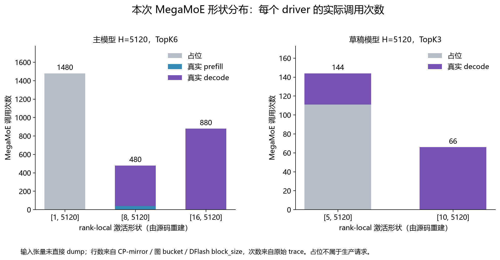
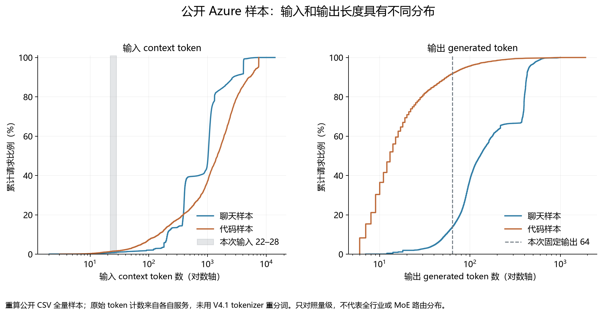

# MegaMoE 的真实负载：本次 Trace 的 Shape 与生产推理负载调研

> 网站阅读版：实测数据、输出原文与技术结论沿用原稿。配图随文提供；源码链接指向固定公开提交。原始 trace、日志和分析数据保留在本地，文中相应位置注明“本地归档”。

调研日期：2026-10-28。本文延续 [Trace 全景与时延拆解](trace-analysis.md)，回答三个问题：本次输入输出是什么；3050 次 MegaMoE 的形状是什么；这些形状是否代表生产服务。

**结论：本次是一个有效的流程学习负载，但不足以代表生产性能或验证模型精度。** 它只有两种 22 / 28 token 的短输入，每个 DP 两条请求，强制各输出 64 token；大量占位执行使按调用次数得到的 shape 分布进一步偏向极小 T。主模型真实 decode 的激活行数主要是 16 和 8，草稿是 10 和 5；kernel 符号中的 512 是容量，不是实际行数。

证据层级：**观测**指原始 trace / metadata / 日志；**重建**指按固定版本源码和图选择规则推导；**公开样本**指来源明确的数据；**建议**是下一轮实验设计，尚未执行。现有 trace 没有输入 tensor dump 和逐专家 token 直方图。

## 1. 那四次请求到底是什么

这次调用的是离线 `llm.generate(prompts, sampling_params=...)`，不是四个不同用户通过 HTTP 持续访问服务。DP0 运行 A、B 两条请求，DP1 重复同一组 A、B。因此有 **2 种输入、4 次请求执行**。

| 计数口径 | 每个 DP | 两个 DP 合计 |
| --- | --- | --- |
| 正式 trace 中请求数 | 2 | 4 |
| 输入 token | 28+22=50 | 100 |
| 输出 token | 64+64=128 | 256 |
| 正式采集前的两轮 generate 预热请求数 | 4 | 8 |
| 这三轮 generate 合计请求数 | 6 | 12 |

上述“4 次执行、256 token”只统计正式采集窗口，**不包括 8 次预热请求，也不包括框架初始化的 dummy/profile 执行**。这里的一次请求会经历多个主模型 / 草稿模型轮次，每个轮次又包含多层，因此请求数远小于 kernel 次数。

### 1.1 原始输入与真实输出

**请求 A：输入 28 token，输出 64 token。**

输入：

```text
请逐步解释大型语言模型推理中 prefill 和 decode 阶段分别计算什么，KV cache 如何参与。答案：
```

本次解码得到的输出，保持原样：

```text
Prefill 阶段一次性处理完整 prompt，计算所有 token 的 Q/K/V 和注意力，生成首 token 并写入 KV cache；Decode 阶段逐 token 生成，仅计算新 token 的 Q/K/V，读取历史 KV cache 做注意力，并追加新 KV。<｜end▁of▁sentence｜><｜begin▁of▁sentence｜>
```

前 12 个输出 token ID：`[43676, 475, 223, 7046, 40755, 4398, 13380, 12275, 303, 4339, 3599, 17840]`。完整 64 个 ID 见 metadata（本地归档：`traces/continuous-dp0.metadata.json`）。

**请求 B：输入 22 token，输出 64 token。**

输入：

```text
请用具体例子解释混合专家模型的路由、专家并行、dispatch 和 combine。答案：
```

本次解码得到的输出，保持原样：

```text
混合专家模型（MoE）的路由、专家并行、dispatch 和 combine 是四个关键机制，下面用具体例子解释：1. 路由（Routing）：假设输入是 …

2025年7月21日 · CSDN问答为您找到问题：`dispatch` 报错“不是有效的
```

前 12 个输出 token ID：`[14769, 10756, 8842, 1237, 28608, 39, 1227, 31245, 1516, 410, 10756, 66518]`。完整 64 个 ID 见 metadata（本地归档：`traces/continuous-dp0.metadata.json`）。

输出不是一个 `[64,5120]` 张量直接交给用户：对外返回的是生成 token ID / 概率等记录，解码后成为上述文字。MegaMoE 输出的 hidden state 只是模型层内部的中间量，还要经过后续层、词表投影与采样。

### 1.2 为什么会出现特殊 token 和网页风格片段

采集脚本使用 `temperature=0.0, max_tokens=64, ignore_eos=True`，目的是固定输出长度，便于覆盖一段连续 decode。所以 A 中出现 EOS 后仍继续生成，不等于正常聊天服务会把这些特殊 token 展示给用户；B 中网页风格的片段也确实来自此次输出，未做清洗。

另外，`LLM._add_request` 直接对字符串调用 tokenizer.encode，本脚本没有显式使用聊天模板渲染 messages。因此它更接近“接着这段文字续写”的 completion 用例，不能当成正式 chat 产品回答质量测试。两个 DP 输出一致说明本次结果一致，不能排除两路共有的实现问题；没有 ground truth、质量数据集或独立模型参考对比，不能宣称模型精度已经通过。

本地证据：采集入口（本地归档：`capture_inference.py`）；[原始字符串分词路径](https://github.com/deepseek-ai/DeepInfer/blob/553741557a57df44a46fb3ab72b6aafeaf945337/deepinfer/entrypoints/llm.py)。

## 2. 从用户输入到 MegaMoE，至少有四种不同的“长度”

| 名称 | 含义 | 本次双请求 decode 示例 |
| --- | --- | --- |
| 用户输入长度 L | 整条 prompt 的 token 数 | A=28，B=22 |
| 本轮逻辑位置 Q | 本次 forward 要验证 / 处理的位置 | 每条 1+5，两条共 12 |
| 物理输入行 T | 选择执行图后，送到层内 tensor 的行数 | 12 选 16 位置图，T=16 |
| 容量 C | 对称通信缓冲区的最大行数 | C=512；不是本次实际输入 |
| 逐专家接收行 m_e | 从所有 EP rank 路由到专家 e 的 token-route 数 | 未采集，不能从 T=16 唯一确定 |

还有 KV 上下文长度 K：它随生成增长，影响 Attention 的读 cache 与稀疏选择；在固定模型中，K 通常不直接成为 MegaMoE 激活矩阵的一维。**长上下文可以对应很小的 decode MegaMoE T；长输出也通常是增加执行轮次，而不是把某次 T 直接改成输出总长度。**

## 3. 一次 MegaMoE 的输入和输出长什么样

以下是当前 Ascend FP8×FP4 路径的接口布局。令 T 为本 rank 这一调用的 tensor 行数，H=5120，I=2304。主模型 routed TopK=6，草稿 TopK=3；各自另有 1 个 shared expert。

| 数据 | 逻辑 / 接口 shape | dtype / 含义 |
| --- | --- | --- |
| 量化激活 x | [T,5120] | FP8 E4M3；输入 hidden state 的量化值 |
| 激活 scale x_sf | [T,80] | int16，每项打包两个 UE8M0 scale；5120/64=80 对 |
| 专家索引 topk_idx | 主：[T,6]；草稿：[T,3] | int64；经过 EPLB 映射的物理专家索引，padding 行可无效 |
| 专家权重 topk_weights | 主：[T,6]；草稿：[T,3] | float32，路由加权系数 |
| 输出 y | [T,5120] | BF16，路由专家加权归并及共享专家结果 |
| 有效行 mask | [T]，由上游 gate 消费 | 无效输入行不能按有效 token-route 计数 |
| 接收统计 | 主：[26]；草稿：[10] | int32，本 rank 物理专家的累计接收统计 |

例如双请求主模型 decode 的接口视图为：

```text
x             FP8    [16, 5120]
x_sf          int16  [16, 80]
topk_idx      int64  [16, 6]
topk_weights  fp32   [16, 6]
y             bf16   [16, 5120]
```

但上面的 tensor 只是容量 512 的对称 buffer 中本次使用的前 T 行；底层注册的 x 缓冲仍可为 `[512,5120]`。本次 API 使用 `y.size(0)` 确定动态 `num_tokens`，所以编译符号不变也能处理不同 T。

源码定位：[MegaMoE 层调用](https://github.com/deepseek-ai/DeepInfer/blob/553741557a57df44a46fb3ab72b6aafeaf945337/deepinfer/model_executor/models/v4_modules/mlp.py)；[Ascend buffer / 权重 shape 校验](https://github.com/deepseek-ai/DeepGEMM-Ascend/blob/3a35326271b069b8b5bf1a754435acd6cc91575b/csrc/apis/mega_moe.hpp)；[scale 打包除数 64](https://github.com/deepseek-ai/DeepGEMM-Ascend/blob/3a35326271b069b8b5bf1a754435acd6cc91575b/deep_gemm/include/deep_gemm/common.hpp)。

### 3.1 权重与内部专家 GEMM

| 权重 | 主模型每卡逻辑 shape | FP4 packed shape（重排前） | 本地专家数 |
| --- | --- | --- | --- |
| W_gate_up | [26,4608,5120] | [26,4608,2560] int8 | 26 |
| W_down | [26,5120,2304] | [26,5120,1152] int8 | 26 |
| 草稿 W_gate_up | [10,4608,5120] | [10,4608,2560] int8 | 10 |
| 草稿 W_down | [10,5120,2304] | [10,5120,1152] int8 | 10 |

当前 kernel 实际接收的是重排后的连续布局：主模型 W1 为 `[26,18,256,2560]`，W2 为 `[26,20,256,1152]`；对应 scale 分别为 `[26,18,80,256]`、`[26,20,36,256]` int16。草稿将第一维 26 换成 10。共享专家权重在这条路径使用 FP8，不能把它也按 routed FP4 的半字节布局解释。以上来自固定版本的接口校验，未重新 dump 权重 tensor。

路由完成后，专家 e 的计算从下面的矩阵关系理解：

```text
GMM1:  [m_e,5120] × [5120,4608] → [m_e,4608]
SwiGLU:                          → [m_e,2304]
GMM2:  [m_e,2304] × [2304,5120] → [m_e,5120]
Combine: 按原 token 位置和 gate 权重归并到 y；另加 shared expert 路径
```

m_e 会随层、rank、请求内容、EPLB 副本选择而改变。内部还有 tile 分块、padding、ring buffer 和同步，不能把外部 `[T,5120]` 当成每个专家都在做同一个 `[T,5120]` GEMM。

## 4. 本次 3050 次 MegaMoE 的 shape 分布



| 模型 | 阶段 | rank-local x shape（重建） | 路由 shape | 调用次数 / driver | 平均设备时长（μs） | P99（μs） |
| --- | --- | --- | --- | --- | --- | --- |
| draft | decode | [5,5120] | [5,3] | 33 | 96.568 | 201.570 |
| draft | decode | [10,5120] | [10,3] | 66 | 99.119 | 138.463 |
| draft | placeholder | [5,5120] | [5,3] | 111 | 95.211 | 163.441 |
| main | decode | [8,5120] | [8,6] | 440 | 133.563 | 154.531 |
| main | decode | [16,5120] | [16,6] | 880 | 149.058 | 173.761 |
| main | placeholder | [1,5120] | [1,6] | 1480 | 36.717 | 40.494 |
| main | prefill | [8,5120] | [8,6] | 40 | 153.653 | 173.143 |

每个 driver：主模型 2840 次＋草稿 210 次＝3050 次；两个已采集 driver 合计 6100 次。两个 driver 的上述调用次数相同；表中平均时长与 P99 专指 DP0，不是两路平均，DP1 统计保存在 evidence JSON 中。时长包含 kernel 内的计算、传输与等待，并汇总了不同层。这不是全 16 rank 的实测汇总。

其中占位的 1480＋111＝**1591 次，占 52.16%**。因此如果把所有 MegaMoE 都混在一起统计 shape，一半以上来自占位，并不能代表用户真实请求的负载。主模型 prefill 的 T=8 与单请求 decode 的 T=8 也应分组，因为有效行、上下文、路由分布和执行方式不同。

### 4.1 Prefill：为什么不是 [50,5120]，而是每 rank [8,5120]

整个 DP 的两条 prompt 共 50 token；CP8 prefill 使用逐序列 zigzag / mirror 切分。每 rank 的分配行数是：

```text
T_CP = Σ_i 2 × ceil(L_i / (2×CP))
     = 2×ceil(28/16) + 2×ceil(22/16)
     = 8
```

这是逐序列 padding 的结果，既不是 50，也不是简单的 50/8。对两个已采集的 driver，CP rank 均为 0，按源码映射，8 行中只有 4 行来自真实 prompt。

| CP rank | 分配行数 T | 有效行数 | A / B 有效行数 |
| --- | --- | --- | --- |
| 0 | 8 | 4 | [2, 2] |
| 1 | 8 | 4 | [2, 2] |
| 2 | 8 | 6 | [4, 2] |
| 3 | 8 | 6 | [4, 2] |
| 4 | 8 | 6 | [4, 2] |
| 5 | 8 | 8 | [4, 4] |
| 6 | 8 | 8 | [4, 4] |
| 7 | 8 | 8 | [4, 4] |

CP0 取到每条序列的位置 `[0,1,30,31]`；30、31 超出长度，成为 padding。8 个 rank 的有效行合计仍为 50。此表是源码参考算法重建，不是采到了其他 14 个 rank 的 tensor。其余 rank 的有效行分布不能直接从 driver 的 4 行代表。

Trace 对照：搜索 `launch_forward_N2_B50`，看 Stream 61 的 40 个主模型 MegaMoE；外部 B50 表示全 DP 逻辑 query，不是各 EP rank 的 MegaMoE 行数。源码见 [CP 长度计算](https://github.com/deepseek-ai/DeepInfer/blob/553741557a57df44a46fb3ab72b6aafeaf945337/csrc/engine/input_metadata/prepare_tensor_input_base.cpp)。

### 4.2 主模型 decode：12 → 16，6 → 8

当前 NextN=5，两个请求的逻辑验证布局通常有 `2×(1+5)=12` 个位置；图选择取覆盖 Q 的最小 bucket，本次选 16 位置图，因此主模型层内激活 T=16。剩一条请求时 Q=6，选 8 位置图。decode 不应用 prefill 的 mirror-CP 分行公式，不能再把 16 除以 CP8。

T 包含图 padding；有效路由还受 valid_token_mask、ZOS 修正和请求是否仍有效影响。本文没有逐次 dump mask / gate，所以不把每次 T=16 都断言为 16 个有效 token，也不把 Q12 断言为最终接受 12 token。

Trace 对照：`launch_forward_N2_B12` → Stream 181，22 次主模型图×40 层=880 次 MegaMoE；`launch_forward_N1_B6` → Stream 178，11×40=440 次。图 bucket 代码见 [CudaGraphRunner.select](https://github.com/deepseek-ai/DeepInfer/blob/553741557a57df44a46fb3ab72b6aafeaf945337/deepinfer/worker/cuda_graph_runner.py)。

### 4.3 草稿：两请求 T=10，单请求 T=5

DFlash 的 `dflash_block_size = max_MTP_value = 5`，将 `[请求数,5]` 的初始化位置展开送入 3 层草稿模型。所以双请求草稿 T=10，单请求 T=5；不要套主模型的 1+5 或主模型的 16 / 8 bucket。草稿模型用 5 个位置的隐藏状态产生候选，并不等于“有 5 个草稿模型层”。

Trace 对照：Stream 163 的 22 次双请求草稿图×3 层=66 次 MegaMoE；Stream 160 的 11 次单请求＋37 次占位草稿图，合计 144 次。源码见 [DFlash 初始化和展开](https://github.com/deepseek-ai/DeepInfer/blob/553741557a57df44a46fb3ab72b6aafeaf945337/deepinfer/model_executor/models/mtp/dflash.py)。

### 4.4 占位：shape 存在，不代表有正常路由工作

主模型占位图分配 T=1；草稿图仍可分配 T=5。上游有效 mask 会标记 padding / placeholder，所以 routed token 工作可能为空，但 kernel 仍可能执行共享路径、同步和进度处理。这解释了为什么有大量 MegaMoE 条，也不能按 `T×TopK` 把每条都算成有效专家负载。实际有效计数没有保存，不能仅凭形状还原。

## 5. 判断 MegaMoE 负载，不能只写一个 shape

如果只写 `EP16, [16,5120], TopK6`，仍缺少决定性能的几项：

| 维度 | 为什么重要 | 本次是否掌握 |
| --- | --- | --- |
| T_alloc / T_valid / C | 物理输入行、有效行与容量不同，padding / 占位会误导算量 | T_alloc 与 C 可重建；部分有效行可推导，未逐次 dump |
| 每层逐专家 m_e | 同样 T、TopK，专家热点和空专家数可以不同 | 未采集逐调用直方图 |
| rank 间偏斜与远端比例 | 决定收发量、慢 rank、跨机压力 | 只采集两个 driver，缺全 rank 证据 |
| EPLB 物理布局 / 副本数 | 逻辑专家相同，物理去向可不同 | 主416 / 草稿160；未保留逐步完整布局 |
| dtype、权重 packing、H、I | 影响算术强度、带宽与转换开销 | 本次已知 |
| 输入内容与草稿接受率 | 内容改变 learned gate，也影响后续迭代次数 | 两种短输入，内容多样性很小 |
| 调度、图 bucket、CP / EP 拓扑 | 请求数如何映射到实际 T，及通信路径 | 本次配置已知，但不是生产分布 |

有效路由的定义可以写成：

```text
m_e = Σ_rank Σ_valid_token Σ_topk_slot 1[physical_expert_id == e]
Σ_e m_e = Σ_rank T_valid(rank) × TopK        # 不含 shared expert；要求有效槽位齐全
```

只有在刻意假设完全均衡时，才可用 `Σ_rank T_valid×TopK / E_physical` 得到每专家均值；这不是每个专家的真实 m_e。EPLB 调整副本和物理映射，并不保证每个小 batch 的 learned gate 均匀。两个 DP 重复相同文本也降低了内容多样性，不能据此假设专家负载像随机均匀 routing。

## 6. 这个负载“正确”吗

| 用途 | 判断 | 原因 |
| --- | --- | --- |
| 理解调度、prefill / decode、投机、跨流配合 | 合适 | 短且可解释；覆盖实际模型、自然路由与 EPLB |
| 验证一次完整功能执行 | 有意义 | 生成完成、token 数与 trace 事件已核对 |
| 验证完整模型精度 / 回答质量 | 不够 | 无独立参考；raw completion；ignore_eos；未做标准质量评测 |
| 估计生产吞吐、尾延迟、并发容量 | 不合适 | 仅两种短输入，瞬时小批量，输出固定，无长期到达过程 |
| 评价 MegaMoE 生产优化收益 | 覆盖不足 | T 极小且占位占比高，缺真实专家分布和全 rank |
| 固定 shape 的微基准 | 可作为一个小 T 用例 | 仍应剥离占位与控制开销，并与参考实现核对 |

这不是把 ignore_eos 或固定长度 benchmark 判为错误：它们适合控制变量。问题是必须把用途写清楚，不能把“流程跑通”换名为“代表生产流量的性能测试”。此外，本次约 3.66 秒还包括约 2.50 秒的 EPLB 重排日志时间，不能当成纯模型计算耗时。

## 7. 工业界真实负载：公开证据而不是一个统一 shape

### 7.1 直接重算 Azure 聊天 / 代码样本

我下载并重算了微软公开的两份长度 trace，保留了 CSV、许可证、文件 SHA256 和脚本。数据只含调用时间、context token 数和生成 token 数，不含用户 prompt。这是特定历史服务的样本，**不是 2026 年全行业均值，更不是 V4.1 的生产 trace**。[数据说明](https://github.com/Azure/AzurePublicDataset/blob/master/AzureLLMInferenceDataset2023.md)。

| 样本 | 长度 | 请求数 | 均值 | P50 | P90 | P99 | 最大值 |
| --- | --- | --- | --- | --- | --- | --- | --- |
| 聊天 | 输入 | 19366 | 1154.7 | 1020.0 | 2734.5 | 4142.0 | 14050 |
| 聊天 | 输出 | 19366 | 211.1 | 129.0 | 424.0 | 601.0 | 1000 |
| 代码 | 输入 | 8819 | 2047.8 | 1469.0 | 5187.6 | 7436.0 | 7437 |
| 代码 | 输出 | 8819 | 27.9 | 13.0 | 55.0 | 251.5 | 1899 |

这些数字由本次下载的完整 [聊天 CSV](https://github.com/Azure/AzurePublicDataset/blob/master/data/AzureLLMInferenceTrace_conv.csv) 与 [代码 CSV](https://github.com/Azure/AzurePublicDataset/blob/master/data/AzureLLMInferenceTrace_code.csv) 自行计算，分位数使用线性插值；没有重新运行模型。原始 token 计数来自原服务，不能与 V4.1 的中文 tokenizer 做严格等价比较。



本快照中，聊天输入不超过 28 token 的比例约 **0.99%**，代码约 **1.67%**。但是代码输出中位数只有 13 token，说明输出 64 token 并非对所有业务都算短；聊天样本中位数是 129。更重要的差别是分布和到达过程，而不是简单把固定 64 换成另一个固定数。

数据时间以 CSV 为准：聊天覆盖 2023-11-16 18:15:46～19:14:08，代码约 18:17:03～19:14:19。仓库说明页写的是另一采集日期，因此本文明确记录实际文件时间及 SHA256，不混用版本。

### 7.2 到达时间、会话、缓存也决定负载

BurstGPT v5 覆盖约 1031 万条服务记录、213 天，研究了请求突发、会话和响应长度差异。它说明在线服务需要保留流量随时间变化的特征，而不是只在零时刻塞入两条请求。[BurstGPT v5](https://arxiv.org/abs/2401.17644v5)。

2026-10 的一项 M365 生产研究分析了超过 1.21 亿次模型调用。在其 Deep Research 样本中，上下文随多次模型 / 工具调用增长，而且相当一部分来自 prefix cache。这是特定 agent 场景的研究结果，不是通用聊天长度标准；它提醒我们区分“完整上下文”与“本次新计算的 token”。[原始研究 v1](https://arxiv.org/abs/2610.22863v1)。

例如完整上下文 32K，但已有 30K 的可复用 KV，则新一轮 prefill 可能只需处理约 2K 新位置。之后单步 decode 的 MegaMoE T 仍由活跃请求数和草稿数决定，而 Attention 继续面对长 KV 上下文。此例用于解释因果关系，不是上述样本的实测点。

### 7.3 标准 benchmark 测什么

MLPerf 将性能与质量要求、数据集和到达场景一起定义；Server 和 Offline 测的是不同服务情景。DeepSeek-R1 也有独立的 benchmark 定义，不能拿本次 V4.1 的短 prompt 冒充它的结果。[MLPerf 规则](https://github.com/mlcommons/inference_policies/blob/master/inference_rules.adoc#3-scenarios)，[DeepSeek-R1 定义](https://docs.mlcommons.org/inference/benchmarks/language/deepseek-r1/)。

vLLM 的 serving benchmark 分别控制请求率、最大并发、突发程度和数据集长度，并支持按 trace 时间重放。这些是不同控制量：并发上限不是到达率，固定长度也不是请求分布。[vLLM bench serve](https://docs.vllm.ai/en/latest/cli/bench/serve/)。

vLLM 的 chunked prefill 还允许把 prefill 切块并与 decode 拼批。因此长 prompt 不会自动变成单次同样长度的 MegaMoE；当前 DeepInfer 用例也不能因为启用了 chunked_prefill，就假设已经覆盖所有其他框架的混合调度行为。[vLLM chunked prefill](https://docs.vllm.ai/en/stable/configuration/optimization/#chunked-prefill)。

### 7.4 直接相关的 EP / MegaMoE 参考负载

DeepEP 历史版本 v1.2.1 的 README 给过一个 V3/R1 低时延 decode 示例：128 token/batch、hidden 7168、TopK8；4096 token 的另一组是其预训练设置。两者都不是当前 V4.1 / Ascend 的标准负载，尤其不能把训练的 4096 直接称为生产 decode。当前 DeepEP API 已变化，这里明确引用历史 tag。[DeepEP v1.2.1 性能示例](https://github.com/deepseek-ai/DeepEP/blob/v1.2.1/README.md#performance)。

本地固定版本 DeepGEMM-Ascend 的 `test_mega_moe.py` 默认扫每 rank T=64、256、4096、16384 等用例，这说明算子测试应覆盖多种规模；它们是合成微基准点，不是实测的生产发生频率。当前我们只覆盖到 T=1 / 5 / 8 / 10 / 16，规模覆盖非常窄。[本地 MegaMoE 测试](https://github.com/deepseek-ai/DeepGEMM-Ascend/blob/3a35326271b069b8b5bf1a754435acd6cc91575b/tests/test_mega_moe.py)。

### 7.5 DeepInfer 官方生产部署与本次配置的直接差别

固定版本的官方部署 Q&A 给出：生产 prefill 采用 EP2–8 / DP2–8，decode 采用 EP64–128 / DP64–128，该方案暂不使用 TP / CP，并分离 P / D。它还按上下文长度分层调度 prefill，逐轮求 chunk 大小；decode 同时平衡请求数与总 KV 长度。因此，本次双节点实验的 EP16 / CP8 / DP2、两条短输入，不能直接代表这一生产部署。[官方 Q&A（固定提交）](https://github.com/deepseek-ai/DeepInfer/blob/553741557a57df44a46fb3ab72b6aafeaf945337/doc/inference_deployment_qa.md)。

官方 decode EPLB 例子采用 1000 步统计窗口、每 10000 步重排；EP64 时每卡 7 个物理专家，不含 shared。其报告的 `moe_lb`（slowest rank / mean）为 1.090，也不是完全均匀。这些是官方 GPU 方案的数据，不能当作 Ascend 实测、逐专家直方图或我们本次的重排参数。相同 H / TopK 下，EP、每卡专家数、来源 rank 的 T 和热点都影响 MegaMoE。[同一官方 Q&A](https://github.com/deepseek-ai/DeepInfer/blob/553741557a57df44a46fb3ab72b6aafeaf945337/doc/inference_deployment_qa.md)。

DeepSeek 开源 EPLB 也明确以估计的专家负载决定复制与放置，历史滑动统计是一种来源。因此，应重放真实 learned routing 或记录下来的不均衡直方图；均匀 / 随机 routing 适合作为控制组，不能自行称为生产路由。[EPLB 官方说明](https://github.com/deepseek-ai/EPLB)。

## 8. 工业界映射到 MegaMoE 后，也是这些 shape 吗

**固定模型、精度和并行配置时，H=5120、I=2304、TopK、专家权重结构等可以相同；T 的分布、有效行和逐专家 m_e 的分布通常不会相同。**

| 服务阶段 | 送入 MoE 的行数如何形成 | 是否能由用户 prompt 长度直接得到 |
| --- | --- | --- |
| 普通 decode，无投机 | 活跃请求本轮各一个 query，再按图 bucket 补齐 | 不能；长上下文不等于大 T |
| 固定 5 草稿验证 | Q≈Σ活跃请求(1+5)，T=覆盖 Q 的图 bucket | 还取决于活跃 batch、padding 和 mask |
| 动态草稿长度 | Q=Σ(1+本轮草稿数)，再选 bucket | 更依赖接受率策略和动态长度 |
| CP prefill | 本轮实际新计算的 chunk 经逐序列 CP-mirror 分行 / padding | 需知道 chunk、缓存命中、各序列长度和 CP |
| DFlash 草稿 | 草稿请求 bucket×block_size，与主模型 bucket 分开 | 本次为请求数×5，不能照抄主模型 T |
| 混合 prefill / decode 服务 | 由具体框架的混合调度与并行策略决定 | 不能把另一框架的公式直接套进 DeepInfer |
| 专家 GMM | m_e 来自全 EP 组的真实路由 | 仅有请求长度无法恢复 |

示意：无投机、活跃 128 条请求时，逻辑 Q 可以是 128；若每条验证 5 个草稿，则 Q 可以是 768，两者即使用户 prompt 长度相同，MegaMoE T 也不同。图 padding 还可能继续增大 T。反过来，一条 32K 上下文请求的普通 decode，逻辑 Q 仍可以只有 1。这里是假设场景，用于说明映射，不是本次运行结果。

公开 Azure 的 CSV 没有 prompt 内容、调度批次、图 bucket、模型 gate 或 EP rank 信息，所以不能从它推导“生产中 T=16 出现多少次”或“每个专家平均收到几个 token”。用随机文本重放可以重现长度和到达特征，却不能保证恢复 MoE 热点、物理路由与草稿接受率。

## 9. 下一步怎样构造更有代表性的测试

以下是建议的实验矩阵，**不是行业统一分布，也尚未在本次双节点实验执行**。

| 层级 | 建议用例 | 目的 |
| --- | --- | --- |
| 流程复现 | 保留当前 22/28→64 用例，单独标注占位 | 以后改框架时可快速回归同一执行路径 |
| 内容与停止行为 | 多语言问答、代码、RAG、推理；正确 chat template；自然 EOS；记录质量 | 覆盖真实 gate 与投机接受率，防止只优化固定续写 |
| 长度控制组 | 输入 128/512/2K/8K/16K；输出上限 32/128/512/2K | 分离短输出、长输入、长生成的影响；固定长度组与自然 EOS 组分别报告 |
| 并发 / 到达 | 每 DP 从 1/2/4 活跃请求起步；再逐步扩大；低/中/近饱和负载，含突发与稳态 | 观察真正的调度 T 分布、排队与尾延迟 |
| 缓存与会话 | 无复用、部分 prefix 命中、多轮重复前缀；保留时间顺序 | 区分完整上下文与新 prefill token |
| 算子控制组 | 每 rank T=1/2/4/8/16/32/64/128/256/512，含不同 rank 的不等长和空 rank | 覆盖小 T、容量边界、专家不均衡及启动 / 同步开销 |
| 端到端结果 | TTFT、ITL/TPOT、E2E 的 P50/P95/P99；满足 SLO 的 goodput、错误率、质量 | 同时约束性能和输出有效性，不能只报总 tokens/s |

当前环境的具体约束：`max_num_seqs=4`、prefill token budget=4096、CP8、MegaMoE C=512。扩大并发需要同步调整请求上限、KV / state 预算和图捕获。固定 5 草稿时 Q≈6×活跃请求数；例如 128 请求需要约 768 逻辑位置，已经超过当前 512 容量，不能直接复用。CP-mirror 又是逐序列向上取整，多短请求时不能只用总 token/CP 粗算缓冲容量。

长输入并不要求把单步 prefill budget 从 4096 改到 32K；可先在现有 32K 上下文容量内验证 chunked prefill。之前 b112 编译器的大 query 分支问题仍是实际限制，不能为了扩展矩阵直接假设更大 shape 可运行。超过当前容量的 T=4096 等点应作为独立算子实验、另行配置和验证，不在这次调研中冒充已经测过。

### 9.1 真正值得采集的 MegaMoE workload 记录

```text
model_hash, source_commit, layer_id, stage, iteration, ep_rank, ep_size
T_alloc, T_valid, capacity, graph_bucket, hidden, intermediate, topk
activation_dtype, weight_dtype, scale_layout, logical_experts, physical_experts
expert_recv_counts[], local_route_count, remote_route_count, destination_rank_counts[]
EPLB_mapping_version, speculative_length, accepted_drafts, measured_kernel_us
```

先按上述字段统计分布，再选高频点、热点和边界做 microbenchmark，才有依据说“我们优化的是服务经常遇到的负载”。逐专家统计可用设备侧计数或采样窗口差分，但不应为每次调用同步 `.cpu()`，否则会改变原推理流水。累计计数的窗口差分只能表示该窗口，不能伪装成每一次调用的精确路由。

## 10. 与前一份 Trace 文档怎样对照

| 位置 | 本篇关注点 | 到 trace 中看什么 |
| --- | --- | --- |
| P01 / +1302.471 ms | 全 DP B50 经 CP 后，本 rank T8 / 有效4 | launch_forward_N2_B50；Stream61；40 次主模型 MegaMoE |
| D01～D22 / +1461.740 ms 起 | 主模型逻辑12→物理16；草稿10 | Stream181 的416专家与 Stream163 的160专家 |
| D23～D33 / +2707.427 ms 起 | 主模型逻辑6→物理8；草稿5 | Stream178 与 Stream160 |
| Z01～Z37 | 不要把占位小 T 混进真实请求分布 | Stream169 的 B1 图；另有草稿占位图 |
| 任意 mega_moe_impl 符号 | 512 是 C；num_tokens 是动态参数 | 查看完整符号、Model Id / stream，再对照本篇源码重建表 |

本表的 stream 与时间锚点专指 DP0；DP1 的对应记录见 CSV。时间相对采集 scope，不能跨机器按绝对时间直接对齐。

逐轮 shape 记录：megamoe-shape-calls.csv（本地归档：`workload-research/megamoe-shape-calls.csv`）。完整输入输出、shape 分组、公开样本统计和校验值：workload-evidence.json（本地归档：`workload-research/workload-evidence.json`）。

## 11. 来源与复现

本地 DeepInfer 源码版本沿用 `553741557a57df44a46fb3ab72b6aafeaf945337`；Ascend 子模块版本见 source-manifest.json（本地归档：`source-manifest.json`）。接口形状来自这一固定版本，不能把其他 GPU 分支的布局混进来。

| 公开来源 | 版本 / 取数说明 |
| --- | --- |
| [DeepInfer deployment Q&A](https://github.com/deepseek-ai/DeepInfer/blob/553741557a57df44a46fb3ab72b6aafeaf945337/doc/inference_deployment_qa.md) | pinned local commit 5537415 |
| [DeepSeek EPLB](https://github.com/deepseek-ai/EPLB) | README read 2026-10-28 |
| [Azure public trace description](https://github.com/Azure/AzurePublicDataset/blob/master/AzureLLMInferenceDataset2023.md) | public master snapshot; see downloaded SHA256 |
| [Azure conversation CSV](https://github.com/Azure/AzurePublicDataset/blob/master/data/AzureLLMInferenceTrace_conv.csv) | 19366 rows in this snapshot |
| [Azure code CSV](https://github.com/Azure/AzurePublicDataset/blob/master/data/AzureLLMInferenceTrace_code.csv) | 8819 rows in this snapshot |
| [BurstGPT](https://arxiv.org/abs/2401.17644v5) | v5, 2025-05-26; 10.31M traces / 213 days |
| [vLLM bench serve](https://docs.vllm.ai/en/latest/cli/bench/serve/) | documentation read 2026-10-28 |
| [vLLM chunked prefill](https://docs.vllm.ai/en/stable/configuration/optimization/#chunked-prefill) | documentation read 2026-10-28 |
| [MLPerf scenario rules](https://github.com/mlcommons/inference_policies/blob/master/inference_rules.adoc#3-scenarios) | rules read 2026-10-28 |
| [MLPerf DeepSeek-R1 benchmark](https://docs.mlcommons.org/inference/benchmarks/language/deepseek-r1/) | framework benchmark, not this V4.1 run |
| [DeepEP historical benchmark](https://github.com/deepseek-ai/DeepEP/blob/v1.2.1/README.md#performance) | v1.2.1; historical V3/R1 NVIDIA example |
| [Production agentic KV study](https://arxiv.org/abs/2610.22863v1) | v1, 2026-10-16; production M365 workloads |

Azure 数据随包保留原始文件和 CC-BY 许可证；依其说明注明来源论文：Patel 等，[Splitwise: Efficient generative LLM inference using phase splitting, ISCA 2024](https://www.microsoft.com/en-us/research/publication/splitwise-efficient-generative-llm-inference-using-phase-splitting/)。这是长度统计的来源归属，不意味着微软或作者认可本次 V4.1 测试。

复算先运行 collect_evidence.py（本地归档：`workload-research/collect_evidence.py`），再运行 build_workload_report.py（本地归档：`workload-research/build_workload_report.py`）。前者缓存下载后按本地快照重算；后者使用上一轮分析目录中的独立 Matplotlib 依赖生成图片与本文，不连接 NPU。

仍未测量：本次每次调用的真实有效 mask、全 EP 的逐专家接收行数与通信字节、生产部署的 MegaMoE shape 直方图、标准模型精度。本文没有用公开请求长度去虚构这些值。

本次校验已核对原始 trace 哈希、两路调用次数与输出 token ID、公开 CSV 行数 / 分位数及本地链接；配图已目视检查。记录见 verification.json（本地归档：`workload-research/verification.json`），复核脚本见 verify_workload.py（本地归档：`workload-research/verify_workload.py`）。
