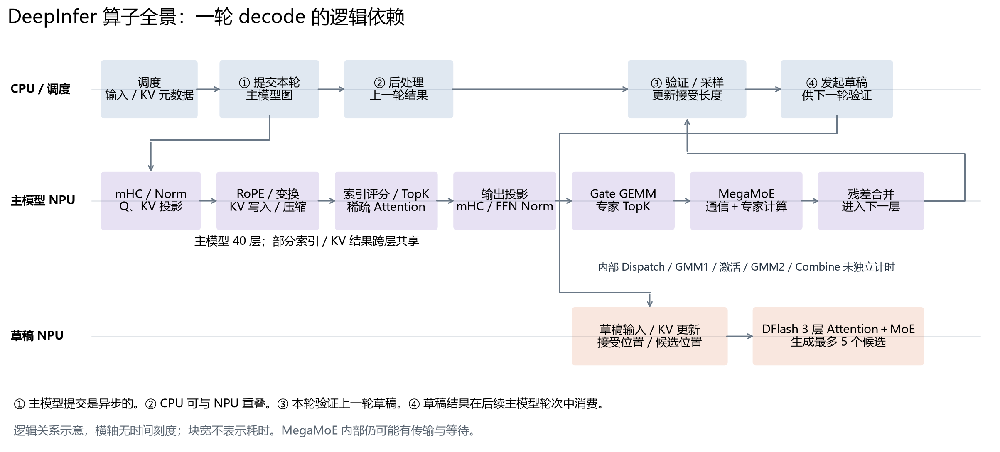
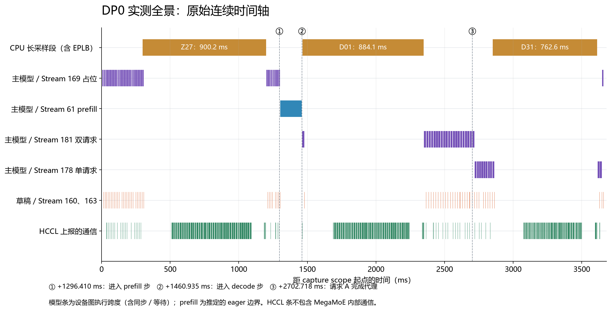
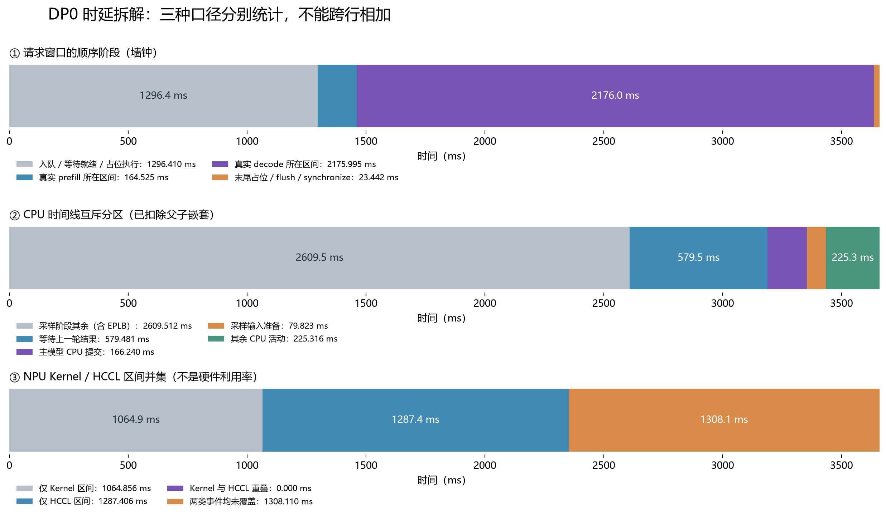
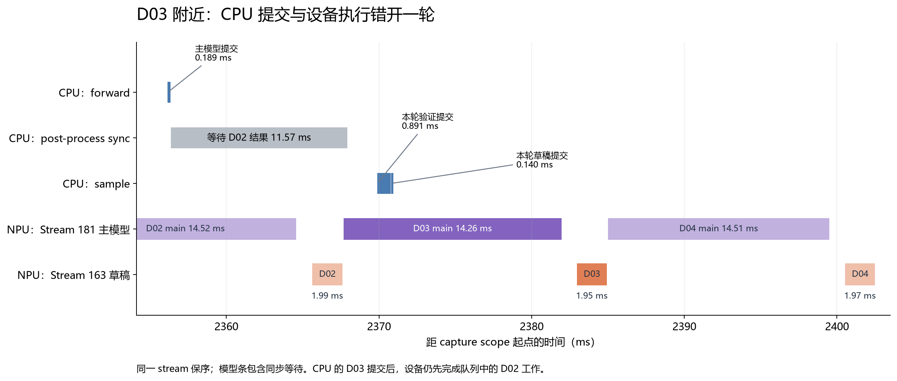
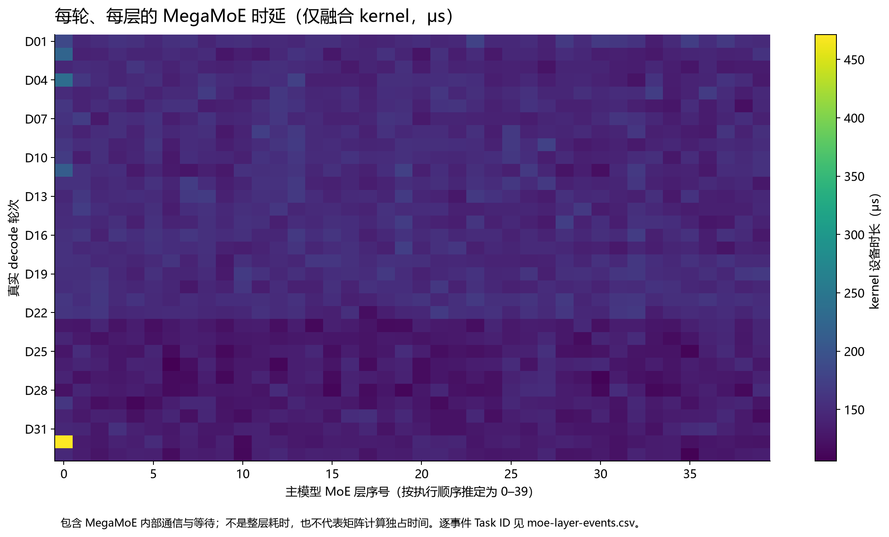

# DeepInfer 实测 Trace：算子全景与时延逐级拆解

> 网站阅读版：实测数据、输出原文与技术结论沿用原稿。配图随文提供；源码链接指向固定公开提交。原始 trace、日志和分析数据保留在本地，文中相应位置注明“本地归档”。

本文对照本次双节点实验的真实 V4.1-Flash 推理 trace，按“请求 → 调度轮次 → 设备图 / stream → 算子”阅读。所有实测数字由同目录 `analyze_trace.py` 从原始 JSON 重算；未重新运行 NPU 实验。分析日期：2026-10-28。

## 0. 先确定统计口径

| 项目 | 本次数据 |
| --- | --- |
| 模型 / 并行 | DeepSeek-V4.1-Flash-1017；EP16 / CP8 / DP2；两节点共 16 NPU |
| 负载 | 每个 DP 各两条中文请求；两路 DP 重复同一组输入；各请求输出 64 token，共 4 次执行、256 个输出 token |
| 路由与投机 | 自然 gate；EPLB 开；NextN=5；varlen 关；ZOS 开 |
| 采集范围 | 仅两个 CP driver：rank 0、rank 8；其余 14 个 rank 没有独立 trace |
| 总时长口径 | 预热后的 generate + synchronize 请求窗口，不含权重加载；也不含事后解析 / JSON 导出 |
| 时间原点 | 每个文件 capture:real_requests_prefill_through_completion 的起点，两个 DP 分别归零 |
| CPU / 设备 | CPU 包围事件用于调度与提交；NPU kernel duration 用于设备任务；二者不能相加 |
| 每个算子 | 正文按每轮、每个完整符号汇总次数 / 平均 / 最大 / 总时长；每一次 kernel 的独立耗时另保存在 CSV |

建议先打开 DP0 原始 trace（本地归档：`traces/continuous-dp0.json`）。在 MindStudio / Perfetto 搜索下面每节给出的事件名，再按相对时间定位。工具导入偏移可能不同，不要直接套用截图左上角的绝对秒数。

| 文件 | scope 原始 timestamp（μs） | scope 相对文件最早事件（ms） | 窗口（ms） |
| --- | --- | --- | --- |
| DP0 | 1793112249772250.760 | 10.275 | 3660.372 |
| DP1 | 1793112243498718.930 | 12.301 | 3668.602 |

请求完成和首 token 的时间没有独立 request-ID 标记，本文提供的是**按输出步数与 ZOS 顺序重建的 CPU 输出处理代理时刻**，不能当成直接测得的服务接口 TTFT / E2E。模型与专家的逐请求独占计算时长也无法从共享 batch 精确分摊。

## 1. 算子全景：先看一次推理如何串起来



主模型 forward 执行 40 个 MoE 层；decode 的 sampler 验证上一轮草稿，随后调用 3 层 DFlash 生成下一轮候选。prefill 中可更新草稿所需 KV，但这不等于运行完整草稿生成图。本次 prefill 没有草稿 MegaMoE。

从源码核对：[Worker.execute_model_step](https://github.com/deepseek-ai/DeepInfer/blob/553741557a57df44a46fb3ab72b6aafeaf945337/deepinfer/worker/worker.py)，[Sampler.forward](https://github.com/deepseek-ai/DeepInfer/blob/553741557a57df44a46fb3ab72b6aafeaf945337/deepinfer/model_executor/layers/sampler.py)，[DecoderLayer.forward](https://github.com/deepseek-ai/DeepInfer/blob/553741557a57df44a46fb3ab72b6aafeaf945337/deepinfer/model_executor/models/decoder_layer.py)。

## 2. 总时延：这次推理到底用了多久



DP0 的完整请求窗口为 **3660.372 ms**，DP1 为 **3668.602 ms**。两路并发协作，不能相加成 7 秒，也没有跨节点时钟校准来声称一个更精确的全局起止差。

| DP0 顺序区间 | 起点（ms） | 终点（ms） | 墙钟（ms） |
| --- | --- | --- | --- |
| 入队 / 等待就绪 / 占位执行 | 0.000 | 1296.410 | 1296.410 |
| 真实 prefill 所在区间 | 1296.410 | 1460.935 | 164.525 |
| 真实 decode 所在区间 | 1460.935 | 3636.931 | 2175.995 |
| 末尾占位 / flush / synchronize | 3636.931 | 3660.372 | 23.442 |

前 1.296 秒中调度结果为空，执行了 36 轮占位；末尾还有 1 轮占位用于推进 / 回收流水。“真实 decode 所在区间”包含 CPU、采样、EPLB、队列等待及结果处理，不等于 decode kernel 总和。



| CPU 互斥分区 | 时间（ms） | 占请求窗口 |
| --- | --- | --- |
| 采样阶段其余（含 EPLB） | 2609.512 | 71.29% |
| 等待上一轮结果 | 579.481 | 15.83% |
| 主模型 CPU 提交 | 166.240 | 4.54% |
| 采样输入准备 | 79.823 | 2.18% |
| 草稿验证 CPU 提交 | 63.040 | 1.72% |
| 其他主机活动 / 空隙 | 56.278 | 1.54% |
| 主模型输入准备 | 52.475 | 1.43% |
| 结果处理（扣除同步） | 35.691 | 0.98% |
| DFlash CPU 提交 | 10.211 | 0.28% |
| 调度 | 5.029 | 0.14% |
| 调度同步回调 | 2.593 | 0.07% |

CPU 表已对父子事件去重，例如 verification 不再重复计入 launch_sample 的“其余”部分。CPU 等待设备时长会与设备计算重叠，不能把它再加到模型设备时间上。

### 2.1 三个长段：Z27、D01、D31

| 轮次 | CPU launch_sample 起点（ms） | CPU 包围时长（ms） | Trace 搜索 |
| --- | --- | --- | --- |
| Z27 | 298.910 | 900.195 | deepinfer:launch_sample |
| D01 | 1463.799 | 884.102 | deepinfer:launch_sample |
| D31 | 2850.507 | 762.604 | deepinfer:launch_sample |

同一采集窗口内，运行日志记录了三轮 EPLB 重排：主 / 草稿分别为 **785 / 104 ms、759 / 107 ms、634 / 113 ms**，打印值合计约 **2502 ms**。源码在 `model.sample()` 内调用 `expert_lb.step()`，所以这些工作被 CPU 的 launch_sample 包围。三个长段和三组日志顺序对应；日志只保留到毫秒 / 秒级，不能把整个长段精确等同为 EPLB，差额还包含采样与其他主机工作。

去 采集日志（本地归档：`logs/capture-node0.log`） 搜索 `"stage": "capture"`，再看后面的六行 `[EPLB] rearranged`。本次 3.66 秒很大一部分用于框架控制工作，不能据此评价 V4.1-Flash 的正常吞吐或 TPOT。

### 2.2 设备时间的另一种分区

| 按原始事件覆盖区间计算 | 时间（ms） |
| --- | --- |
| 只有 Kernel 区间 | 1064.856 |
| 只有 HCCL 上报区间 | 1287.406 |
| 两类区间重叠 | 0.000 |
| 两类事件都没有覆盖 | 1308.110 |
| 所有 Kernel duration 求和 | 1064.856 |
| 所有 Kernel 区间并集 | 1064.856 |

“两类都未覆盖”不是硬件真正空闲的证明，可能仍有 DMA、同步、设备调度或未分类任务。自定义 CP 和 MegaMoE 内部通信被放在 kernel 中；HCCL 区间本身也可能含等待。**这些都是事件时间口径，不是 Cube 利用率。**

## 3. 有几个请求，每条大约多长

### 3.1 DP0：两个共享 batch 的请求

| 请求 | 输入 / 输出 token | 入队开始（ms） | 首输出代理（ms） | TTFT 代理（ms） | 完成代理（ms） | 入队至完成代理（ms） | 有效 decode 输出轮次 |
| --- | --- | --- | --- | --- | --- | --- | --- |
| A | 28 / 64 | 0.420 | 1460.041 | 1459.621 | 2702.718 | 2702.298 | 21 |
| B | 22 / 64 | 0.977 | 1460.041 | 1459.064 | 3632.667 | 3631.690 | 32 |

### 3.2 DP1：两个共享 batch 的请求

| 请求 | 输入 / 输出 token | 入队开始（ms） | 首输出代理（ms） | TTFT 代理（ms） | 完成代理（ms） | 入队至完成代理（ms） | 有效 decode 输出轮次 |
| --- | --- | --- | --- | --- | --- | --- | --- |
| A | 28 / 64 | 0.470 | 1462.883 | 1462.413 | 2710.896 | 2710.426 | 21 |
| B | 22 / 64 | 1.015 | 1462.883 | 1461.868 | 3640.932 | 3639.917 | 32 |

A 是“prefill / decode / KV cache”问题，B 是“MoE 路由 / dispatch / combine”问题。每个 DP 都执行这两个问题，并不是一个 DP 独占一个问题。两路 DP 的最终 token ID 相同。

**完成代理如何重建：** metadata 中 A 的 target_steps=22、B=33，包含 prefill 输出首 token 的那一步，因此有效 decode 输出轮次分别为 21、32。ZOS 在下一轮处理上一轮结果；A 最后一轮输出对应 D22 中的 `build_request_outputs`，B 对应 D33 中的同名事件。先选中这些 CPU 事件，再对照下一步 batch 从 N2 到 N1 的变化。每个输出轮次的最后一个已发 token 带有 draft_tok / accept_tok 计数，源码见 `csrc/engine/outputs.hpp`。

这是顺序推断而非逐请求完成标签：精确服务 E2E、分词耗时、网络返回耗时、逐 token ITL 均未记录。不要把以上小数位理解为逐请求测量精度。A、B 同享主模型图，也不能把一轮 14 ms 平均除以 2 当成每条请求的计算时延。

## 4. Stream：各流多长，怎样配合

| 流 / 图 | 职责 | 本次执行次数 | 主要设备任务 |
| --- | --- | --- | --- |
| 61，普通执行 | prefill、采样、验证、元数据、图启动等待 | 1 次主模型 prefill；其他工作贯穿全窗口 | 含 40 次主模型 MegaMoE |
| 167 / 168 / 169，Model Id 58 | 主模型 B1 占位图 | 37 | 169 执行 37×40=1480 次 MegaMoE |
| 179 / 180 / 181，Model Id 62 | 主模型 16 位置图，承载 N2_B12 | 22 | 181 执行 22×40=880 次 MegaMoE |
| 176 / 177 / 178，Model Id 61 | 主模型 8 位置图，承载 N1_B6 | 11 | 178 执行 11×40=440 次 MegaMoE |
| 158 / 159 / 160，Model Id 55 | 单请求 / 占位草稿图 | 48 = 37 占位 + 11 真实 decode | 160 执行 48×3=144 次 MegaMoE |
| 161 / 162 / 163，Model Id 56 | 双请求草稿图 | 22 | 163 执行 22×3=66 次 MegaMoE |
| 24 | prefill CP AllGather | 48 个 AllGather kernel | 另有 barrier 在 61 |
| 26 / 57 / 58 / 65535 | 运行时通知、Event、底层任务 | 见 stream 明细 CSV | 不是额外模型副本 |

每组三个图流中，前两个以通知 / 同步为主，最后一个承载计算。`Model Id` 是本次捕获图实例的 ID，不是 HF 模型编号。界面的 `Stream Merged(158,159,…)` 是合并显示，红色草稿 MegaMoE 的物理 stream 实际为 160。

两条请求一起 decode 时，关键计算队列是 **61（采样）＋181（主模型）＋163（草稿）**；B 单独 decode 时换成 **61＋178＋160**。算上两张图各自的辅助同步流，相关图 / 提交队列有 7 条，此外还有运行时、HCCL 辅助队列。“本轮使用多少流”必须先说明是否包括这些辅助流，以及是否把上一轮异步尾部算进去。

| 请求 / 阶段 | 关键计算队列 | 解释 |
| --- | --- | --- |
| A、B 的共享 prefill | 61 + 24 | 一个 batch 前向；24 是 CP AllGather。不能把批次时间平分给 A、B |
| A、B 的共享双请求 decode | 61 + 181 + 163 | 三个关键队列：采样、主模型、草稿；两条请求共同使用 |
| A 完成后的 B 单请求 decode | 61 + 178 + 160 | 主模型与草稿切换到较小的图 |
| 额外辅助队列 | 各图两个同步流，另有运行时辅助流 | 流数不是请求数，也不是算子内部 AIC/AIV 核数 |

### 4.1 DP0 每个非空物理流的时间

| 流 | 首次～末次事件（ms） | 跨度（ms） | Kernel 次数 | Kernel 总和（ms） | Kernel 并集（ms） | 所有任务并集（ms） |
| --- | --- | --- | --- | --- | --- | --- |
| 24 | 1306.349～1455.609 | 149.260 | 48 | 0.341 | 0.341 | 0.349 |
| 26 | 3.528～3659.438 | 3655.910 | 0 | 0.000 | 0.000 | 972.349 |
| 57 | 308.968～3612.064 | 3303.096 | 0 | 0.000 | 0.000 | 1187.926 |
| 58 | 5.383～3657.198 | 3651.815 | 0 | 0.000 | 0.000 | 720.817 |
| 61 | 2.686～3660.252 | 3657.566 | 53411 | 234.255 | 234.255 | 2352.997 |
| 158 | 14.552～3657.830 | 3643.278 | 0 | 0.000 | 0.000 | 0.001 |
| 159 | 14.409～3657.837 | 3643.429 | 0 | 0.000 | 0.000 | 7.057 |
| 160 | 14.406～3659.437 | 3645.031 | 6672 | 76.624 | 76.624 | 83.985 |
| 161 | 1478.620～2717.905 | 1239.285 | 0 | 0.000 | 0.000 | 0.001 |
| 162 | 1478.475～2717.912 | 1239.436 | 0 | 0.000 | 0.000 | 3.382 |
| 163 | 1478.473～2719.739 | 1241.266 | 3190 | 40.097 | 40.097 | 43.604 |
| 167 | 6.019～3649.270 | 3643.251 | 0 | 0.000 | 0.000 | 0.001 |
| 168 | 4.747～3649.278 | 3644.531 | 0 | 0.000 | 0.000 | 38.790 |
| 169 | 4.744～3657.070 | 3652.326 | 46657 | 285.013 | 285.013 | 324.800 |
| 176 | 2720.969～3633.238 | 912.269 | 0 | 0.000 | 0.000 | 0.000 |
| 177 | 2719.826～3633.248 | 913.421 | 0 | 0.000 | 0.000 | 12.606 |
| 178 | 2719.824～3645.614 | 925.790 | 13486 | 135.520 | 135.520 | 148.419 |
| 179 | 1463.854～2703.264 | 1239.409 | 0 | 0.000 | 0.000 | 0.001 |
| 180 | 1462.659～2703.273 | 1240.614 | 0 | 0.000 | 0.000 | 25.481 |
| 181 | 1462.657～2716.700 | 1254.043 | 26972 | 293.005 | 293.005 | 319.072 |
| 65535 | 5.008～3657.836 | 3652.828 | 0 | 0.000 | 0.000 | 1195.225 |

跨度是首末事件间隔，包含中间长空隙；Kernel 总和是任务耗时累加；所有任务并集还包括 WAIT / RECORD 等。不能把各流的跨度相加得到总时延，也不能把等待条宽看成 AI Core 忙碌。Stream 65535 的 UBDMA / SQE 无法仅靠时间重叠精确归属到某个 MegaMoE。

按“物理计算流＋模型＋阶段”继续拆开，可得到下表。图跨度含同步 / 等待；61 的 prefill 是前述推定边界，61 上的采样 / EPLB 另列在逐轮数据中。

| 流 | 模型 | 阶段 | 次数 | 跨度总和（ms） | 单次中位数（ms） | 最小～最大（ms） | Kernel 总和（ms） |
| --- | --- | --- | --- | --- | --- | --- | --- |
| 61 | main | prefill | 1 | 155.737 | 155.737 | 155.737～155.737 | 14.546 |
| 160 | draft | decode | 11 | 19.282 | 1.737 | 1.723～1.865 | 17.512 |
| 160 | draft | placeholder | 37 | 65.065 | 1.752 | 1.738～1.824 | 59.112 |
| 163 | draft | decode | 22 | 43.771 | 1.983 | 1.953～2.045 | 40.097 |
| 169 | main | placeholder | 37 | 326.150 | 8.787 | 8.744～9.155 | 285.013 |
| 178 | main | decode | 11 | 148.814 | 13.488 | 13.363～14.056 | 135.520 |
| 181 | main | decode | 22 | 319.856 | 14.520 | 14.263～14.796 | 293.005 |

### 4.2 一轮 decode 的跨流配合



| D03 对照位置 | 开始（ms） | 结束（ms） | 口径 |
| --- | --- | --- | --- |
| CPU launch_forward | 2356.151 | 2356.340 | 提交区间 |
| 设备主模型图 / 181 | 2367.690 | 2381.952 | MODEL_EXECUTE 至 WAIT_COMPLETE 结束 |
| 设备草稿图 / 163 | 2382.968 | 2384.921 | 同上 |

这里 CPU 在约 2356 ms 提交 D03，设备要到约 2368 ms 才进入它的图执行，因为队列里还有 D02 的工作。`worker.post_process.sync` 等待的是上一轮的 sample_end_evt，不能与旁边当前图的名字机械配对。图中的依赖表示源码约束，不是测得的链路传播延迟。

### 4.3 为什么 Communication 不显示 MegaMoE 内部通信

本次 MegaMoE 类型为 KERNEL_MIX_AIC，Dispatch 拉取远端 token、Combine 远端写回以及同步都在同一个 kernel 中。Communication 泳道主要记录 HCCL 等上报的通信操作，无法自动拆开自定义融合 kernel。因此 Computing 条中也包含传输和等待，Communication 空白不能证明无通信。参见 [官方泳道说明](https://www.hiascend.com/document/detail/en/mindstudio/830/practicalcases/GeneralPerformanceIssue/toolsample6_022.html) 和 [MegaMoE 远端读写实现](https://github.com/deepseek-ai/DeepGEMM-Ascend/blob/3a35326271b069b8b5bf1a754435acd6cc91575b/deep_gemm/include/deep_gemm/mega_moe.hpp)。

## 5. Prefill / decode / 占位到底各执行多少次

| 阶段 | 模型 | 执行次数 / DP | 设备图跨度之和（ms） | Kernel 总和（ms） | 单次跨度中位数（ms） | MegaMoE 次数 |
| --- | --- | --- | --- | --- | --- | --- |
| prefill | main | 1 | 155.737 | 14.546 | 155.737 | 40 |
| decode | main | 33 | 468.670 | 428.525 | 14.470 | 1320 |
| decode | draft | 33 | 63.053 | 57.609 | 1.973 | 99 |
| placeholder | main | 37 | 326.150 | 285.013 | 8.787 | 1480 |
| placeholder | draft | 37 | 65.065 | 59.112 | 1.752 | 111 |

主模型合计 71 次 = 1 prefill + 33 真实 decode + 37 占位。完整草稿生成图合计 70 次 = 33 真实 decode + 37 占位。主模型 MegaMoE 总计 2840 次，草稿为 210 次。**占位图也执行实际算子。**

另一 driver 的执行次数相同，但设备耗时不同；保留两个 rank 的独立结果，不能用其中一个代表全部 16 卡。

| 阶段 / 模型 | 每 DP 次数 | DP0 设备跨度和（ms） | DP1 设备跨度和（ms） | DP0 Kernel 和（ms） | DP1 Kernel 和（ms） |
| --- | --- | --- | --- | --- | --- |
| prefill / main | 1 | 155.737 | 151.084 | 14.546 | 135.073 |
| decode / main | 33 | 468.670 | 468.171 | 428.525 | 428.630 |
| decode / draft | 33 | 63.053 | 63.117 | 57.609 | 57.660 |
| placeholder / main | 37 | 326.150 | 326.315 | 285.013 | 285.543 |
| placeholder / draft | 37 | 65.065 | 64.759 | 59.112 | 58.800 |

33 次真实 decode 图执行，不等于每条请求都得到 33 次有效输出：A 有效 21 轮、B 有效 32 轮，ZOS 的在途执行使最后的输出处理与图提交不在同一轮。每次图执行可能包含已经失效 / padding 的位置，不能从 batch 名字推断每个位置最终都被接受。



图中每格只统计一个融合 MegaMoE kernel 的 duration；按模型顺序推定层号，不包含这一层的 attention、gate 和残差处理。原始 trace 没有逐层 record_function 标记，因此不能把两个相邻 MegaMoE 之间的所有任务无条件归给某一整层。

## 6. 每个阶段中，算子在做什么

| 搜索关键词 | 含义 | 读图注意 |
| --- | --- | --- |
| mhc_* / hc_prenorm | 超连接的混合、归一化、残差处理 | 不是普通 Dense FFN，也不是跨卡通信 |
| fp8_gemm_impl / bf16_gemm_impl | Q/KV/O 等投影、gate、词表投影 | 须看形状和上下文，不能仅凭 gemm 判断职责 |
| rope / hadamard / cast_store_kvcache | 位置变换、量化、KV 写入 | 融合事件无法再拆出内部各部分时间 |
| compress_and_update_state | 压缩 KV / 更新压缩状态 | 各层压缩比例不同，部分结果跨层共享 |
| mqa_logits / topk_select / convert_kv_index | 历史 KV 评分、选择位置、准备稀疏索引 | TopK 也可出现在采样，不应全部当成 MoE 路由 |
| sparse_attn_fwd | 使用 KV cache 的注意力计算 | 底层名字带 prefill 不代表上层一定是 prefill |
| moe_topk_gate | 选择逻辑专家并映射物理槽位 | 主模型逻辑384→物理416；草稿逻辑128→物理160 |
| mega_moe_impl | 专家通信、GMM、激活与归并 | 包含内部等待，当前 trace 无五阶段独立计时 |
| engram_* | Engram 记忆分支 | 不是每层都有 |
| sample / verification / get_logits | 词表投影、草稿验证、采样 | CPU verification 的宽度不是 NPU 验证耗时 |

下表把 P01 和代表性的 D03 按职责类别再汇总一次，数值是 **kernel duration 求和**，不是阶段墙钟。例如 P01 的设备跨度约 156 ms，但其中已识别 kernel 仅累加约 14.5 ms，中间还有任务下发、同步和空隙。

| 职责类别 | P01 主模型（ms） | D03 主模型（ms） | D03 草稿（ms） |
| --- | --- | --- | --- |
| Attention | 0.709 | 0.536 | 0.031 |
| Engram | 0.048 | 0.051 | 0.000 |
| Gate GEMM（按形状推定） | 0.187 | 0.218 | 0.013 |
| KV 压缩与状态更新 | 0.022 | 0.024 | 0.000 |
| MegaMoE（含内部通信与等待） | 6.146 | 5.711 | 0.279 |
| Norm | 0.602 | 0.767 | 0.049 |
| RoPE / 变换 / KV 写入 | 0.670 | 0.517 | 0.029 |
| TopK 选择（索引或采样） | 0.020 | 0.021 | 0.000 |
| mHC / 残差混合 | 2.022 | 1.992 | 0.151 |
| 专家 TopK 路由 | 0.203 | 0.213 | 0.014 |
| 其他 / 元数据 | 0.331 | 0.064 | 0.400 |
| 其他 GEMM / 投影 | 2.346 | 2.555 | 0.709 |
| 搬运 / Gather / Cast | 0.558 | 0.350 | 0.070 |
| 稀疏索引评分 / 元数据 | 0.039 | 0.055 | 0.000 |
| 自定义 CP 通信 / 屏障 | 0.643 | 0.000 | 0.000 |
| 采样 / 验证相关 | 0.000 | 0.000 | 0.038 |

### 6.1 先看 P01，再看 D03，最后看 D31

P01：搜索 `launch_forward_N2_B50`，查看两个请求的 prompt 一次进入模型；Stream 61 走 eager，Stream 24 做 CP AllGather。其 CPU forward 返回不一定代表设备尾部结束：DP1 的尾部明显晚于 CPU 返回。本文以同流首个词表投影之前的 gather 作为采样边界，这是一条按源码与任务顺序推定的 eager 边界，不是设备原生层标记。

D03：搜索 `launch_forward_N2_B12` 的第三次出现，结合上面的跨流图看 CPU / NPU 如何错开；放大某个 MegaMoE，可见 Gate GEMM → 专家 TopK → MEMSET → MegaMoE → mHC post。

D31：逻辑 N1_B6 的一次长 CPU sample。对照主模型 / 草稿的图时长与 CPU sample 长度，就能看出长停顿主要在模型图以外；结合 EPLB 日志理解专家重排为何影响小批次总时延。

## 7. 每轮完整索引

| 轮次 | 逻辑 N / B | CPU run_workers 范围（ms） | 主模型流 / 图跨度（ms） | 草稿流 / 图跨度（ms） | CPU sample（ms） |
| --- | --- | --- | --- | --- | --- |
| P01 | 2 / 50 | 1296.410～1460.307 | 61 / 155.737 | 无草稿生成图 | 1.070 |
| D01 | 2 / 12 | 1460.935～2348.114 | 181 / 14.785 | 163 / 2.045 | 884.102 |
| D02 | 2 / 12 | 2348.637～2354.677 | 181 / 14.518 | 163 / 1.991 | 2.281 |
| D03 | 2 / 12 | 2355.117～2371.836 | 181 / 14.263 | 163 / 1.953 | 2.042 |
| D04 | 2 / 12 | 2372.234～2389.156 | 181 / 14.510 | 163 / 1.968 | 2.057 |
| D05 | 2 / 12 | 2389.826～2406.602 | 181 / 14.564 | 163 / 1.974 | 2.020 |
| D06 | 2 / 12 | 2406.976～2424.329 | 181 / 14.403 | 163 / 1.999 | 1.991 |
| D07 | 2 / 12 | 2424.707～2442.029 | 181 / 14.426 | 163 / 1.980 | 2.066 |
| D08 | 2 / 12 | 2442.407～2459.970 | 181 / 14.796 | 163 / 2.027 | 2.167 |
| D09 | 2 / 12 | 2460.359～2477.117 | 181 / 14.562 | 163 / 1.973 | 1.922 |
| D10 | 2 / 12 | 2477.495～2494.659 | 181 / 14.526 | 163 / 2.014 | 1.836 |
| D11 | 2 / 12 | 2495.024～2512.848 | 181 / 14.470 | 163 / 2.021 | 2.229 |
| D12 | 2 / 12 | 2513.268～2529.874 | 181 / 14.500 | 163 / 1.993 | 1.916 |
| D13 | 2 / 12 | 2530.247～2547.368 | 181 / 14.511 | 163 / 1.965 | 1.911 |
| D14 | 2 / 12 | 2547.739～2564.907 | 181 / 14.442 | 163 / 1.973 | 1.845 |
| D15 | 2 / 12 | 2565.819～2582.489 | 181 / 14.488 | 163 / 1.964 | 1.929 |
| D16 | 2 / 12 | 2582.854～2600.053 | 181 / 14.599 | 163 / 1.976 | 1.865 |
| D17 | 2 / 12 | 2600.417～2618.018 | 181 / 14.435 | 163 / 2.011 | 1.988 |
| D18 | 2 / 12 | 2618.399～2635.186 | 181 / 14.590 | 163 / 1.969 | 1.838 |
| D19 | 2 / 12 | 2635.553～2652.844 | 181 / 14.651 | 163 / 2.003 | 1.904 |
| D20 | 2 / 12 | 2653.223～2670.712 | 181 / 14.523 | 163 / 2.005 | 2.026 |
| D21 | 2 / 12 | 2671.098～2688.873 | 181 / 14.717 | 163 / 1.980 | 2.224 |
| D22 | 2 / 12 | 2689.277～2706.116 | 181 / 14.579 | 163 / 1.986 | 1.981 |
| D23 | 1 / 6 | 2706.480～2723.841 | 178 / 13.475 | 160 / 1.748 | 1.972 |
| D24 | 1 / 6 | 2724.219～2739.814 | 178 / 13.481 | 160 / 1.744 | 1.920 |
| D25 | 1 / 6 | 2740.177～2756.003 | 178 / 13.434 | 160 / 1.723 | 1.951 |
| D26 | 1 / 6 | 2756.531～2771.969 | 178 / 13.505 | 160 / 1.726 | 1.865 |
| D27 | 1 / 6 | 2772.322～2788.396 | 178 / 13.363 | 160 / 1.732 | 1.909 |
| D28 | 1 / 6 | 2788.767～2803.992 | 178 / 13.366 | 160 / 1.737 | 1.867 |
| D29 | 1 / 6 | 2804.348～2820.044 | 178 / 13.488 | 160 / 1.782 | 1.881 |
| D30 | 1 / 6 | 2820.429～2836.215 | 178 / 13.519 | 160 / 1.735 | 1.903 |
| D31 | 1 / 6 | 2836.672～3613.478 | 178 / 13.574 | 160 / 1.865 | 762.604 |
| D32 | 1 / 6 | 3614.018～3619.917 | 178 / 14.056 | 160 / 1.765 | 2.472 |
| D33 | 1 / 6 | 3620.876～3636.413 | 178 / 13.551 | 160 / 1.726 | 1.986 |

完整 71 轮（含 37 轮占位）的表格见 dp0-iterations.csv（本地归档：`analysis/data/dp0-iterations.csv`）；DP1 对应 dp1-iterations.csv（本地归档：`analysis/data/dp1-iterations.csv`）。这些设备图时间不是逐请求独占时间。

## 8. 逐轮算子明细：每段都可回到 trace 定位

表中 K 编号对应第 9 节的**完整 kernel 符号**，相同 K 才合并为一行；不同模板形状不混合。每轮分别列主模型、Stream 61 的采样桥接区间、草稿模型。采样桥接按同流顺序取“主图完成 → 草稿图启动”之间的非图 kernel，包括词表投影 / 验证和草稿准备；它不是一个纯 verification 算子。草稿图后的 epilogue、EPLB 与下一轮元数据可能混排，保留在全事件 CSV 中，未强行归属本轮。P01 没有草稿生成图，其桥接区间取到首个 decode 图启动，包含下一轮输入准备。所有次数均为本 rank 上的实际执行次数；K 编号只在各自 DP 文件内有效。

### 8.1 P01：prefill，N2_B50

Trace 锚点：`deepinfer:launch_forward_N2_B50`，CPU 起点 **+1302.471 ms**。本轮 `run_workers` 为 163.897 ms，CPU `launch_sample` 为 1.070 ms。

**主模型设备前向**：物理 Stream 61，Model Id 非捕获图，区间 +1302.492～+1458.230 ms，跨度 155.737 ms；Kernel 累加 14.546 ms。首 / 末 kernel Task Id：218110 / 220079。

| 算子 ID | 职责类别 | 次数 | 平均（μs） | 最小（μs） | 最大（μs） | 累加（μs） | 首次 +ms |
| --- | --- | --- | --- | --- | --- | --- | --- |
| K038 | MegaMoE（含内部通信与等待） | 40 | 153.653 | 137.399 | 174.679 | 6146.101 | 1309.350 |
| K128 | mHC / 残差混合 | 80 | 9.554 | 9.155 | 10.515 | 764.298 | 1304.119 |
| K003 | Attention | 40 | 17.730 | 13.158 | 20.222 | 709.202 | 1307.395 |
| K017 | 其他 GEMM / 投影 | 40 | 15.561 | 14.594 | 16.685 | 622.442 | 1307.988 |
| K068 | Norm | 125 | 4.814 | 2.634 | 7.850 | 601.756 | 1304.683 |
| K010 | 其他 GEMM / 投影 | 40 | 14.888 | 14.066 | 15.904 | 595.527 | 1307.821 |
| K014 | 其他 GEMM / 投影 | 32 | 16.495 | 15.890 | 18.328 | 527.842 | 1306.654 |
| K055 | RoPE / 变换 / KV 写入 | 99 | 3.948 | 2.371 | 10.479 | 390.870 | 1306.139 |
| K008 | 自定义 CP 通信 / 屏障 | 48 | 7.114 | 6.605 | 10.744 | 341.469 | 1306.374 |
| K127 | 搬运 / Gather / Cast | 81 | 3.907 | 3.398 | 5.647 | 316.489 | 1307.728 |
| K125 | mHC / 残差混合 | 80 | 3.931 | 3.201 | 5.020 | 314.448 | 1304.520 |
| K006 | 自定义 CP 通信 / 屏障 | 48 | 6.274 | 5.908 | 8.992 | 301.139 | 1306.908 |
| K121 | mHC / 残差混合 | 80 | 3.276 | 2.869 | 3.857 | 262.110 | 1308.176 |
| K122 | mHC / 残差混合 | 81 | 3.060 | 2.637 | 3.861 | 247.864 | 1303.962 |
| K012 | 其他 GEMM / 投影 | 40 | 5.938 | 5.524 | 6.642 | 237.517 | 1305.871 |
| K123 | mHC / 残差混合 | 80 | 2.802 | 2.105 | 3.422 | 224.151 | 1304.427 |
| K124 | mHC / 残差混合 | 80 | 2.584 | 1.882 | 3.570 | 206.728 | 1304.278 |
| K126 | 专家 TopK 路由 | 40 | 5.080 | 4.645 | 5.680 | 203.195 | 1309.251 |
| K026 | Gate GEMM（按形状推定） | 40 | 4.668 | 4.375 | 5.006 | 186.725 | 1309.173 |
| K059 | 搬运 / Gather / Cast | 48 | 3.813 | 2.786 | 5.992 | 183.048 | 1303.281 |
| K066 | 其他 / 元数据 | 48 | 3.616 | 2.433 | 4.802 | 173.553 | 1307.156 |
| K074 | RoPE / 变换 / KV 写入 | 40 | 3.900 | 3.085 | 4.652 | 155.998 | 1307.593 |
| K015 | 其他 GEMM / 投影 | 8 | 18.154 | 17.650 | 18.781 | 145.234 | 1315.102 |
| K075 | RoPE / 变换 / KV 写入 | 40 | 3.080 | 2.613 | 3.678 | 123.210 | 1307.217 |
| K013 | 其他 GEMM / 投影 | 2 | 58.521 | 57.439 | 59.603 | 117.042 | 1309.643 |
| K064 | 其他 / 元数据 | 38 | 2.386 | 1.996 | 3.047 | 90.686 | 1317.224 |
| K016 | 其他 GEMM / 投影 | 1 | 34.771 | 34.771 | 34.771 | 34.771 | 1453.277 |
| K119 | Engram | 1 | 21.575 | 21.575 | 21.575 | 21.575 | 1303.315 |
| K025 | 其他 GEMM / 投影 | 5 | 4.262 | 4.137 | 4.441 | 21.310 | 1380.057 |
| K096 | 搬运 / Gather / Cast | 8 | 2.550 | 2.054 | 3.295 | 20.403 | 1316.668 |
| K018 | 其他 GEMM / 投影 | 3 | 6.787 | 6.619 | 6.945 | 20.362 | 1314.199 |
| K007 | Engram | 1 | 18.752 | 18.752 | 18.752 | 18.752 | 1303.386 |
| K028 | 稀疏索引评分 / 元数据 | 4 | 4.432 | 4.158 | 5.112 | 17.729 | 1316.733 |
| K002 | TopK 选择（索引或采样） | 8 | 2.109 | 1.821 | 2.771 | 16.874 | 1316.777 |
| K031 | 稀疏索引评分 / 元数据 | 4 | 3.112 | 2.882 | 3.672 | 12.448 | 1397.009 |
| K094 | 搬运 / Gather / Cast | 6 | 1.988 | 1.352 | 2.528 | 11.925 | 1314.275 |
| K043 | KV 压缩与状态更新 | 3 | 3.970 | 3.841 | 4.146 | 11.909 | 1315.505 |
| K073 | 其他 / 元数据 | 4 | 2.733 | 2.244 | 3.037 | 10.933 | 1397.131 |
| K060 | 搬运 / Gather / Cast | 4 | 2.726 | 2.142 | 3.044 | 10.902 | 1303.297 |
| K069 | 其他 / 元数据 | 1 | 9.954 | 9.954 | 9.954 | 9.954 | 1303.287 |
| K044 | KV 压缩与状态更新 | 3 | 3.231 | 2.814 | 3.666 | 9.693 | 1315.519 |
| K050 | 其他 / 元数据 | 3 | 3.032 | 2.807 | 3.346 | 9.095 | 1441.336 |
| K021 | 其他 GEMM / 投影 | 3 | 2.962 | 2.744 | 3.296 | 8.886 | 1316.189 |
| K032 | 稀疏索引评分 / 元数据 | 1 | 8.732 | 8.732 | 8.732 | 8.732 | 1396.961 |
| K118 | Engram | 2 | 4.045 | 3.632 | 4.457 | 8.089 | 1309.715 |
| K011 | 其他 GEMM / 投影 | 1 | 6.604 | 6.604 | 6.604 | 6.604 | 1453.495 |
| K093 | 搬运 / Gather / Cast | 5 | 1.183 | 0.981 | 1.498 | 5.915 | 1304.830 |
| K098 | 其他 / 元数据 | 4 | 1.473 | 1.004 | 2.341 | 5.893 | 1303.804 |
| K027 | 其他 GEMM / 投影 | 1 | 5.405 | 5.405 | 5.405 | 5.405 | 1380.151 |
| K112 | 搬运 / Gather / Cast | 2 | 2.557 | 2.200 | 2.914 | 5.114 | 1305.035 |
| K102 | 其他 / 元数据 | 3 | 1.379 | 1.249 | 1.602 | 4.138 | 1303.770 |
| K077 | 其他 / 元数据 | 1 | 3.984 | 3.984 | 3.984 | 3.984 | 1396.923 |
| K062 | 其他 / 元数据 | 1 | 3.978 | 3.978 | 3.978 | 3.978 | 1396.671 |
| K083 | 其他 / 元数据 | 2 | 1.931 | 1.623 | 2.239 | 3.862 | 1305.110 |
| K020 | 其他 GEMM / 投影 | 1 | 3.484 | 3.484 | 3.484 | 3.484 | 1381.561 |
| K001 | TopK 选择（索引或采样） | 1 | 2.985 | 2.985 | 2.985 | 2.985 | 1382.294 |
| K120 | mHC / 残差混合 | 1 | 2.716 | 2.716 | 2.716 | 2.716 | 1303.714 |
| K115 | 其他 / 元数据 | 2 | 1.321 | 0.674 | 1.967 | 2.641 | 1305.682 |
| K039 | 其他 / 元数据 | 1 | 2.609 | 2.609 | 2.609 | 2.609 | 1382.228 |
| K052 | 其他 / 元数据 | 1 | 2.567 | 2.567 | 2.567 | 2.567 | 1305.565 |
| K040 | 其他 / 元数据 | 1 | 2.492 | 2.492 | 2.492 | 2.492 | 1382.233 |
| K084 | 其他 / 元数据 | 1 | 2.403 | 2.403 | 2.403 | 2.403 | 1396.779 |
| K097 | 搬运 / Gather / Cast | 1 | 2.322 | 2.322 | 2.322 | 2.322 | 1303.840 |
| K107 | 其他 / 元数据 | 1 | 2.224 | 2.224 | 2.224 | 2.224 | 1303.306 |
| K092 | 搬运 / Gather / Cast | 1 | 1.817 | 1.817 | 1.817 | 1.817 | 1303.835 |

**Stream 61：采样桥接**：物理 Stream 61，Model Id 非捕获图，区间 +1458.230～+1462.653 ms，跨度 4.424 ms；Kernel 累加 0.511 ms。首 / 末 kernel Task Id：220105 / 220148。

| 算子 ID | 职责类别 | 次数 | 平均（μs） | 最小（μs） | 最大（μs） | 累加（μs） | 首次 +ms |
| --- | --- | --- | --- | --- | --- | --- | --- |
| K024 | 其他 GEMM / 投影 | 1 | 394.597 | 394.597 | 394.597 | 394.597 | 1458.454 |
| K117 | 其他 / 元数据 | 1 | 79.857 | 79.857 | 79.857 | 79.857 | 1458.848 |
| K056 | 采样 / 验证相关 | 1 | 7.929 | 7.929 | 7.929 | 7.929 | 1458.930 |
| K110 | 其他 / 元数据 | 2 | 2.792 | 2.103 | 3.481 | 5.584 | 1459.044 |
| K088 | 搬运 / Gather / Cast | 2 | 2.533 | 2.504 | 2.562 | 5.066 | 1458.938 |
| K070 | 其他 / 元数据 | 1 | 4.144 | 4.144 | 4.144 | 4.144 | 1461.546 |
| K102 | 其他 / 元数据 | 2 | 1.679 | 1.262 | 2.097 | 3.359 | 1459.066 |
| K059 | 搬运 / Gather / Cast | 1 | 2.794 | 2.794 | 2.794 | 2.794 | 1458.383 |
| K109 | 搬运 / Gather / Cast | 2 | 1.381 | 1.062 | 1.701 | 2.763 | 1459.038 |
| K048 | 搬运 / Gather / Cast | 1 | 2.721 | 2.721 | 2.721 | 2.721 | 1461.578 |
| K093 | 搬运 / Gather / Cast | 1 | 2.050 | 2.050 | 2.050 | 2.050 | 1458.928 |

本轮没有 DFlash 草稿生成图；prefill 可更新草稿 KV。

本轮完整符号统计：dp0-P01-operators.csv（本地归档：`analysis/data/dp0-P01-operators.csv`）。每一次调用的独立 duration、stream、Model Id、Task Id：在 逐事件 CSV（本地归档：`analysis/data/dp0-all-kernel-events.csv`） 中筛选 `call_id` 以 `P01-` 开头。

### 8.2 D01：decode，N2_B12

Trace 锚点：`deepinfer:launch_forward_N2_B12`，CPU 起点 **+1461.740 ms**。本轮 `run_workers` 为 887.179 ms，CPU `launch_sample` 为 884.102 ms。

**主模型设备前向**：物理 Stream 181，Model Id 62，区间 +1462.653～+1477.438 ms，跨度 14.785 ms；Kernel 累加 13.522 ms。首 / 末 kernel Task Id：21651 / 22916。

| 算子 ID | 职责类别 | 次数 | 平均（μs） | 最小（μs） | 最大（μs） | 累加（μs） | 首次 +ms |
| --- | --- | --- | --- | --- | --- | --- | --- |
| K038 | MegaMoE（含内部通信与等待） | 40 | 153.760 | 136.002 | 185.506 | 6150.416 | 1464.092 |
| K068 | Norm | 122 | 6.299 | 3.649 | 11.341 | 768.447 | 1463.947 |
| K128 | mHC / 残差混合 | 80 | 9.482 | 9.049 | 10.030 | 758.540 | 1463.927 |
| K017 | 其他 GEMM / 投影 | 40 | 18.684 | 17.510 | 19.424 | 747.348 | 1464.030 |
| K010 | 其他 GEMM / 投影 | 40 | 14.951 | 14.337 | 15.507 | 598.045 | 1464.012 |
| K014 | 其他 GEMM / 投影 | 32 | 17.654 | 16.889 | 18.449 | 564.926 | 1463.973 |
| K005 | Attention | 38 | 13.695 | 13.305 | 15.355 | 520.428 | 1464.775 |
| K055 | RoPE / 变换 / KV 写入 | 99 | 3.461 | 2.713 | 5.380 | 342.687 | 1463.965 |
| K125 | mHC / 残差混合 | 80 | 4.140 | 3.548 | 4.774 | 331.190 | 1463.942 |
| K127 | 搬运 / Gather / Cast | 81 | 3.978 | 3.574 | 5.785 | 322.192 | 1464.008 |
| K121 | mHC / 残差混合 | 80 | 3.295 | 2.952 | 3.800 | 263.608 | 1464.050 |
| K012 | 其他 GEMM / 投影 | 40 | 6.352 | 5.979 | 6.776 | 254.090 | 1463.959 |
| K122 | mHC / 残差混合 | 81 | 2.999 | 2.724 | 3.364 | 242.897 | 1463.924 |
| K026 | Gate GEMM（按形状推定） | 40 | 5.425 | 5.064 | 5.889 | 216.992 | 1464.079 |
| K126 | 专家 TopK 路由 | 40 | 5.411 | 4.689 | 6.798 | 216.427 | 1464.085 |
| K123 | mHC / 残差混合 | 80 | 2.631 | 2.086 | 3.381 | 210.516 | 1463.939 |
| K124 | mHC / 残差混合 | 80 | 2.394 | 1.849 | 2.904 | 191.513 | 1463.937 |
| K074 | RoPE / 变换 / KV 写入 | 40 | 4.405 | 3.796 | 4.946 | 176.202 | 1464.004 |
| K015 | 其他 GEMM / 投影 | 8 | 19.096 | 18.638 | 19.618 | 152.768 | 1464.711 |
| K013 | 其他 GEMM / 投影 | 2 | 57.825 | 56.619 | 59.031 | 115.650 | 1464.281 |
| K016 | 其他 GEMM / 投影 | 1 | 36.543 | 36.543 | 36.543 | 36.543 | 1477.359 |
| K047 | 其他 / 元数据 | 8 | 3.106 | 2.766 | 3.535 | 24.850 | 1464.771 |
| K025 | 其他 GEMM / 投影 | 5 | 4.852 | 4.657 | 5.036 | 24.261 | 1470.693 |
| K018 | 其他 GEMM / 投影 | 3 | 7.766 | 7.736 | 7.806 | 23.299 | 1464.686 |
| K119 | Engram | 1 | 20.980 | 20.980 | 20.980 | 20.980 | 1463.870 |
| K007 | Engram | 1 | 20.909 | 20.909 | 20.909 | 20.909 | 1463.891 |
| K002 | TopK 选择（索引或采样） | 8 | 2.254 | 2.141 | 2.425 | 18.032 | 1464.769 |
| K004 | Attention | 2 | 8.750 | 7.664 | 9.835 | 17.499 | 1463.994 |
| K041 | KV 压缩与状态更新 | 3 | 5.503 | 5.134 | 5.809 | 16.509 | 1464.734 |
| K030 | 稀疏索引评分 / 元数据 | 3 | 4.589 | 4.485 | 4.723 | 13.766 | 1464.764 |
| K035 | 稀疏索引评分 / 元数据 | 1 | 13.418 | 13.418 | 13.418 | 13.418 | 1472.112 |
| K033 | 稀疏索引评分 / 元数据 | 3 | 4.349 | 3.741 | 4.713 | 13.046 | 1473.422 |
| K096 | 搬运 / Gather / Cast | 4 | 3.080 | 2.956 | 3.244 | 12.319 | 1464.761 |
| K022 | 其他 GEMM / 投影 | 4 | 2.822 | 2.703 | 2.925 | 11.287 | 1464.751 |
| K073 | 其他 / 元数据 | 4 | 2.548 | 2.267 | 3.130 | 10.192 | 1472.133 |
| K050 | 其他 / 元数据 | 3 | 3.151 | 3.034 | 3.328 | 9.452 | 1476.394 |
| K118 | Engram | 2 | 4.159 | 4.149 | 4.170 | 8.319 | 1464.338 |
| K042 | KV 压缩与状态更新 | 3 | 2.469 | 2.208 | 2.707 | 7.407 | 1464.739 |
| K011 | 其他 GEMM / 投影 | 1 | 7.388 | 7.388 | 7.388 | 7.388 | 1477.407 |
| K036 | 稀疏索引评分 / 元数据 | 2 | 3.503 | 2.973 | 4.033 | 7.006 | 1464.757 |
| K094 | 搬运 / Gather / Cast | 3 | 1.901 | 1.588 | 2.247 | 5.703 | 1464.693 |
| K034 | 稀疏索引评分 / 元数据 | 1 | 5.628 | 5.628 | 5.628 | 5.628 | 1472.125 |
| K027 | 其他 GEMM / 投影 | 1 | 5.621 | 5.621 | 5.621 | 5.621 | 1470.698 |
| K062 | 其他 / 元数据 | 1 | 5.153 | 5.153 | 5.153 | 5.153 | 1472.107 |
| K029 | 稀疏索引评分 / 元数据 | 1 | 4.692 | 4.692 | 4.692 | 4.692 | 1470.766 |
| K059 | 搬运 / Gather / Cast | 1 | 4.303 | 4.303 | 4.303 | 4.303 | 1463.865 |
| K098 | 其他 / 元数据 | 2 | 2.130 | 1.691 | 2.568 | 4.259 | 1463.917 |
| K097 | 搬运 / Gather / Cast | 1 | 3.618 | 3.618 | 3.618 | 3.618 | 1463.920 |
| K093 | 搬运 / Gather / Cast | 3 | 1.170 | 0.908 | 1.569 | 3.509 | 1464.696 |
| K120 | mHC / 残差混合 | 1 | 3.153 | 3.153 | 3.153 | 3.153 | 1463.912 |
| K039 | 其他 / 元数据 | 1 | 3.016 | 3.016 | 3.016 | 3.016 | 1470.771 |
| K001 | TopK 选择（索引或采样） | 1 | 2.829 | 2.829 | 2.829 | 2.829 | 1470.776 |
| K040 | 其他 / 元数据 | 1 | 2.816 | 2.816 | 2.816 | 2.816 | 1470.774 |
| K065 | 其他 / 元数据 | 1 | 2.663 | 2.663 | 2.663 | 2.663 | 1463.956 |
| K092 | 搬运 / Gather / Cast | 1 | 2.008 | 2.008 | 2.008 | 2.008 | 1463.918 |
| K102 | 其他 / 元数据 | 1 | 1.817 | 1.817 | 1.817 | 1.817 | 1463.915 |

**Stream 61：采样桥接**：物理 Stream 61，Model Id 非捕获图，区间 +1477.438～+1478.469 ms，跨度 1.031 ms；Kernel 累加 0.888 ms。首 / 末 kernel Task Id：220208 / 220221。

| 算子 ID | 职责类别 | 次数 | 平均（μs） | 最小（μs） | 最大（μs） | 累加（μs） | 首次 +ms |
| --- | --- | --- | --- | --- | --- | --- | --- |
| K024 | 其他 GEMM / 投影 | 1 | 420.175 | 420.175 | 420.175 | 420.175 | 1477.585 |
| K117 | 其他 / 元数据 | 1 | 412.533 | 412.533 | 412.533 | 412.533 | 1478.014 |
| K056 | 采样 / 验证相关 | 1 | 10.276 | 10.276 | 10.276 | 10.276 | 1478.436 |
| K054 | 采样 / 验证相关 | 1 | 7.012 | 7.012 | 7.012 | 7.012 | 1478.458 |
| K067 | 其他 / 元数据 | 2 | 3.268 | 2.116 | 4.419 | 6.535 | 1478.446 |
| K072 | 其他 / 元数据 | 1 | 5.975 | 5.975 | 5.975 | 5.975 | 1478.430 |
| K051 | 采样 / 验证相关 | 1 | 4.763 | 4.763 | 4.763 | 4.763 | 1478.009 |
| K059 | 搬运 / Gather / Cast | 1 | 4.539 | 4.539 | 4.539 | 4.539 | 1477.581 |
| K093 | 搬运 / Gather / Cast | 1 | 3.831 | 3.831 | 3.831 | 3.831 | 1478.426 |
| K049 | 搬运 / Gather / Cast | 1 | 3.778 | 3.778 | 3.778 | 3.778 | 1478.465 |
| K061 | 其他 / 元数据 | 1 | 3.741 | 3.741 | 3.741 | 3.741 | 1478.448 |
| K071 | 采样 / 验证相关 | 1 | 3.240 | 3.240 | 3.240 | 3.240 | 1478.006 |
| K053 | 采样 / 验证相关 | 1 | 1.194 | 1.194 | 1.194 | 1.194 | 1478.457 |

**DFlash 草稿设备前向**：物理 Stream 163，Model Id 56，区间 +1478.469～+1480.513 ms，跨度 2.045 ms；Kernel 累加 1.879 ms。首 / 末 kernel Task Id：35043 / 35190。

| 算子 ID | 职责类别 | 次数 | 平均（μs） | 最小（μs） | 最大（μs） | 累加（μs） | 首次 +ms |
| --- | --- | --- | --- | --- | --- | --- | --- |
| K024 | 其他 GEMM / 投影 | 1 | 417.108 | 417.108 | 417.108 | 417.108 | 1479.473 |
| K117 | 其他 / 元数据 | 5 | 74.115 | 66.409 | 86.505 | 370.576 | 1479.938 |
| K037 | MegaMoE（含内部通信与等待） | 3 | 110.848 | 102.754 | 118.154 | 332.544 | 1478.812 |
| K023 | 其他 GEMM / 投影 | 5 | 24.536 | 24.170 | 25.450 | 122.679 | 1479.904 |
| K128 | mHC / 残差混合 | 6 | 9.524 | 9.238 | 10.023 | 57.143 | 1478.657 |
| K017 | 其他 GEMM / 投影 | 3 | 18.142 | 17.872 | 18.479 | 54.426 | 1478.756 |
| K014 | 其他 GEMM / 投影 | 3 | 17.428 | 17.272 | 17.542 | 52.285 | 1478.694 |
| K068 | Norm | 10 | 4.891 | 2.781 | 7.637 | 48.907 | 1478.677 |
| K010 | 其他 GEMM / 投影 | 3 | 15.407 | 14.713 | 15.781 | 46.221 | 1478.737 |
| K056 | 采样 / 验证相关 | 5 | 7.708 | 7.341 | 8.577 | 38.541 | 1480.006 |
| K004 | Attention | 3 | 10.352 | 9.713 | 11.500 | 31.056 | 1478.718 |
| K125 | mHC / 残差混合 | 6 | 3.968 | 3.562 | 4.236 | 23.808 | 1478.672 |
| K127 | 搬运 / Gather / Cast | 6 | 3.831 | 3.564 | 4.044 | 22.983 | 1478.734 |
| K116 | 其他 / 元数据 | 5 | 4.404 | 4.063 | 4.814 | 22.018 | 1479.933 |
| K122 | mHC / 残差混合 | 7 | 2.926 | 2.774 | 3.036 | 20.483 | 1478.654 |
| K055 | RoPE / 变换 / KV 写入 | 6 | 3.333 | 3.113 | 3.541 | 19.999 | 1478.711 |
| K059 | 搬运 / Gather / Cast | 6 | 3.083 | 2.327 | 4.308 | 18.498 | 1478.637 |
| K012 | 其他 GEMM / 投影 | 3 | 6.098 | 5.972 | 6.198 | 18.293 | 1478.684 |
| K121 | mHC / 残差混合 | 6 | 3.045 | 2.908 | 3.138 | 18.268 | 1478.774 |
| K123 | mHC / 残差混合 | 6 | 2.754 | 2.549 | 3.073 | 16.525 | 1478.669 |
| K126 | 专家 TopK 路由 | 3 | 4.928 | 4.642 | 5.304 | 14.784 | 1478.807 |
| K046 | 其他 / 元数据 | 5 | 2.772 | 2.393 | 2.962 | 13.861 | 1479.930 |
| K124 | mHC / 残差混合 | 6 | 2.308 | 1.885 | 2.767 | 13.845 | 1478.667 |
| K019 | Gate GEMM（按形状推定） | 3 | 4.280 | 4.033 | 4.728 | 12.841 | 1478.802 |
| K074 | RoPE / 变换 / KV 写入 | 3 | 3.751 | 3.624 | 3.849 | 11.254 | 1478.730 |
| K088 | 搬运 / Gather / Cast | 5 | 1.914 | 1.640 | 2.381 | 9.571 | 1480.014 |
| K093 | 搬运 / Gather / Cast | 6 | 1.562 | 0.971 | 1.796 | 9.373 | 1479.900 |
| K097 | 搬运 / Gather / Cast | 2 | 3.682 | 3.642 | 3.721 | 7.363 | 1478.634 |
| K114 | 其他 / 元数据 | 2 | 3.160 | 2.272 | 4.049 | 6.321 | 1480.501 |
| K077 | 其他 / 元数据 | 2 | 2.696 | 1.902 | 3.490 | 5.392 | 1479.893 |
| K063 | 其他 / 元数据 | 1 | 4.851 | 4.851 | 4.851 | 4.851 | 1478.628 |
| K076 | 其他 / 元数据 | 1 | 4.051 | 4.051 | 4.051 | 4.051 | 1480.508 |
| K098 | 其他 / 元数据 | 2 | 1.503 | 0.952 | 2.054 | 3.006 | 1478.633 |
| K120 | mHC / 残差混合 | 1 | 2.687 | 2.687 | 2.687 | 2.687 | 1478.642 |
| K078 | 搬运 / Gather / Cast | 2 | 1.227 | 0.838 | 1.616 | 2.454 | 1479.892 |
| K092 | 搬运 / Gather / Cast | 1 | 2.069 | 2.069 | 2.069 | 2.069 | 1478.648 |
| K080 | 其他 / 元数据 | 1 | 1.719 | 1.719 | 1.719 | 1.719 | 1479.890 |
| K102 | 其他 / 元数据 | 1 | 1.513 | 1.513 | 1.513 | 1.513 | 1478.644 |

本轮完整符号统计：dp0-D01-operators.csv（本地归档：`analysis/data/dp0-D01-operators.csv`）。每一次调用的独立 duration、stream、Model Id、Task Id：在 逐事件 CSV（本地归档：`analysis/data/dp0-all-kernel-events.csv`） 中筛选 `call_id` 以 `D01-` 开头。

### 8.3 D02：decode，N2_B12

Trace 锚点：`deepinfer:launch_forward_N2_B12`，CPU 起点 **+2349.944 ms**。本轮 `run_workers` 为 6.040 ms，CPU `launch_sample` 为 2.281 ms。

**主模型设备前向**：物理 Stream 181，Model Id 62，区间 +2350.062～+2364.580 ms，跨度 14.518 ms；Kernel 累加 13.228 ms。首 / 末 kernel Task Id：21651 / 22916。

| 算子 ID | 职责类别 | 次数 | 平均（μs） | 最小（μs） | 最大（μs） | 累加（μs） | 首次 +ms |
| --- | --- | --- | --- | --- | --- | --- | --- |
| K038 | MegaMoE（含内部通信与等待） | 40 | 145.130 | 124.718 | 223.728 | 5805.206 | 2351.542 |
| K068 | Norm | 122 | 6.349 | 3.848 | 11.265 | 774.574 | 2351.386 |
| K128 | mHC / 残差混合 | 80 | 9.510 | 9.115 | 9.970 | 760.838 | 2351.363 |
| K017 | 其他 GEMM / 投影 | 40 | 18.908 | 18.237 | 20.315 | 756.304 | 2351.477 |
| K010 | 其他 GEMM / 投影 | 40 | 14.998 | 14.397 | 15.918 | 599.926 | 2351.458 |
| K014 | 其他 GEMM / 投影 | 32 | 17.741 | 17.072 | 18.882 | 567.725 | 2351.414 |
| K005 | Attention | 38 | 13.664 | 13.091 | 15.187 | 519.224 | 2352.273 |
| K055 | RoPE / 变换 / KV 写入 | 99 | 3.514 | 2.704 | 6.436 | 347.928 | 2351.406 |
| K125 | mHC / 残差混合 | 80 | 4.108 | 3.507 | 4.931 | 328.601 | 2351.381 |
| K127 | 搬运 / Gather / Cast | 81 | 4.019 | 3.612 | 5.727 | 325.551 | 2351.453 |
| K121 | mHC / 残差混合 | 80 | 3.320 | 2.982 | 4.742 | 265.622 | 2351.497 |
| K012 | 其他 GEMM / 投影 | 40 | 6.415 | 6.038 | 7.343 | 256.606 | 2351.399 |
| K122 | mHC / 残差混合 | 81 | 3.007 | 2.741 | 3.804 | 243.562 | 2351.359 |
| K026 | Gate GEMM（按形状推定） | 40 | 5.627 | 5.188 | 6.142 | 225.088 | 2351.529 |
| K126 | 专家 TopK 路由 | 40 | 5.347 | 4.900 | 6.222 | 213.898 | 2351.535 |
| K123 | mHC / 残差混合 | 80 | 2.613 | 2.151 | 4.500 | 209.033 | 2351.376 |
| K124 | mHC / 残差混合 | 80 | 2.429 | 1.906 | 3.307 | 194.352 | 2351.373 |
| K074 | RoPE / 变换 / KV 写入 | 40 | 4.415 | 3.776 | 4.903 | 176.588 | 2351.449 |
| K015 | 其他 GEMM / 投影 | 8 | 19.135 | 18.507 | 19.474 | 153.077 | 2352.204 |
| K013 | 其他 GEMM / 投影 | 2 | 59.076 | 57.995 | 60.157 | 118.152 | 2351.770 |
| K016 | 其他 GEMM / 投影 | 1 | 36.602 | 36.602 | 36.602 | 36.602 | 2364.501 |
| K047 | 其他 / 元数据 | 8 | 3.119 | 2.829 | 4.235 | 24.950 | 2352.268 |
| K025 | 其他 GEMM / 投影 | 5 | 4.990 | 4.535 | 5.399 | 24.948 | 2358.085 |
| K018 | 其他 GEMM / 投影 | 3 | 7.968 | 7.749 | 8.207 | 23.905 | 2352.176 |
| K119 | Engram | 1 | 21.116 | 21.116 | 21.116 | 21.116 | 2351.306 |
| K007 | Engram | 1 | 20.281 | 20.281 | 20.281 | 20.281 | 2351.327 |
| K004 | Attention | 2 | 9.621 | 8.286 | 10.956 | 19.242 | 2351.438 |
| K002 | TopK 选择（索引或采样） | 8 | 2.295 | 2.142 | 2.967 | 18.358 | 2352.265 |
| K041 | KV 压缩与状态更新 | 3 | 5.240 | 4.743 | 6.009 | 15.720 | 2352.227 |
| K030 | 稀疏索引评分 / 元数据 | 3 | 4.779 | 4.510 | 4.957 | 14.337 | 2352.261 |
| K035 | 稀疏索引评分 / 元数据 | 1 | 14.103 | 14.103 | 14.103 | 14.103 | 2359.448 |
| K033 | 稀疏索引评分 / 元数据 | 3 | 4.494 | 4.128 | 4.855 | 13.483 | 2360.735 |
| K096 | 搬运 / Gather / Cast | 4 | 3.108 | 2.973 | 3.425 | 12.432 | 2352.257 |
| K022 | 其他 GEMM / 投影 | 4 | 3.049 | 2.755 | 3.538 | 12.196 | 2352.246 |
| K073 | 其他 / 元数据 | 4 | 2.565 | 2.276 | 3.181 | 10.260 | 2359.470 |
| K050 | 其他 / 元数据 | 3 | 3.153 | 2.842 | 3.637 | 9.458 | 2363.563 |
| K118 | Engram | 2 | 4.485 | 3.971 | 4.999 | 8.970 | 2351.828 |
| K042 | KV 压缩与状态更新 | 3 | 2.954 | 2.868 | 3.111 | 8.863 | 2352.233 |
| K036 | 稀疏索引评分 / 元数据 | 2 | 3.481 | 3.034 | 3.927 | 6.961 | 2352.253 |
| K011 | 其他 GEMM / 投影 | 1 | 6.534 | 6.534 | 6.534 | 6.534 | 2364.549 |
| K094 | 搬运 / Gather / Cast | 3 | 2.175 | 1.676 | 2.970 | 6.524 | 2352.185 |
| K059 | 搬运 / Gather / Cast | 1 | 6.353 | 6.353 | 6.353 | 6.353 | 2351.300 |
| K027 | 其他 GEMM / 投影 | 1 | 5.882 | 5.882 | 5.882 | 5.882 | 2358.091 |
| K034 | 稀疏索引评分 / 元数据 | 1 | 5.467 | 5.467 | 5.467 | 5.467 | 2359.462 |
| K029 | 稀疏索引评分 / 元数据 | 1 | 4.708 | 4.708 | 4.708 | 4.708 | 2358.158 |
| K062 | 其他 / 元数据 | 1 | 4.539 | 4.539 | 4.539 | 4.539 | 2359.443 |
| K098 | 其他 / 元数据 | 2 | 2.056 | 1.606 | 2.505 | 4.111 | 2351.353 |
| K039 | 其他 / 元数据 | 1 | 3.532 | 3.532 | 3.532 | 3.532 | 2358.162 |
| K093 | 搬运 / Gather / Cast | 3 | 1.177 | 0.908 | 1.582 | 3.530 | 2352.188 |
| K001 | TopK 选择（索引或采样） | 1 | 3.523 | 3.523 | 3.523 | 3.523 | 2358.169 |
| K097 | 搬运 / Gather / Cast | 1 | 3.431 | 3.431 | 3.431 | 3.431 | 2351.356 |
| K120 | mHC / 残差混合 | 1 | 3.154 | 3.154 | 3.154 | 3.154 | 2351.348 |
| K040 | 其他 / 元数据 | 1 | 2.643 | 2.643 | 2.643 | 2.643 | 2358.166 |
| K065 | 其他 / 元数据 | 1 | 2.413 | 2.413 | 2.413 | 2.413 | 2351.396 |
| K102 | 其他 / 元数据 | 1 | 1.759 | 1.759 | 1.759 | 1.759 | 2351.351 |
| K092 | 搬运 / Gather / Cast | 1 | 1.715 | 1.715 | 1.715 | 1.715 | 2351.354 |

**Stream 61：采样桥接**：物理 Stream 61，Model Id 非捕获图，区间 +2364.580～+2365.618 ms，跨度 1.039 ms；Kernel 累加 0.875 ms。首 / 末 kernel Task Id：239376 / 239389。

| 算子 ID | 职责类别 | 次数 | 平均（μs） | 最小（μs） | 最大（μs） | 累加（μs） | 首次 +ms |
| --- | --- | --- | --- | --- | --- | --- | --- |
| K024 | 其他 GEMM / 投影 | 1 | 417.815 | 417.815 | 417.815 | 417.815 | 2364.747 |
| K117 | 其他 / 元数据 | 1 | 400.991 | 400.991 | 400.991 | 400.991 | 2365.173 |
| K056 | 采样 / 验证相关 | 1 | 10.931 | 10.931 | 10.931 | 10.931 | 2365.585 |
| K054 | 采样 / 验证相关 | 1 | 6.936 | 6.936 | 6.936 | 6.936 | 2365.607 |
| K067 | 其他 / 元数据 | 2 | 3.274 | 2.270 | 4.277 | 6.547 | 2365.596 |
| K072 | 其他 / 元数据 | 1 | 5.883 | 5.883 | 5.883 | 5.883 | 2365.579 |
| K051 | 采样 / 验证相关 | 1 | 5.271 | 5.271 | 5.271 | 5.271 | 2365.168 |
| K093 | 搬运 / Gather / Cast | 1 | 4.748 | 4.748 | 4.748 | 4.748 | 2365.574 |
| K059 | 搬运 / Gather / Cast | 1 | 4.166 | 4.166 | 4.166 | 4.166 | 2364.743 |
| K049 | 搬运 / Gather / Cast | 1 | 3.836 | 3.836 | 3.836 | 3.836 | 2365.614 |
| K061 | 其他 / 元数据 | 1 | 3.526 | 3.526 | 3.526 | 3.526 | 2365.598 |
| K071 | 采样 / 验证相关 | 1 | 3.052 | 3.052 | 3.052 | 3.052 | 2365.165 |
| K053 | 采样 / 验证相关 | 1 | 1.179 | 1.179 | 1.179 | 1.179 | 2365.606 |

**DFlash 草稿设备前向**：物理 Stream 163，Model Id 56，区间 +2365.618～+2367.609 ms，跨度 1.991 ms；Kernel 累加 1.822 ms。首 / 末 kernel Task Id：35043 / 35190。

| 算子 ID | 职责类别 | 次数 | 平均（μs） | 最小（μs） | 最大（μs） | 累加（μs） | 首次 +ms |
| --- | --- | --- | --- | --- | --- | --- | --- |
| K024 | 其他 GEMM / 投影 | 1 | 416.344 | 416.344 | 416.344 | 416.344 | 2366.593 |
| K117 | 其他 / 元数据 | 5 | 70.081 | 65.655 | 73.642 | 350.404 | 2367.057 |
| K037 | MegaMoE（含内部通信与等待） | 3 | 100.517 | 94.768 | 108.553 | 301.552 | 2365.967 |
| K023 | 其他 GEMM / 投影 | 5 | 24.279 | 23.836 | 24.999 | 121.395 | 2367.024 |
| K128 | mHC / 残差混合 | 6 | 9.502 | 9.214 | 9.820 | 57.009 | 2365.808 |
| K017 | 其他 GEMM / 投影 | 3 | 18.130 | 17.833 | 18.386 | 54.391 | 2365.908 |
| K014 | 其他 GEMM / 投影 | 3 | 17.330 | 16.759 | 18.181 | 51.990 | 2365.846 |
| K068 | Norm | 10 | 4.933 | 3.074 | 7.913 | 49.330 | 2365.828 |
| K010 | 其他 GEMM / 投影 | 3 | 14.994 | 14.700 | 15.284 | 44.982 | 2365.889 |
| K056 | 采样 / 验证相关 | 5 | 7.516 | 7.334 | 7.690 | 37.578 | 2367.125 |
| K004 | Attention | 3 | 10.464 | 9.805 | 11.129 | 31.392 | 2365.871 |
| K125 | mHC / 残差混合 | 6 | 3.979 | 3.825 | 4.315 | 23.875 | 2365.824 |
| K127 | 搬运 / Gather / Cast | 6 | 3.863 | 3.607 | 4.075 | 23.176 | 2365.885 |
| K116 | 其他 / 元数据 | 5 | 4.327 | 4.079 | 4.660 | 21.637 | 2367.052 |
| K122 | mHC / 残差混合 | 7 | 2.922 | 2.858 | 3.075 | 20.457 | 2365.805 |
| K055 | RoPE / 变换 / KV 写入 | 6 | 3.247 | 2.669 | 3.613 | 19.484 | 2365.864 |
| K012 | 其他 GEMM / 投影 | 3 | 6.165 | 6.028 | 6.364 | 18.496 | 2365.836 |
| K121 | mHC / 残差混合 | 6 | 3.005 | 2.904 | 3.161 | 18.028 | 2365.926 |
| K059 | 搬运 / Gather / Cast | 6 | 2.775 | 2.018 | 3.661 | 16.650 | 2365.790 |
| K123 | mHC / 残差混合 | 6 | 2.730 | 2.496 | 2.954 | 16.378 | 2365.821 |
| K126 | 专家 TopK 路由 | 3 | 5.127 | 4.787 | 5.790 | 15.380 | 2365.960 |
| K124 | mHC / 残差混合 | 6 | 2.377 | 1.917 | 2.609 | 14.260 | 2365.818 |
| K046 | 其他 / 元数据 | 5 | 2.621 | 2.098 | 3.591 | 13.104 | 2367.049 |
| K019 | Gate GEMM（按形状推定） | 3 | 4.167 | 3.843 | 4.748 | 12.502 | 2365.955 |
| K074 | RoPE / 变换 / KV 写入 | 3 | 3.631 | 3.580 | 3.672 | 10.892 | 2365.882 |
| K088 | 搬运 / Gather / Cast | 5 | 1.947 | 1.626 | 2.392 | 9.733 | 2367.133 |
| K093 | 搬运 / Gather / Cast | 6 | 1.486 | 0.965 | 1.622 | 8.914 | 2367.019 |
| K097 | 搬运 / Gather / Cast | 2 | 3.374 | 3.252 | 3.497 | 6.749 | 2365.786 |
| K114 | 其他 / 元数据 | 2 | 3.159 | 2.129 | 4.188 | 6.317 | 2367.596 |
| K077 | 其他 / 元数据 | 2 | 2.909 | 2.084 | 3.735 | 5.819 | 2367.013 |
| K063 | 其他 / 元数据 | 1 | 4.881 | 4.881 | 4.881 | 4.881 | 2365.780 |
| K076 | 其他 / 元数据 | 1 | 4.764 | 4.764 | 4.764 | 4.764 | 2367.602 |
| K120 | mHC / 残差混合 | 1 | 2.985 | 2.985 | 2.985 | 2.985 | 2365.793 |
| K098 | 其他 / 元数据 | 2 | 1.373 | 0.948 | 1.797 | 2.745 | 2365.785 |
| K078 | 搬运 / Gather / Cast | 2 | 1.312 | 0.827 | 1.797 | 2.624 | 2367.011 |
| K092 | 搬运 / Gather / Cast | 1 | 2.414 | 2.414 | 2.414 | 2.414 | 2365.800 |
| K080 | 其他 / 元数据 | 1 | 1.641 | 1.641 | 1.641 | 1.641 | 2367.009 |
| K102 | 其他 / 元数据 | 1 | 1.533 | 1.533 | 1.533 | 1.533 | 2365.796 |

本轮完整符号统计：dp0-D02-operators.csv（本地归档：`analysis/data/dp0-D02-operators.csv`）。每一次调用的独立 duration、stream、Model Id、Task Id：在 逐事件 CSV（本地归档：`analysis/data/dp0-all-kernel-events.csv`） 中筛选 `call_id` 以 `D02-` 开头。

### 8.4 D03：decode，N2_B12

Trace 锚点：`deepinfer:launch_forward_N2_B12`，CPU 起点 **+2356.151 ms**。本轮 `run_workers` 为 16.718 ms，CPU `launch_sample` 为 2.042 ms。

**主模型设备前向**：物理 Stream 181，Model Id 62，区间 +2367.690～+2381.952 ms，跨度 14.263 ms；Kernel 累加 13.074 ms。首 / 末 kernel Task Id：21651 / 22916。

| 算子 ID | 职责类别 | 次数 | 平均（μs） | 最小（μs） | 最大（μs） | 累加（μs） | 首次 +ms |
| --- | --- | --- | --- | --- | --- | --- | --- |
| K038 | MegaMoE（含内部通信与等待） | 40 | 142.787 | 124.354 | 162.083 | 5711.483 | 2369.050 |
| K068 | Norm | 122 | 6.284 | 3.669 | 11.014 | 766.705 | 2368.907 |
| K128 | mHC / 残差混合 | 80 | 9.521 | 9.003 | 10.171 | 761.715 | 2368.888 |
| K017 | 其他 GEMM / 投影 | 40 | 18.899 | 17.868 | 19.813 | 755.966 | 2368.990 |
| K010 | 其他 GEMM / 投影 | 40 | 15.101 | 14.343 | 16.596 | 604.055 | 2368.972 |
| K014 | 其他 GEMM / 投影 | 32 | 17.721 | 17.077 | 18.473 | 567.062 | 2368.934 |
| K005 | Attention | 38 | 13.679 | 13.191 | 14.294 | 519.803 | 2369.702 |
| K055 | RoPE / 变换 / KV 写入 | 99 | 3.432 | 2.455 | 4.436 | 339.794 | 2368.926 |
| K125 | mHC / 残差混合 | 80 | 4.063 | 3.624 | 4.595 | 325.046 | 2368.904 |
| K127 | 搬运 / Gather / Cast | 81 | 3.941 | 3.521 | 5.517 | 319.182 | 2368.968 |
| K121 | mHC / 残差混合 | 80 | 3.266 | 2.921 | 3.592 | 261.308 | 2369.009 |
| K012 | 其他 GEMM / 投影 | 40 | 6.337 | 5.869 | 7.046 | 253.493 | 2368.920 |
| K122 | mHC / 残差混合 | 81 | 2.974 | 2.763 | 3.301 | 240.874 | 2368.885 |
| K026 | Gate GEMM（按形状推定） | 40 | 5.462 | 5.061 | 6.094 | 218.471 | 2369.038 |
| K126 | 专家 TopK 路由 | 40 | 5.331 | 5.040 | 5.631 | 213.228 | 2369.044 |
| K123 | mHC / 残差混合 | 80 | 2.580 | 2.086 | 3.170 | 206.435 | 2368.901 |
| K124 | mHC / 残差混合 | 80 | 2.425 | 1.796 | 2.803 | 193.975 | 2368.898 |
| K074 | RoPE / 变换 / KV 写入 | 40 | 4.431 | 3.660 | 4.840 | 177.235 | 2368.963 |
| K015 | 其他 GEMM / 投影 | 8 | 18.973 | 18.325 | 19.464 | 151.786 | 2369.638 |
| K013 | 其他 GEMM / 投影 | 2 | 58.532 | 56.767 | 60.297 | 117.064 | 2369.200 |
| K016 | 其他 GEMM / 投影 | 1 | 35.198 | 35.198 | 35.198 | 35.198 | 2381.877 |
| K047 | 其他 / 元数据 | 8 | 3.095 | 2.753 | 3.871 | 24.761 | 2369.698 |
| K025 | 其他 GEMM / 投影 | 5 | 4.781 | 4.625 | 5.049 | 23.903 | 2375.537 |
| K018 | 其他 GEMM / 投影 | 3 | 7.663 | 7.581 | 7.799 | 22.989 | 2369.612 |
| K119 | Engram | 1 | 22.160 | 22.160 | 22.160 | 22.160 | 2368.833 |
| K007 | Engram | 1 | 20.833 | 20.833 | 20.833 | 20.833 | 2368.855 |
| K002 | TopK 选择（索引或采样） | 8 | 2.177 | 2.024 | 2.369 | 17.419 | 2369.696 |
| K004 | Attention | 2 | 8.079 | 8.054 | 8.103 | 16.157 | 2368.955 |
| K041 | KV 压缩与状态更新 | 3 | 5.001 | 4.720 | 5.481 | 15.002 | 2369.661 |
| K035 | 稀疏索引评分 / 元数据 | 1 | 13.518 | 13.518 | 13.518 | 13.518 | 2376.896 |
| K030 | 稀疏索引评分 / 元数据 | 3 | 4.303 | 4.141 | 4.427 | 12.910 | 2369.691 |
| K033 | 稀疏索引评分 / 元数据 | 3 | 4.260 | 4.075 | 4.487 | 12.780 | 2378.163 |
| K096 | 搬运 / Gather / Cast | 4 | 3.026 | 2.760 | 3.354 | 12.104 | 2369.688 |
| K022 | 其他 GEMM / 投影 | 4 | 2.741 | 2.681 | 2.848 | 10.963 | 2369.678 |
| K073 | 其他 / 元数据 | 4 | 2.588 | 2.215 | 3.412 | 10.351 | 2376.917 |
| K050 | 其他 / 元数据 | 3 | 3.181 | 3.031 | 3.381 | 9.544 | 2380.981 |
| K042 | KV 压缩与状态更新 | 3 | 2.894 | 2.382 | 3.691 | 8.682 | 2369.666 |
| K118 | Engram | 2 | 4.074 | 4.019 | 4.129 | 8.148 | 2369.257 |
| K036 | 稀疏索引评分 / 元数据 | 2 | 3.275 | 3.171 | 3.378 | 6.549 | 2369.684 |
| K011 | 其他 GEMM / 投影 | 1 | 6.453 | 6.453 | 6.453 | 6.453 | 2381.923 |
| K094 | 搬运 / Gather / Cast | 3 | 2.089 | 1.823 | 2.560 | 6.266 | 2369.620 |
| K027 | 其他 GEMM / 投影 | 1 | 6.123 | 6.123 | 6.123 | 6.123 | 2375.541 |
| K034 | 稀疏索引评分 / 元数据 | 1 | 5.147 | 5.147 | 5.147 | 5.147 | 2376.910 |
| K062 | 其他 / 元数据 | 1 | 5.123 | 5.123 | 5.123 | 5.123 | 2376.891 |
| K059 | 搬运 / Gather / Cast | 1 | 4.736 | 4.736 | 4.736 | 4.736 | 2368.828 |
| K029 | 稀疏索引评分 / 元数据 | 1 | 4.155 | 4.155 | 4.155 | 4.155 | 2375.608 |
| K093 | 搬运 / Gather / Cast | 3 | 1.218 | 0.911 | 1.712 | 3.654 | 2369.622 |
| K098 | 其他 / 元数据 | 2 | 1.775 | 1.070 | 2.480 | 3.550 | 2368.880 |
| K039 | 其他 / 元数据 | 1 | 3.276 | 3.276 | 3.276 | 3.276 | 2375.612 |
| K001 | TopK 选择（索引或采样） | 1 | 3.139 | 3.139 | 3.139 | 3.139 | 2375.618 |
| K040 | 其他 / 元数据 | 1 | 2.846 | 2.846 | 2.846 | 2.846 | 2375.616 |
| K120 | mHC / 残差混合 | 1 | 2.687 | 2.687 | 2.687 | 2.687 | 2368.876 |
| K065 | 其他 / 元数据 | 1 | 2.598 | 2.598 | 2.598 | 2.598 | 2368.917 |
| K097 | 搬运 / Gather / Cast | 1 | 2.215 | 2.215 | 2.215 | 2.215 | 2368.883 |
| K102 | 其他 / 元数据 | 1 | 1.592 | 1.592 | 1.592 | 1.592 | 2368.879 |
| K092 | 搬运 / Gather / Cast | 1 | 1.458 | 1.458 | 1.458 | 1.458 | 2368.882 |

**Stream 61：采样桥接**：物理 Stream 61，Model Id 非捕获图，区间 +2381.952～+2382.968 ms，跨度 1.016 ms；Kernel 累加 0.873 ms。首 / 末 kernel Task Id：239509 / 239522。

| 算子 ID | 职责类别 | 次数 | 平均（μs） | 最小（μs） | 最大（μs） | 累加（μs） | 首次 +ms |
| --- | --- | --- | --- | --- | --- | --- | --- |
| K024 | 其他 GEMM / 投影 | 1 | 416.293 | 416.293 | 416.293 | 416.293 | 2382.099 |
| K117 | 其他 / 元数据 | 1 | 399.584 | 399.584 | 399.584 | 399.584 | 2382.524 |
| K056 | 采样 / 验证相关 | 1 | 11.449 | 11.449 | 11.449 | 11.449 | 2382.934 |
| K067 | 其他 / 元数据 | 2 | 3.566 | 2.310 | 4.821 | 7.131 | 2382.945 |
| K054 | 采样 / 验证相关 | 1 | 6.811 | 6.811 | 6.811 | 6.811 | 2382.958 |
| K072 | 其他 / 元数据 | 1 | 6.324 | 6.324 | 6.324 | 6.324 | 2382.927 |
| K051 | 采样 / 验证相关 | 1 | 5.379 | 5.379 | 5.379 | 5.379 | 2382.518 |
| K059 | 搬运 / Gather / Cast | 1 | 4.221 | 4.221 | 4.221 | 4.221 | 2382.094 |
| K093 | 搬运 / Gather / Cast | 1 | 4.046 | 4.046 | 4.046 | 4.046 | 2382.923 |
| K061 | 其他 / 元数据 | 1 | 3.768 | 3.768 | 3.768 | 3.768 | 2382.947 |
| K049 | 搬运 / Gather / Cast | 1 | 3.693 | 3.693 | 3.693 | 3.693 | 2382.964 |
| K071 | 采样 / 验证相关 | 1 | 3.381 | 3.381 | 3.381 | 3.381 | 2382.515 |
| K053 | 采样 / 验证相关 | 1 | 1.387 | 1.387 | 1.387 | 1.387 | 2382.956 |

**DFlash 草稿设备前向**：物理 Stream 163，Model Id 56，区间 +2382.968～+2384.921 ms，跨度 1.953 ms；Kernel 累加 1.783 ms。首 / 末 kernel Task Id：35043 / 35190。

| 算子 ID | 职责类别 | 次数 | 平均（μs） | 最小（μs） | 最大（μs） | 累加（μs） | 首次 +ms |
| --- | --- | --- | --- | --- | --- | --- | --- |
| K024 | 其他 GEMM / 投影 | 1 | 413.383 | 413.383 | 413.383 | 413.383 | 2383.919 |
| K117 | 其他 / 元数据 | 5 | 68.479 | 65.019 | 72.797 | 342.397 | 2384.377 |
| K037 | MegaMoE（含内部通信与等待） | 3 | 92.949 | 83.313 | 103.644 | 278.848 | 2383.316 |
| K023 | 其他 GEMM / 投影 | 5 | 24.602 | 23.910 | 25.616 | 123.010 | 2384.345 |
| K128 | mHC / 残差混合 | 6 | 9.410 | 9.187 | 9.578 | 56.461 | 2383.160 |
| K017 | 其他 GEMM / 投影 | 3 | 18.214 | 17.509 | 18.950 | 54.641 | 2383.258 |
| K014 | 其他 GEMM / 投影 | 3 | 17.470 | 17.297 | 17.661 | 52.410 | 2383.197 |
| K068 | Norm | 10 | 4.881 | 2.746 | 7.554 | 48.813 | 2383.179 |
| K010 | 其他 GEMM / 投影 | 3 | 15.504 | 15.228 | 15.737 | 46.512 | 2383.240 |
| K056 | 采样 / 验证相关 | 5 | 7.583 | 7.086 | 8.073 | 37.913 | 2384.452 |
| K004 | Attention | 3 | 10.401 | 9.992 | 11.199 | 31.204 | 2383.221 |
| K125 | mHC / 残差混合 | 6 | 3.808 | 3.468 | 4.039 | 22.850 | 2383.176 |
| K127 | 搬运 / Gather / Cast | 6 | 3.747 | 3.513 | 4.014 | 22.481 | 2383.236 |
| K122 | mHC / 残差混合 | 7 | 2.922 | 2.665 | 3.053 | 20.457 | 2383.157 |
| K055 | RoPE / 变换 / KV 写入 | 6 | 3.255 | 2.779 | 3.612 | 19.528 | 2383.215 |
| K116 | 其他 / 元数据 | 5 | 3.905 | 3.650 | 4.032 | 19.523 | 2384.373 |
| K012 | 其他 GEMM / 投影 | 3 | 6.268 | 6.129 | 6.426 | 18.804 | 2383.187 |
| K059 | 搬运 / Gather / Cast | 6 | 3.112 | 2.565 | 4.147 | 18.671 | 2383.141 |
| K121 | mHC / 残差混合 | 6 | 3.027 | 2.955 | 3.116 | 18.163 | 2383.277 |
| K123 | mHC / 残差混合 | 6 | 2.527 | 2.230 | 3.434 | 15.159 | 2383.172 |
| K124 | mHC / 残差混合 | 6 | 2.410 | 1.990 | 2.605 | 14.459 | 2383.170 |
| K126 | 专家 TopK 路由 | 3 | 4.707 | 4.445 | 5.066 | 14.121 | 2383.310 |
| K019 | Gate GEMM（按形状推定） | 3 | 4.460 | 4.019 | 4.914 | 13.379 | 2383.305 |
| K046 | 其他 / 元数据 | 5 | 2.570 | 1.858 | 3.062 | 12.851 | 2384.370 |
| K074 | RoPE / 变换 / KV 写入 | 3 | 3.284 | 3.094 | 3.441 | 9.851 | 2383.232 |
| K088 | 搬运 / Gather / Cast | 5 | 1.919 | 1.618 | 2.362 | 9.596 | 2384.460 |
| K093 | 搬运 / Gather / Cast | 6 | 1.440 | 0.972 | 1.621 | 8.639 | 2384.340 |
| K097 | 搬运 / Gather / Cast | 2 | 3.395 | 3.250 | 3.540 | 6.790 | 2383.138 |
| K114 | 其他 / 元数据 | 2 | 3.150 | 2.252 | 4.048 | 6.300 | 2384.910 |
| K077 | 其他 / 元数据 | 2 | 2.469 | 1.861 | 3.076 | 4.937 | 2384.334 |
| K063 | 其他 / 元数据 | 1 | 4.599 | 4.599 | 4.599 | 4.599 | 2383.132 |
| K076 | 其他 / 元数据 | 1 | 3.750 | 3.750 | 3.750 | 3.750 | 2384.916 |
| K120 | mHC / 残差混合 | 1 | 3.094 | 3.094 | 3.094 | 3.094 | 2383.145 |
| K098 | 其他 / 元数据 | 2 | 1.437 | 0.958 | 1.915 | 2.873 | 2383.137 |
| K078 | 搬运 / Gather / Cast | 2 | 1.078 | 0.940 | 1.216 | 2.156 | 2384.333 |
| K092 | 搬运 / Gather / Cast | 1 | 1.845 | 1.845 | 1.845 | 1.845 | 2383.152 |
| K102 | 其他 / 元数据 | 1 | 1.512 | 1.512 | 1.512 | 1.512 | 2383.148 |
| K080 | 其他 / 元数据 | 1 | 0.985 | 0.985 | 0.985 | 0.985 | 2384.332 |

本轮完整符号统计：dp0-D03-operators.csv（本地归档：`analysis/data/dp0-D03-operators.csv`）。每一次调用的独立 duration、stream、Model Id、Task Id：在 逐事件 CSV（本地归档：`analysis/data/dp0-all-kernel-events.csv`） 中筛选 `call_id` 以 `D03-` 开头。

### 8.5 D04：decode，N2_B12

Trace 锚点：`deepinfer:launch_forward_N2_B12`，CPU 起点 **+2373.177 ms**。本轮 `run_workers` 为 16.922 ms，CPU `launch_sample` 为 2.057 ms。

**主模型设备前向**：物理 Stream 181，Model Id 62，区间 +2384.999～+2399.509 ms，跨度 14.510 ms；Kernel 累加 13.323 ms。首 / 末 kernel Task Id：21651 / 22916。

| 算子 ID | 职责类别 | 次数 | 平均（μs） | 最小（μs） | 最大（μs） | 累加（μs） | 首次 +ms |
| --- | --- | --- | --- | --- | --- | --- | --- |
| K038 | MegaMoE（含内部通信与等待） | 40 | 149.561 | 125.384 | 236.399 | 5982.441 | 2386.356 |
| K068 | Norm | 122 | 6.257 | 3.759 | 10.584 | 763.332 | 2386.214 |
| K128 | mHC / 残差混合 | 80 | 9.478 | 8.936 | 10.167 | 758.267 | 2386.194 |
| K017 | 其他 GEMM / 投影 | 40 | 18.710 | 17.584 | 19.842 | 748.388 | 2386.298 |
| K010 | 其他 GEMM / 投影 | 40 | 15.100 | 14.432 | 15.859 | 604.020 | 2386.278 |
| K014 | 其他 GEMM / 投影 | 32 | 17.686 | 17.098 | 19.218 | 565.943 | 2386.241 |
| K005 | Attention | 38 | 13.676 | 13.307 | 14.338 | 519.695 | 2387.108 |
| K055 | RoPE / 变换 / KV 写入 | 99 | 3.447 | 2.754 | 4.610 | 341.257 | 2386.233 |
| K125 | mHC / 残差混合 | 80 | 4.047 | 3.542 | 4.518 | 323.722 | 2386.210 |
| K127 | 搬运 / Gather / Cast | 81 | 3.930 | 3.648 | 5.173 | 318.338 | 2386.274 |
| K121 | mHC / 残差混合 | 80 | 3.211 | 2.939 | 3.627 | 256.867 | 2386.316 |
| K012 | 其他 GEMM / 投影 | 40 | 6.296 | 5.897 | 6.792 | 251.842 | 2386.226 |
| K122 | mHC / 残差混合 | 81 | 2.974 | 2.718 | 3.354 | 240.899 | 2386.191 |
| K026 | Gate GEMM（按形状推定） | 40 | 5.393 | 4.971 | 5.975 | 215.702 | 2386.345 |
| K126 | 专家 TopK 路由 | 40 | 5.330 | 4.874 | 6.187 | 213.219 | 2386.350 |
| K123 | mHC / 残差混合 | 80 | 2.625 | 1.966 | 3.324 | 209.986 | 2386.207 |
| K124 | mHC / 残差混合 | 80 | 2.380 | 1.853 | 2.806 | 190.435 | 2386.204 |
| K074 | RoPE / 变换 / KV 写入 | 40 | 4.368 | 3.661 | 4.994 | 174.727 | 2386.270 |
| K015 | 其他 GEMM / 投影 | 8 | 19.090 | 18.564 | 19.769 | 152.718 | 2387.045 |
| K013 | 其他 GEMM / 投影 | 2 | 58.523 | 56.805 | 60.241 | 117.046 | 2386.596 |
| K016 | 其他 GEMM / 投影 | 1 | 35.840 | 35.840 | 35.840 | 35.840 | 2399.432 |
| K047 | 其他 / 元数据 | 8 | 3.204 | 2.824 | 4.068 | 25.631 | 2387.104 |
| K025 | 其他 GEMM / 投影 | 5 | 4.940 | 4.527 | 5.757 | 24.701 | 2392.988 |
| K018 | 其他 GEMM / 投影 | 3 | 7.679 | 7.293 | 8.038 | 23.036 | 2387.019 |
| K119 | Engram | 1 | 21.863 | 21.863 | 21.863 | 21.863 | 2386.140 |
| K007 | Engram | 1 | 20.148 | 20.148 | 20.148 | 20.148 | 2386.162 |
| K002 | TopK 选择（索引或采样） | 8 | 2.197 | 2.036 | 2.343 | 17.574 | 2387.102 |
| K004 | Attention | 2 | 8.267 | 8.091 | 8.442 | 16.533 | 2386.262 |
| K041 | KV 压缩与状态更新 | 3 | 5.427 | 5.111 | 5.725 | 16.281 | 2387.068 |
| K030 | 稀疏索引评分 / 元数据 | 3 | 4.654 | 4.139 | 4.996 | 13.963 | 2387.098 |
| K035 | 稀疏索引评分 / 元数据 | 1 | 13.523 | 13.523 | 13.523 | 13.523 | 2394.394 |
| K033 | 稀疏索引评分 / 元数据 | 3 | 4.330 | 3.974 | 4.693 | 12.991 | 2395.678 |
| K096 | 搬运 / Gather / Cast | 4 | 3.039 | 2.973 | 3.119 | 12.157 | 2387.095 |
| K022 | 其他 GEMM / 投影 | 4 | 2.780 | 2.684 | 2.967 | 11.120 | 2387.085 |
| K073 | 其他 / 元数据 | 4 | 2.593 | 2.237 | 3.376 | 10.372 | 2394.415 |
| K050 | 其他 / 元数据 | 3 | 3.267 | 3.084 | 3.616 | 9.801 | 2398.503 |
| K042 | KV 压缩与状态更新 | 3 | 3.057 | 2.714 | 3.363 | 9.170 | 2387.074 |
| K118 | Engram | 2 | 4.365 | 4.341 | 4.389 | 8.730 | 2386.653 |
| K011 | 其他 GEMM / 投影 | 1 | 6.614 | 6.614 | 6.614 | 6.614 | 2399.479 |
| K036 | 稀疏索引评分 / 元数据 | 2 | 3.139 | 2.877 | 3.400 | 6.277 | 2387.091 |
| K027 | 其他 GEMM / 投影 | 1 | 6.228 | 6.228 | 6.228 | 6.228 | 2392.993 |
| K094 | 搬运 / Gather / Cast | 3 | 1.833 | 1.395 | 2.057 | 5.498 | 2387.027 |
| K034 | 稀疏索引评分 / 元数据 | 1 | 5.444 | 5.444 | 5.444 | 5.444 | 2394.407 |
| K062 | 其他 / 元数据 | 1 | 5.195 | 5.195 | 5.195 | 5.195 | 2394.389 |
| K059 | 搬运 / Gather / Cast | 1 | 4.444 | 4.444 | 4.444 | 4.444 | 2386.135 |
| K029 | 稀疏索引评分 / 元数据 | 1 | 4.340 | 4.340 | 4.340 | 4.340 | 2393.060 |
| K093 | 搬运 / Gather / Cast | 3 | 1.291 | 0.909 | 1.943 | 3.872 | 2387.029 |
| K098 | 其他 / 元数据 | 2 | 1.883 | 1.189 | 2.576 | 3.765 | 2386.186 |
| K039 | 其他 / 元数据 | 1 | 3.500 | 3.500 | 3.500 | 3.500 | 2393.064 |
| K001 | TopK 选择（索引或采样） | 1 | 2.893 | 2.893 | 2.893 | 2.893 | 2393.071 |
| K120 | mHC / 残差混合 | 1 | 2.717 | 2.717 | 2.717 | 2.717 | 2386.182 |
| K040 | 其他 / 元数据 | 1 | 2.669 | 2.669 | 2.669 | 2.669 | 2393.068 |
| K065 | 其他 / 元数据 | 1 | 2.572 | 2.572 | 2.572 | 2.572 | 2386.224 |
| K097 | 搬运 / Gather / Cast | 1 | 2.190 | 2.190 | 2.190 | 2.190 | 2386.189 |
| K102 | 其他 / 元数据 | 1 | 1.593 | 1.593 | 1.593 | 1.593 | 2386.185 |
| K092 | 搬运 / Gather / Cast | 1 | 1.292 | 1.292 | 1.292 | 1.292 | 2386.187 |

**Stream 61：采样桥接**：物理 Stream 61，Model Id 非捕获图，区间 +2399.509～+2400.527 ms，跨度 1.018 ms；Kernel 累加 0.878 ms。首 / 末 kernel Task Id：239642 / 239655。

| 算子 ID | 职责类别 | 次数 | 平均（μs） | 最小（μs） | 最大（μs） | 累加（μs） | 首次 +ms |
| --- | --- | --- | --- | --- | --- | --- | --- |
| K024 | 其他 GEMM / 投影 | 1 | 416.964 | 416.964 | 416.964 | 416.964 | 2399.652 |
| K117 | 其他 / 元数据 | 1 | 404.661 | 404.661 | 404.661 | 404.661 | 2400.078 |
| K056 | 采样 / 验证相关 | 1 | 11.271 | 11.271 | 11.271 | 11.271 | 2400.493 |
| K067 | 其他 / 元数据 | 2 | 3.467 | 2.721 | 4.213 | 6.934 | 2400.504 |
| K054 | 采样 / 验证相关 | 1 | 6.731 | 6.731 | 6.731 | 6.731 | 2400.516 |
| K072 | 其他 / 元数据 | 1 | 6.666 | 6.666 | 6.666 | 6.666 | 2400.486 |
| K051 | 采样 / 验证相关 | 1 | 5.771 | 5.771 | 5.771 | 5.771 | 2400.072 |
| K059 | 搬运 / Gather / Cast | 1 | 4.145 | 4.145 | 4.145 | 4.145 | 2399.648 |
| K093 | 搬运 / Gather / Cast | 1 | 3.960 | 3.960 | 3.960 | 3.960 | 2400.482 |
| K061 | 其他 / 元数据 | 1 | 3.610 | 3.610 | 3.610 | 3.610 | 2400.507 |
| K049 | 搬运 / Gather / Cast | 1 | 3.529 | 3.529 | 3.529 | 3.529 | 2400.523 |
| K071 | 采样 / 验证相关 | 1 | 2.584 | 2.584 | 2.584 | 2.584 | 2400.069 |
| K053 | 采样 / 验证相关 | 1 | 1.242 | 1.242 | 1.242 | 1.242 | 2400.515 |

**DFlash 草稿设备前向**：物理 Stream 163，Model Id 56，区间 +2400.527～+2402.494 ms，跨度 1.968 ms；Kernel 累加 1.806 ms。首 / 末 kernel Task Id：35043 / 35190。

| 算子 ID | 职责类别 | 次数 | 平均（μs） | 最小（μs） | 最大（μs） | 累加（μs） | 首次 +ms |
| --- | --- | --- | --- | --- | --- | --- | --- |
| K024 | 其他 GEMM / 投影 | 1 | 414.130 | 414.130 | 414.130 | 414.130 | 2401.471 |
| K117 | 其他 / 元数据 | 5 | 72.387 | 65.490 | 78.976 | 361.933 | 2401.931 |
| K037 | MegaMoE（含内部通信与等待） | 3 | 93.616 | 83.409 | 106.974 | 280.847 | 2400.864 |
| K023 | 其他 GEMM / 投影 | 5 | 24.892 | 24.213 | 25.681 | 124.461 | 2401.897 |
| K128 | mHC / 残差混合 | 6 | 9.521 | 9.298 | 9.680 | 57.123 | 2400.709 |
| K017 | 其他 GEMM / 投影 | 3 | 18.200 | 17.780 | 18.422 | 54.601 | 2400.807 |
| K014 | 其他 GEMM / 投影 | 3 | 17.205 | 16.757 | 17.764 | 51.615 | 2400.746 |
| K068 | Norm | 10 | 4.934 | 3.102 | 7.657 | 49.344 | 2400.728 |
| K010 | 其他 GEMM / 投影 | 3 | 15.011 | 14.621 | 15.608 | 45.032 | 2400.789 |
| K056 | 采样 / 验证相关 | 5 | 7.532 | 7.190 | 8.534 | 37.658 | 2401.998 |
| K004 | Attention | 3 | 10.247 | 9.658 | 11.409 | 30.740 | 2400.770 |
| K125 | mHC / 残差混合 | 6 | 4.160 | 3.859 | 4.515 | 24.958 | 2400.724 |
| K127 | 搬运 / Gather / Cast | 6 | 3.779 | 3.538 | 4.054 | 22.672 | 2400.785 |
| K122 | mHC / 残差混合 | 7 | 2.931 | 2.833 | 3.011 | 20.518 | 2400.706 |
| K116 | 其他 / 元数据 | 5 | 4.042 | 3.626 | 4.450 | 20.211 | 2401.926 |
| K055 | RoPE / 变换 / KV 写入 | 6 | 3.200 | 2.859 | 3.528 | 19.200 | 2400.764 |
| K012 | 其他 GEMM / 投影 | 3 | 6.312 | 5.942 | 6.720 | 18.936 | 2400.736 |
| K121 | mHC / 残差混合 | 6 | 3.020 | 2.882 | 3.292 | 18.119 | 2400.825 |
| K059 | 搬运 / Gather / Cast | 6 | 2.945 | 2.219 | 3.691 | 17.671 | 2400.690 |
| K123 | mHC / 残差混合 | 6 | 2.579 | 2.420 | 2.807 | 15.475 | 2400.721 |
| K126 | 专家 TopK 路由 | 3 | 5.151 | 4.982 | 5.473 | 15.453 | 2400.858 |
| K124 | mHC / 残差混合 | 6 | 2.224 | 1.815 | 2.546 | 13.343 | 2400.719 |
| K019 | Gate GEMM（按形状推定） | 3 | 4.260 | 3.972 | 4.753 | 12.780 | 2400.853 |
| K046 | 其他 / 元数据 | 5 | 2.376 | 1.835 | 3.032 | 11.879 | 2401.923 |
| K074 | RoPE / 变换 / KV 写入 | 3 | 3.534 | 3.275 | 3.775 | 10.602 | 2400.781 |
| K088 | 搬运 / Gather / Cast | 5 | 1.917 | 1.617 | 2.339 | 9.584 | 2402.006 |
| K093 | 搬运 / Gather / Cast | 6 | 1.482 | 0.963 | 1.645 | 8.890 | 2401.893 |
| K097 | 搬运 / Gather / Cast | 2 | 3.518 | 3.442 | 3.593 | 7.035 | 2400.687 |
| K114 | 其他 / 元数据 | 2 | 3.050 | 2.131 | 3.969 | 6.100 | 2402.482 |
| K077 | 其他 / 元数据 | 2 | 2.304 | 1.396 | 3.212 | 4.608 | 2401.888 |
| K076 | 其他 / 元数据 | 1 | 3.863 | 3.863 | 3.863 | 3.863 | 2402.488 |
| K063 | 其他 / 元数据 | 1 | 3.618 | 3.618 | 3.618 | 3.618 | 2400.682 |
| K098 | 其他 / 元数据 | 2 | 1.444 | 0.953 | 1.936 | 2.889 | 2400.686 |
| K120 | mHC / 残差混合 | 1 | 2.737 | 2.737 | 2.737 | 2.737 | 2400.694 |
| K092 | 搬运 / Gather / Cast | 1 | 2.168 | 2.168 | 2.168 | 2.168 | 2400.701 |
| K078 | 搬运 / Gather / Cast | 2 | 0.927 | 0.607 | 1.248 | 1.855 | 2401.886 |
| K102 | 其他 / 元数据 | 1 | 1.758 | 1.758 | 1.758 | 1.758 | 2400.697 |
| K080 | 其他 / 元数据 | 1 | 1.121 | 1.121 | 1.121 | 1.121 | 2401.885 |

本轮完整符号统计：dp0-D04-operators.csv（本地归档：`analysis/data/dp0-D04-operators.csv`）。每一次调用的独立 duration、stream、Model Id、Task Id：在 逐事件 CSV（本地归档：`analysis/data/dp0-all-kernel-events.csv`） 中筛选 `call_id` 以 `D04-` 开头。

### 8.6 D05：decode，N2_B12

Trace 锚点：`deepinfer:launch_forward_N2_B12`，CPU 起点 **+2390.871 ms**。本轮 `run_workers` 为 16.776 ms，CPU `launch_sample` 为 2.020 ms。

**主模型设备前向**：物理 Stream 181，Model Id 62，区间 +2402.573～+2417.137 ms，跨度 14.564 ms；Kernel 累加 13.367 ms。首 / 末 kernel Task Id：21651 / 22916。

| 算子 ID | 职责类别 | 次数 | 平均（μs） | 最小（μs） | 最大（μs） | 累加（μs） | 首次 +ms |
| --- | --- | --- | --- | --- | --- | --- | --- |
| K038 | MegaMoE（含内部通信与等待） | 40 | 150.089 | 133.618 | 172.595 | 6003.557 | 2403.943 |
| K068 | Norm | 122 | 6.274 | 3.595 | 11.399 | 765.407 | 2403.798 |
| K128 | mHC / 残差混合 | 80 | 9.513 | 9.118 | 10.076 | 761.039 | 2403.778 |
| K017 | 其他 GEMM / 投影 | 40 | 18.926 | 17.917 | 19.985 | 757.051 | 2403.882 |
| K010 | 其他 GEMM / 投影 | 40 | 14.954 | 14.336 | 15.847 | 598.149 | 2403.862 |
| K014 | 其他 GEMM / 投影 | 32 | 17.632 | 16.942 | 18.259 | 564.221 | 2403.825 |
| K005 | Attention | 38 | 13.762 | 13.169 | 14.368 | 522.941 | 2404.584 |
| K055 | RoPE / 变换 / KV 写入 | 99 | 3.444 | 2.849 | 4.470 | 340.983 | 2403.817 |
| K125 | mHC / 残差混合 | 80 | 4.097 | 3.437 | 4.665 | 327.791 | 2403.794 |
| K127 | 搬运 / Gather / Cast | 81 | 3.965 | 3.490 | 5.648 | 321.139 | 2403.858 |
| K121 | mHC / 残差混合 | 80 | 3.257 | 2.945 | 6.848 | 260.588 | 2403.901 |
| K012 | 其他 GEMM / 投影 | 40 | 6.271 | 5.983 | 6.574 | 250.853 | 2403.810 |
| K122 | mHC / 残差混合 | 81 | 2.975 | 2.763 | 3.291 | 240.995 | 2403.775 |
| K026 | Gate GEMM（按形状推定） | 40 | 5.429 | 4.930 | 6.018 | 217.167 | 2403.931 |
| K126 | 专家 TopK 路由 | 40 | 5.338 | 4.971 | 6.438 | 213.512 | 2403.937 |
| K123 | mHC / 残差混合 | 80 | 2.602 | 2.156 | 3.326 | 208.122 | 2403.791 |
| K124 | mHC / 残差混合 | 80 | 2.398 | 1.793 | 2.827 | 191.873 | 2403.788 |
| K074 | RoPE / 变换 / KV 写入 | 40 | 4.455 | 3.767 | 5.025 | 178.182 | 2403.854 |
| K015 | 其他 GEMM / 投影 | 8 | 19.087 | 18.391 | 19.613 | 152.693 | 2404.520 |
| K013 | 其他 GEMM / 投影 | 2 | 58.412 | 56.977 | 59.847 | 116.824 | 2404.096 |
| K016 | 其他 GEMM / 投影 | 1 | 35.460 | 35.460 | 35.460 | 35.460 | 2417.060 |
| K047 | 其他 / 元数据 | 8 | 3.140 | 2.715 | 4.133 | 25.118 | 2404.580 |
| K025 | 其他 GEMM / 投影 | 5 | 4.801 | 4.627 | 5.012 | 24.006 | 2410.477 |
| K018 | 其他 GEMM / 投影 | 3 | 7.640 | 7.609 | 7.695 | 22.919 | 2404.495 |
| K119 | Engram | 1 | 21.910 | 21.910 | 21.910 | 21.910 | 2403.725 |
| K007 | Engram | 1 | 19.294 | 19.294 | 19.294 | 19.294 | 2403.747 |
| K002 | TopK 选择（索引或采样） | 8 | 2.153 | 1.966 | 2.348 | 17.227 | 2404.578 |
| K004 | Attention | 2 | 8.412 | 8.199 | 8.625 | 16.824 | 2403.846 |
| K041 | KV 压缩与状态更新 | 3 | 5.232 | 4.808 | 6.008 | 15.696 | 2404.543 |
| K035 | 稀疏索引评分 / 元数据 | 1 | 14.638 | 14.638 | 14.638 | 14.638 | 2411.878 |
| K030 | 稀疏索引评分 / 元数据 | 3 | 4.843 | 4.513 | 5.042 | 14.529 | 2404.573 |
| K033 | 稀疏索引评分 / 元数据 | 3 | 4.409 | 4.004 | 4.625 | 13.228 | 2413.198 |
| K096 | 搬运 / Gather / Cast | 4 | 3.107 | 2.705 | 3.672 | 12.427 | 2404.569 |
| K022 | 其他 GEMM / 投影 | 4 | 2.784 | 2.539 | 3.213 | 11.136 | 2404.559 |
| K073 | 其他 / 元数据 | 4 | 2.575 | 2.229 | 3.346 | 10.300 | 2411.900 |
| K050 | 其他 / 元数据 | 3 | 3.413 | 3.033 | 4.071 | 10.240 | 2416.130 |
| K042 | KV 压缩与状态更新 | 3 | 2.820 | 2.437 | 3.427 | 8.460 | 2404.548 |
| K118 | Engram | 2 | 4.200 | 3.796 | 4.604 | 8.400 | 2404.153 |
| K011 | 其他 GEMM / 投影 | 1 | 6.661 | 6.661 | 6.661 | 6.661 | 2417.107 |
| K027 | 其他 GEMM / 投影 | 1 | 6.367 | 6.367 | 6.367 | 6.367 | 2410.481 |
| K036 | 稀疏索引评分 / 元数据 | 2 | 3.094 | 2.648 | 3.539 | 6.187 | 2404.565 |
| K094 | 搬运 / Gather / Cast | 3 | 1.850 | 1.391 | 2.278 | 5.549 | 2404.503 |
| K062 | 其他 / 元数据 | 1 | 5.308 | 5.308 | 5.308 | 5.308 | 2411.872 |
| K034 | 稀疏索引评分 / 元数据 | 1 | 5.116 | 5.116 | 5.116 | 5.116 | 2411.892 |
| K059 | 搬运 / Gather / Cast | 1 | 4.896 | 4.896 | 4.896 | 4.896 | 2403.720 |
| K029 | 稀疏索引评分 / 元数据 | 1 | 4.706 | 4.706 | 4.706 | 4.706 | 2410.549 |
| K098 | 其他 / 元数据 | 2 | 1.873 | 1.070 | 2.677 | 3.747 | 2403.771 |
| K093 | 搬运 / Gather / Cast | 3 | 1.171 | 0.907 | 1.575 | 3.513 | 2404.505 |
| K001 | TopK 选择（索引或采样） | 1 | 3.434 | 3.434 | 3.434 | 3.434 | 2410.559 |
| K039 | 其他 / 元数据 | 1 | 3.011 | 3.011 | 3.011 | 3.011 | 2410.553 |
| K120 | mHC / 残差混合 | 1 | 2.960 | 2.960 | 2.960 | 2.960 | 2403.766 |
| K040 | 其他 / 元数据 | 1 | 2.780 | 2.780 | 2.780 | 2.780 | 2410.556 |
| K065 | 其他 / 元数据 | 1 | 2.515 | 2.515 | 2.515 | 2.515 | 2403.808 |
| K097 | 搬运 / Gather / Cast | 1 | 2.198 | 2.198 | 2.198 | 2.198 | 2403.773 |
| K102 | 其他 / 元数据 | 1 | 1.594 | 1.594 | 1.594 | 1.594 | 2403.769 |
| K092 | 搬运 / Gather / Cast | 1 | 1.117 | 1.117 | 1.117 | 1.117 | 2403.772 |

**Stream 61：采样桥接**：物理 Stream 61，Model Id 非捕获图，区间 +2417.137～+2418.158 ms，跨度 1.022 ms；Kernel 累加 0.878 ms。首 / 末 kernel Task Id：239775 / 239788。

| 算子 ID | 职责类别 | 次数 | 平均（μs） | 最小（μs） | 最大（μs） | 累加（μs） | 首次 +ms |
| --- | --- | --- | --- | --- | --- | --- | --- |
| K024 | 其他 GEMM / 投影 | 1 | 417.144 | 417.144 | 417.144 | 417.144 | 2417.285 |
| K117 | 其他 / 元数据 | 1 | 405.502 | 405.502 | 405.502 | 405.502 | 2417.712 |
| K056 | 采样 / 验证相关 | 1 | 9.596 | 9.596 | 9.596 | 9.596 | 2418.127 |
| K067 | 其他 / 元数据 | 2 | 3.635 | 2.643 | 4.627 | 7.270 | 2418.136 |
| K054 | 采样 / 验证相关 | 1 | 6.722 | 6.722 | 6.722 | 6.722 | 2418.148 |
| K072 | 其他 / 元数据 | 1 | 6.093 | 6.093 | 6.093 | 6.093 | 2418.121 |
| K051 | 采样 / 验证相关 | 1 | 5.841 | 5.841 | 5.841 | 5.841 | 2417.706 |
| K059 | 搬运 / Gather / Cast | 1 | 4.565 | 4.565 | 4.565 | 4.565 | 2417.280 |
| K071 | 采样 / 验证相关 | 1 | 3.672 | 3.672 | 3.672 | 3.672 | 2417.702 |
| K049 | 搬运 / Gather / Cast | 1 | 3.658 | 3.658 | 3.658 | 3.658 | 2418.155 |
| K093 | 搬运 / Gather / Cast | 1 | 3.411 | 3.411 | 3.411 | 3.411 | 2418.117 |
| K061 | 其他 / 元数据 | 1 | 3.309 | 3.309 | 3.309 | 3.309 | 2418.139 |
| K053 | 采样 / 验证相关 | 1 | 0.822 | 0.822 | 0.822 | 0.822 | 2418.147 |

**DFlash 草稿设备前向**：物理 Stream 163，Model Id 56，区间 +2418.158～+2420.133 ms，跨度 1.974 ms；Kernel 累加 1.813 ms。首 / 末 kernel Task Id：35043 / 35190。

| 算子 ID | 职责类别 | 次数 | 平均（μs） | 最小（μs） | 最大（μs） | 累加（μs） | 首次 +ms |
| --- | --- | --- | --- | --- | --- | --- | --- |
| K024 | 其他 GEMM / 投影 | 1 | 414.460 | 414.460 | 414.460 | 414.460 | 2419.102 |
| K117 | 其他 / 元数据 | 5 | 73.330 | 69.670 | 77.999 | 366.651 | 2419.562 |
| K037 | MegaMoE（含内部通信与等待） | 3 | 92.076 | 82.796 | 104.255 | 276.227 | 2418.497 |
| K023 | 其他 GEMM / 投影 | 5 | 24.839 | 24.015 | 25.482 | 124.193 | 2419.529 |
| K128 | mHC / 残差混合 | 6 | 9.556 | 9.323 | 9.870 | 57.334 | 2418.341 |
| K017 | 其他 GEMM / 投影 | 3 | 18.878 | 18.221 | 19.412 | 56.635 | 2418.438 |
| K014 | 其他 GEMM / 投影 | 3 | 17.494 | 17.383 | 17.671 | 52.482 | 2418.377 |
| K068 | Norm | 10 | 4.842 | 2.445 | 7.519 | 48.416 | 2418.360 |
| K010 | 其他 GEMM / 投影 | 3 | 15.227 | 14.637 | 16.401 | 45.682 | 2418.420 |
| K056 | 采样 / 验证相关 | 5 | 7.729 | 7.330 | 8.186 | 38.646 | 2419.637 |
| K004 | Attention | 3 | 10.232 | 9.888 | 10.705 | 30.696 | 2418.401 |
| K125 | mHC / 残差混合 | 6 | 3.960 | 3.593 | 4.401 | 23.760 | 2418.356 |
| K127 | 搬运 / Gather / Cast | 6 | 3.812 | 3.739 | 3.918 | 22.870 | 2418.416 |
| K122 | mHC / 残差混合 | 7 | 2.919 | 2.732 | 3.083 | 20.434 | 2418.338 |
| K116 | 其他 / 元数据 | 5 | 4.059 | 3.667 | 4.674 | 20.293 | 2419.558 |
| K055 | RoPE / 变换 / KV 写入 | 6 | 3.250 | 3.035 | 3.446 | 19.500 | 2418.395 |
| K012 | 其他 GEMM / 投影 | 3 | 6.221 | 6.078 | 6.493 | 18.663 | 2418.367 |
| K121 | mHC / 残差混合 | 6 | 3.086 | 2.960 | 3.224 | 18.518 | 2418.458 |
| K059 | 搬运 / Gather / Cast | 6 | 3.073 | 2.687 | 3.780 | 18.439 | 2418.322 |
| K123 | mHC / 残差混合 | 6 | 2.665 | 2.411 | 2.990 | 15.987 | 2418.353 |
| K126 | 专家 TopK 路由 | 3 | 4.855 | 4.611 | 5.326 | 14.564 | 2418.491 |
| K124 | mHC / 残差混合 | 6 | 2.398 | 2.023 | 2.630 | 14.388 | 2418.351 |
| K046 | 其他 / 元数据 | 5 | 2.583 | 2.239 | 3.517 | 12.914 | 2419.554 |
| K019 | Gate GEMM（按形状推定） | 3 | 4.260 | 4.058 | 4.569 | 12.781 | 2418.486 |
| K074 | RoPE / 变换 / KV 写入 | 3 | 3.826 | 3.799 | 3.867 | 11.479 | 2418.412 |
| K088 | 搬运 / Gather / Cast | 5 | 1.911 | 1.635 | 2.379 | 9.553 | 2419.646 |
| K093 | 搬运 / Gather / Cast | 6 | 1.460 | 0.975 | 1.617 | 8.762 | 2419.524 |
| K097 | 搬运 / Gather / Cast | 2 | 3.409 | 3.292 | 3.525 | 6.817 | 2418.319 |
| K114 | 其他 / 元数据 | 2 | 2.963 | 2.124 | 3.803 | 5.927 | 2420.121 |
| K077 | 其他 / 元数据 | 2 | 2.424 | 1.865 | 2.982 | 4.847 | 2419.519 |
| K063 | 其他 / 元数据 | 1 | 4.513 | 4.513 | 4.513 | 4.513 | 2418.313 |
| K076 | 其他 / 元数据 | 1 | 3.945 | 3.945 | 3.945 | 3.945 | 2420.127 |
| K120 | mHC / 残差混合 | 1 | 3.136 | 3.136 | 3.136 | 3.136 | 2418.326 |
| K098 | 其他 / 元数据 | 2 | 1.141 | 0.952 | 1.331 | 2.283 | 2418.318 |
| K102 | 其他 / 元数据 | 1 | 2.037 | 2.037 | 2.037 | 2.037 | 2418.329 |
| K078 | 搬运 / Gather / Cast | 2 | 0.974 | 0.835 | 1.113 | 1.948 | 2419.517 |
| K092 | 搬运 / Gather / Cast | 1 | 1.831 | 1.831 | 1.831 | 1.831 | 2418.333 |
| K080 | 其他 / 元数据 | 1 | 1.124 | 1.124 | 1.124 | 1.124 | 2419.516 |

本轮完整符号统计：dp0-D05-operators.csv（本地归档：`analysis/data/dp0-D05-operators.csv`）。每一次调用的独立 duration、stream、Model Id、Task Id：在 逐事件 CSV（本地归档：`analysis/data/dp0-all-kernel-events.csv`） 中筛选 `call_id` 以 `D05-` 开头。

### 8.7 D06：decode，N2_B12

Trace 锚点：`deepinfer:launch_forward_N2_B12`，CPU 起点 **+2407.859 ms**。本轮 `run_workers` 为 17.352 ms，CPU `launch_sample` 为 1.991 ms。

**主模型设备前向**：物理 Stream 181，Model Id 62，区间 +2420.210～+2434.614 ms，跨度 14.403 ms；Kernel 累加 13.211 ms。首 / 末 kernel Task Id：21651 / 22916。

| 算子 ID | 职责类别 | 次数 | 平均（μs） | 最小（μs） | 最大（μs） | 累加（μs） | 首次 +ms |
| --- | --- | --- | --- | --- | --- | --- | --- |
| K038 | MegaMoE（含内部通信与等待） | 40 | 146.435 | 120.526 | 164.499 | 5857.396 | 2421.576 |
| K068 | Norm | 122 | 6.297 | 3.988 | 11.481 | 768.223 | 2421.432 |
| K128 | mHC / 残差混合 | 80 | 9.532 | 9.070 | 9.978 | 762.578 | 2421.413 |
| K017 | 其他 GEMM / 投影 | 40 | 18.907 | 18.124 | 19.868 | 756.288 | 2421.516 |
| K010 | 其他 GEMM / 投影 | 40 | 14.976 | 14.278 | 15.557 | 599.044 | 2421.497 |
| K014 | 其他 GEMM / 投影 | 32 | 17.645 | 17.037 | 18.156 | 564.625 | 2421.459 |
| K005 | Attention | 38 | 13.794 | 13.377 | 14.576 | 524.154 | 2422.229 |
| K055 | RoPE / 变换 / KV 写入 | 99 | 3.443 | 2.865 | 4.742 | 340.878 | 2421.451 |
| K125 | mHC / 残差混合 | 80 | 4.081 | 3.304 | 4.553 | 326.487 | 2421.428 |
| K127 | 搬运 / Gather / Cast | 81 | 3.969 | 3.681 | 5.315 | 321.497 | 2421.493 |
| K121 | mHC / 残差混合 | 80 | 3.211 | 2.966 | 3.576 | 256.872 | 2421.535 |
| K012 | 其他 GEMM / 投影 | 40 | 6.337 | 5.889 | 6.889 | 253.472 | 2421.445 |
| K122 | mHC / 残差混合 | 81 | 2.950 | 2.711 | 3.161 | 238.919 | 2421.410 |
| K126 | 专家 TopK 路由 | 40 | 5.362 | 4.996 | 5.997 | 214.498 | 2421.570 |
| K026 | Gate GEMM（按形状推定） | 40 | 5.353 | 4.779 | 5.756 | 214.133 | 2421.564 |
| K123 | mHC / 残差混合 | 80 | 2.604 | 2.120 | 3.168 | 208.353 | 2421.425 |
| K124 | mHC / 残差混合 | 80 | 2.404 | 1.788 | 2.795 | 192.360 | 2421.423 |
| K074 | RoPE / 变换 / KV 写入 | 40 | 4.308 | 3.684 | 4.960 | 172.316 | 2421.489 |
| K015 | 其他 GEMM / 投影 | 8 | 18.896 | 17.905 | 19.459 | 151.164 | 2422.166 |
| K013 | 其他 GEMM / 投影 | 2 | 57.687 | 56.221 | 59.153 | 115.374 | 2421.742 |
| K016 | 其他 GEMM / 投影 | 1 | 35.218 | 35.218 | 35.218 | 35.218 | 2434.536 |
| K047 | 其他 / 元数据 | 8 | 3.184 | 2.718 | 4.239 | 25.471 | 2422.225 |
| K025 | 其他 GEMM / 投影 | 5 | 4.713 | 4.374 | 4.958 | 23.564 | 2428.096 |
| K018 | 其他 GEMM / 投影 | 3 | 7.442 | 7.256 | 7.682 | 22.327 | 2422.141 |
| K119 | Engram | 1 | 22.123 | 22.123 | 22.123 | 22.123 | 2421.358 |
| K007 | Engram | 1 | 21.423 | 21.423 | 21.423 | 21.423 | 2421.380 |
| K002 | TopK 选择（索引或采样） | 8 | 2.254 | 1.983 | 2.488 | 18.035 | 2422.223 |
| K004 | Attention | 2 | 8.199 | 8.056 | 8.342 | 16.398 | 2421.481 |
| K041 | KV 压缩与状态更新 | 3 | 5.015 | 4.697 | 5.563 | 15.046 | 2422.189 |
| K035 | 稀疏索引评分 / 元数据 | 1 | 14.146 | 14.146 | 14.146 | 14.146 | 2429.488 |
| K030 | 稀疏索引评分 / 元数据 | 3 | 4.616 | 4.388 | 4.969 | 13.849 | 2422.218 |
| K033 | 稀疏索引评分 / 元数据 | 3 | 4.605 | 4.360 | 4.738 | 13.814 | 2430.809 |
| K022 | 其他 GEMM / 投影 | 4 | 2.986 | 2.792 | 3.203 | 11.946 | 2422.205 |
| K096 | 搬运 / Gather / Cast | 4 | 2.889 | 2.711 | 2.978 | 11.557 | 2422.215 |
| K073 | 其他 / 元数据 | 4 | 2.497 | 2.190 | 3.119 | 9.986 | 2429.510 |
| K050 | 其他 / 元数据 | 3 | 3.316 | 3.046 | 3.759 | 9.949 | 2433.623 |
| K042 | KV 压缩与状态更新 | 3 | 2.780 | 2.592 | 2.962 | 8.339 | 2422.195 |
| K118 | Engram | 2 | 4.032 | 3.849 | 4.215 | 8.064 | 2421.798 |
| K011 | 其他 GEMM / 投影 | 1 | 6.715 | 6.715 | 6.715 | 6.715 | 2434.583 |
| K027 | 其他 GEMM / 投影 | 1 | 6.303 | 6.303 | 6.303 | 6.303 | 2428.101 |
| K036 | 稀疏索引评分 / 元数据 | 2 | 3.141 | 3.017 | 3.265 | 6.282 | 2422.211 |
| K094 | 搬运 / Gather / Cast | 3 | 1.925 | 1.587 | 2.305 | 5.774 | 2422.149 |
| K034 | 稀疏索引评分 / 元数据 | 1 | 5.711 | 5.711 | 5.711 | 5.711 | 2429.502 |
| K062 | 其他 / 元数据 | 1 | 4.918 | 4.918 | 4.918 | 4.918 | 2429.483 |
| K059 | 搬运 / Gather / Cast | 1 | 4.813 | 4.813 | 4.813 | 4.813 | 2421.353 |
| K029 | 稀疏索引评分 / 元数据 | 1 | 4.314 | 4.314 | 4.314 | 4.314 | 2428.169 |
| K098 | 其他 / 元数据 | 2 | 1.860 | 1.078 | 2.641 | 3.719 | 2421.405 |
| K093 | 搬运 / Gather / Cast | 3 | 1.165 | 0.909 | 1.553 | 3.494 | 2422.151 |
| K001 | TopK 选择（索引或采样） | 1 | 3.276 | 3.276 | 3.276 | 3.276 | 2428.178 |
| K040 | 其他 / 元数据 | 1 | 2.742 | 2.742 | 2.742 | 2.742 | 2428.176 |
| K120 | mHC / 残差混合 | 1 | 2.681 | 2.681 | 2.681 | 2.681 | 2421.401 |
| K039 | 其他 / 元数据 | 1 | 2.508 | 2.508 | 2.508 | 2.508 | 2428.173 |
| K065 | 其他 / 元数据 | 1 | 2.465 | 2.465 | 2.465 | 2.465 | 2421.442 |
| K097 | 搬运 / Gather / Cast | 1 | 2.181 | 2.181 | 2.181 | 2.181 | 2421.408 |
| K102 | 其他 / 元数据 | 1 | 1.600 | 1.600 | 1.600 | 1.600 | 2421.404 |
| K092 | 搬运 / Gather / Cast | 1 | 1.272 | 1.272 | 1.272 | 1.272 | 2421.407 |

**Stream 61：采样桥接**：物理 Stream 61，Model Id 非捕获图，区间 +2434.614～+2435.627 ms，跨度 1.013 ms；Kernel 累加 0.860 ms。首 / 末 kernel Task Id：239908 / 239921。

| 算子 ID | 职责类别 | 次数 | 平均（μs） | 最小（μs） | 最大（μs） | 累加（μs） | 首次 +ms |
| --- | --- | --- | --- | --- | --- | --- | --- |
| K024 | 其他 GEMM / 投影 | 1 | 418.294 | 418.294 | 418.294 | 418.294 | 2434.770 |
| K117 | 其他 / 元数据 | 1 | 386.350 | 386.350 | 386.350 | 386.350 | 2435.197 |
| K056 | 采样 / 验证相关 | 1 | 10.871 | 10.871 | 10.871 | 10.871 | 2435.593 |
| K054 | 采样 / 验证相关 | 1 | 7.389 | 7.389 | 7.389 | 7.389 | 2435.616 |
| K067 | 其他 / 元数据 | 2 | 3.605 | 2.319 | 4.891 | 7.210 | 2435.604 |
| K072 | 其他 / 元数据 | 1 | 6.028 | 6.028 | 6.028 | 6.028 | 2435.587 |
| K051 | 采样 / 验证相关 | 1 | 5.246 | 5.246 | 5.246 | 5.246 | 2435.192 |
| K059 | 搬运 / Gather / Cast | 1 | 4.242 | 4.242 | 4.242 | 4.242 | 2434.766 |
| K093 | 搬运 / Gather / Cast | 1 | 3.907 | 3.907 | 3.907 | 3.907 | 2435.583 |
| K061 | 其他 / 元数据 | 1 | 3.386 | 3.386 | 3.386 | 3.386 | 2435.606 |
| K049 | 搬运 / Gather / Cast | 1 | 3.294 | 3.294 | 3.294 | 3.294 | 2435.623 |
| K071 | 采样 / 验证相关 | 1 | 2.963 | 2.963 | 2.963 | 2.963 | 2435.189 |
| K053 | 采样 / 验证相关 | 1 | 1.057 | 1.057 | 1.057 | 1.057 | 2435.615 |

**DFlash 草稿设备前向**：物理 Stream 163，Model Id 56，区间 +2435.627～+2437.626 ms，跨度 1.999 ms；Kernel 累加 1.828 ms。首 / 末 kernel Task Id：35043 / 35190。

| 算子 ID | 职责类别 | 次数 | 平均（μs） | 最小（μs） | 最大（μs） | 累加（μs） | 首次 +ms |
| --- | --- | --- | --- | --- | --- | --- | --- |
| K024 | 其他 GEMM / 投影 | 1 | 415.610 | 415.610 | 415.610 | 415.610 | 2436.597 |
| K117 | 其他 / 元数据 | 5 | 73.829 | 71.950 | 78.755 | 369.145 | 2437.059 |
| K037 | MegaMoE（含内部通信与等待） | 3 | 100.362 | 93.910 | 107.438 | 301.085 | 2435.975 |
| K023 | 其他 GEMM / 投影 | 5 | 24.665 | 24.006 | 25.283 | 123.324 | 2437.026 |
| K128 | mHC / 残差混合 | 6 | 9.438 | 9.231 | 9.877 | 56.629 | 2435.820 |
| K017 | 其他 GEMM / 投影 | 3 | 18.021 | 17.538 | 18.825 | 54.063 | 2435.917 |
| K014 | 其他 GEMM / 投影 | 3 | 16.986 | 16.285 | 17.581 | 50.958 | 2435.856 |
| K068 | Norm | 10 | 4.835 | 2.442 | 7.856 | 48.350 | 2435.839 |
| K010 | 其他 GEMM / 投影 | 3 | 14.827 | 14.389 | 15.470 | 44.482 | 2435.899 |
| K056 | 采样 / 验证相关 | 5 | 7.342 | 6.844 | 8.435 | 36.711 | 2437.134 |
| K004 | Attention | 3 | 9.963 | 9.455 | 10.783 | 29.890 | 2435.881 |
| K125 | mHC / 残差混合 | 6 | 3.803 | 3.587 | 4.218 | 22.820 | 2435.835 |
| K127 | 搬运 / Gather / Cast | 6 | 3.787 | 3.615 | 4.012 | 22.719 | 2435.895 |
| K122 | mHC / 残差混合 | 7 | 2.949 | 2.841 | 3.146 | 20.643 | 2435.817 |
| K055 | RoPE / 变换 / KV 写入 | 6 | 3.285 | 2.963 | 3.474 | 19.709 | 2435.874 |
| K116 | 其他 / 元数据 | 5 | 3.918 | 3.768 | 4.213 | 19.589 | 2437.054 |
| K012 | 其他 GEMM / 投影 | 3 | 6.159 | 6.033 | 6.300 | 18.476 | 2435.846 |
| K059 | 搬运 / Gather / Cast | 6 | 3.020 | 2.020 | 3.964 | 18.117 | 2435.800 |
| K121 | mHC / 残差混合 | 6 | 3.011 | 2.837 | 3.180 | 18.069 | 2435.936 |
| K123 | mHC / 残差混合 | 6 | 2.689 | 2.397 | 2.899 | 16.136 | 2435.832 |
| K124 | mHC / 残差混合 | 6 | 2.475 | 1.974 | 2.744 | 14.849 | 2435.830 |
| K126 | 专家 TopK 路由 | 3 | 4.821 | 4.618 | 5.154 | 14.462 | 2435.969 |
| K019 | Gate GEMM（按形状推定） | 3 | 4.277 | 4.043 | 4.634 | 12.831 | 2435.964 |
| K046 | 其他 / 元数据 | 5 | 2.249 | 1.861 | 3.107 | 11.247 | 2437.051 |
| K074 | RoPE / 变换 / KV 写入 | 3 | 3.483 | 3.406 | 3.531 | 10.448 | 2435.892 |
| K088 | 搬运 / Gather / Cast | 5 | 1.930 | 1.619 | 2.401 | 9.652 | 2437.142 |
| K093 | 搬运 / Gather / Cast | 6 | 1.467 | 0.964 | 1.636 | 8.800 | 2437.021 |
| K097 | 搬运 / Gather / Cast | 2 | 3.624 | 3.619 | 3.629 | 7.248 | 2435.797 |
| K114 | 其他 / 元数据 | 2 | 3.004 | 1.962 | 4.045 | 6.007 | 2437.614 |
| K077 | 其他 / 元数据 | 2 | 2.478 | 1.873 | 3.082 | 4.955 | 2437.015 |
| K076 | 其他 / 元数据 | 1 | 3.861 | 3.861 | 3.861 | 3.861 | 2437.621 |
| K063 | 其他 / 元数据 | 1 | 3.639 | 3.639 | 3.639 | 3.639 | 2435.792 |
| K120 | mHC / 残差混合 | 1 | 3.245 | 3.245 | 3.245 | 3.245 | 2435.804 |
| K098 | 其他 / 元数据 | 2 | 1.543 | 0.942 | 2.144 | 3.086 | 2435.796 |
| K078 | 搬运 / Gather / Cast | 2 | 1.107 | 0.838 | 1.375 | 2.213 | 2437.014 |
| K092 | 搬运 / Gather / Cast | 1 | 1.831 | 1.831 | 1.831 | 1.831 | 2435.811 |
| K102 | 其他 / 元数据 | 1 | 1.767 | 1.767 | 1.767 | 1.767 | 2435.807 |
| K080 | 其他 / 元数据 | 1 | 1.121 | 1.121 | 1.121 | 1.121 | 2437.013 |

本轮完整符号统计：dp0-D06-operators.csv（本地归档：`analysis/data/dp0-D06-operators.csv`）。每一次调用的独立 duration、stream、Model Id、Task Id：在 逐事件 CSV（本地归档：`analysis/data/dp0-all-kernel-events.csv`） 中筛选 `call_id` 以 `D06-` 开头。

### 8.8 D07：decode，N2_B12

Trace 锚点：`deepinfer:launch_forward_N2_B12`，CPU 起点 **+2425.749 ms**。本轮 `run_workers` 为 17.321 ms，CPU `launch_sample` 为 2.066 ms。

**主模型设备前向**：物理 Stream 181，Model Id 62，区间 +2437.705～+2452.131 ms，跨度 14.426 ms；Kernel 累加 13.232 ms。首 / 末 kernel Task Id：21651 / 22916。

| 算子 ID | 职责类别 | 次数 | 平均（μs） | 最小（μs） | 最大（μs） | 累加（μs） | 首次 +ms |
| --- | --- | --- | --- | --- | --- | --- | --- |
| K038 | MegaMoE（含内部通信与等待） | 40 | 147.269 | 132.581 | 171.208 | 5890.753 | 2439.067 |
| K068 | Norm | 122 | 6.302 | 4.051 | 11.140 | 768.796 | 2438.925 |
| K128 | mHC / 残差混合 | 80 | 9.462 | 9.050 | 10.156 | 756.959 | 2438.907 |
| K017 | 其他 GEMM / 投影 | 40 | 18.843 | 18.101 | 19.842 | 753.714 | 2439.008 |
| K010 | 其他 GEMM / 投影 | 40 | 14.959 | 14.301 | 15.709 | 598.358 | 2438.989 |
| K014 | 其他 GEMM / 投影 | 32 | 17.589 | 17.131 | 18.126 | 562.852 | 2438.952 |
| K005 | Attention | 38 | 13.817 | 13.399 | 14.405 | 525.044 | 2439.750 |
| K055 | RoPE / 变换 / KV 写入 | 99 | 3.428 | 2.382 | 4.870 | 339.416 | 2438.944 |
| K125 | mHC / 残差混合 | 80 | 4.088 | 3.345 | 4.576 | 327.049 | 2438.922 |
| K127 | 搬运 / Gather / Cast | 81 | 3.966 | 3.546 | 5.179 | 321.252 | 2438.985 |
| K121 | mHC / 残差混合 | 80 | 3.197 | 2.931 | 3.628 | 255.781 | 2439.027 |
| K012 | 其他 GEMM / 投影 | 40 | 6.311 | 5.993 | 6.776 | 252.456 | 2438.938 |
| K122 | mHC / 残差混合 | 81 | 2.975 | 2.746 | 3.200 | 241.006 | 2438.904 |
| K026 | Gate GEMM（按形状推定） | 40 | 5.425 | 4.924 | 5.759 | 217.001 | 2439.056 |
| K126 | 专家 TopK 路由 | 40 | 5.294 | 4.939 | 5.819 | 211.770 | 2439.062 |
| K123 | mHC / 残差混合 | 80 | 2.563 | 2.151 | 3.105 | 205.032 | 2438.919 |
| K124 | mHC / 残差混合 | 80 | 2.384 | 1.807 | 2.809 | 190.756 | 2438.917 |
| K074 | RoPE / 变换 / KV 写入 | 40 | 4.353 | 3.712 | 4.948 | 174.139 | 2438.981 |
| K015 | 其他 GEMM / 投影 | 8 | 18.928 | 18.041 | 19.461 | 151.424 | 2439.686 |
| K013 | 其他 GEMM / 投影 | 2 | 58.219 | 57.147 | 59.291 | 116.438 | 2439.230 |
| K016 | 其他 GEMM / 投影 | 1 | 35.893 | 35.893 | 35.893 | 35.893 | 2452.053 |
| K047 | 其他 / 元数据 | 8 | 3.104 | 2.797 | 4.169 | 24.835 | 2439.746 |
| K025 | 其他 GEMM / 投影 | 5 | 4.842 | 4.575 | 5.236 | 24.210 | 2445.620 |
| K018 | 其他 GEMM / 投影 | 3 | 7.816 | 7.597 | 8.095 | 23.449 | 2439.660 |
| K119 | Engram | 1 | 22.039 | 22.039 | 22.039 | 22.039 | 2438.853 |
| K007 | Engram | 1 | 20.104 | 20.104 | 20.104 | 20.104 | 2438.875 |
| K002 | TopK 选择（索引或采样） | 8 | 2.206 | 2.082 | 2.479 | 17.649 | 2439.743 |
| K004 | Attention | 2 | 8.223 | 8.182 | 8.264 | 16.446 | 2438.973 |
| K041 | KV 压缩与状态更新 | 3 | 5.061 | 4.157 | 6.165 | 15.182 | 2439.709 |
| K030 | 稀疏索引评分 / 元数据 | 3 | 4.970 | 4.466 | 5.761 | 14.911 | 2439.739 |
| K035 | 稀疏索引评分 / 元数据 | 1 | 14.005 | 14.005 | 14.005 | 14.005 | 2446.970 |
| K033 | 稀疏索引评分 / 元数据 | 3 | 4.319 | 4.230 | 4.385 | 12.958 | 2448.252 |
| K096 | 搬运 / Gather / Cast | 4 | 2.944 | 2.640 | 3.170 | 11.776 | 2439.736 |
| K022 | 其他 GEMM / 投影 | 4 | 2.762 | 2.617 | 2.932 | 11.048 | 2439.726 |
| K050 | 其他 / 元数据 | 3 | 3.238 | 2.916 | 3.778 | 9.714 | 2451.122 |
| K073 | 其他 / 元数据 | 4 | 2.357 | 2.200 | 2.480 | 9.429 | 2446.992 |
| K118 | Engram | 2 | 4.312 | 4.149 | 4.475 | 8.624 | 2439.287 |
| K042 | KV 压缩与状态更新 | 3 | 2.656 | 2.315 | 3.260 | 7.969 | 2439.715 |
| K011 | 其他 GEMM / 投影 | 1 | 6.810 | 6.810 | 6.810 | 6.810 | 2452.100 |
| K027 | 其他 GEMM / 投影 | 1 | 6.509 | 6.509 | 6.509 | 6.509 | 2445.625 |
| K036 | 稀疏索引评分 / 元数据 | 2 | 3.218 | 3.056 | 3.381 | 6.437 | 2439.732 |
| K094 | 搬运 / Gather / Cast | 3 | 1.923 | 1.588 | 2.283 | 5.769 | 2439.668 |
| K034 | 稀疏索引评分 / 元数据 | 1 | 5.632 | 5.632 | 5.632 | 5.632 | 2446.984 |
| K062 | 其他 / 元数据 | 1 | 5.583 | 5.583 | 5.583 | 5.583 | 2446.965 |
| K059 | 搬运 / Gather / Cast | 1 | 4.488 | 4.488 | 4.488 | 4.488 | 2438.848 |
| K029 | 稀疏索引评分 / 元数据 | 1 | 4.359 | 4.359 | 4.359 | 4.359 | 2445.691 |
| K098 | 其他 / 元数据 | 2 | 1.868 | 1.086 | 2.649 | 3.735 | 2438.899 |
| K093 | 搬运 / Gather / Cast | 3 | 1.197 | 0.908 | 1.654 | 3.591 | 2439.670 |
| K039 | 其他 / 元数据 | 1 | 3.068 | 3.068 | 3.068 | 3.068 | 2445.696 |
| K001 | TopK 选择（索引或采样） | 1 | 3.010 | 3.010 | 3.010 | 3.010 | 2445.701 |
| K040 | 其他 / 元数据 | 1 | 2.760 | 2.760 | 2.760 | 2.760 | 2445.699 |
| K120 | mHC / 残差混合 | 1 | 2.615 | 2.615 | 2.615 | 2.615 | 2438.895 |
| K065 | 其他 / 元数据 | 1 | 2.539 | 2.539 | 2.539 | 2.539 | 2438.935 |
| K097 | 搬运 / Gather / Cast | 1 | 2.178 | 2.178 | 2.178 | 2.178 | 2438.902 |
| K102 | 其他 / 元数据 | 1 | 1.595 | 1.595 | 1.595 | 1.595 | 2438.898 |
| K092 | 搬运 / Gather / Cast | 1 | 1.282 | 1.282 | 1.282 | 1.282 | 2438.900 |

**Stream 61：采样桥接**：物理 Stream 61，Model Id 非捕获图，区间 +2452.131～+2453.167 ms，跨度 1.036 ms；Kernel 累加 0.866 ms。首 / 末 kernel Task Id：240041 / 240054。

| 算子 ID | 职责类别 | 次数 | 平均（μs） | 最小（μs） | 最大（μs） | 累加（μs） | 首次 +ms |
| --- | --- | --- | --- | --- | --- | --- | --- |
| K024 | 其他 GEMM / 投影 | 1 | 418.203 | 418.203 | 418.203 | 418.203 | 2452.306 |
| K117 | 其他 / 元数据 | 1 | 389.963 | 389.963 | 389.963 | 389.963 | 2452.733 |
| K056 | 采样 / 验证相关 | 1 | 11.368 | 11.368 | 11.368 | 11.368 | 2453.134 |
| K067 | 其他 / 元数据 | 2 | 4.036 | 3.206 | 4.866 | 8.072 | 2453.145 |
| K054 | 采样 / 验证相关 | 1 | 6.968 | 6.968 | 6.968 | 6.968 | 2453.157 |
| K072 | 其他 / 元数据 | 1 | 6.158 | 6.158 | 6.158 | 6.158 | 2453.127 |
| K051 | 采样 / 验证相关 | 1 | 5.828 | 5.828 | 5.828 | 5.828 | 2452.727 |
| K059 | 搬运 / Gather / Cast | 1 | 4.858 | 4.858 | 4.858 | 4.858 | 2452.301 |
| K093 | 搬运 / Gather / Cast | 1 | 4.209 | 4.209 | 4.209 | 4.209 | 2453.123 |
| K049 | 搬运 / Gather / Cast | 1 | 3.188 | 3.188 | 3.188 | 3.188 | 2453.164 |
| K071 | 采样 / 验证相关 | 1 | 3.156 | 3.156 | 3.156 | 3.156 | 2452.724 |
| K061 | 其他 / 元数据 | 1 | 2.678 | 2.678 | 2.678 | 2.678 | 2453.148 |
| K053 | 采样 / 验证相关 | 1 | 1.121 | 1.121 | 1.121 | 1.121 | 2453.156 |

**DFlash 草稿设备前向**：物理 Stream 163，Model Id 56，区间 +2453.167～+2455.147 ms，跨度 1.980 ms；Kernel 累加 1.777 ms。首 / 末 kernel Task Id：35043 / 35190。

| 算子 ID | 职责类别 | 次数 | 平均（μs） | 最小（μs） | 最大（μs） | 累加（μs） | 首次 +ms |
| --- | --- | --- | --- | --- | --- | --- | --- |
| K024 | 其他 GEMM / 投影 | 1 | 417.715 | 417.715 | 417.715 | 417.715 | 2454.142 |
| K117 | 其他 / 元数据 | 5 | 68.331 | 58.110 | 73.946 | 341.653 | 2454.604 |
| K037 | MegaMoE（含内部通信与等待） | 3 | 90.145 | 82.457 | 103.631 | 270.436 | 2453.548 |
| K023 | 其他 GEMM / 投影 | 5 | 24.293 | 24.027 | 24.836 | 121.463 | 2454.572 |
| K128 | mHC / 残差混合 | 6 | 9.556 | 9.269 | 10.065 | 57.336 | 2453.392 |
| K017 | 其他 GEMM / 投影 | 3 | 18.004 | 17.235 | 18.542 | 54.011 | 2453.490 |
| K014 | 其他 GEMM / 投影 | 3 | 17.064 | 16.940 | 17.261 | 51.193 | 2453.430 |
| K068 | Norm | 10 | 4.827 | 2.814 | 7.574 | 48.265 | 2453.412 |
| K010 | 其他 GEMM / 投影 | 3 | 14.761 | 14.423 | 14.983 | 44.283 | 2453.472 |
| K056 | 采样 / 验证相关 | 5 | 7.683 | 6.932 | 8.811 | 38.417 | 2454.680 |
| K004 | Attention | 3 | 10.217 | 9.455 | 11.347 | 30.650 | 2453.454 |
| K125 | mHC / 残差混合 | 6 | 4.008 | 3.470 | 4.445 | 24.050 | 2453.408 |
| K127 | 搬运 / Gather / Cast | 6 | 3.802 | 3.509 | 4.035 | 22.811 | 2453.469 |
| K122 | mHC / 残差混合 | 7 | 2.960 | 2.775 | 3.023 | 20.719 | 2453.389 |
| K012 | 其他 GEMM / 投影 | 3 | 6.657 | 6.214 | 7.181 | 19.970 | 2453.419 |
| K116 | 其他 / 元数据 | 5 | 3.941 | 3.708 | 4.212 | 19.703 | 2454.600 |
| K055 | RoPE / 变换 / KV 写入 | 6 | 3.192 | 2.844 | 3.503 | 19.154 | 2453.447 |
| K059 | 搬运 / Gather / Cast | 6 | 3.034 | 2.312 | 3.949 | 18.202 | 2453.373 |
| K121 | mHC / 残差混合 | 6 | 3.032 | 2.862 | 3.286 | 18.192 | 2453.509 |
| K123 | mHC / 残差混合 | 6 | 2.724 | 2.369 | 3.074 | 16.345 | 2453.405 |
| K126 | 专家 TopK 路由 | 3 | 4.881 | 4.667 | 5.288 | 14.643 | 2453.542 |
| K124 | mHC / 残差混合 | 6 | 2.332 | 1.831 | 2.602 | 13.992 | 2453.402 |
| K019 | Gate GEMM（按形状推定） | 3 | 4.263 | 3.846 | 4.823 | 12.789 | 2453.537 |
| K046 | 其他 / 元数据 | 5 | 2.420 | 2.047 | 3.342 | 12.098 | 2454.597 |
| K074 | RoPE / 变换 / KV 写入 | 3 | 3.527 | 3.319 | 3.757 | 10.581 | 2453.465 |
| K088 | 搬运 / Gather / Cast | 5 | 1.977 | 1.620 | 2.358 | 9.884 | 2454.689 |
| K093 | 搬运 / Gather / Cast | 6 | 1.463 | 0.985 | 1.610 | 8.775 | 2454.567 |
| K097 | 搬运 / Gather / Cast | 2 | 3.521 | 3.367 | 3.674 | 7.041 | 2453.369 |
| K114 | 其他 / 元数据 | 2 | 2.992 | 2.140 | 3.843 | 5.983 | 2455.134 |
| K063 | 其他 / 元数据 | 1 | 4.729 | 4.729 | 4.729 | 4.729 | 2453.363 |
| K076 | 其他 / 元数据 | 1 | 4.445 | 4.445 | 4.445 | 4.445 | 2455.140 |
| K077 | 其他 / 元数据 | 2 | 2.113 | 1.403 | 2.822 | 4.225 | 2454.562 |
| K120 | mHC / 残差混合 | 1 | 3.186 | 3.186 | 3.186 | 3.186 | 2453.377 |
| K098 | 其他 / 元数据 | 2 | 1.446 | 0.957 | 1.936 | 2.893 | 2453.368 |
| K092 | 搬运 / Gather / Cast | 1 | 2.167 | 2.167 | 2.167 | 2.167 | 2453.384 |
| K078 | 搬运 / Gather / Cast | 2 | 1.010 | 0.605 | 1.416 | 2.021 | 2454.561 |
| K102 | 其他 / 元数据 | 1 | 1.757 | 1.757 | 1.757 | 1.757 | 2453.380 |
| K080 | 其他 / 元数据 | 1 | 1.124 | 1.124 | 1.124 | 1.124 | 2454.560 |

本轮完整符号统计：dp0-D07-operators.csv（本地归档：`analysis/data/dp0-D07-operators.csv`）。每一次调用的独立 duration、stream、Model Id、Task Id：在 逐事件 CSV（本地归档：`analysis/data/dp0-all-kernel-events.csv`） 中筛选 `call_id` 以 `D07-` 开头。

### 8.9 D08：decode，N2_B12

Trace 锚点：`deepinfer:launch_forward_N2_B12`，CPU 起点 **+2443.323 ms**。本轮 `run_workers` 为 17.562 ms，CPU `launch_sample` 为 2.167 ms。

**主模型设备前向**：物理 Stream 181，Model Id 62，区间 +2455.225～+2470.021 ms，跨度 14.796 ms；Kernel 累加 13.297 ms。首 / 末 kernel Task Id：21651 / 22916。

| 算子 ID | 职责类别 | 次数 | 平均（μs） | 最小（μs） | 最大（μs） | 累加（μs） | 首次 +ms |
| --- | --- | --- | --- | --- | --- | --- | --- |
| K038 | MegaMoE（含内部通信与等待） | 40 | 148.979 | 130.619 | 173.742 | 5959.166 | 2456.894 |
| K068 | Norm | 122 | 6.295 | 3.878 | 10.683 | 768.020 | 2456.751 |
| K128 | mHC / 残差混合 | 80 | 9.481 | 9.018 | 10.247 | 758.444 | 2456.731 |
| K017 | 其他 GEMM / 投影 | 40 | 18.785 | 17.906 | 19.754 | 751.408 | 2456.834 |
| K010 | 其他 GEMM / 投影 | 40 | 15.021 | 14.198 | 15.906 | 600.829 | 2456.815 |
| K014 | 其他 GEMM / 投影 | 32 | 17.554 | 16.961 | 18.101 | 561.717 | 2456.778 |
| K005 | Attention | 38 | 13.758 | 13.395 | 14.321 | 522.790 | 2457.540 |
| K055 | RoPE / 变换 / KV 写入 | 99 | 3.442 | 2.878 | 4.894 | 340.761 | 2456.770 |
| K125 | mHC / 残差混合 | 80 | 4.026 | 3.462 | 4.563 | 322.051 | 2456.747 |
| K127 | 搬运 / Gather / Cast | 81 | 3.955 | 3.660 | 5.511 | 320.353 | 2456.811 |
| K121 | mHC / 残差混合 | 80 | 3.220 | 2.946 | 3.509 | 257.574 | 2456.854 |
| K012 | 其他 GEMM / 投影 | 40 | 6.348 | 5.888 | 6.963 | 253.932 | 2456.763 |
| K122 | mHC / 残差混合 | 81 | 2.983 | 2.785 | 3.301 | 241.591 | 2456.728 |
| K026 | Gate GEMM（按形状推定） | 40 | 5.388 | 5.021 | 5.961 | 215.521 | 2456.882 |
| K126 | 专家 TopK 路由 | 40 | 5.315 | 4.945 | 5.800 | 212.583 | 2456.888 |
| K123 | mHC / 残差混合 | 80 | 2.604 | 2.143 | 3.122 | 208.326 | 2456.744 |
| K124 | mHC / 残差混合 | 80 | 2.340 | 1.811 | 2.836 | 187.195 | 2456.742 |
| K074 | RoPE / 变换 / KV 写入 | 40 | 4.421 | 3.821 | 5.042 | 176.822 | 2456.807 |
| K015 | 其他 GEMM / 投影 | 8 | 18.998 | 18.309 | 19.347 | 151.985 | 2457.475 |
| K013 | 其他 GEMM / 投影 | 2 | 58.102 | 56.331 | 59.873 | 116.204 | 2457.052 |
| K016 | 其他 GEMM / 投影 | 1 | 35.045 | 35.045 | 35.045 | 35.045 | 2469.943 |
| K025 | 其他 GEMM / 投影 | 5 | 4.922 | 4.643 | 5.259 | 24.608 | 2463.445 |
| K047 | 其他 / 元数据 | 8 | 3.067 | 2.778 | 4.129 | 24.534 | 2457.536 |
| K018 | 其他 GEMM / 投影 | 3 | 7.557 | 7.408 | 7.688 | 22.671 | 2457.450 |
| K119 | Engram | 1 | 21.592 | 21.592 | 21.592 | 21.592 | 2456.678 |
| K007 | Engram | 1 | 19.726 | 19.726 | 19.726 | 19.726 | 2456.699 |
| K002 | TopK 选择（索引或采样） | 8 | 2.198 | 1.916 | 2.339 | 17.587 | 2457.534 |
| K004 | Attention | 2 | 8.243 | 8.014 | 8.471 | 16.485 | 2456.799 |
| K041 | KV 压缩与状态更新 | 3 | 5.156 | 4.681 | 5.774 | 15.469 | 2457.498 |
| K035 | 稀疏索引评分 / 元数据 | 1 | 14.559 | 14.559 | 14.559 | 14.559 | 2464.833 |
| K033 | 稀疏索引评分 / 元数据 | 3 | 4.649 | 4.196 | 5.251 | 13.947 | 2466.148 |
| K030 | 稀疏索引评分 / 元数据 | 3 | 4.289 | 4.222 | 4.411 | 12.868 | 2457.529 |
| K096 | 搬运 / Gather / Cast | 4 | 3.002 | 2.664 | 3.227 | 12.006 | 2457.526 |
| K022 | 其他 GEMM / 投影 | 4 | 2.791 | 2.653 | 2.866 | 11.163 | 2457.516 |
| K073 | 其他 / 元数据 | 4 | 2.522 | 2.169 | 3.418 | 10.088 | 2464.855 |
| K050 | 其他 / 元数据 | 3 | 3.166 | 2.982 | 3.499 | 9.497 | 2468.992 |
| K042 | KV 压缩与状态更新 | 3 | 2.974 | 2.512 | 3.349 | 8.921 | 2457.504 |
| K118 | Engram | 2 | 4.359 | 4.286 | 4.432 | 8.718 | 2457.108 |
| K011 | 其他 GEMM / 投影 | 1 | 6.539 | 6.539 | 6.539 | 6.539 | 2469.989 |
| K036 | 稀疏索引评分 / 元数据 | 2 | 3.131 | 2.863 | 3.400 | 6.263 | 2457.523 |
| K027 | 其他 GEMM / 投影 | 1 | 6.014 | 6.014 | 6.014 | 6.014 | 2463.450 |
| K094 | 搬运 / Gather / Cast | 3 | 1.832 | 1.592 | 2.017 | 5.495 | 2457.457 |
| K062 | 其他 / 元数据 | 1 | 5.354 | 5.354 | 5.354 | 5.354 | 2464.827 |
| K034 | 稀疏索引评分 / 元数据 | 1 | 5.201 | 5.201 | 5.201 | 5.201 | 2464.847 |
| K059 | 搬运 / Gather / Cast | 1 | 4.806 | 4.806 | 4.806 | 4.806 | 2456.673 |
| K029 | 稀疏索引评分 / 元数据 | 1 | 4.560 | 4.560 | 4.560 | 4.560 | 2463.517 |
| K098 | 其他 / 元数据 | 2 | 1.888 | 1.081 | 2.695 | 3.776 | 2456.723 |
| K093 | 搬运 / Gather / Cast | 3 | 1.166 | 0.911 | 1.567 | 3.499 | 2457.459 |
| K039 | 其他 / 元数据 | 1 | 3.410 | 3.410 | 3.410 | 3.410 | 2463.522 |
| K001 | TopK 选择（索引或采样） | 1 | 2.836 | 2.836 | 2.836 | 2.836 | 2463.528 |
| K120 | mHC / 残差混合 | 1 | 2.722 | 2.722 | 2.722 | 2.722 | 2456.719 |
| K040 | 其他 / 元数据 | 1 | 2.637 | 2.637 | 2.637 | 2.637 | 2463.525 |
| K097 | 搬运 / Gather / Cast | 1 | 2.183 | 2.183 | 2.183 | 2.183 | 2456.726 |
| K065 | 其他 / 元数据 | 1 | 2.117 | 2.117 | 2.117 | 2.117 | 2456.761 |
| K102 | 其他 / 元数据 | 1 | 1.824 | 1.824 | 1.824 | 1.824 | 2456.722 |
| K092 | 搬运 / Gather / Cast | 1 | 1.269 | 1.269 | 1.269 | 1.269 | 2456.725 |

**Stream 61：采样桥接**：物理 Stream 61，Model Id 非捕获图，区间 +2470.021～+2471.046 ms，跨度 1.025 ms；Kernel 累加 0.880 ms。首 / 末 kernel Task Id：240174 / 240187。

| 算子 ID | 职责类别 | 次数 | 平均（μs） | 最小（μs） | 最大（μs） | 累加（μs） | 首次 +ms |
| --- | --- | --- | --- | --- | --- | --- | --- |
| K024 | 其他 GEMM / 投影 | 1 | 417.302 | 417.302 | 417.302 | 417.302 | 2470.170 |
| K117 | 其他 / 元数据 | 1 | 405.963 | 405.963 | 405.963 | 405.963 | 2470.596 |
| K056 | 采样 / 验证相关 | 1 | 10.777 | 10.777 | 10.777 | 10.777 | 2471.012 |
| K067 | 其他 / 元数据 | 2 | 3.810 | 3.056 | 4.563 | 7.619 | 2471.022 |
| K054 | 采样 / 验证相关 | 1 | 7.328 | 7.328 | 7.328 | 7.328 | 2471.035 |
| K072 | 其他 / 元数据 | 1 | 5.844 | 5.844 | 5.844 | 5.844 | 2471.006 |
| K051 | 采样 / 验证相关 | 1 | 5.443 | 5.443 | 5.443 | 5.443 | 2470.590 |
| K059 | 搬运 / Gather / Cast | 1 | 5.171 | 5.171 | 5.171 | 5.171 | 2470.165 |
| K093 | 搬运 / Gather / Cast | 1 | 3.912 | 3.912 | 3.912 | 3.912 | 2471.002 |
| K061 | 其他 / 元数据 | 1 | 3.808 | 3.808 | 3.808 | 3.808 | 2471.026 |
| K049 | 搬运 / Gather / Cast | 1 | 3.373 | 3.373 | 3.373 | 3.373 | 2471.042 |
| K071 | 采样 / 验证相关 | 1 | 2.888 | 2.888 | 2.888 | 2.888 | 2470.588 |
| K053 | 采样 / 验证相关 | 1 | 0.839 | 0.839 | 0.839 | 0.839 | 2471.034 |

**DFlash 草稿设备前向**：物理 Stream 163，Model Id 56，区间 +2471.046～+2473.073 ms，跨度 2.027 ms；Kernel 累加 1.861 ms。首 / 末 kernel Task Id：35043 / 35190。

| 算子 ID | 职责类别 | 次数 | 平均（μs） | 最小（μs） | 最大（μs） | 累加（μs） | 首次 +ms |
| --- | --- | --- | --- | --- | --- | --- | --- |
| K024 | 其他 GEMM / 投影 | 1 | 416.963 | 416.963 | 416.963 | 416.963 | 2472.039 |
| K117 | 其他 / 元数据 | 5 | 73.966 | 72.599 | 78.495 | 369.830 | 2472.501 |
| K037 | MegaMoE（含内部通信与等待） | 3 | 109.126 | 86.599 | 153.917 | 327.379 | 2471.389 |
| K023 | 其他 GEMM / 投影 | 5 | 24.954 | 24.377 | 25.965 | 124.772 | 2472.468 |
| K128 | mHC / 残差混合 | 6 | 9.543 | 9.244 | 10.001 | 57.255 | 2471.233 |
| K017 | 其他 GEMM / 投影 | 3 | 18.128 | 18.008 | 18.314 | 54.384 | 2471.332 |
| K014 | 其他 GEMM / 投影 | 3 | 17.677 | 17.304 | 17.938 | 53.032 | 2471.270 |
| K068 | Norm | 10 | 4.874 | 2.806 | 7.383 | 48.744 | 2471.252 |
| K010 | 其他 GEMM / 投影 | 3 | 14.991 | 14.364 | 15.548 | 44.974 | 2471.314 |
| K056 | 采样 / 验证相关 | 5 | 7.570 | 7.171 | 8.497 | 37.849 | 2472.575 |
| K004 | Attention | 3 | 10.223 | 9.130 | 11.894 | 30.670 | 2471.294 |
| K125 | mHC / 残差混合 | 6 | 3.901 | 3.538 | 4.483 | 23.404 | 2471.248 |
| K127 | 搬运 / Gather / Cast | 6 | 3.712 | 3.521 | 3.871 | 22.273 | 2471.310 |
| K122 | mHC / 残差混合 | 7 | 2.943 | 2.759 | 3.040 | 20.599 | 2471.230 |
| K116 | 其他 / 元数据 | 5 | 3.937 | 3.693 | 4.397 | 19.684 | 2472.497 |
| K055 | RoPE / 变换 / KV 写入 | 6 | 3.233 | 2.843 | 3.448 | 19.398 | 2471.288 |
| K012 | 其他 GEMM / 投影 | 3 | 6.211 | 6.150 | 6.274 | 18.633 | 2471.260 |
| K059 | 搬运 / Gather / Cast | 6 | 3.006 | 2.514 | 3.463 | 18.035 | 2471.214 |
| K121 | mHC / 残差混合 | 6 | 3.000 | 2.867 | 3.117 | 17.998 | 2471.350 |
| K123 | mHC / 残差混合 | 6 | 2.649 | 2.421 | 3.003 | 15.894 | 2471.245 |
| K126 | 专家 TopK 路由 | 3 | 4.642 | 4.588 | 4.740 | 13.927 | 2471.384 |
| K124 | mHC / 残差混合 | 6 | 2.231 | 1.794 | 2.576 | 13.384 | 2471.243 |
| K019 | Gate GEMM（按形状推定） | 3 | 4.415 | 3.979 | 5.028 | 13.244 | 2471.379 |
| K046 | 其他 / 元数据 | 5 | 2.301 | 1.810 | 2.633 | 11.504 | 2472.494 |
| K074 | RoPE / 变换 / KV 写入 | 3 | 3.622 | 3.450 | 3.714 | 10.867 | 2471.306 |
| K088 | 搬运 / Gather / Cast | 5 | 1.924 | 1.631 | 2.433 | 9.622 | 2472.583 |
| K093 | 搬运 / Gather / Cast | 6 | 1.463 | 0.964 | 1.630 | 8.777 | 2472.464 |
| K097 | 搬运 / Gather / Cast | 2 | 3.401 | 3.252 | 3.551 | 6.803 | 2471.210 |
| K114 | 其他 / 元数据 | 2 | 3.080 | 2.123 | 4.037 | 6.160 | 2473.061 |
| K077 | 其他 / 元数据 | 2 | 2.094 | 1.393 | 2.795 | 4.188 | 2472.459 |
| K063 | 其他 / 元数据 | 1 | 3.970 | 3.970 | 3.970 | 3.970 | 2471.205 |
| K076 | 其他 / 元数据 | 1 | 3.955 | 3.955 | 3.955 | 3.955 | 2473.067 |
| K120 | mHC / 残差混合 | 1 | 3.262 | 3.262 | 3.262 | 3.262 | 2471.217 |
| K098 | 其他 / 元数据 | 2 | 1.375 | 0.945 | 1.805 | 2.750 | 2471.209 |
| K092 | 搬运 / Gather / Cast | 1 | 2.175 | 2.175 | 2.175 | 2.175 | 2471.224 |
| K078 | 搬运 / Gather / Cast | 2 | 0.985 | 0.603 | 1.367 | 1.970 | 2472.457 |
| K102 | 其他 / 元数据 | 1 | 1.785 | 1.785 | 1.785 | 1.785 | 2471.221 |
| K080 | 其他 / 元数据 | 1 | 1.123 | 1.123 | 1.123 | 1.123 | 2472.456 |

本轮完整符号统计：dp0-D08-operators.csv（本地归档：`analysis/data/dp0-D08-operators.csv`）。每一次调用的独立 duration、stream、Model Id、Task Id：在 逐事件 CSV（本地归档：`analysis/data/dp0-all-kernel-events.csv`） 中筛选 `call_id` 以 `D08-` 开头。

### 8.10 D09：decode，N2_B12

Trace 锚点：`deepinfer:launch_forward_N2_B12`，CPU 起点 **+2461.242 ms**。本轮 `run_workers` 为 16.758 ms，CPU `launch_sample` 为 1.922 ms。

**主模型设备前向**：物理 Stream 181，Model Id 62，区间 +2473.150～+2487.712 ms，跨度 14.562 ms；Kernel 累加 13.305 ms。首 / 末 kernel Task Id：21651 / 22916。

| 算子 ID | 职责类别 | 次数 | 平均（μs） | 最小（μs） | 最大（μs） | 累加（μs） | 首次 +ms |
| --- | --- | --- | --- | --- | --- | --- | --- |
| K038 | MegaMoE（含内部通信与等待） | 40 | 149.073 | 132.768 | 176.866 | 5962.909 | 2474.578 |
| K068 | Norm | 122 | 6.330 | 4.066 | 11.434 | 772.296 | 2474.436 |
| K128 | mHC / 残差混合 | 80 | 9.518 | 9.089 | 9.993 | 761.468 | 2474.416 |
| K017 | 其他 GEMM / 投影 | 40 | 18.620 | 17.879 | 19.402 | 744.789 | 2474.519 |
| K010 | 其他 GEMM / 投影 | 40 | 15.045 | 14.402 | 15.897 | 601.815 | 2474.500 |
| K014 | 其他 GEMM / 投影 | 32 | 17.538 | 17.037 | 17.987 | 561.217 | 2474.462 |
| K005 | Attention | 38 | 13.745 | 13.357 | 14.131 | 522.321 | 2475.243 |
| K055 | RoPE / 变换 / KV 写入 | 99 | 3.443 | 2.849 | 5.149 | 340.827 | 2474.455 |
| K125 | mHC / 残差混合 | 80 | 4.050 | 3.495 | 4.478 | 323.961 | 2474.432 |
| K127 | 搬运 / Gather / Cast | 81 | 3.943 | 3.608 | 5.555 | 319.399 | 2474.496 |
| K121 | mHC / 残差混合 | 80 | 3.216 | 2.901 | 3.644 | 257.289 | 2474.538 |
| K012 | 其他 GEMM / 投影 | 40 | 6.326 | 5.844 | 6.889 | 253.057 | 2474.448 |
| K122 | mHC / 残差混合 | 81 | 2.962 | 2.737 | 3.235 | 239.902 | 2474.413 |
| K026 | Gate GEMM（按形状推定） | 40 | 5.446 | 4.953 | 5.874 | 217.855 | 2474.567 |
| K126 | 专家 TopK 路由 | 40 | 5.329 | 4.996 | 6.028 | 213.159 | 2474.572 |
| K123 | mHC / 残差混合 | 80 | 2.604 | 2.122 | 3.216 | 208.316 | 2474.429 |
| K124 | mHC / 残差混合 | 80 | 2.320 | 1.813 | 2.885 | 185.591 | 2474.426 |
| K074 | RoPE / 变换 / KV 写入 | 40 | 4.378 | 3.722 | 4.981 | 175.136 | 2474.491 |
| K015 | 其他 GEMM / 投影 | 8 | 19.181 | 18.514 | 19.530 | 153.451 | 2475.178 |
| K013 | 其他 GEMM / 投影 | 2 | 58.226 | 56.437 | 60.015 | 116.452 | 2474.744 |
| K016 | 其他 GEMM / 投影 | 1 | 35.653 | 35.653 | 35.653 | 35.653 | 2487.634 |
| K047 | 其他 / 元数据 | 8 | 3.190 | 2.737 | 4.178 | 25.521 | 2475.239 |
| K025 | 其他 GEMM / 投影 | 5 | 4.834 | 4.633 | 5.068 | 24.168 | 2481.121 |
| K018 | 其他 GEMM / 投影 | 3 | 7.759 | 7.530 | 7.921 | 23.278 | 2475.153 |
| K119 | Engram | 1 | 21.523 | 21.523 | 21.523 | 21.523 | 2474.362 |
| K007 | Engram | 1 | 20.156 | 20.156 | 20.156 | 20.156 | 2474.384 |
| K002 | TopK 选择（索引或采样） | 8 | 2.154 | 2.032 | 2.316 | 17.232 | 2475.236 |
| K041 | KV 压缩与状态更新 | 3 | 5.674 | 4.902 | 6.230 | 17.021 | 2475.201 |
| K004 | Attention | 2 | 8.078 | 8.026 | 8.129 | 16.155 | 2474.483 |
| K035 | 稀疏索引评分 / 元数据 | 1 | 13.863 | 13.863 | 13.863 | 13.863 | 2482.524 |
| K033 | 稀疏索引评分 / 元数据 | 3 | 4.516 | 4.482 | 4.577 | 13.548 | 2483.879 |
| K030 | 稀疏索引评分 / 元数据 | 3 | 4.440 | 3.955 | 4.685 | 13.319 | 2475.232 |
| K096 | 搬运 / Gather / Cast | 4 | 3.010 | 2.827 | 3.308 | 12.038 | 2475.228 |
| K022 | 其他 GEMM / 投影 | 4 | 2.731 | 2.650 | 2.778 | 10.922 | 2475.219 |
| K050 | 其他 / 元数据 | 3 | 3.265 | 3.056 | 3.669 | 9.796 | 2486.691 |
| K073 | 其他 / 元数据 | 4 | 2.329 | 2.139 | 2.502 | 9.315 | 2482.546 |
| K042 | KV 压缩与状态更新 | 3 | 2.830 | 2.464 | 3.238 | 8.491 | 2475.208 |
| K118 | Engram | 2 | 4.136 | 4.110 | 4.162 | 8.272 | 2474.801 |
| K011 | 其他 GEMM / 投影 | 1 | 6.832 | 6.832 | 6.832 | 6.832 | 2487.681 |
| K036 | 稀疏索引评分 / 元数据 | 2 | 3.347 | 3.205 | 3.489 | 6.694 | 2475.225 |
| K027 | 其他 GEMM / 投影 | 1 | 6.041 | 6.041 | 6.041 | 6.041 | 2481.126 |
| K094 | 搬运 / Gather / Cast | 3 | 2.008 | 1.584 | 2.515 | 6.025 | 2475.161 |
| K034 | 稀疏索引评分 / 元数据 | 1 | 5.884 | 5.884 | 5.884 | 5.884 | 2482.538 |
| K062 | 其他 / 元数据 | 1 | 5.146 | 5.146 | 5.146 | 5.146 | 2482.519 |
| K029 | 稀疏索引评分 / 元数据 | 1 | 4.754 | 4.754 | 4.754 | 4.754 | 2481.194 |
| K059 | 搬运 / Gather / Cast | 1 | 4.597 | 4.597 | 4.597 | 4.597 | 2474.358 |
| K098 | 其他 / 元数据 | 2 | 1.967 | 1.176 | 2.757 | 3.933 | 2474.408 |
| K093 | 搬运 / Gather / Cast | 3 | 1.170 | 0.909 | 1.570 | 3.509 | 2475.163 |
| K001 | TopK 选择（索引或采样） | 1 | 3.395 | 3.395 | 3.395 | 3.395 | 2481.205 |
| K039 | 其他 / 元数据 | 1 | 3.363 | 3.363 | 3.363 | 3.363 | 2481.199 |
| K120 | mHC / 残差混合 | 1 | 2.715 | 2.715 | 2.715 | 2.715 | 2474.404 |
| K040 | 其他 / 元数据 | 1 | 2.691 | 2.691 | 2.691 | 2.691 | 2481.202 |
| K065 | 其他 / 元数据 | 1 | 2.608 | 2.608 | 2.608 | 2.608 | 2474.446 |
| K097 | 搬运 / Gather / Cast | 1 | 2.182 | 2.182 | 2.182 | 2.182 | 2474.411 |
| K102 | 其他 / 元数据 | 1 | 1.599 | 1.599 | 1.599 | 1.599 | 2474.407 |
| K092 | 搬运 / Gather / Cast | 1 | 1.261 | 1.261 | 1.261 | 1.261 | 2474.410 |

**Stream 61：采样桥接**：物理 Stream 61，Model Id 非捕获图，区间 +2487.712～+2488.734 ms，跨度 1.022 ms；Kernel 累加 0.877 ms。首 / 末 kernel Task Id：240307 / 240320。

| 算子 ID | 职责类别 | 次数 | 平均（μs） | 最小（μs） | 最大（μs） | 累加（μs） | 首次 +ms |
| --- | --- | --- | --- | --- | --- | --- | --- |
| K024 | 其他 GEMM / 投影 | 1 | 414.676 | 414.676 | 414.676 | 414.676 | 2487.861 |
| K117 | 其他 / 元数据 | 1 | 406.615 | 406.615 | 406.615 | 406.615 | 2488.284 |
| K056 | 采样 / 验证相关 | 1 | 11.192 | 11.192 | 11.192 | 11.192 | 2488.701 |
| K067 | 其他 / 元数据 | 2 | 3.543 | 2.887 | 4.198 | 7.085 | 2488.712 |
| K054 | 采样 / 验证相关 | 1 | 6.945 | 6.945 | 6.945 | 6.945 | 2488.724 |
| K072 | 其他 / 元数据 | 1 | 6.175 | 6.175 | 6.175 | 6.175 | 2488.695 |
| K051 | 采样 / 验证相关 | 1 | 5.306 | 5.306 | 5.306 | 5.306 | 2488.279 |
| K059 | 搬运 / Gather / Cast | 1 | 4.498 | 4.498 | 4.498 | 4.498 | 2487.856 |
| K093 | 搬运 / Gather / Cast | 1 | 3.909 | 3.909 | 3.909 | 3.909 | 2488.691 |
| K061 | 其他 / 元数据 | 1 | 3.692 | 3.692 | 3.692 | 3.692 | 2488.715 |
| K071 | 采样 / 验证相关 | 1 | 3.434 | 3.434 | 3.434 | 3.434 | 2488.275 |
| K049 | 搬运 / Gather / Cast | 1 | 2.988 | 2.988 | 2.988 | 2.988 | 2488.731 |
| K053 | 采样 / 验证相关 | 1 | 0.945 | 0.945 | 0.945 | 0.945 | 2488.723 |

**DFlash 草稿设备前向**：物理 Stream 163，Model Id 56，区间 +2488.734～+2490.707 ms，跨度 1.973 ms；Kernel 累加 1.809 ms。首 / 末 kernel Task Id：35043 / 35190。

| 算子 ID | 职责类别 | 次数 | 平均（μs） | 最小（μs） | 最大（μs） | 累加（μs） | 首次 +ms |
| --- | --- | --- | --- | --- | --- | --- | --- |
| K024 | 其他 GEMM / 投影 | 1 | 416.645 | 416.645 | 416.645 | 416.645 | 2489.683 |
| K117 | 其他 / 元数据 | 5 | 72.409 | 63.704 | 79.098 | 362.043 | 2490.145 |
| K037 | MegaMoE（含内部通信与等待） | 3 | 92.651 | 81.229 | 101.882 | 277.954 | 2489.076 |
| K023 | 其他 GEMM / 投影 | 5 | 24.463 | 23.796 | 25.573 | 122.315 | 2490.111 |
| K128 | mHC / 残差混合 | 6 | 9.398 | 9.214 | 9.678 | 56.390 | 2488.921 |
| K017 | 其他 GEMM / 投影 | 3 | 18.286 | 17.855 | 19.070 | 54.857 | 2489.020 |
| K014 | 其他 GEMM / 投影 | 3 | 17.429 | 17.192 | 17.618 | 52.286 | 2488.958 |
| K068 | Norm | 10 | 4.840 | 2.874 | 7.628 | 48.395 | 2488.940 |
| K010 | 其他 GEMM / 投影 | 3 | 15.446 | 14.777 | 15.971 | 46.337 | 2489.001 |
| K056 | 采样 / 验证相关 | 5 | 7.523 | 6.941 | 7.977 | 37.616 | 2490.220 |
| K004 | Attention | 3 | 10.764 | 10.333 | 11.490 | 32.292 | 2488.982 |
| K125 | mHC / 残差混合 | 6 | 3.873 | 3.408 | 4.235 | 23.235 | 2488.936 |
| K127 | 搬运 / Gather / Cast | 6 | 3.779 | 3.579 | 4.029 | 22.674 | 2488.997 |
| K122 | mHC / 残差混合 | 7 | 2.901 | 2.803 | 3.011 | 20.304 | 2488.918 |
| K055 | RoPE / 变换 / KV 写入 | 6 | 3.343 | 3.072 | 3.557 | 20.057 | 2488.975 |
| K116 | 其他 / 元数据 | 5 | 3.994 | 3.773 | 4.296 | 19.969 | 2490.140 |
| K012 | 其他 GEMM / 投影 | 3 | 6.209 | 6.069 | 6.372 | 18.626 | 2488.948 |
| K121 | mHC / 残差混合 | 6 | 3.094 | 2.900 | 3.332 | 18.565 | 2489.038 |
| K059 | 搬运 / Gather / Cast | 6 | 2.904 | 2.569 | 3.770 | 17.422 | 2488.902 |
| K123 | mHC / 残差混合 | 6 | 2.585 | 2.354 | 2.980 | 15.507 | 2488.933 |
| K126 | 专家 TopK 路由 | 3 | 4.951 | 4.766 | 5.132 | 14.853 | 2489.071 |
| K124 | mHC / 残差混合 | 6 | 2.364 | 1.873 | 2.806 | 14.181 | 2488.931 |
| K046 | 其他 / 元数据 | 5 | 2.712 | 2.133 | 3.973 | 13.562 | 2490.136 |
| K019 | Gate GEMM（按形状推定） | 3 | 4.401 | 4.034 | 4.922 | 13.204 | 2489.066 |
| K074 | RoPE / 变换 / KV 写入 | 3 | 3.751 | 3.623 | 3.958 | 11.252 | 2488.993 |
| K088 | 搬运 / Gather / Cast | 5 | 1.935 | 1.736 | 2.347 | 9.676 | 2490.228 |
| K093 | 搬运 / Gather / Cast | 6 | 1.470 | 0.974 | 1.643 | 8.822 | 2490.107 |
| K097 | 搬运 / Gather / Cast | 2 | 3.520 | 3.510 | 3.530 | 7.040 | 2488.898 |
| K114 | 其他 / 元数据 | 2 | 3.045 | 2.362 | 3.728 | 6.090 | 2490.696 |
| K063 | 其他 / 元数据 | 1 | 4.687 | 4.687 | 4.687 | 4.687 | 2488.892 |
| K077 | 其他 / 元数据 | 2 | 2.207 | 1.398 | 3.015 | 4.413 | 2490.102 |
| K076 | 其他 / 元数据 | 1 | 3.841 | 3.841 | 3.841 | 3.841 | 2490.702 |
| K120 | mHC / 残差混合 | 1 | 3.490 | 3.490 | 3.490 | 3.490 | 2488.905 |
| K098 | 其他 / 元数据 | 2 | 1.321 | 0.964 | 1.679 | 2.643 | 2488.897 |
| K092 | 搬运 / Gather / Cast | 1 | 2.169 | 2.169 | 2.169 | 2.169 | 2488.913 |
| K102 | 其他 / 元数据 | 1 | 2.018 | 2.018 | 2.018 | 2.018 | 2488.909 |
| K078 | 搬运 / Gather / Cast | 2 | 0.984 | 0.604 | 1.365 | 1.969 | 2490.101 |
| K080 | 其他 / 元数据 | 1 | 1.120 | 1.120 | 1.120 | 1.120 | 2490.099 |

本轮完整符号统计：dp0-D09-operators.csv（本地归档：`analysis/data/dp0-D09-operators.csv`）。每一次调用的独立 duration、stream、Model Id、Task Id：在 逐事件 CSV（本地归档：`analysis/data/dp0-all-kernel-events.csv`） 中筛选 `call_id` 以 `D09-` 开头。

### 8.11 D10：decode，N2_B12

Trace 锚点：`deepinfer:launch_forward_N2_B12`，CPU 起点 **+2478.364 ms**。本轮 `run_workers` 为 17.164 ms，CPU `launch_sample` 为 1.836 ms。

**主模型设备前向**：物理 Stream 181，Model Id 62，区间 +2490.785～+2505.311 ms，跨度 14.526 ms；Kernel 累加 13.315 ms。首 / 末 kernel Task Id：21651 / 22916。

| 算子 ID | 职责类别 | 次数 | 平均（μs） | 最小（μs） | 最大（μs） | 累加（μs） | 首次 +ms |
| --- | --- | --- | --- | --- | --- | --- | --- |
| K038 | MegaMoE（含内部通信与等待） | 40 | 149.168 | 128.787 | 169.054 | 5966.715 | 2492.167 |
| K068 | Norm | 122 | 6.287 | 3.711 | 10.670 | 767.045 | 2492.024 |
| K128 | mHC / 残差混合 | 80 | 9.466 | 9.027 | 10.094 | 757.266 | 2492.005 |
| K017 | 其他 GEMM / 投影 | 40 | 18.797 | 17.679 | 19.802 | 751.874 | 2492.107 |
| K010 | 其他 GEMM / 投影 | 40 | 15.096 | 14.129 | 15.852 | 603.821 | 2492.088 |
| K014 | 其他 GEMM / 投影 | 32 | 17.495 | 16.795 | 18.086 | 559.831 | 2492.051 |
| K005 | Attention | 38 | 13.732 | 13.258 | 14.708 | 521.819 | 2492.820 |
| K055 | RoPE / 变换 / KV 写入 | 99 | 3.424 | 2.840 | 4.600 | 338.941 | 2492.043 |
| K125 | mHC / 残差混合 | 80 | 4.070 | 3.398 | 4.553 | 325.616 | 2492.020 |
| K127 | 搬运 / Gather / Cast | 81 | 3.939 | 3.562 | 5.540 | 319.080 | 2492.084 |
| K121 | mHC / 残差混合 | 80 | 3.208 | 2.943 | 3.537 | 256.627 | 2492.126 |
| K012 | 其他 GEMM / 投影 | 40 | 6.305 | 5.887 | 6.790 | 252.210 | 2492.036 |
| K122 | mHC / 残差混合 | 81 | 2.986 | 2.709 | 3.297 | 241.838 | 2492.002 |
| K026 | Gate GEMM（按形状推定） | 40 | 5.361 | 4.850 | 5.860 | 214.448 | 2492.156 |
| K126 | 专家 TopK 路由 | 40 | 5.343 | 4.769 | 6.376 | 213.725 | 2492.161 |
| K123 | mHC / 残差混合 | 80 | 2.626 | 2.075 | 3.263 | 210.082 | 2492.017 |
| K124 | mHC / 残差混合 | 80 | 2.402 | 1.801 | 2.810 | 192.135 | 2492.015 |
| K074 | RoPE / 变换 / KV 写入 | 40 | 4.446 | 3.758 | 5.049 | 177.832 | 2492.080 |
| K015 | 其他 GEMM / 投影 | 8 | 18.811 | 18.571 | 19.096 | 150.484 | 2492.757 |
| K013 | 其他 GEMM / 投影 | 2 | 58.739 | 56.078 | 61.400 | 117.478 | 2492.339 |
| K016 | 其他 GEMM / 投影 | 1 | 34.590 | 34.590 | 34.590 | 34.590 | 2505.235 |
| K047 | 其他 / 元数据 | 8 | 3.237 | 2.773 | 4.267 | 25.893 | 2492.816 |
| K025 | 其他 GEMM / 投影 | 5 | 4.857 | 4.539 | 5.419 | 24.285 | 2498.723 |
| K018 | 其他 GEMM / 投影 | 3 | 7.757 | 7.603 | 7.858 | 23.270 | 2492.732 |
| K119 | Engram | 1 | 22.434 | 22.434 | 22.434 | 22.434 | 2491.950 |
| K007 | Engram | 1 | 20.480 | 20.480 | 20.480 | 20.480 | 2491.973 |
| K002 | TopK 选择（索引或采样） | 8 | 2.161 | 1.958 | 2.412 | 17.291 | 2492.814 |
| K041 | KV 压缩与状态更新 | 3 | 5.537 | 5.136 | 5.753 | 16.612 | 2492.780 |
| K004 | Attention | 2 | 8.268 | 8.088 | 8.447 | 16.535 | 2492.071 |
| K035 | 稀疏索引评分 / 元数据 | 1 | 14.502 | 14.502 | 14.502 | 14.502 | 2500.100 |
| K030 | 稀疏索引评分 / 元数据 | 3 | 4.765 | 4.129 | 5.659 | 14.295 | 2492.809 |
| K033 | 稀疏索引评分 / 元数据 | 3 | 4.726 | 4.393 | 5.199 | 14.178 | 2501.434 |
| K096 | 搬运 / Gather / Cast | 4 | 3.010 | 2.672 | 3.174 | 12.040 | 2492.806 |
| K022 | 其他 GEMM / 投影 | 4 | 2.883 | 2.696 | 3.125 | 11.531 | 2492.796 |
| K073 | 其他 / 元数据 | 4 | 2.620 | 2.241 | 3.574 | 10.479 | 2500.122 |
| K050 | 其他 / 元数据 | 3 | 3.273 | 3.046 | 3.619 | 9.819 | 2504.278 |
| K118 | Engram | 2 | 4.328 | 4.287 | 4.368 | 8.655 | 2492.395 |
| K042 | KV 压缩与状态更新 | 3 | 2.845 | 2.500 | 3.139 | 8.534 | 2492.785 |
| K011 | 其他 GEMM / 投影 | 1 | 6.646 | 6.646 | 6.646 | 6.646 | 2505.280 |
| K036 | 稀疏索引评分 / 元数据 | 2 | 3.111 | 3.023 | 3.198 | 6.221 | 2492.803 |
| K094 | 搬运 / Gather / Cast | 3 | 1.886 | 1.731 | 2.049 | 5.657 | 2492.739 |
| K027 | 其他 GEMM / 投影 | 1 | 5.588 | 5.588 | 5.588 | 5.588 | 2498.728 |
| K062 | 其他 / 元数据 | 1 | 5.492 | 5.492 | 5.492 | 5.492 | 2500.094 |
| K034 | 稀疏索引评分 / 元数据 | 1 | 5.482 | 5.482 | 5.482 | 5.482 | 2500.114 |
| K029 | 稀疏索引评分 / 元数据 | 1 | 4.639 | 4.639 | 4.639 | 4.639 | 2498.794 |
| K059 | 搬运 / Gather / Cast | 1 | 4.260 | 4.260 | 4.260 | 4.260 | 2491.946 |
| K098 | 其他 / 元数据 | 2 | 1.772 | 1.078 | 2.466 | 3.544 | 2491.998 |
| K093 | 搬运 / Gather / Cast | 3 | 1.173 | 0.909 | 1.581 | 3.519 | 2492.741 |
| K039 | 其他 / 元数据 | 1 | 3.294 | 3.294 | 3.294 | 3.294 | 2498.799 |
| K001 | TopK 选择（索引或采样） | 1 | 2.980 | 2.980 | 2.980 | 2.980 | 2498.805 |
| K040 | 其他 / 元数据 | 1 | 2.733 | 2.733 | 2.733 | 2.733 | 2498.802 |
| K120 | mHC / 残差混合 | 1 | 2.604 | 2.604 | 2.604 | 2.604 | 2491.993 |
| K065 | 其他 / 元数据 | 1 | 2.560 | 2.560 | 2.560 | 2.560 | 2492.034 |
| K097 | 搬运 / Gather / Cast | 1 | 2.181 | 2.181 | 2.181 | 2.181 | 2492.000 |
| K102 | 其他 / 元数据 | 1 | 1.593 | 1.593 | 1.593 | 1.593 | 2491.996 |
| K092 | 搬运 / Gather / Cast | 1 | 1.269 | 1.269 | 1.269 | 1.269 | 2491.999 |

**Stream 61：采样桥接**：物理 Stream 61，Model Id 非捕获图，区间 +2505.311～+2506.322 ms，跨度 1.010 ms；Kernel 累加 0.868 ms。首 / 末 kernel Task Id：240440 / 240453。

| 算子 ID | 职责类别 | 次数 | 平均（μs） | 最小（μs） | 最大（μs） | 累加（μs） | 首次 +ms |
| --- | --- | --- | --- | --- | --- | --- | --- |
| K024 | 其他 GEMM / 投影 | 1 | 415.145 | 415.145 | 415.145 | 415.145 | 2505.457 |
| K117 | 其他 / 元数据 | 1 | 396.973 | 396.973 | 396.973 | 396.973 | 2505.880 |
| K056 | 采样 / 验证相关 | 1 | 11.066 | 11.066 | 11.066 | 11.066 | 2506.288 |
| K054 | 采样 / 验证相关 | 1 | 7.181 | 7.181 | 7.181 | 7.181 | 2506.311 |
| K067 | 其他 / 元数据 | 2 | 3.509 | 2.782 | 4.235 | 7.017 | 2506.299 |
| K072 | 其他 / 元数据 | 1 | 6.401 | 6.401 | 6.401 | 6.401 | 2506.281 |
| K051 | 采样 / 验证相关 | 1 | 6.120 | 6.120 | 6.120 | 6.120 | 2505.874 |
| K093 | 搬运 / Gather / Cast | 1 | 3.907 | 3.907 | 3.907 | 3.907 | 2506.277 |
| K061 | 其他 / 元数据 | 1 | 3.848 | 3.848 | 3.848 | 3.848 | 2506.302 |
| K049 | 搬运 / Gather / Cast | 1 | 3.442 | 3.442 | 3.442 | 3.442 | 2506.318 |
| K059 | 搬运 / Gather / Cast | 1 | 3.431 | 3.431 | 3.431 | 3.431 | 2505.453 |
| K071 | 采样 / 验证相关 | 1 | 2.285 | 2.285 | 2.285 | 2.285 | 2505.872 |
| K053 | 采样 / 验证相关 | 1 | 1.129 | 1.129 | 1.129 | 1.129 | 2506.310 |

**DFlash 草稿设备前向**：物理 Stream 163，Model Id 56，区间 +2506.322～+2508.336 ms，跨度 2.014 ms；Kernel 累加 1.851 ms。首 / 末 kernel Task Id：35043 / 35190。

| 算子 ID | 职责类别 | 次数 | 平均（μs） | 最小（μs） | 最大（μs） | 累加（μs） | 首次 +ms |
| --- | --- | --- | --- | --- | --- | --- | --- |
| K024 | 其他 GEMM / 投影 | 1 | 418.972 | 418.972 | 418.972 | 418.972 | 2507.304 |
| K117 | 其他 / 元数据 | 5 | 73.400 | 71.282 | 79.694 | 366.999 | 2507.768 |
| K037 | MegaMoE（含内部通信与等待） | 3 | 106.148 | 88.183 | 130.141 | 318.445 | 2506.661 |
| K023 | 其他 GEMM / 投影 | 5 | 24.537 | 24.151 | 25.135 | 122.684 | 2507.736 |
| K128 | mHC / 残差混合 | 6 | 9.446 | 9.248 | 9.642 | 56.673 | 2506.507 |
| K017 | 其他 GEMM / 投影 | 3 | 18.226 | 17.311 | 18.907 | 54.678 | 2506.604 |
| K014 | 其他 GEMM / 投影 | 3 | 17.084 | 16.888 | 17.293 | 51.251 | 2506.543 |
| K068 | Norm | 10 | 4.806 | 2.726 | 7.826 | 48.062 | 2506.526 |
| K010 | 其他 GEMM / 投影 | 3 | 14.855 | 14.295 | 15.966 | 44.566 | 2506.586 |
| K056 | 采样 / 验证相关 | 5 | 7.552 | 6.916 | 8.176 | 37.761 | 2507.842 |
| K004 | Attention | 3 | 10.340 | 9.895 | 11.032 | 31.021 | 2506.567 |
| K125 | mHC / 残差混合 | 6 | 4.002 | 3.735 | 4.237 | 24.013 | 2506.522 |
| K127 | 搬运 / Gather / Cast | 6 | 3.750 | 3.517 | 4.027 | 22.502 | 2506.582 |
| K122 | mHC / 残差混合 | 7 | 2.936 | 2.697 | 3.106 | 20.552 | 2506.504 |
| K116 | 其他 / 元数据 | 5 | 3.924 | 3.761 | 4.267 | 19.622 | 2507.764 |
| K055 | RoPE / 变换 / KV 写入 | 6 | 3.192 | 2.762 | 3.483 | 19.155 | 2506.561 |
| K012 | 其他 GEMM / 投影 | 3 | 6.221 | 6.118 | 6.319 | 18.662 | 2506.533 |
| K059 | 搬运 / Gather / Cast | 6 | 3.065 | 2.608 | 3.817 | 18.387 | 2506.488 |
| K121 | mHC / 残差混合 | 6 | 3.006 | 2.788 | 3.220 | 18.035 | 2506.623 |
| K123 | mHC / 残差混合 | 6 | 2.687 | 2.448 | 3.055 | 16.123 | 2506.519 |
| K126 | 专家 TopK 路由 | 3 | 5.056 | 4.797 | 5.319 | 15.169 | 2506.655 |
| K124 | mHC / 残差混合 | 6 | 2.235 | 1.875 | 2.688 | 13.409 | 2506.516 |
| K019 | Gate GEMM（按形状推定） | 3 | 4.398 | 4.118 | 4.747 | 13.195 | 2506.650 |
| K046 | 其他 / 元数据 | 5 | 2.440 | 2.020 | 2.894 | 12.201 | 2507.761 |
| K074 | RoPE / 变换 / KV 写入 | 3 | 3.875 | 3.799 | 3.972 | 11.626 | 2506.578 |
| K088 | 搬运 / Gather / Cast | 5 | 1.909 | 1.554 | 2.743 | 9.546 | 2507.850 |
| K093 | 搬运 / Gather / Cast | 6 | 1.385 | 0.965 | 1.628 | 8.308 | 2507.731 |
| K097 | 搬运 / Gather / Cast | 2 | 3.575 | 3.547 | 3.603 | 7.150 | 2506.484 |
| K114 | 其他 / 元数据 | 2 | 3.018 | 2.001 | 4.036 | 6.037 | 2508.324 |
| K077 | 其他 / 元数据 | 2 | 2.526 | 1.995 | 3.057 | 5.052 | 2507.726 |
| K063 | 其他 / 元数据 | 1 | 4.816 | 4.816 | 4.816 | 4.816 | 2506.478 |
| K076 | 其他 / 元数据 | 1 | 3.848 | 3.848 | 3.848 | 3.848 | 2508.330 |
| K120 | mHC / 残差混合 | 1 | 2.925 | 2.925 | 2.925 | 2.925 | 2506.491 |
| K098 | 其他 / 元数据 | 2 | 1.437 | 0.951 | 1.923 | 2.874 | 2506.483 |
| K092 | 搬运 / Gather / Cast | 1 | 2.186 | 2.186 | 2.186 | 2.186 | 2506.498 |
| K078 | 搬运 / Gather / Cast | 2 | 0.988 | 0.604 | 1.371 | 1.975 | 2507.724 |
| K102 | 其他 / 元数据 | 1 | 1.512 | 1.512 | 1.512 | 1.512 | 2506.494 |
| K080 | 其他 / 元数据 | 1 | 1.118 | 1.118 | 1.118 | 1.118 | 2507.723 |

本轮完整符号统计：dp0-D10-operators.csv（本地归档：`analysis/data/dp0-D10-operators.csv`）。每一次调用的独立 duration、stream、Model Id、Task Id：在 逐事件 CSV（本地归档：`analysis/data/dp0-all-kernel-events.csv`） 中筛选 `call_id` 以 `D10-` 开头。

### 8.12 D11：decode，N2_B12

Trace 锚点：`deepinfer:launch_forward_N2_B12`，CPU 起点 **+2495.929 ms**。本轮 `run_workers` 为 17.825 ms，CPU `launch_sample` 为 2.229 ms。

**主模型设备前向**：物理 Stream 181，Model Id 62，区间 +2508.414～+2522.884 ms，跨度 14.470 ms；Kernel 累加 13.270 ms。首 / 末 kernel Task Id：21651 / 22916。

| 算子 ID | 职责类别 | 次数 | 平均（μs） | 最小（μs） | 最大（μs） | 累加（μs） | 首次 +ms |
| --- | --- | --- | --- | --- | --- | --- | --- |
| K038 | MegaMoE（含内部通信与等待） | 40 | 148.146 | 121.404 | 214.054 | 5925.857 | 2509.787 |
| K068 | Norm | 122 | 6.271 | 3.944 | 10.552 | 765.071 | 2509.641 |
| K128 | mHC / 残差混合 | 80 | 9.542 | 9.021 | 9.987 | 763.366 | 2509.622 |
| K017 | 其他 GEMM / 投影 | 40 | 18.761 | 17.222 | 20.023 | 750.455 | 2509.726 |
| K010 | 其他 GEMM / 投影 | 40 | 15.055 | 14.427 | 16.201 | 602.198 | 2509.706 |
| K014 | 其他 GEMM / 投影 | 32 | 17.567 | 16.952 | 18.436 | 562.148 | 2509.668 |
| K005 | Attention | 38 | 13.813 | 13.433 | 14.663 | 524.912 | 2510.510 |
| K055 | RoPE / 变换 / KV 写入 | 99 | 3.422 | 2.793 | 4.807 | 338.826 | 2509.660 |
| K127 | 搬运 / Gather / Cast | 81 | 3.981 | 3.648 | 5.285 | 322.458 | 2509.702 |
| K125 | mHC / 残差混合 | 80 | 3.990 | 3.377 | 4.615 | 319.213 | 2509.637 |
| K121 | mHC / 残差混合 | 80 | 3.199 | 2.865 | 3.473 | 255.958 | 2509.745 |
| K012 | 其他 GEMM / 投影 | 40 | 6.276 | 5.874 | 6.762 | 251.045 | 2509.654 |
| K122 | mHC / 残差混合 | 81 | 2.965 | 2.747 | 3.228 | 240.188 | 2509.619 |
| K026 | Gate GEMM（按形状推定） | 40 | 5.434 | 4.836 | 5.883 | 217.376 | 2509.775 |
| K126 | 专家 TopK 路由 | 40 | 5.287 | 4.902 | 6.157 | 211.466 | 2509.781 |
| K123 | mHC / 残差混合 | 80 | 2.589 | 2.066 | 3.201 | 207.136 | 2509.634 |
| K124 | mHC / 残差混合 | 80 | 2.404 | 1.852 | 2.825 | 192.307 | 2509.632 |
| K074 | RoPE / 变换 / KV 写入 | 40 | 4.416 | 3.682 | 4.992 | 176.655 | 2509.697 |
| K015 | 其他 GEMM / 投影 | 8 | 19.076 | 17.985 | 19.363 | 152.606 | 2510.447 |
| K013 | 其他 GEMM / 投影 | 2 | 58.731 | 57.105 | 60.356 | 117.461 | 2510.004 |
| K016 | 其他 GEMM / 投影 | 1 | 34.454 | 34.454 | 34.454 | 34.454 | 2522.808 |
| K047 | 其他 / 元数据 | 8 | 3.190 | 2.727 | 4.432 | 25.520 | 2510.506 |
| K025 | 其他 GEMM / 投影 | 5 | 4.868 | 4.483 | 5.284 | 24.342 | 2516.351 |
| K018 | 其他 GEMM / 投影 | 3 | 7.717 | 7.571 | 7.840 | 23.150 | 2510.421 |
| K119 | Engram | 1 | 21.513 | 21.513 | 21.513 | 21.513 | 2509.568 |
| K007 | Engram | 1 | 20.554 | 20.554 | 20.554 | 20.554 | 2509.590 |
| K002 | TopK 选择（索引或采样） | 8 | 2.178 | 1.970 | 2.342 | 17.420 | 2510.503 |
| K004 | Attention | 2 | 8.413 | 8.225 | 8.602 | 16.827 | 2509.689 |
| K041 | KV 压缩与状态更新 | 3 | 5.196 | 4.246 | 5.966 | 15.589 | 2510.470 |
| K035 | 稀疏索引评分 / 元数据 | 1 | 14.825 | 14.825 | 14.825 | 14.825 | 2517.723 |
| K033 | 稀疏索引评分 / 元数据 | 3 | 4.856 | 4.742 | 5.076 | 14.568 | 2519.040 |
| K030 | 稀疏索引评分 / 元数据 | 3 | 4.815 | 4.267 | 5.288 | 14.444 | 2510.499 |
| K096 | 搬运 / Gather / Cast | 4 | 2.949 | 2.676 | 3.085 | 11.796 | 2510.496 |
| K022 | 其他 GEMM / 投影 | 4 | 2.832 | 2.711 | 2.938 | 11.329 | 2510.486 |
| K050 | 其他 / 元数据 | 3 | 3.194 | 3.042 | 3.456 | 9.583 | 2521.853 |
| K073 | 其他 / 元数据 | 4 | 2.335 | 2.214 | 2.531 | 9.338 | 2517.745 |
| K042 | KV 压缩与状态更新 | 3 | 2.956 | 2.686 | 3.189 | 8.867 | 2510.475 |
| K118 | Engram | 2 | 4.194 | 4.124 | 4.264 | 8.388 | 2510.061 |
| K011 | 其他 GEMM / 投影 | 1 | 6.992 | 6.992 | 6.992 | 6.992 | 2522.853 |
| K036 | 稀疏索引评分 / 元数据 | 2 | 3.318 | 3.025 | 3.611 | 6.636 | 2510.493 |
| K027 | 其他 GEMM / 投影 | 1 | 6.057 | 6.057 | 6.057 | 6.057 | 2516.357 |
| K094 | 搬运 / Gather / Cast | 3 | 2.012 | 1.593 | 2.555 | 6.036 | 2510.429 |
| K034 | 稀疏索引评分 / 元数据 | 1 | 5.232 | 5.232 | 5.232 | 5.232 | 2517.737 |
| K062 | 其他 / 元数据 | 1 | 4.953 | 4.953 | 4.953 | 4.953 | 2517.718 |
| K059 | 搬运 / Gather / Cast | 1 | 4.744 | 4.744 | 4.744 | 4.744 | 2509.564 |
| K029 | 稀疏索引评分 / 元数据 | 1 | 4.386 | 4.386 | 4.386 | 4.386 | 2516.424 |
| K098 | 其他 / 元数据 | 2 | 1.867 | 1.079 | 2.654 | 3.733 | 2509.615 |
| K093 | 搬运 / Gather / Cast | 3 | 1.243 | 1.030 | 1.571 | 3.730 | 2510.432 |
| K001 | TopK 选择（索引或采样） | 1 | 3.180 | 3.180 | 3.180 | 3.180 | 2516.434 |
| K040 | 其他 / 元数据 | 1 | 2.764 | 2.764 | 2.764 | 2.764 | 2516.431 |
| K120 | mHC / 残差混合 | 1 | 2.664 | 2.664 | 2.664 | 2.664 | 2509.610 |
| K065 | 其他 / 元数据 | 1 | 2.572 | 2.572 | 2.572 | 2.572 | 2509.651 |
| K039 | 其他 / 元数据 | 1 | 2.529 | 2.529 | 2.529 | 2.529 | 2516.428 |
| K097 | 搬运 / Gather / Cast | 1 | 2.205 | 2.205 | 2.205 | 2.205 | 2509.617 |
| K102 | 其他 / 元数据 | 1 | 1.592 | 1.592 | 1.592 | 1.592 | 2509.613 |
| K092 | 搬运 / Gather / Cast | 1 | 1.270 | 1.270 | 1.270 | 1.270 | 2509.616 |

**Stream 61：采样桥接**：物理 Stream 61，Model Id 非捕获图，区间 +2522.884～+2523.892 ms，跨度 1.008 ms；Kernel 累加 0.871 ms。首 / 末 kernel Task Id：240573 / 240586。

| 算子 ID | 职责类别 | 次数 | 平均（μs） | 最小（μs） | 最大（μs） | 累加（μs） | 首次 +ms |
| --- | --- | --- | --- | --- | --- | --- | --- |
| K024 | 其他 GEMM / 投影 | 1 | 415.564 | 415.564 | 415.564 | 415.564 | 2523.025 |
| K117 | 其他 / 元数据 | 1 | 398.302 | 398.302 | 398.302 | 398.302 | 2523.450 |
| K056 | 采样 / 验证相关 | 1 | 11.139 | 11.139 | 11.139 | 11.139 | 2523.858 |
| K067 | 其他 / 元数据 | 2 | 3.461 | 2.668 | 4.254 | 6.922 | 2523.869 |
| K054 | 采样 / 验证相关 | 1 | 6.545 | 6.545 | 6.545 | 6.545 | 2523.881 |
| K072 | 其他 / 元数据 | 1 | 6.204 | 6.204 | 6.204 | 6.204 | 2523.852 |
| K051 | 采样 / 验证相关 | 1 | 5.935 | 5.935 | 5.935 | 5.935 | 2523.444 |
| K049 | 搬运 / Gather / Cast | 1 | 4.727 | 4.727 | 4.727 | 4.727 | 2523.887 |
| K059 | 搬运 / Gather / Cast | 1 | 4.064 | 4.064 | 4.064 | 4.064 | 2523.021 |
| K093 | 搬运 / Gather / Cast | 1 | 3.869 | 3.869 | 3.869 | 3.869 | 2523.848 |
| K061 | 其他 / 元数据 | 1 | 3.610 | 3.610 | 3.610 | 3.610 | 2523.872 |
| K071 | 采样 / 验证相关 | 1 | 2.985 | 2.985 | 2.985 | 2.985 | 2523.441 |
| K053 | 采样 / 验证相关 | 1 | 0.970 | 0.970 | 0.970 | 0.970 | 2523.880 |

**DFlash 草稿设备前向**：物理 Stream 163，Model Id 56，区间 +2523.892～+2525.913 ms，跨度 2.021 ms；Kernel 累加 1.844 ms。首 / 末 kernel Task Id：35043 / 35190。

| 算子 ID | 职责类别 | 次数 | 平均（μs） | 最小（μs） | 最大（μs） | 累加（μs） | 首次 +ms |
| --- | --- | --- | --- | --- | --- | --- | --- |
| K024 | 其他 GEMM / 投影 | 1 | 413.992 | 413.992 | 413.992 | 413.992 | 2524.881 |
| K117 | 其他 / 元数据 | 5 | 74.262 | 72.148 | 79.476 | 371.310 | 2525.341 |
| K037 | MegaMoE（含内部通信与等待） | 3 | 103.383 | 85.267 | 117.630 | 310.149 | 2524.245 |
| K023 | 其他 GEMM / 投影 | 5 | 24.857 | 24.352 | 25.706 | 124.286 | 2525.307 |
| K128 | mHC / 残差混合 | 6 | 9.364 | 9.210 | 9.563 | 56.183 | 2524.090 |
| K017 | 其他 GEMM / 投影 | 3 | 18.152 | 18.005 | 18.238 | 54.455 | 2524.188 |
| K014 | 其他 GEMM / 投影 | 3 | 17.337 | 16.887 | 17.706 | 52.011 | 2524.126 |
| K068 | Norm | 10 | 4.912 | 2.990 | 7.651 | 49.122 | 2524.109 |
| K010 | 其他 GEMM / 投影 | 3 | 15.179 | 14.857 | 15.450 | 45.537 | 2524.169 |
| K056 | 采样 / 验证相关 | 5 | 7.482 | 7.159 | 8.157 | 37.410 | 2525.416 |
| K004 | Attention | 3 | 10.168 | 9.472 | 11.373 | 30.505 | 2524.150 |
| K125 | mHC / 残差混合 | 6 | 4.063 | 3.644 | 4.432 | 24.375 | 2524.105 |
| K127 | 搬运 / Gather / Cast | 6 | 3.728 | 3.508 | 3.837 | 22.369 | 2524.166 |
| K122 | mHC / 残差混合 | 7 | 2.840 | 2.689 | 3.017 | 19.883 | 2524.088 |
| K116 | 其他 / 元数据 | 5 | 3.884 | 3.770 | 4.033 | 19.422 | 2525.336 |
| K055 | RoPE / 变换 / KV 写入 | 6 | 3.178 | 2.618 | 3.573 | 19.067 | 2524.144 |
| K121 | mHC / 残差混合 | 6 | 3.072 | 2.915 | 3.242 | 18.434 | 2524.206 |
| K012 | 其他 GEMM / 投影 | 3 | 6.083 | 5.917 | 6.350 | 18.249 | 2524.116 |
| K059 | 搬运 / Gather / Cast | 6 | 2.929 | 2.392 | 3.463 | 17.574 | 2524.072 |
| K123 | mHC / 残差混合 | 6 | 2.680 | 2.533 | 2.776 | 16.080 | 2524.102 |
| K126 | 专家 TopK 路由 | 3 | 4.946 | 4.726 | 5.122 | 14.838 | 2524.239 |
| K124 | mHC / 残差混合 | 6 | 2.349 | 1.927 | 2.660 | 14.096 | 2524.100 |
| K019 | Gate GEMM（按形状推定） | 3 | 4.315 | 4.048 | 4.836 | 12.944 | 2524.235 |
| K046 | 其他 / 元数据 | 5 | 2.372 | 2.015 | 3.328 | 11.858 | 2525.333 |
| K074 | RoPE / 变换 / KV 写入 | 3 | 3.837 | 3.788 | 3.893 | 11.511 | 2524.162 |
| K088 | 搬运 / Gather / Cast | 5 | 1.960 | 1.616 | 2.427 | 9.801 | 2525.424 |
| K093 | 搬运 / Gather / Cast | 6 | 1.466 | 0.977 | 1.730 | 8.798 | 2525.303 |
| K097 | 搬运 / Gather / Cast | 2 | 3.352 | 3.226 | 3.477 | 6.703 | 2524.068 |
| K114 | 其他 / 元数据 | 2 | 3.270 | 2.353 | 4.187 | 6.540 | 2525.901 |
| K077 | 其他 / 元数据 | 2 | 2.262 | 1.393 | 3.130 | 4.523 | 2525.298 |
| K063 | 其他 / 元数据 | 1 | 4.119 | 4.119 | 4.119 | 4.119 | 2524.063 |
| K076 | 其他 / 元数据 | 1 | 3.851 | 3.851 | 3.851 | 3.851 | 2525.908 |
| K120 | mHC / 残差混合 | 1 | 2.948 | 2.948 | 2.948 | 2.948 | 2524.075 |
| K098 | 其他 / 元数据 | 2 | 1.409 | 1.003 | 1.815 | 2.818 | 2524.067 |
| K092 | 搬运 / Gather / Cast | 1 | 2.367 | 2.367 | 2.367 | 2.367 | 2524.082 |
| K078 | 搬运 / Gather / Cast | 2 | 1.122 | 0.829 | 1.415 | 2.244 | 2525.296 |
| K102 | 其他 / 元数据 | 1 | 2.057 | 2.057 | 2.057 | 2.057 | 2524.078 |
| K080 | 其他 / 元数据 | 1 | 1.119 | 1.119 | 1.119 | 1.119 | 2525.295 |

本轮完整符号统计：dp0-D11-operators.csv（本地归档：`analysis/data/dp0-D11-operators.csv`）。每一次调用的独立 duration、stream、Model Id、Task Id：在 逐事件 CSV（本地归档：`analysis/data/dp0-all-kernel-events.csv`） 中筛选 `call_id` 以 `D11-` 开头。

### 8.13 D12：decode，N2_B12

Trace 锚点：`deepinfer:launch_forward_N2_B12`，CPU 起点 **+2514.274 ms**。本轮 `run_workers` 为 16.606 ms，CPU `launch_sample` 为 1.916 ms。

**主模型设备前向**：物理 Stream 181，Model Id 62，区间 +2525.992～+2540.493 ms，跨度 14.500 ms；Kernel 累加 13.304 ms。首 / 末 kernel Task Id：21651 / 22916。

| 算子 ID | 职责类别 | 次数 | 平均（μs） | 最小（μs） | 最大（μs） | 累加（μs） | 首次 +ms |
| --- | --- | --- | --- | --- | --- | --- | --- |
| K038 | MegaMoE（含内部通信与等待） | 40 | 149.018 | 129.473 | 170.524 | 5960.703 | 2527.358 |
| K068 | Norm | 122 | 6.278 | 4.049 | 10.667 | 765.962 | 2527.216 |
| K128 | mHC / 残差混合 | 80 | 9.510 | 9.011 | 9.858 | 760.819 | 2527.197 |
| K017 | 其他 GEMM / 投影 | 40 | 18.964 | 17.832 | 20.170 | 758.558 | 2527.300 |
| K010 | 其他 GEMM / 投影 | 40 | 14.848 | 14.275 | 15.674 | 593.909 | 2527.281 |
| K014 | 其他 GEMM / 投影 | 32 | 17.613 | 16.858 | 18.332 | 563.617 | 2527.243 |
| K005 | Attention | 38 | 13.893 | 13.389 | 14.867 | 527.920 | 2528.021 |
| K055 | RoPE / 变换 / KV 写入 | 99 | 3.432 | 2.433 | 4.473 | 339.730 | 2527.235 |
| K125 | mHC / 残差混合 | 80 | 4.079 | 3.496 | 4.602 | 326.326 | 2527.212 |
| K127 | 搬运 / Gather / Cast | 81 | 3.941 | 3.597 | 5.470 | 319.235 | 2527.277 |
| K121 | mHC / 残差混合 | 80 | 3.217 | 2.955 | 3.483 | 257.373 | 2527.318 |
| K012 | 其他 GEMM / 投影 | 40 | 6.299 | 5.911 | 6.781 | 251.946 | 2527.229 |
| K122 | mHC / 残差混合 | 81 | 2.971 | 2.744 | 3.256 | 240.683 | 2527.193 |
| K026 | Gate GEMM（按形状推定） | 40 | 5.406 | 4.963 | 5.881 | 216.221 | 2527.347 |
| K126 | 专家 TopK 路由 | 40 | 5.288 | 4.893 | 5.883 | 211.527 | 2527.352 |
| K123 | mHC / 残差混合 | 80 | 2.619 | 2.145 | 3.075 | 209.505 | 2527.209 |
| K124 | mHC / 残差混合 | 80 | 2.357 | 1.764 | 2.835 | 188.555 | 2527.206 |
| K074 | RoPE / 变换 / KV 写入 | 40 | 4.299 | 3.598 | 4.895 | 171.975 | 2527.272 |
| K015 | 其他 GEMM / 投影 | 8 | 18.955 | 18.299 | 19.418 | 151.637 | 2527.958 |
| K013 | 其他 GEMM / 投影 | 2 | 58.184 | 56.949 | 59.418 | 116.367 | 2527.519 |
| K016 | 其他 GEMM / 投影 | 1 | 35.411 | 35.411 | 35.411 | 35.411 | 2540.416 |
| K047 | 其他 / 元数据 | 8 | 3.166 | 2.823 | 4.094 | 25.330 | 2528.017 |
| K025 | 其他 GEMM / 投影 | 5 | 4.856 | 4.686 | 5.078 | 24.282 | 2533.896 |
| K018 | 其他 GEMM / 投影 | 3 | 7.707 | 7.539 | 7.816 | 23.122 | 2527.933 |
| K119 | Engram | 1 | 22.182 | 22.182 | 22.182 | 22.182 | 2527.143 |
| K007 | Engram | 1 | 19.603 | 19.603 | 19.603 | 19.603 | 2527.165 |
| K002 | TopK 选择（索引或采样） | 8 | 2.189 | 2.020 | 2.261 | 17.513 | 2528.015 |
| K004 | Attention | 2 | 8.179 | 8.105 | 8.253 | 16.358 | 2527.264 |
| K041 | KV 压缩与状态更新 | 3 | 5.342 | 4.730 | 6.173 | 16.025 | 2527.981 |
| K035 | 稀疏索引评分 / 元数据 | 1 | 14.511 | 14.511 | 14.511 | 14.511 | 2535.286 |
| K033 | 稀疏索引评分 / 元数据 | 3 | 4.432 | 4.260 | 4.555 | 13.296 | 2536.648 |
| K030 | 稀疏索引评分 / 元数据 | 3 | 4.342 | 4.198 | 4.523 | 13.027 | 2528.010 |
| K096 | 搬运 / Gather / Cast | 4 | 3.001 | 2.788 | 3.212 | 12.003 | 2528.007 |
| K022 | 其他 GEMM / 投影 | 4 | 2.813 | 2.696 | 3.006 | 11.254 | 2527.998 |
| K073 | 其他 / 元数据 | 4 | 2.622 | 2.221 | 3.669 | 10.487 | 2535.308 |
| K050 | 其他 / 元数据 | 3 | 3.218 | 2.977 | 3.680 | 9.653 | 2539.505 |
| K042 | KV 压缩与状态更新 | 3 | 2.917 | 2.475 | 3.305 | 8.752 | 2527.987 |
| K118 | Engram | 2 | 4.158 | 4.054 | 4.262 | 8.316 | 2527.576 |
| K011 | 其他 GEMM / 投影 | 1 | 6.707 | 6.707 | 6.707 | 6.707 | 2540.462 |
| K036 | 稀疏索引评分 / 元数据 | 2 | 3.246 | 3.230 | 3.262 | 6.492 | 2528.004 |
| K027 | 其他 GEMM / 投影 | 1 | 6.242 | 6.242 | 6.242 | 6.242 | 2533.901 |
| K094 | 搬运 / Gather / Cast | 3 | 1.833 | 1.611 | 2.015 | 5.499 | 2527.941 |
| K034 | 稀疏索引评分 / 元数据 | 1 | 5.259 | 5.259 | 5.259 | 5.259 | 2535.300 |
| K062 | 其他 / 元数据 | 1 | 5.189 | 5.189 | 5.189 | 5.189 | 2535.280 |
| K059 | 搬运 / Gather / Cast | 1 | 4.562 | 4.562 | 4.562 | 4.562 | 2527.138 |
| K029 | 稀疏索引评分 / 元数据 | 1 | 4.484 | 4.484 | 4.484 | 4.484 | 2533.966 |
| K093 | 搬运 / Gather / Cast | 3 | 1.177 | 0.907 | 1.585 | 3.532 | 2527.943 |
| K098 | 其他 / 元数据 | 2 | 1.736 | 1.080 | 2.393 | 3.473 | 2527.189 |
| K039 | 其他 / 元数据 | 1 | 3.407 | 3.407 | 3.407 | 3.407 | 2533.971 |
| K001 | TopK 选择（索引或采样） | 1 | 2.811 | 2.811 | 2.811 | 2.811 | 2533.977 |
| K120 | mHC / 残差混合 | 1 | 2.681 | 2.681 | 2.681 | 2.681 | 2527.184 |
| K040 | 其他 / 元数据 | 1 | 2.643 | 2.643 | 2.643 | 2.643 | 2533.974 |
| K065 | 其他 / 元数据 | 1 | 2.506 | 2.506 | 2.506 | 2.506 | 2527.226 |
| K097 | 搬运 / Gather / Cast | 1 | 2.194 | 2.194 | 2.194 | 2.194 | 2527.191 |
| K102 | 其他 / 元数据 | 1 | 1.700 | 1.700 | 1.700 | 1.700 | 2527.187 |
| K092 | 搬运 / Gather / Cast | 1 | 1.261 | 1.261 | 1.261 | 1.261 | 2527.190 |

**Stream 61：采样桥接**：物理 Stream 61，Model Id 非捕获图，区间 +2540.493～+2541.500 ms，跨度 1.007 ms；Kernel 累加 0.869 ms。首 / 末 kernel Task Id：240706 / 240719。

| 算子 ID | 职责类别 | 次数 | 平均（μs） | 最小（μs） | 最大（μs） | 累加（μs） | 首次 +ms |
| --- | --- | --- | --- | --- | --- | --- | --- |
| K024 | 其他 GEMM / 投影 | 1 | 412.284 | 412.284 | 412.284 | 412.284 | 2540.635 |
| K117 | 其他 / 元数据 | 1 | 398.834 | 398.834 | 398.834 | 398.834 | 2541.056 |
| K056 | 采样 / 验证相关 | 1 | 12.018 | 12.018 | 12.018 | 12.018 | 2541.465 |
| K054 | 采样 / 验证相关 | 1 | 7.153 | 7.153 | 7.153 | 7.153 | 2541.489 |
| K067 | 其他 / 元数据 | 2 | 3.542 | 2.557 | 4.528 | 7.085 | 2541.477 |
| K072 | 其他 / 元数据 | 1 | 6.214 | 6.214 | 6.214 | 6.214 | 2541.458 |
| K051 | 采样 / 验证相关 | 1 | 5.363 | 5.363 | 5.363 | 5.363 | 2541.050 |
| K059 | 搬运 / Gather / Cast | 1 | 4.379 | 4.379 | 4.379 | 4.379 | 2540.631 |
| K061 | 其他 / 元数据 | 1 | 3.962 | 3.962 | 3.962 | 3.962 | 2541.479 |
| K093 | 搬运 / Gather / Cast | 1 | 3.748 | 3.748 | 3.748 | 3.748 | 2541.455 |
| K049 | 搬运 / Gather / Cast | 1 | 3.202 | 3.202 | 3.202 | 3.202 | 2541.496 |
| K071 | 采样 / 验证相关 | 1 | 3.020 | 3.020 | 3.020 | 3.020 | 2541.047 |
| K053 | 采样 / 验证相关 | 1 | 1.279 | 1.279 | 1.279 | 1.279 | 2541.488 |

**DFlash 草稿设备前向**：物理 Stream 163，Model Id 56，区间 +2541.500～+2543.493 ms，跨度 1.993 ms；Kernel 累加 1.831 ms。首 / 末 kernel Task Id：35043 / 35190。

| 算子 ID | 职责类别 | 次数 | 平均（μs） | 最小（μs） | 最大（μs） | 累加（μs） | 首次 +ms |
| --- | --- | --- | --- | --- | --- | --- | --- |
| K024 | 其他 GEMM / 投影 | 1 | 417.064 | 417.064 | 417.064 | 417.064 | 2542.466 |
| K117 | 其他 / 元数据 | 5 | 72.369 | 71.466 | 73.003 | 361.844 | 2542.928 |
| K037 | MegaMoE（含内部通信与等待） | 3 | 100.679 | 87.679 | 120.043 | 302.036 | 2541.839 |
| K023 | 其他 GEMM / 投影 | 5 | 24.637 | 23.730 | 25.532 | 123.183 | 2542.895 |
| K128 | mHC / 残差混合 | 6 | 9.551 | 9.463 | 9.608 | 57.305 | 2541.683 |
| K017 | 其他 GEMM / 投影 | 3 | 18.260 | 17.841 | 18.678 | 54.779 | 2541.782 |
| K014 | 其他 GEMM / 投影 | 3 | 17.224 | 16.976 | 17.465 | 51.671 | 2541.721 |
| K068 | Norm | 10 | 4.819 | 3.085 | 7.523 | 48.193 | 2541.703 |
| K010 | 其他 GEMM / 投影 | 3 | 15.256 | 14.566 | 16.059 | 45.767 | 2541.764 |
| K056 | 采样 / 验证相关 | 5 | 7.681 | 7.110 | 8.728 | 38.405 | 2543.002 |
| K004 | Attention | 3 | 10.822 | 10.144 | 11.930 | 32.467 | 2541.744 |
| K125 | mHC / 残差混合 | 6 | 4.040 | 3.703 | 4.757 | 24.240 | 2541.698 |
| K127 | 搬运 / Gather / Cast | 6 | 3.808 | 3.583 | 4.053 | 22.848 | 2541.760 |
| K116 | 其他 / 元数据 | 5 | 4.148 | 3.853 | 4.517 | 20.742 | 2542.924 |
| K122 | mHC / 残差混合 | 7 | 2.908 | 2.831 | 3.042 | 20.359 | 2541.680 |
| K055 | RoPE / 变换 / KV 写入 | 6 | 3.249 | 2.840 | 3.512 | 19.492 | 2541.738 |
| K012 | 其他 GEMM / 投影 | 3 | 6.244 | 5.889 | 6.445 | 18.731 | 2541.710 |
| K121 | mHC / 残差混合 | 6 | 3.052 | 2.882 | 3.241 | 18.310 | 2541.800 |
| K059 | 搬运 / Gather / Cast | 6 | 2.904 | 1.934 | 3.987 | 17.421 | 2541.664 |
| K123 | mHC / 残差混合 | 6 | 2.511 | 2.323 | 2.894 | 15.064 | 2541.695 |
| K126 | 专家 TopK 路由 | 3 | 4.752 | 4.687 | 4.855 | 14.256 | 2541.833 |
| K046 | 其他 / 元数据 | 5 | 2.734 | 2.228 | 3.340 | 13.671 | 2542.921 |
| K124 | mHC / 残差混合 | 6 | 2.161 | 1.779 | 2.544 | 12.963 | 2541.693 |
| K019 | Gate GEMM（按形状推定） | 3 | 4.211 | 3.890 | 4.641 | 12.633 | 2541.829 |
| K074 | RoPE / 变换 / KV 写入 | 3 | 3.627 | 3.512 | 3.689 | 10.880 | 2541.756 |
| K088 | 搬运 / Gather / Cast | 5 | 1.919 | 1.641 | 2.390 | 9.597 | 2543.011 |
| K093 | 搬运 / Gather / Cast | 6 | 1.434 | 0.965 | 1.660 | 8.604 | 2542.891 |
| K097 | 搬运 / Gather / Cast | 2 | 3.407 | 3.266 | 3.548 | 6.814 | 2541.661 |
| K114 | 其他 / 元数据 | 2 | 3.033 | 2.141 | 3.925 | 6.066 | 2543.481 |
| K077 | 其他 / 元数据 | 2 | 2.323 | 1.857 | 2.789 | 4.646 | 2542.885 |
| K076 | 其他 / 元数据 | 1 | 3.930 | 3.930 | 3.930 | 3.930 | 2543.487 |
| K063 | 其他 / 元数据 | 1 | 3.786 | 3.786 | 3.786 | 3.786 | 2541.656 |
| K120 | mHC / 残差混合 | 1 | 3.034 | 3.034 | 3.034 | 3.034 | 2541.668 |
| K098 | 其他 / 元数据 | 2 | 1.434 | 0.944 | 1.925 | 2.869 | 2541.660 |
| K078 | 搬运 / Gather / Cast | 2 | 1.100 | 0.835 | 1.365 | 2.200 | 2542.884 |
| K092 | 搬运 / Gather / Cast | 1 | 2.161 | 2.161 | 2.161 | 2.161 | 2541.675 |
| K102 | 其他 / 元数据 | 1 | 1.513 | 1.513 | 1.513 | 1.513 | 2541.671 |
| K080 | 其他 / 元数据 | 1 | 1.115 | 1.115 | 1.115 | 1.115 | 2542.883 |

本轮完整符号统计：dp0-D12-operators.csv（本地归档：`analysis/data/dp0-D12-operators.csv`）。每一次调用的独立 duration、stream、Model Id、Task Id：在 逐事件 CSV（本地归档：`analysis/data/dp0-all-kernel-events.csv`） 中筛选 `call_id` 以 `D12-` 开头。

### 8.14 D13：decode，N2_B12

Trace 锚点：`deepinfer:launch_forward_N2_B12`，CPU 起点 **+2531.165 ms**。本轮 `run_workers` 为 17.121 ms，CPU `launch_sample` 为 1.911 ms。

**主模型设备前向**：物理 Stream 181，Model Id 62，区间 +2543.572～+2558.083 ms，跨度 14.511 ms；Kernel 累加 13.323 ms。首 / 末 kernel Task Id：21651 / 22916。

| 算子 ID | 职责类别 | 次数 | 平均（μs） | 最小（μs） | 最大（μs） | 累加（μs） | 首次 +ms |
| --- | --- | --- | --- | --- | --- | --- | --- |
| K038 | MegaMoE（含内部通信与等待） | 40 | 149.256 | 128.903 | 169.761 | 5970.245 | 2544.931 |
| K068 | Norm | 122 | 6.317 | 4.016 | 10.966 | 770.631 | 2544.786 |
| K128 | mHC / 残差混合 | 80 | 9.478 | 8.991 | 9.873 | 758.246 | 2544.767 |
| K017 | 其他 GEMM / 投影 | 40 | 18.816 | 18.136 | 20.298 | 752.638 | 2544.871 |
| K010 | 其他 GEMM / 投影 | 40 | 15.015 | 14.074 | 16.058 | 600.595 | 2544.851 |
| K014 | 其他 GEMM / 投影 | 32 | 17.543 | 16.858 | 18.771 | 561.372 | 2544.812 |
| K005 | Attention | 38 | 13.995 | 13.199 | 15.145 | 531.798 | 2545.591 |
| K055 | RoPE / 变换 / KV 写入 | 99 | 3.454 | 2.475 | 5.297 | 341.918 | 2544.805 |
| K125 | mHC / 残差混合 | 80 | 4.022 | 3.491 | 4.588 | 321.766 | 2544.783 |
| K127 | 搬运 / Gather / Cast | 81 | 3.966 | 3.617 | 4.649 | 321.255 | 2544.847 |
| K121 | mHC / 残差混合 | 80 | 3.210 | 2.927 | 3.509 | 256.828 | 2544.890 |
| K012 | 其他 GEMM / 投影 | 40 | 6.320 | 5.885 | 6.909 | 252.795 | 2544.798 |
| K122 | mHC / 残差混合 | 81 | 2.973 | 2.753 | 3.224 | 240.790 | 2544.764 |
| K026 | Gate GEMM（按形状推定） | 40 | 5.380 | 4.857 | 5.900 | 215.188 | 2544.919 |
| K126 | 专家 TopK 路由 | 40 | 5.337 | 4.879 | 5.750 | 213.462 | 2544.924 |
| K123 | mHC / 残差混合 | 80 | 2.564 | 2.064 | 2.983 | 205.114 | 2544.780 |
| K124 | mHC / 残差混合 | 80 | 2.392 | 1.818 | 2.778 | 191.385 | 2544.777 |
| K074 | RoPE / 变换 / KV 写入 | 40 | 4.350 | 3.759 | 4.788 | 174.011 | 2544.843 |
| K015 | 其他 GEMM / 投影 | 8 | 18.945 | 18.440 | 19.361 | 151.563 | 2545.527 |
| K013 | 其他 GEMM / 投影 | 2 | 58.567 | 57.074 | 60.060 | 117.134 | 2545.081 |
| K016 | 其他 GEMM / 投影 | 1 | 34.921 | 34.921 | 34.921 | 34.921 | 2558.006 |
| K047 | 其他 / 元数据 | 8 | 3.130 | 2.666 | 3.997 | 25.039 | 2545.587 |
| K025 | 其他 GEMM / 投影 | 5 | 4.666 | 4.595 | 4.724 | 23.329 | 2551.531 |
| K018 | 其他 GEMM / 投影 | 3 | 7.721 | 7.406 | 7.926 | 23.164 | 2545.501 |
| K119 | Engram | 1 | 22.089 | 22.089 | 22.089 | 22.089 | 2544.714 |
| K007 | Engram | 1 | 19.131 | 19.131 | 19.131 | 19.131 | 2544.736 |
| K002 | TopK 选择（索引或采样） | 8 | 2.200 | 1.971 | 2.555 | 17.600 | 2545.585 |
| K004 | Attention | 2 | 8.274 | 8.059 | 8.488 | 16.547 | 2544.834 |
| K041 | KV 压缩与状态更新 | 3 | 5.332 | 4.260 | 6.188 | 15.995 | 2545.551 |
| K030 | 稀疏索引评分 / 元数据 | 3 | 5.182 | 4.648 | 5.683 | 15.547 | 2545.581 |
| K035 | 稀疏索引评分 / 元数据 | 1 | 15.258 | 15.258 | 15.258 | 15.258 | 2552.906 |
| K033 | 稀疏索引评分 / 元数据 | 3 | 4.759 | 4.642 | 4.960 | 14.276 | 2554.213 |
| K096 | 搬运 / Gather / Cast | 4 | 2.971 | 2.735 | 3.131 | 11.886 | 2545.577 |
| K022 | 其他 GEMM / 投影 | 4 | 2.767 | 2.654 | 2.929 | 11.067 | 2545.568 |
| K073 | 其他 / 元数据 | 4 | 2.527 | 2.244 | 3.215 | 10.108 | 2552.929 |
| K050 | 其他 / 元数据 | 3 | 3.246 | 3.018 | 3.558 | 9.738 | 2557.087 |
| K118 | Engram | 2 | 4.168 | 4.083 | 4.254 | 8.337 | 2545.138 |
| K042 | KV 压缩与状态更新 | 3 | 2.587 | 2.309 | 2.729 | 7.762 | 2545.557 |
| K011 | 其他 GEMM / 投影 | 1 | 6.691 | 6.691 | 6.691 | 6.691 | 2558.052 |
| K036 | 稀疏索引评分 / 元数据 | 2 | 3.309 | 3.030 | 3.589 | 6.619 | 2545.574 |
| K027 | 其他 GEMM / 投影 | 1 | 6.201 | 6.201 | 6.201 | 6.201 | 2551.536 |
| K034 | 稀疏索引评分 / 元数据 | 1 | 5.696 | 5.696 | 5.696 | 5.696 | 2552.921 |
| K094 | 搬运 / Gather / Cast | 3 | 1.856 | 1.398 | 2.283 | 5.568 | 2545.509 |
| K062 | 其他 / 元数据 | 1 | 5.354 | 5.354 | 5.354 | 5.354 | 2552.901 |
| K059 | 搬运 / Gather / Cast | 1 | 5.021 | 5.021 | 5.021 | 5.021 | 2544.709 |
| K029 | 稀疏索引评分 / 元数据 | 1 | 4.546 | 4.546 | 4.546 | 4.546 | 2551.603 |
| K098 | 其他 / 元数据 | 2 | 1.822 | 1.071 | 2.574 | 3.645 | 2544.760 |
| K093 | 搬运 / Gather / Cast | 3 | 1.171 | 0.912 | 1.572 | 3.514 | 2545.512 |
| K039 | 其他 / 元数据 | 1 | 3.445 | 3.445 | 3.445 | 3.445 | 2551.607 |
| K001 | TopK 选择（索引或采样） | 1 | 3.214 | 3.214 | 3.214 | 3.214 | 2551.614 |
| K040 | 其他 / 元数据 | 1 | 3.189 | 3.189 | 3.189 | 3.189 | 2551.611 |
| K120 | mHC / 残差混合 | 1 | 2.686 | 2.686 | 2.686 | 2.686 | 2544.755 |
| K065 | 其他 / 元数据 | 1 | 2.403 | 2.403 | 2.403 | 2.403 | 2544.796 |
| K097 | 搬运 / Gather / Cast | 1 | 2.196 | 2.196 | 2.196 | 2.196 | 2544.762 |
| K102 | 其他 / 元数据 | 1 | 1.594 | 1.594 | 1.594 | 1.594 | 2544.758 |
| K092 | 搬运 / Gather / Cast | 1 | 1.265 | 1.265 | 1.265 | 1.265 | 2544.761 |

**Stream 61：采样桥接**：物理 Stream 61，Model Id 非捕获图，区间 +2558.083～+2559.088 ms，跨度 1.005 ms；Kernel 累加 0.867 ms。首 / 末 kernel Task Id：240839 / 240852。

| 算子 ID | 职责类别 | 次数 | 平均（μs） | 最小（μs） | 最大（μs） | 累加（μs） | 首次 +ms |
| --- | --- | --- | --- | --- | --- | --- | --- |
| K024 | 其他 GEMM / 投影 | 1 | 416.101 | 416.101 | 416.101 | 416.101 | 2558.226 |
| K117 | 其他 / 元数据 | 1 | 390.160 | 390.160 | 390.160 | 390.160 | 2558.652 |
| K056 | 采样 / 验证相关 | 1 | 10.870 | 10.870 | 10.870 | 10.870 | 2559.053 |
| K067 | 其他 / 元数据 | 2 | 3.805 | 2.889 | 4.720 | 7.609 | 2559.064 |
| K054 | 采样 / 验证相关 | 1 | 7.147 | 7.147 | 7.147 | 7.147 | 2559.077 |
| K072 | 其他 / 元数据 | 1 | 6.574 | 6.574 | 6.574 | 6.574 | 2559.046 |
| K051 | 采样 / 验证相关 | 1 | 5.787 | 5.787 | 5.787 | 5.787 | 2558.646 |
| K059 | 搬运 / Gather / Cast | 1 | 4.837 | 4.837 | 4.837 | 4.837 | 2558.221 |
| K071 | 采样 / 验证相关 | 1 | 4.658 | 4.658 | 4.658 | 4.658 | 2558.642 |
| K061 | 其他 / 元数据 | 1 | 4.376 | 4.376 | 4.376 | 4.376 | 2559.067 |
| K049 | 搬运 / Gather / Cast | 1 | 4.151 | 4.151 | 4.151 | 4.151 | 2559.084 |
| K093 | 搬运 / Gather / Cast | 1 | 3.994 | 3.994 | 3.994 | 3.994 | 2559.042 |
| K053 | 采样 / 验证相关 | 1 | 1.083 | 1.083 | 1.083 | 1.083 | 2559.076 |

**DFlash 草稿设备前向**：物理 Stream 163，Model Id 56，区间 +2559.088～+2561.053 ms，跨度 1.965 ms；Kernel 累加 1.803 ms。首 / 末 kernel Task Id：35043 / 35190。

| 算子 ID | 职责类别 | 次数 | 平均（μs） | 最小（μs） | 最大（μs） | 累加（μs） | 首次 +ms |
| --- | --- | --- | --- | --- | --- | --- | --- |
| K024 | 其他 GEMM / 投影 | 1 | 419.075 | 419.075 | 419.075 | 419.075 | 2560.043 |
| K117 | 其他 / 元数据 | 5 | 69.455 | 58.542 | 79.013 | 347.274 | 2560.507 |
| K037 | MegaMoE（含内部通信与等待） | 3 | 95.205 | 83.234 | 114.955 | 285.614 | 2559.430 |
| K023 | 其他 GEMM / 投影 | 5 | 24.484 | 23.995 | 24.887 | 122.418 | 2560.474 |
| K128 | mHC / 残差混合 | 6 | 9.530 | 9.402 | 9.819 | 57.182 | 2559.273 |
| K017 | 其他 GEMM / 投影 | 3 | 18.046 | 17.910 | 18.280 | 54.138 | 2559.373 |
| K014 | 其他 GEMM / 投影 | 3 | 17.252 | 16.767 | 17.526 | 51.757 | 2559.311 |
| K068 | Norm | 10 | 5.002 | 2.626 | 7.700 | 50.017 | 2559.292 |
| K010 | 其他 GEMM / 投影 | 3 | 15.913 | 15.205 | 16.272 | 47.739 | 2559.354 |
| K056 | 采样 / 验证相关 | 5 | 7.447 | 6.722 | 8.443 | 37.235 | 2560.567 |
| K004 | Attention | 3 | 10.699 | 10.073 | 11.736 | 32.098 | 2559.335 |
| K125 | mHC / 残差混合 | 6 | 4.060 | 3.911 | 4.229 | 24.359 | 2559.288 |
| K127 | 搬运 / Gather / Cast | 6 | 3.756 | 3.618 | 3.954 | 22.534 | 2559.350 |
| K122 | mHC / 残差混合 | 7 | 2.929 | 2.823 | 3.051 | 20.501 | 2559.270 |
| K116 | 其他 / 元数据 | 5 | 3.938 | 3.547 | 4.473 | 19.690 | 2560.502 |
| K055 | RoPE / 变换 / KV 写入 | 6 | 3.182 | 2.782 | 3.531 | 19.089 | 2559.328 |
| K012 | 其他 GEMM / 投影 | 3 | 6.219 | 5.971 | 6.501 | 18.657 | 2559.300 |
| K059 | 搬运 / Gather / Cast | 6 | 3.035 | 2.609 | 4.055 | 18.209 | 2559.253 |
| K121 | mHC / 残差混合 | 6 | 2.988 | 2.855 | 3.093 | 17.925 | 2559.391 |
| K123 | mHC / 残差混合 | 6 | 2.502 | 2.210 | 2.884 | 15.012 | 2559.285 |
| K126 | 专家 TopK 路由 | 3 | 4.897 | 4.824 | 4.956 | 14.690 | 2559.424 |
| K124 | mHC / 残差混合 | 6 | 2.360 | 1.814 | 2.552 | 14.158 | 2559.283 |
| K019 | Gate GEMM（按形状推定） | 3 | 4.319 | 4.002 | 4.633 | 12.957 | 2559.420 |
| K046 | 其他 / 元数据 | 5 | 2.551 | 1.855 | 3.625 | 12.755 | 2560.499 |
| K074 | RoPE / 变换 / KV 写入 | 3 | 3.654 | 3.446 | 3.892 | 10.962 | 2559.347 |
| K088 | 搬运 / Gather / Cast | 5 | 1.882 | 1.618 | 2.245 | 9.409 | 2560.575 |
| K093 | 搬运 / Gather / Cast | 6 | 1.502 | 1.173 | 1.613 | 9.011 | 2560.469 |
| K097 | 搬运 / Gather / Cast | 2 | 3.439 | 3.261 | 3.618 | 6.879 | 2559.250 |
| K114 | 其他 / 元数据 | 2 | 2.864 | 1.913 | 3.815 | 5.728 | 2561.042 |
| K063 | 其他 / 元数据 | 1 | 4.592 | 4.592 | 4.592 | 4.592 | 2559.244 |
| K077 | 其他 / 元数据 | 2 | 2.111 | 1.397 | 2.824 | 4.221 | 2560.464 |
| K076 | 其他 / 元数据 | 1 | 3.722 | 3.722 | 3.722 | 3.722 | 2561.048 |
| K120 | mHC / 残差混合 | 1 | 3.077 | 3.077 | 3.077 | 3.077 | 2559.257 |
| K098 | 其他 / 元数据 | 2 | 1.373 | 0.948 | 1.798 | 2.746 | 2559.249 |
| K078 | 搬运 / Gather / Cast | 2 | 1.143 | 0.829 | 1.458 | 2.287 | 2560.463 |
| K092 | 搬运 / Gather / Cast | 1 | 2.226 | 2.226 | 2.226 | 2.226 | 2559.264 |
| K102 | 其他 / 元数据 | 1 | 2.049 | 2.049 | 2.049 | 2.049 | 2559.260 |
| K080 | 其他 / 元数据 | 1 | 1.134 | 1.134 | 1.134 | 1.134 | 2560.462 |

本轮完整符号统计：dp0-D13-operators.csv（本地归档：`analysis/data/dp0-D13-operators.csv`）。每一次调用的独立 duration、stream、Model Id、Task Id：在 逐事件 CSV（本地归档：`analysis/data/dp0-all-kernel-events.csv`） 中筛选 `call_id` 以 `D13-` 开头。

### 8.15 D14：decode，N2_B12

Trace 锚点：`deepinfer:launch_forward_N2_B12`，CPU 起点 **+2548.614 ms**。本轮 `run_workers` 为 17.169 ms，CPU `launch_sample` 为 1.845 ms。

**主模型设备前向**：物理 Stream 181，Model Id 62，区间 +2561.134～+2575.576 ms，跨度 14.442 ms；Kernel 累加 13.253 ms。首 / 末 kernel Task Id：21651 / 22916。

| 算子 ID | 职责类别 | 次数 | 平均（μs） | 最小（μs） | 最大（μs） | 累加（μs） | 首次 +ms |
| --- | --- | --- | --- | --- | --- | --- | --- |
| K038 | MegaMoE（含内部通信与等待） | 40 | 147.792 | 133.311 | 170.836 | 5911.670 | 2562.492 |
| K068 | Norm | 122 | 6.291 | 3.966 | 11.327 | 767.448 | 2562.351 |
| K128 | mHC / 残差混合 | 80 | 9.489 | 9.099 | 10.130 | 759.131 | 2562.331 |
| K017 | 其他 GEMM / 投影 | 40 | 18.899 | 17.860 | 23.100 | 755.951 | 2562.434 |
| K010 | 其他 GEMM / 投影 | 40 | 14.841 | 14.167 | 15.573 | 593.645 | 2562.415 |
| K014 | 其他 GEMM / 投影 | 32 | 17.513 | 16.919 | 18.259 | 560.431 | 2562.377 |
| K005 | Attention | 38 | 14.021 | 13.311 | 15.213 | 532.797 | 2563.161 |
| K055 | RoPE / 变换 / KV 写入 | 99 | 3.416 | 2.604 | 4.435 | 338.179 | 2562.370 |
| K125 | mHC / 残差混合 | 80 | 4.065 | 3.447 | 4.482 | 325.191 | 2562.347 |
| K127 | 搬运 / Gather / Cast | 81 | 3.966 | 3.525 | 5.947 | 321.285 | 2562.411 |
| K121 | mHC / 残差混合 | 80 | 3.196 | 2.937 | 3.620 | 255.671 | 2562.452 |
| K012 | 其他 GEMM / 投影 | 40 | 6.269 | 5.980 | 6.653 | 250.764 | 2562.364 |
| K122 | mHC / 残差混合 | 81 | 2.971 | 2.748 | 3.215 | 240.644 | 2562.328 |
| K026 | Gate GEMM（按形状推定） | 40 | 5.403 | 4.947 | 5.868 | 216.129 | 2562.480 |
| K126 | 专家 TopK 路由 | 40 | 5.326 | 4.882 | 6.030 | 213.048 | 2562.486 |
| K123 | mHC / 残差混合 | 80 | 2.552 | 2.109 | 3.098 | 204.155 | 2562.344 |
| K124 | mHC / 残差混合 | 80 | 2.358 | 1.818 | 2.821 | 188.627 | 2562.341 |
| K074 | RoPE / 变换 / KV 写入 | 40 | 4.382 | 3.822 | 4.792 | 175.293 | 2562.407 |
| K015 | 其他 GEMM / 投影 | 8 | 19.222 | 18.430 | 19.672 | 153.779 | 2563.096 |
| K013 | 其他 GEMM / 投影 | 2 | 58.506 | 56.422 | 60.589 | 117.011 | 2562.645 |
| K016 | 其他 GEMM / 投影 | 1 | 35.394 | 35.394 | 35.394 | 35.394 | 2575.498 |
| K047 | 其他 / 元数据 | 8 | 3.144 | 2.645 | 3.911 | 25.152 | 2563.157 |
| K025 | 其他 GEMM / 投影 | 5 | 4.774 | 4.354 | 5.085 | 23.871 | 2569.046 |
| K018 | 其他 GEMM / 投影 | 3 | 7.529 | 7.425 | 7.622 | 22.588 | 2563.072 |
| K119 | Engram | 1 | 21.786 | 21.786 | 21.786 | 21.786 | 2562.277 |
| K007 | Engram | 1 | 20.773 | 20.773 | 20.773 | 20.773 | 2562.298 |
| K002 | TopK 选择（索引或采样） | 8 | 2.219 | 2.004 | 2.525 | 17.750 | 2563.154 |
| K041 | KV 压缩与状态更新 | 3 | 5.698 | 5.332 | 6.114 | 17.094 | 2563.119 |
| K004 | Attention | 2 | 8.500 | 8.218 | 8.781 | 16.999 | 2562.398 |
| K035 | 稀疏索引评分 / 元数据 | 1 | 14.322 | 14.322 | 14.322 | 14.322 | 2570.422 |
| K030 | 稀疏索引评分 / 元数据 | 3 | 4.461 | 4.021 | 4.809 | 13.382 | 2563.149 |
| K033 | 稀疏索引评分 / 元数据 | 3 | 4.379 | 4.239 | 4.559 | 13.138 | 2571.717 |
| K096 | 搬运 / Gather / Cast | 4 | 2.858 | 2.633 | 3.078 | 11.433 | 2563.146 |
| K022 | 其他 GEMM / 投影 | 4 | 2.825 | 2.727 | 2.955 | 11.301 | 2563.136 |
| K050 | 其他 / 元数据 | 3 | 3.310 | 2.972 | 3.854 | 9.930 | 2574.584 |
| K073 | 其他 / 元数据 | 4 | 2.445 | 2.337 | 2.537 | 9.780 | 2570.445 |
| K042 | KV 压缩与状态更新 | 3 | 2.739 | 2.400 | 3.059 | 8.216 | 2563.125 |
| K118 | Engram | 2 | 3.966 | 3.925 | 4.008 | 7.933 | 2562.702 |
| K036 | 稀疏索引评分 / 元数据 | 2 | 3.315 | 3.021 | 3.609 | 6.630 | 2563.143 |
| K011 | 其他 GEMM / 投影 | 1 | 6.271 | 6.271 | 6.271 | 6.271 | 2575.545 |
| K027 | 其他 GEMM / 投影 | 1 | 5.989 | 5.989 | 5.989 | 5.989 | 2569.051 |
| K094 | 搬运 / Gather / Cast | 3 | 1.929 | 1.597 | 2.303 | 5.786 | 2563.079 |
| K034 | 稀疏索引评分 / 元数据 | 1 | 5.570 | 5.570 | 5.570 | 5.570 | 2570.437 |
| K062 | 其他 / 元数据 | 1 | 4.668 | 4.668 | 4.668 | 4.668 | 2570.418 |
| K029 | 稀疏索引评分 / 元数据 | 1 | 4.410 | 4.410 | 4.410 | 4.410 | 2569.118 |
| K059 | 搬运 / Gather / Cast | 1 | 4.242 | 4.242 | 4.242 | 4.242 | 2562.272 |
| K098 | 其他 / 元数据 | 2 | 1.819 | 1.079 | 2.559 | 3.638 | 2562.324 |
| K039 | 其他 / 元数据 | 1 | 3.508 | 3.508 | 3.508 | 3.508 | 2569.123 |
| K093 | 搬运 / Gather / Cast | 3 | 1.168 | 0.906 | 1.565 | 3.503 | 2563.081 |
| K001 | TopK 选择（索引或采样） | 1 | 3.425 | 3.425 | 3.425 | 3.425 | 2569.129 |
| K040 | 其他 / 元数据 | 1 | 2.969 | 2.969 | 2.969 | 2.969 | 2569.126 |
| K065 | 其他 / 元数据 | 1 | 2.718 | 2.718 | 2.718 | 2.718 | 2562.361 |
| K120 | mHC / 残差混合 | 1 | 2.611 | 2.611 | 2.611 | 2.611 | 2562.319 |
| K097 | 搬运 / Gather / Cast | 1 | 2.199 | 2.199 | 2.199 | 2.199 | 2562.326 |
| K102 | 其他 / 元数据 | 1 | 1.720 | 1.720 | 1.720 | 1.720 | 2562.322 |
| K092 | 搬运 / Gather / Cast | 1 | 1.268 | 1.268 | 1.268 | 1.268 | 2562.325 |

**Stream 61：采样桥接**：物理 Stream 61，Model Id 非捕获图，区间 +2575.576～+2576.597 ms，跨度 1.022 ms；Kernel 累加 0.873 ms。首 / 末 kernel Task Id：240972 / 240985。

| 算子 ID | 职责类别 | 次数 | 平均（μs） | 最小（μs） | 最大（μs） | 累加（μs） | 首次 +ms |
| --- | --- | --- | --- | --- | --- | --- | --- |
| K024 | 其他 GEMM / 投影 | 1 | 417.654 | 417.654 | 417.654 | 417.654 | 2575.728 |
| K117 | 其他 / 元数据 | 1 | 399.266 | 399.266 | 399.266 | 399.266 | 2576.154 |
| K056 | 采样 / 验证相关 | 1 | 11.298 | 11.298 | 11.298 | 11.298 | 2576.564 |
| K067 | 其他 / 元数据 | 2 | 3.543 | 2.609 | 4.477 | 7.086 | 2576.576 |
| K072 | 其他 / 元数据 | 1 | 6.920 | 6.920 | 6.920 | 6.920 | 2576.557 |
| K054 | 采样 / 验证相关 | 1 | 5.768 | 5.768 | 5.768 | 5.768 | 2576.588 |
| K051 | 采样 / 验证相关 | 1 | 4.785 | 4.785 | 4.785 | 4.785 | 2576.150 |
| K059 | 搬运 / Gather / Cast | 1 | 4.443 | 4.443 | 4.443 | 4.443 | 2575.724 |
| K061 | 其他 / 元数据 | 1 | 4.038 | 4.038 | 4.038 | 4.038 | 2576.578 |
| K049 | 搬运 / Gather / Cast | 1 | 3.836 | 3.836 | 3.836 | 3.836 | 2576.593 |
| K093 | 搬运 / Gather / Cast | 1 | 3.535 | 3.535 | 3.535 | 3.535 | 2576.554 |
| K071 | 采样 / 验证相关 | 1 | 3.521 | 3.521 | 3.521 | 3.521 | 2576.146 |
| K053 | 采样 / 验证相关 | 1 | 0.857 | 0.857 | 0.857 | 0.857 | 2576.587 |

**DFlash 草稿设备前向**：物理 Stream 163，Model Id 56，区间 +2576.597～+2578.571 ms，跨度 1.973 ms；Kernel 累加 1.808 ms。首 / 末 kernel Task Id：35043 / 35190。

| 算子 ID | 职责类别 | 次数 | 平均（μs） | 最小（μs） | 最大（μs） | 累加（μs） | 首次 +ms |
| --- | --- | --- | --- | --- | --- | --- | --- |
| K024 | 其他 GEMM / 投影 | 1 | 417.160 | 417.160 | 417.160 | 417.160 | 2577.547 |
| K117 | 其他 / 元数据 | 5 | 72.058 | 65.376 | 78.723 | 360.290 | 2578.011 |
| K037 | MegaMoE（含内部通信与等待） | 3 | 94.835 | 78.410 | 114.443 | 284.506 | 2576.940 |
| K023 | 其他 GEMM / 投影 | 5 | 24.488 | 23.977 | 24.927 | 122.438 | 2577.977 |
| K128 | mHC / 残差混合 | 6 | 9.562 | 9.327 | 10.033 | 57.370 | 2576.785 |
| K017 | 其他 GEMM / 投影 | 3 | 18.317 | 17.788 | 18.600 | 54.951 | 2576.883 |
| K014 | 其他 GEMM / 投影 | 3 | 17.126 | 16.536 | 17.607 | 51.379 | 2576.821 |
| K068 | Norm | 10 | 4.767 | 2.782 | 7.285 | 47.669 | 2576.804 |
| K010 | 其他 GEMM / 投影 | 3 | 14.822 | 14.167 | 15.501 | 44.465 | 2576.865 |
| K056 | 采样 / 验证相关 | 5 | 7.427 | 6.927 | 8.055 | 37.137 | 2578.085 |
| K004 | Attention | 3 | 10.711 | 9.942 | 12.056 | 32.132 | 2576.845 |
| K125 | mHC / 残差混合 | 6 | 3.995 | 3.713 | 4.203 | 23.970 | 2576.800 |
| K127 | 搬运 / Gather / Cast | 6 | 3.759 | 3.614 | 4.003 | 22.552 | 2576.861 |
| K122 | mHC / 残差混合 | 7 | 2.878 | 2.689 | 3.054 | 20.144 | 2576.782 |
| K116 | 其他 / 元数据 | 5 | 4.019 | 3.611 | 4.649 | 20.095 | 2578.006 |
| K055 | RoPE / 变换 / KV 写入 | 6 | 3.239 | 3.047 | 3.535 | 19.433 | 2576.839 |
| K012 | 其他 GEMM / 投影 | 3 | 6.238 | 6.141 | 6.428 | 18.713 | 2576.811 |
| K059 | 搬运 / Gather / Cast | 6 | 3.028 | 1.962 | 4.158 | 18.170 | 2576.765 |
| K121 | mHC / 残差混合 | 6 | 2.994 | 2.881 | 3.131 | 17.964 | 2576.901 |
| K123 | mHC / 残差混合 | 6 | 2.559 | 2.308 | 2.997 | 15.354 | 2576.797 |
| K126 | 专家 TopK 路由 | 3 | 4.711 | 4.446 | 4.925 | 14.132 | 2576.935 |
| K124 | mHC / 残差混合 | 6 | 2.264 | 1.951 | 2.549 | 13.581 | 2576.795 |
| K019 | Gate GEMM（按形状推定） | 3 | 4.338 | 4.177 | 4.617 | 13.015 | 2576.930 |
| K046 | 其他 / 元数据 | 5 | 2.579 | 1.792 | 4.279 | 12.896 | 2578.002 |
| K074 | RoPE / 变换 / KV 写入 | 3 | 3.570 | 3.415 | 3.801 | 10.709 | 2576.857 |
| K088 | 搬运 / Gather / Cast | 5 | 1.978 | 1.754 | 2.528 | 9.889 | 2578.093 |
| K093 | 搬运 / Gather / Cast | 6 | 1.506 | 0.973 | 1.716 | 9.034 | 2577.972 |
| K097 | 搬运 / Gather / Cast | 2 | 3.505 | 3.462 | 3.547 | 7.009 | 2576.762 |
| K114 | 其他 / 元数据 | 2 | 3.099 | 2.138 | 4.059 | 6.197 | 2578.559 |
| K063 | 其他 / 元数据 | 1 | 4.572 | 4.572 | 4.572 | 4.572 | 2576.756 |
| K077 | 其他 / 元数据 | 2 | 2.055 | 1.410 | 2.701 | 4.111 | 2577.967 |
| K076 | 其他 / 元数据 | 1 | 3.946 | 3.946 | 3.946 | 3.946 | 2578.565 |
| K098 | 其他 / 元数据 | 2 | 1.438 | 0.954 | 1.923 | 2.877 | 2576.761 |
| K120 | mHC / 残差混合 | 1 | 2.861 | 2.861 | 2.861 | 2.861 | 2576.770 |
| K078 | 搬运 / Gather / Cast | 2 | 1.117 | 0.605 | 1.630 | 2.235 | 2577.966 |
| K092 | 搬运 / Gather / Cast | 1 | 2.188 | 2.188 | 2.188 | 2.188 | 2576.776 |
| K102 | 其他 / 元数据 | 1 | 1.779 | 1.779 | 1.779 | 1.779 | 2576.772 |
| K080 | 其他 / 元数据 | 1 | 1.116 | 1.116 | 1.116 | 1.116 | 2577.964 |

本轮完整符号统计：dp0-D14-operators.csv（本地归档：`analysis/data/dp0-D14-operators.csv`）。每一次调用的独立 duration、stream、Model Id、Task Id：在 逐事件 CSV（本地归档：`analysis/data/dp0-all-kernel-events.csv`） 中筛选 `call_id` 以 `D14-` 开头。

### 8.16 D15：decode，N2_B12

Trace 锚点：`deepinfer:launch_forward_N2_B12`，CPU 起点 **+2566.719 ms**。本轮 `run_workers` 为 16.671 ms，CPU `launch_sample` 为 1.929 ms。

**主模型设备前向**：物理 Stream 181，Model Id 62，区间 +2578.649～+2593.136 ms，跨度 14.488 ms；Kernel 累加 13.289 ms。首 / 末 kernel Task Id：21651 / 22916。

| 算子 ID | 职责类别 | 次数 | 平均（μs） | 最小（μs） | 最大（μs） | 累加（μs） | 首次 +ms |
| --- | --- | --- | --- | --- | --- | --- | --- |
| K038 | MegaMoE（含内部通信与等待） | 40 | 148.373 | 128.281 | 173.833 | 5934.902 | 2580.015 |
| K068 | Norm | 122 | 6.298 | 3.990 | 11.694 | 768.323 | 2579.873 |
| K128 | mHC / 残差混合 | 80 | 9.488 | 9.020 | 9.915 | 759.074 | 2579.854 |
| K017 | 其他 GEMM / 投影 | 40 | 18.839 | 17.995 | 19.828 | 753.543 | 2579.956 |
| K010 | 其他 GEMM / 投影 | 40 | 14.929 | 14.312 | 15.514 | 597.153 | 2579.937 |
| K014 | 其他 GEMM / 投影 | 32 | 17.586 | 16.782 | 18.690 | 562.736 | 2579.899 |
| K005 | Attention | 38 | 14.081 | 13.428 | 15.128 | 535.097 | 2580.671 |
| K055 | RoPE / 变换 / KV 写入 | 99 | 3.444 | 2.811 | 4.597 | 340.970 | 2579.892 |
| K125 | mHC / 残差混合 | 80 | 4.037 | 3.410 | 4.750 | 322.993 | 2579.869 |
| K127 | 搬运 / Gather / Cast | 81 | 3.942 | 3.565 | 5.131 | 319.326 | 2579.933 |
| K121 | mHC / 残差混合 | 80 | 3.210 | 2.892 | 3.672 | 256.780 | 2579.975 |
| K012 | 其他 GEMM / 投影 | 40 | 6.324 | 5.853 | 6.750 | 252.951 | 2579.885 |
| K122 | mHC / 残差混合 | 81 | 2.950 | 2.757 | 3.188 | 238.931 | 2579.851 |
| K026 | Gate GEMM（按形状推定） | 40 | 5.377 | 5.059 | 5.787 | 215.090 | 2580.004 |
| K126 | 专家 TopK 路由 | 40 | 5.289 | 4.949 | 5.727 | 211.552 | 2580.009 |
| K123 | mHC / 残差混合 | 80 | 2.580 | 2.096 | 3.107 | 206.387 | 2579.866 |
| K124 | mHC / 残差混合 | 80 | 2.406 | 1.770 | 2.808 | 192.506 | 2579.864 |
| K074 | RoPE / 变换 / KV 写入 | 40 | 4.499 | 3.785 | 4.885 | 179.966 | 2579.929 |
| K015 | 其他 GEMM / 投影 | 8 | 18.982 | 18.185 | 19.638 | 151.853 | 2580.608 |
| K013 | 其他 GEMM / 投影 | 2 | 57.598 | 55.878 | 59.317 | 115.195 | 2580.170 |
| K016 | 其他 GEMM / 投影 | 1 | 35.792 | 35.792 | 35.792 | 35.792 | 2593.057 |
| K047 | 其他 / 元数据 | 8 | 3.194 | 2.770 | 4.296 | 25.554 | 2580.667 |
| K025 | 其他 GEMM / 投影 | 5 | 4.832 | 4.599 | 5.096 | 24.162 | 2586.576 |
| K018 | 其他 GEMM / 投影 | 3 | 7.696 | 7.353 | 7.953 | 23.088 | 2580.583 |
| K119 | Engram | 1 | 21.966 | 21.966 | 21.966 | 21.966 | 2579.801 |
| K007 | Engram | 1 | 18.836 | 18.836 | 18.836 | 18.836 | 2579.823 |
| K002 | TopK 选择（索引或采样） | 8 | 2.173 | 1.992 | 2.283 | 17.383 | 2580.664 |
| K004 | Attention | 2 | 8.558 | 8.231 | 8.886 | 17.117 | 2579.920 |
| K041 | KV 压缩与状态更新 | 3 | 5.409 | 4.664 | 5.846 | 16.228 | 2580.630 |
| K035 | 稀疏索引评分 / 元数据 | 1 | 15.417 | 15.417 | 15.417 | 15.417 | 2587.950 |
| K033 | 稀疏索引评分 / 元数据 | 3 | 4.648 | 4.528 | 4.760 | 13.945 | 2589.231 |
| K030 | 稀疏索引评分 / 元数据 | 3 | 4.334 | 3.985 | 5.014 | 13.002 | 2580.660 |
| K096 | 搬运 / Gather / Cast | 4 | 2.973 | 2.735 | 3.080 | 11.890 | 2580.657 |
| K022 | 其他 GEMM / 投影 | 4 | 2.770 | 2.606 | 2.851 | 11.081 | 2580.647 |
| K050 | 其他 / 元数据 | 3 | 3.367 | 3.036 | 4.022 | 10.100 | 2592.138 |
| K073 | 其他 / 元数据 | 4 | 2.324 | 2.264 | 2.402 | 9.296 | 2587.973 |
| K042 | KV 压缩与状态更新 | 3 | 2.876 | 2.691 | 3.207 | 8.627 | 2580.636 |
| K118 | Engram | 2 | 4.187 | 3.954 | 4.420 | 8.374 | 2580.226 |
| K011 | 其他 GEMM / 投影 | 1 | 7.155 | 7.155 | 7.155 | 7.155 | 2593.104 |
| K036 | 稀疏索引评分 / 元数据 | 2 | 3.408 | 3.017 | 3.799 | 6.816 | 2580.654 |
| K027 | 其他 GEMM / 投影 | 1 | 6.000 | 6.000 | 6.000 | 6.000 | 2586.581 |
| K034 | 稀疏索引评分 / 元数据 | 1 | 5.762 | 5.762 | 5.762 | 5.762 | 2587.965 |
| K094 | 搬运 / Gather / Cast | 3 | 1.829 | 1.589 | 2.017 | 5.487 | 2580.591 |
| K062 | 其他 / 元数据 | 1 | 5.088 | 5.088 | 5.088 | 5.088 | 2587.945 |
| K029 | 稀疏索引评分 / 元数据 | 1 | 4.640 | 4.640 | 4.640 | 4.640 | 2586.648 |
| K059 | 搬运 / Gather / Cast | 1 | 4.254 | 4.254 | 4.254 | 4.254 | 2579.797 |
| K098 | 其他 / 元数据 | 2 | 1.764 | 1.078 | 2.451 | 3.529 | 2579.846 |
| K001 | TopK 选择（索引或采样） | 1 | 3.466 | 3.466 | 3.466 | 3.466 | 2586.658 |
| K093 | 搬运 / Gather / Cast | 3 | 1.082 | 0.909 | 1.310 | 3.247 | 2580.593 |
| K039 | 其他 / 元数据 | 1 | 2.986 | 2.986 | 2.986 | 2.986 | 2586.653 |
| K040 | 其他 / 元数据 | 1 | 2.709 | 2.709 | 2.709 | 2.709 | 2586.656 |
| K120 | mHC / 残差混合 | 1 | 2.627 | 2.627 | 2.627 | 2.627 | 2579.842 |
| K065 | 其他 / 元数据 | 1 | 2.509 | 2.509 | 2.509 | 2.509 | 2579.883 |
| K097 | 搬运 / Gather / Cast | 1 | 2.318 | 2.318 | 2.318 | 2.318 | 2579.849 |
| K102 | 其他 / 元数据 | 1 | 1.701 | 1.701 | 1.701 | 1.701 | 2579.845 |
| K092 | 搬运 / Gather / Cast | 1 | 1.116 | 1.116 | 1.116 | 1.116 | 2579.848 |

**Stream 61：采样桥接**：物理 Stream 61，Model Id 非捕获图，区间 +2593.136～+2594.138 ms，跨度 1.002 ms；Kernel 累加 0.864 ms。首 / 末 kernel Task Id：241105 / 241118。

| 算子 ID | 职责类别 | 次数 | 平均（μs） | 最小（μs） | 最大（μs） | 累加（μs） | 首次 +ms |
| --- | --- | --- | --- | --- | --- | --- | --- |
| K024 | 其他 GEMM / 投影 | 1 | 415.445 | 415.445 | 415.445 | 415.445 | 2593.279 |
| K117 | 其他 / 元数据 | 1 | 389.978 | 389.978 | 389.978 | 389.978 | 2593.704 |
| K056 | 采样 / 验证相关 | 1 | 10.637 | 10.637 | 10.637 | 10.637 | 2594.104 |
| K054 | 采样 / 验证相关 | 1 | 8.015 | 8.015 | 8.015 | 8.015 | 2594.126 |
| K067 | 其他 / 元数据 | 2 | 3.332 | 2.454 | 4.210 | 6.664 | 2594.115 |
| K072 | 其他 / 元数据 | 1 | 6.471 | 6.471 | 6.471 | 6.471 | 2594.098 |
| K051 | 采样 / 验证相关 | 1 | 5.736 | 5.736 | 5.736 | 5.736 | 2593.698 |
| K059 | 搬运 / Gather / Cast | 1 | 4.379 | 4.379 | 4.379 | 4.379 | 2593.274 |
| K071 | 采样 / 验证相关 | 1 | 4.099 | 4.099 | 4.099 | 4.099 | 2593.694 |
| K049 | 搬运 / Gather / Cast | 1 | 3.874 | 3.874 | 3.874 | 3.874 | 2594.134 |
| K061 | 其他 / 元数据 | 1 | 3.781 | 3.781 | 3.781 | 3.781 | 2594.117 |
| K093 | 搬运 / Gather / Cast | 1 | 3.585 | 3.585 | 3.585 | 3.585 | 2594.094 |
| K053 | 采样 / 验证相关 | 1 | 0.958 | 0.958 | 0.958 | 0.958 | 2594.125 |

**DFlash 草稿设备前向**：物理 Stream 163，Model Id 56，区间 +2594.138～+2596.103 ms，跨度 1.964 ms；Kernel 累加 1.801 ms。首 / 末 kernel Task Id：35043 / 35190。

| 算子 ID | 职责类别 | 次数 | 平均（μs） | 最小（μs） | 最大（μs） | 累加（μs） | 首次 +ms |
| --- | --- | --- | --- | --- | --- | --- | --- |
| K024 | 其他 GEMM / 投影 | 1 | 413.964 | 413.964 | 413.964 | 413.964 | 2595.085 |
| K117 | 其他 / 元数据 | 5 | 71.775 | 65.489 | 74.533 | 358.874 | 2595.544 |
| K037 | MegaMoE（含内部通信与等待） | 3 | 93.515 | 81.136 | 101.438 | 280.544 | 2594.480 |
| K023 | 其他 GEMM / 投影 | 5 | 24.523 | 24.377 | 24.833 | 122.615 | 2595.512 |
| K128 | mHC / 残差混合 | 6 | 9.479 | 9.133 | 9.766 | 56.876 | 2594.323 |
| K017 | 其他 GEMM / 投影 | 3 | 17.971 | 17.355 | 18.389 | 53.914 | 2594.422 |
| K014 | 其他 GEMM / 投影 | 3 | 17.371 | 16.738 | 17.886 | 52.113 | 2594.360 |
| K068 | Norm | 10 | 4.993 | 3.241 | 7.702 | 49.931 | 2594.342 |
| K010 | 其他 GEMM / 投影 | 3 | 14.750 | 14.144 | 15.263 | 44.249 | 2594.404 |
| K056 | 采样 / 验证相关 | 5 | 7.596 | 7.128 | 8.424 | 37.980 | 2595.620 |
| K004 | Attention | 3 | 10.748 | 10.074 | 12.018 | 32.243 | 2594.384 |
| K125 | mHC / 残差混合 | 6 | 4.095 | 3.907 | 4.184 | 24.572 | 2594.338 |
| K127 | 搬运 / Gather / Cast | 6 | 3.781 | 3.550 | 4.046 | 22.685 | 2594.400 |
| K122 | mHC / 残差混合 | 7 | 2.926 | 2.825 | 3.028 | 20.479 | 2594.320 |
| K116 | 其他 / 元数据 | 5 | 4.014 | 3.685 | 4.348 | 20.068 | 2595.540 |
| K055 | RoPE / 变换 / KV 写入 | 6 | 3.299 | 2.971 | 3.565 | 19.791 | 2594.377 |
| K012 | 其他 GEMM / 投影 | 3 | 6.324 | 6.168 | 6.446 | 18.973 | 2594.349 |
| K121 | mHC / 残差混合 | 6 | 2.970 | 2.848 | 3.141 | 17.819 | 2594.441 |
| K123 | mHC / 残差混合 | 6 | 2.630 | 2.187 | 2.944 | 15.782 | 2594.335 |
| K059 | 搬运 / Gather / Cast | 6 | 2.610 | 1.796 | 3.582 | 15.661 | 2594.304 |
| K126 | 专家 TopK 路由 | 3 | 5.034 | 4.783 | 5.251 | 15.102 | 2594.474 |
| K019 | Gate GEMM（按形状推定） | 3 | 4.257 | 3.989 | 4.662 | 12.770 | 2594.469 |
| K124 | mHC / 残差混合 | 6 | 2.124 | 1.850 | 2.735 | 12.742 | 2594.333 |
| K046 | 其他 / 元数据 | 5 | 2.465 | 2.204 | 3.118 | 12.326 | 2595.537 |
| K074 | RoPE / 变换 / KV 写入 | 3 | 3.569 | 3.183 | 3.872 | 10.707 | 2594.396 |
| K088 | 搬运 / Gather / Cast | 5 | 1.928 | 1.616 | 2.458 | 9.639 | 2595.628 |
| K093 | 搬运 / Gather / Cast | 6 | 1.474 | 1.095 | 1.702 | 8.845 | 2595.507 |
| K097 | 搬运 / Gather / Cast | 2 | 3.501 | 3.455 | 3.546 | 7.001 | 2594.300 |
| K114 | 其他 / 元数据 | 2 | 3.081 | 2.109 | 4.053 | 6.162 | 2596.091 |
| K077 | 其他 / 元数据 | 2 | 2.349 | 1.392 | 3.305 | 4.697 | 2595.502 |
| K063 | 其他 / 元数据 | 1 | 4.417 | 4.417 | 4.417 | 4.417 | 2594.295 |
| K076 | 其他 / 元数据 | 1 | 3.776 | 3.776 | 3.776 | 3.776 | 2596.097 |
| K120 | mHC / 残差混合 | 1 | 3.465 | 3.465 | 3.465 | 3.465 | 2594.307 |
| K098 | 其他 / 元数据 | 2 | 1.431 | 0.948 | 1.915 | 2.863 | 2594.299 |
| K078 | 搬运 / Gather / Cast | 2 | 1.132 | 0.835 | 1.430 | 2.265 | 2595.500 |
| K092 | 搬运 / Gather / Cast | 1 | 2.191 | 2.191 | 2.191 | 2.191 | 2594.315 |
| K102 | 其他 / 元数据 | 1 | 1.783 | 1.783 | 1.783 | 1.783 | 2594.311 |
| K080 | 其他 / 元数据 | 1 | 1.127 | 1.127 | 1.127 | 1.127 | 2595.499 |

本轮完整符号统计：dp0-D15-operators.csv（本地归档：`analysis/data/dp0-D15-operators.csv`）。每一次调用的独立 duration、stream、Model Id、Task Id：在 逐事件 CSV（本地归档：`analysis/data/dp0-all-kernel-events.csv`） 中筛选 `call_id` 以 `D15-` 开头。

### 8.17 D16：decode，N2_B12

Trace 锚点：`deepinfer:launch_forward_N2_B12`，CPU 起点 **+2583.731 ms**。本轮 `run_workers` 为 17.199 ms，CPU `launch_sample` 为 1.865 ms。

**主模型设备前向**：物理 Stream 181，Model Id 62，区间 +2596.183～+2610.781 ms，跨度 14.599 ms；Kernel 累加 13.403 ms。首 / 末 kernel Task Id：21651 / 22916。

| 算子 ID | 职责类别 | 次数 | 平均（μs） | 最小（μs） | 最大（μs） | 累加（μs） | 首次 +ms |
| --- | --- | --- | --- | --- | --- | --- | --- |
| K038 | MegaMoE（含内部通信与等待） | 40 | 151.593 | 130.127 | 171.347 | 6063.711 | 2597.549 |
| K068 | Norm | 122 | 6.286 | 4.026 | 10.916 | 766.931 | 2597.405 |
| K128 | mHC / 残差混合 | 80 | 9.497 | 9.008 | 10.218 | 759.744 | 2597.386 |
| K017 | 其他 GEMM / 投影 | 40 | 18.753 | 17.789 | 19.393 | 750.117 | 2597.489 |
| K010 | 其他 GEMM / 投影 | 40 | 14.850 | 14.169 | 15.690 | 594.011 | 2597.471 |
| K014 | 其他 GEMM / 投影 | 32 | 17.603 | 17.105 | 18.766 | 563.289 | 2597.432 |
| K005 | Attention | 38 | 14.064 | 13.579 | 15.487 | 534.437 | 2598.220 |
| K055 | RoPE / 变换 / KV 写入 | 99 | 3.439 | 2.797 | 5.081 | 340.459 | 2597.425 |
| K125 | mHC / 残差混合 | 80 | 4.040 | 3.610 | 4.619 | 323.203 | 2597.401 |
| K127 | 搬运 / Gather / Cast | 81 | 3.939 | 3.620 | 5.322 | 319.094 | 2597.467 |
| K121 | mHC / 残差混合 | 80 | 3.208 | 2.905 | 3.567 | 256.670 | 2597.508 |
| K012 | 其他 GEMM / 投影 | 40 | 6.336 | 5.976 | 6.780 | 253.421 | 2597.418 |
| K122 | mHC / 残差混合 | 81 | 2.965 | 2.739 | 3.304 | 240.144 | 2597.383 |
| K026 | Gate GEMM（按形状推定） | 40 | 5.398 | 4.984 | 5.864 | 215.912 | 2597.537 |
| K126 | 专家 TopK 路由 | 40 | 5.291 | 4.979 | 5.620 | 211.624 | 2597.543 |
| K123 | mHC / 残差混合 | 80 | 2.586 | 2.108 | 3.256 | 206.876 | 2597.398 |
| K124 | mHC / 残差混合 | 80 | 2.339 | 1.786 | 2.763 | 187.159 | 2597.396 |
| K074 | RoPE / 变换 / KV 写入 | 40 | 4.412 | 3.727 | 4.942 | 176.469 | 2597.462 |
| K015 | 其他 GEMM / 投影 | 8 | 19.045 | 18.400 | 19.428 | 152.363 | 2598.155 |
| K013 | 其他 GEMM / 投影 | 2 | 57.726 | 55.934 | 59.517 | 115.451 | 2597.709 |
| K016 | 其他 GEMM / 投影 | 1 | 35.361 | 35.361 | 35.361 | 35.361 | 2610.703 |
| K047 | 其他 / 元数据 | 8 | 3.090 | 2.760 | 4.325 | 24.717 | 2598.215 |
| K025 | 其他 GEMM / 投影 | 5 | 4.564 | 4.281 | 4.916 | 22.818 | 2604.167 |
| K018 | 其他 GEMM / 投影 | 3 | 7.605 | 7.532 | 7.728 | 22.816 | 2598.130 |
| K119 | Engram | 1 | 21.737 | 21.737 | 21.737 | 21.737 | 2597.332 |
| K007 | Engram | 1 | 20.041 | 20.041 | 20.041 | 20.041 | 2597.354 |
| K002 | TopK 选择（索引或采样） | 8 | 2.221 | 1.895 | 2.391 | 17.771 | 2598.213 |
| K004 | Attention | 2 | 8.574 | 8.333 | 8.815 | 17.148 | 2597.454 |
| K041 | KV 压缩与状态更新 | 3 | 5.194 | 4.906 | 5.623 | 15.582 | 2598.179 |
| K035 | 稀疏索引评分 / 元数据 | 1 | 14.565 | 14.565 | 14.565 | 14.565 | 2605.556 |
| K033 | 稀疏索引评分 / 元数据 | 3 | 4.751 | 4.425 | 5.031 | 14.252 | 2606.860 |
| K030 | 稀疏索引评分 / 元数据 | 3 | 4.447 | 4.252 | 4.696 | 13.342 | 2598.209 |
| K096 | 搬运 / Gather / Cast | 4 | 3.021 | 2.675 | 3.243 | 12.082 | 2598.205 |
| K022 | 其他 GEMM / 投影 | 4 | 2.768 | 2.530 | 2.896 | 11.070 | 2598.196 |
| K073 | 其他 / 元数据 | 4 | 2.586 | 2.271 | 3.424 | 10.345 | 2605.578 |
| K050 | 其他 / 元数据 | 3 | 3.251 | 2.988 | 3.727 | 9.753 | 2609.777 |
| K118 | Engram | 2 | 4.279 | 4.172 | 4.386 | 8.558 | 2597.764 |
| K042 | KV 压缩与状态更新 | 3 | 2.805 | 2.372 | 3.219 | 8.416 | 2598.184 |
| K011 | 其他 GEMM / 投影 | 1 | 7.164 | 7.164 | 7.164 | 7.164 | 2610.749 |
| K036 | 稀疏索引评分 / 元数据 | 2 | 3.198 | 3.020 | 3.375 | 6.395 | 2598.202 |
| K094 | 搬运 / Gather / Cast | 3 | 2.084 | 1.583 | 2.550 | 6.252 | 2598.137 |
| K027 | 其他 GEMM / 投影 | 1 | 6.154 | 6.154 | 6.154 | 6.154 | 2604.172 |
| K034 | 稀疏索引评分 / 元数据 | 1 | 5.767 | 5.767 | 5.767 | 5.767 | 2605.570 |
| K062 | 其他 / 元数据 | 1 | 5.040 | 5.040 | 5.040 | 5.040 | 2605.551 |
| K029 | 稀疏索引评分 / 元数据 | 1 | 4.242 | 4.242 | 4.242 | 4.242 | 2604.238 |
| K059 | 搬运 / Gather / Cast | 1 | 3.930 | 3.930 | 3.930 | 3.930 | 2597.328 |
| K001 | TopK 选择（索引或采样） | 1 | 3.552 | 3.552 | 3.552 | 3.552 | 2604.248 |
| K093 | 搬运 / Gather / Cast | 3 | 1.180 | 0.908 | 1.601 | 3.539 | 2598.140 |
| K098 | 其他 / 元数据 | 2 | 1.734 | 1.079 | 2.389 | 3.468 | 2597.378 |
| K039 | 其他 / 元数据 | 1 | 2.922 | 2.922 | 2.922 | 2.922 | 2604.242 |
| K120 | mHC / 残差混合 | 1 | 2.696 | 2.696 | 2.696 | 2.696 | 2597.374 |
| K040 | 其他 / 元数据 | 1 | 2.683 | 2.683 | 2.683 | 2.683 | 2604.245 |
| K065 | 其他 / 元数据 | 1 | 2.630 | 2.630 | 2.630 | 2.630 | 2597.415 |
| K097 | 搬运 / Gather / Cast | 1 | 2.188 | 2.188 | 2.188 | 2.188 | 2597.381 |
| K102 | 其他 / 元数据 | 1 | 1.604 | 1.604 | 1.604 | 1.604 | 2597.377 |
| K092 | 搬运 / Gather / Cast | 1 | 1.258 | 1.258 | 1.258 | 1.258 | 2597.379 |

**Stream 61：采样桥接**：物理 Stream 61，Model Id 非捕获图，区间 +2610.781～+2611.770 ms，跨度 0.989 ms；Kernel 累加 0.852 ms。首 / 末 kernel Task Id：241238 / 241251。

| 算子 ID | 职责类别 | 次数 | 平均（μs） | 最小（μs） | 最大（μs） | 累加（μs） | 首次 +ms |
| --- | --- | --- | --- | --- | --- | --- | --- |
| K024 | 其他 GEMM / 投影 | 1 | 414.606 | 414.606 | 414.606 | 414.606 | 2610.922 |
| K117 | 其他 / 元数据 | 1 | 382.935 | 382.935 | 382.935 | 382.935 | 2611.345 |
| K056 | 采样 / 验证相关 | 1 | 10.913 | 10.913 | 10.913 | 10.913 | 2611.739 |
| K072 | 其他 / 元数据 | 1 | 6.744 | 6.744 | 6.744 | 6.744 | 2611.732 |
| K054 | 采样 / 验证相关 | 1 | 6.632 | 6.632 | 6.632 | 6.632 | 2611.760 |
| K067 | 其他 / 元数据 | 2 | 3.306 | 2.380 | 4.233 | 6.613 | 2611.750 |
| K051 | 采样 / 验证相关 | 1 | 5.400 | 5.400 | 5.400 | 5.400 | 2611.340 |
| K059 | 搬运 / Gather / Cast | 1 | 4.284 | 4.284 | 4.284 | 4.284 | 2610.918 |
| K093 | 搬运 / Gather / Cast | 1 | 3.846 | 3.846 | 3.846 | 3.846 | 2611.728 |
| K049 | 搬运 / Gather / Cast | 1 | 3.274 | 3.274 | 3.274 | 3.274 | 2611.767 |
| K061 | 其他 / 元数据 | 1 | 3.206 | 3.206 | 3.206 | 3.206 | 2611.752 |
| K071 | 采样 / 验证相关 | 1 | 2.819 | 2.819 | 2.819 | 2.819 | 2611.337 |
| K053 | 采样 / 验证相关 | 1 | 0.975 | 0.975 | 0.975 | 0.975 | 2611.759 |

**DFlash 草稿设备前向**：物理 Stream 163，Model Id 56，区间 +2611.770～+2613.747 ms，跨度 1.976 ms；Kernel 累加 1.816 ms。首 / 末 kernel Task Id：35043 / 35190。

| 算子 ID | 职责类别 | 次数 | 平均（μs） | 最小（μs） | 最大（μs） | 累加（μs） | 首次 +ms |
| --- | --- | --- | --- | --- | --- | --- | --- |
| K024 | 其他 GEMM / 投影 | 1 | 416.879 | 416.879 | 416.879 | 416.879 | 2612.728 |
| K117 | 其他 / 元数据 | 5 | 71.373 | 65.756 | 73.246 | 356.867 | 2613.190 |
| K037 | MegaMoE（含内部通信与等待） | 3 | 98.868 | 88.088 | 105.526 | 296.603 | 2612.108 |
| K023 | 其他 GEMM / 投影 | 5 | 24.518 | 23.940 | 25.063 | 122.592 | 2613.158 |
| K128 | mHC / 残差混合 | 6 | 9.404 | 9.283 | 9.522 | 56.426 | 2611.952 |
| K017 | 其他 GEMM / 投影 | 3 | 18.138 | 17.454 | 18.606 | 54.414 | 2612.050 |
| K014 | 其他 GEMM / 投影 | 3 | 16.937 | 16.676 | 17.163 | 50.811 | 2611.989 |
| K068 | Norm | 10 | 4.925 | 2.579 | 7.842 | 49.250 | 2611.971 |
| K010 | 其他 GEMM / 投影 | 3 | 14.702 | 14.226 | 15.061 | 44.107 | 2612.032 |
| K056 | 采样 / 验证相关 | 5 | 7.592 | 7.041 | 8.686 | 37.958 | 2613.264 |
| K004 | Attention | 3 | 10.741 | 10.039 | 11.909 | 32.223 | 2612.012 |
| K125 | mHC / 残差混合 | 6 | 3.904 | 3.616 | 4.233 | 23.425 | 2611.967 |
| K127 | 搬运 / Gather / Cast | 6 | 3.811 | 3.600 | 4.070 | 22.865 | 2612.028 |
| K122 | mHC / 残差混合 | 7 | 2.936 | 2.679 | 3.148 | 20.555 | 2611.949 |
| K116 | 其他 / 元数据 | 5 | 4.042 | 3.710 | 4.595 | 20.210 | 2613.186 |
| K055 | RoPE / 变换 / KV 写入 | 6 | 3.252 | 2.926 | 3.562 | 19.515 | 2612.006 |
| K012 | 其他 GEMM / 投影 | 3 | 6.227 | 6.154 | 6.365 | 18.680 | 2611.979 |
| K121 | mHC / 残差混合 | 6 | 3.052 | 2.956 | 3.162 | 18.310 | 2612.069 |
| K059 | 搬运 / Gather / Cast | 6 | 2.832 | 1.909 | 3.698 | 16.990 | 2611.933 |
| K123 | mHC / 残差混合 | 6 | 2.550 | 2.246 | 2.816 | 15.297 | 2611.964 |
| K126 | 专家 TopK 路由 | 3 | 4.967 | 4.836 | 5.209 | 14.900 | 2612.103 |
| K124 | mHC / 残差混合 | 6 | 2.419 | 2.022 | 2.615 | 14.512 | 2611.962 |
| K019 | Gate GEMM（按形状推定） | 3 | 4.310 | 3.983 | 4.920 | 12.929 | 2612.098 |
| K046 | 其他 / 元数据 | 5 | 2.369 | 1.860 | 3.177 | 11.846 | 2613.183 |
| K074 | RoPE / 变换 / KV 写入 | 3 | 3.565 | 3.460 | 3.720 | 10.696 | 2612.024 |
| K088 | 搬运 / Gather / Cast | 5 | 1.911 | 1.621 | 2.382 | 9.556 | 2613.273 |
| K093 | 搬运 / Gather / Cast | 6 | 1.461 | 0.974 | 1.622 | 8.764 | 2613.153 |
| K097 | 搬运 / Gather / Cast | 2 | 3.459 | 3.420 | 3.498 | 6.918 | 2611.930 |
| K114 | 其他 / 元数据 | 2 | 2.913 | 1.940 | 3.886 | 5.826 | 2613.735 |
| K077 | 其他 / 元数据 | 2 | 2.449 | 1.877 | 3.020 | 4.897 | 2613.147 |
| K063 | 其他 / 元数据 | 1 | 4.061 | 4.061 | 4.061 | 4.061 | 2611.925 |
| K076 | 其他 / 元数据 | 1 | 3.748 | 3.748 | 3.748 | 3.748 | 2613.741 |
| K120 | mHC / 残差混合 | 1 | 3.036 | 3.036 | 3.036 | 3.036 | 2611.937 |
| K098 | 其他 / 元数据 | 2 | 1.280 | 0.951 | 1.608 | 2.559 | 2611.929 |
| K078 | 搬运 / Gather / Cast | 2 | 1.105 | 0.839 | 1.371 | 2.210 | 2613.146 |
| K092 | 搬运 / Gather / Cast | 1 | 2.177 | 2.177 | 2.177 | 2.177 | 2611.944 |
| K102 | 其他 / 元数据 | 1 | 2.024 | 2.024 | 2.024 | 2.024 | 2611.940 |
| K080 | 其他 / 元数据 | 1 | 0.984 | 0.984 | 0.984 | 0.984 | 2613.145 |

本轮完整符号统计：dp0-D16-operators.csv（本地归档：`analysis/data/dp0-D16-operators.csv`）。每一次调用的独立 duration、stream、Model Id、Task Id：在 逐事件 CSV（本地归档：`analysis/data/dp0-all-kernel-events.csv`） 中筛选 `call_id` 以 `D16-` 开头。

### 8.18 D17：decode，N2_B12

Trace 锚点：`deepinfer:launch_forward_N2_B12`，CPU 起点 **+2601.335 ms**。本轮 `run_workers` 为 17.601 ms，CPU `launch_sample` 为 1.988 ms。

**主模型设备前向**：物理 Stream 181，Model Id 62，区间 +2613.827～+2628.262 ms，跨度 14.435 ms；Kernel 累加 13.243 ms。首 / 末 kernel Task Id：21651 / 22916。

| 算子 ID | 职责类别 | 次数 | 平均（μs） | 最小（μs） | 最大（μs） | 累加（μs） | 首次 +ms |
| --- | --- | --- | --- | --- | --- | --- | --- |
| K038 | MegaMoE（含内部通信与等待） | 40 | 146.993 | 126.808 | 173.572 | 5879.719 | 2615.188 |
| K068 | Norm | 122 | 6.295 | 3.895 | 10.984 | 768.002 | 2615.046 |
| K128 | mHC / 残差混合 | 80 | 9.497 | 9.059 | 10.115 | 759.752 | 2615.027 |
| K017 | 其他 GEMM / 投影 | 40 | 18.800 | 17.832 | 19.944 | 752.001 | 2615.128 |
| K010 | 其他 GEMM / 投影 | 40 | 14.897 | 14.381 | 15.673 | 595.882 | 2615.110 |
| K014 | 其他 GEMM / 投影 | 32 | 17.627 | 16.990 | 19.143 | 564.079 | 2615.072 |
| K005 | Attention | 38 | 14.196 | 13.623 | 15.163 | 539.439 | 2615.845 |
| K055 | RoPE / 变换 / KV 写入 | 99 | 3.405 | 2.362 | 4.569 | 337.078 | 2615.065 |
| K125 | mHC / 残差混合 | 80 | 4.041 | 3.547 | 4.600 | 323.265 | 2615.042 |
| K127 | 搬运 / Gather / Cast | 81 | 3.953 | 3.624 | 5.742 | 320.229 | 2615.106 |
| K121 | mHC / 残差混合 | 80 | 3.296 | 2.876 | 3.676 | 263.719 | 2615.147 |
| K012 | 其他 GEMM / 投影 | 40 | 6.343 | 5.950 | 6.917 | 253.722 | 2615.058 |
| K122 | mHC / 残差混合 | 81 | 2.980 | 2.749 | 3.245 | 241.408 | 2615.024 |
| K026 | Gate GEMM（按形状推定） | 40 | 5.449 | 4.859 | 6.117 | 217.971 | 2615.177 |
| K126 | 专家 TopK 路由 | 40 | 5.320 | 4.833 | 6.152 | 212.802 | 2615.182 |
| K123 | mHC / 残差混合 | 80 | 2.585 | 2.053 | 3.133 | 206.797 | 2615.039 |
| K124 | mHC / 残差混合 | 80 | 2.368 | 1.819 | 2.929 | 189.452 | 2615.037 |
| K074 | RoPE / 变换 / KV 写入 | 40 | 4.427 | 3.700 | 4.951 | 177.099 | 2615.102 |
| K015 | 其他 GEMM / 投影 | 8 | 19.049 | 18.448 | 19.739 | 152.390 | 2615.783 |
| K013 | 其他 GEMM / 投影 | 2 | 58.010 | 56.980 | 59.039 | 116.019 | 2615.349 |
| K016 | 其他 GEMM / 投影 | 1 | 35.048 | 35.048 | 35.048 | 35.048 | 2628.185 |
| K047 | 其他 / 元数据 | 8 | 3.068 | 2.798 | 3.972 | 24.542 | 2615.841 |
| K025 | 其他 GEMM / 投影 | 5 | 4.713 | 4.444 | 4.986 | 23.565 | 2621.751 |
| K018 | 其他 GEMM / 投影 | 3 | 7.621 | 7.529 | 7.702 | 22.864 | 2615.757 |
| K119 | Engram | 1 | 22.166 | 22.166 | 22.166 | 22.166 | 2614.973 |
| K007 | Engram | 1 | 19.739 | 19.739 | 19.739 | 19.739 | 2614.995 |
| K002 | TopK 选择（索引或采样） | 8 | 2.163 | 1.984 | 2.377 | 17.304 | 2615.839 |
| K004 | Attention | 2 | 8.576 | 8.387 | 8.764 | 17.151 | 2615.093 |
| K041 | KV 压缩与状态更新 | 3 | 5.327 | 4.807 | 6.014 | 15.981 | 2615.805 |
| K035 | 稀疏索引评分 / 元数据 | 1 | 15.115 | 15.115 | 15.115 | 15.115 | 2623.143 |
| K033 | 稀疏索引评分 / 元数据 | 3 | 4.831 | 4.491 | 5.376 | 14.492 | 2624.456 |
| K030 | 稀疏索引评分 / 元数据 | 3 | 4.325 | 3.867 | 4.675 | 12.974 | 2615.834 |
| K096 | 搬运 / Gather / Cast | 4 | 2.998 | 2.767 | 3.223 | 11.993 | 2615.831 |
| K022 | 其他 GEMM / 投影 | 4 | 2.774 | 2.689 | 2.873 | 11.095 | 2615.822 |
| K073 | 其他 / 元数据 | 4 | 2.536 | 2.155 | 3.428 | 10.146 | 2623.166 |
| K050 | 其他 / 元数据 | 3 | 3.147 | 2.887 | 3.499 | 9.441 | 2627.284 |
| K042 | KV 压缩与状态更新 | 3 | 2.989 | 2.615 | 3.519 | 8.967 | 2615.810 |
| K118 | Engram | 2 | 4.007 | 3.974 | 4.040 | 8.014 | 2615.406 |
| K011 | 其他 GEMM / 投影 | 1 | 6.989 | 6.989 | 6.989 | 6.989 | 2628.231 |
| K036 | 稀疏索引评分 / 元数据 | 2 | 3.318 | 3.039 | 3.597 | 6.636 | 2615.828 |
| K034 | 稀疏索引评分 / 元数据 | 1 | 5.988 | 5.988 | 5.988 | 5.988 | 2623.158 |
| K027 | 其他 GEMM / 投影 | 1 | 5.900 | 5.900 | 5.900 | 5.900 | 2621.756 |
| K094 | 搬运 / Gather / Cast | 3 | 1.917 | 1.581 | 2.290 | 5.752 | 2615.765 |
| K062 | 其他 / 元数据 | 1 | 5.153 | 5.153 | 5.153 | 5.153 | 2623.138 |
| K059 | 搬运 / Gather / Cast | 1 | 4.475 | 4.475 | 4.475 | 4.475 | 2614.969 |
| K029 | 稀疏索引评分 / 元数据 | 1 | 4.231 | 4.231 | 4.231 | 4.231 | 2621.824 |
| K098 | 其他 / 元数据 | 2 | 1.981 | 1.083 | 2.879 | 3.962 | 2615.020 |
| K093 | 搬运 / Gather / Cast | 3 | 1.173 | 0.909 | 1.577 | 3.519 | 2615.767 |
| K001 | TopK 选择（索引或采样） | 1 | 3.116 | 3.116 | 3.116 | 3.116 | 2621.834 |
| K040 | 其他 / 元数据 | 1 | 2.992 | 2.992 | 2.992 | 2.992 | 2621.831 |
| K120 | mHC / 残差混合 | 1 | 2.728 | 2.728 | 2.728 | 2.728 | 2615.015 |
| K039 | 其他 / 元数据 | 1 | 2.520 | 2.520 | 2.520 | 2.520 | 2621.828 |
| K065 | 其他 / 元数据 | 1 | 2.306 | 2.306 | 2.306 | 2.306 | 2615.056 |
| K097 | 搬运 / Gather / Cast | 1 | 2.183 | 2.183 | 2.183 | 2.183 | 2615.022 |
| K102 | 其他 / 元数据 | 1 | 1.601 | 1.601 | 1.601 | 1.601 | 2615.018 |
| K092 | 搬运 / Gather / Cast | 1 | 1.270 | 1.270 | 1.270 | 1.270 | 2615.021 |

**Stream 61：采样桥接**：物理 Stream 61，Model Id 非捕获图，区间 +2628.262～+2629.268 ms，跨度 1.006 ms；Kernel 累加 0.868 ms。首 / 末 kernel Task Id：241371 / 241384。

| 算子 ID | 职责类别 | 次数 | 平均（μs） | 最小（μs） | 最大（μs） | 累加（μs） | 首次 +ms |
| --- | --- | --- | --- | --- | --- | --- | --- |
| K024 | 其他 GEMM / 投影 | 1 | 414.553 | 414.553 | 414.553 | 414.553 | 2628.404 |
| K117 | 其他 / 元数据 | 1 | 396.670 | 396.670 | 396.670 | 396.670 | 2628.828 |
| K056 | 采样 / 验证相关 | 1 | 10.898 | 10.898 | 10.898 | 10.898 | 2629.234 |
| K067 | 其他 / 元数据 | 2 | 3.371 | 2.595 | 4.146 | 6.741 | 2629.245 |
| K054 | 采样 / 验证相关 | 1 | 6.539 | 6.539 | 6.539 | 6.539 | 2629.257 |
| K072 | 其他 / 元数据 | 1 | 5.832 | 5.832 | 5.832 | 5.832 | 2629.228 |
| K051 | 采样 / 验证相关 | 1 | 5.340 | 5.340 | 5.340 | 5.340 | 2628.823 |
| K059 | 搬运 / Gather / Cast | 1 | 4.795 | 4.795 | 4.795 | 4.795 | 2628.400 |
| K061 | 其他 / 元数据 | 1 | 4.207 | 4.207 | 4.207 | 4.207 | 2629.248 |
| K049 | 搬运 / Gather / Cast | 1 | 3.983 | 3.983 | 3.983 | 3.983 | 2629.264 |
| K093 | 搬运 / Gather / Cast | 1 | 3.740 | 3.740 | 3.740 | 3.740 | 2629.225 |
| K071 | 采样 / 验证相关 | 1 | 3.481 | 3.481 | 3.481 | 3.481 | 2628.819 |
| K053 | 采样 / 验证相关 | 1 | 1.062 | 1.062 | 1.062 | 1.062 | 2629.256 |

**DFlash 草稿设备前向**：物理 Stream 163，Model Id 56，区间 +2629.268～+2631.279 ms，跨度 2.011 ms；Kernel 累加 1.848 ms。首 / 末 kernel Task Id：35043 / 35190。

| 算子 ID | 职责类别 | 次数 | 平均（μs） | 最小（μs） | 最大（μs） | 累加（μs） | 首次 +ms |
| --- | --- | --- | --- | --- | --- | --- | --- |
| K024 | 其他 GEMM / 投影 | 1 | 415.832 | 415.832 | 415.832 | 415.832 | 2630.247 |
| K117 | 其他 / 元数据 | 5 | 73.652 | 71.847 | 79.301 | 368.258 | 2630.710 |
| K037 | MegaMoE（含内部通信与等待） | 3 | 104.859 | 95.862 | 115.899 | 314.578 | 2629.607 |
| K023 | 其他 GEMM / 投影 | 5 | 24.389 | 24.153 | 25.248 | 121.942 | 2630.676 |
| K128 | mHC / 残差混合 | 6 | 9.509 | 9.359 | 9.669 | 57.053 | 2629.453 |
| K017 | 其他 GEMM / 投影 | 3 | 17.977 | 17.702 | 18.185 | 53.930 | 2629.550 |
| K014 | 其他 GEMM / 投影 | 3 | 17.360 | 16.851 | 17.645 | 52.079 | 2629.489 |
| K068 | Norm | 10 | 4.876 | 3.036 | 7.249 | 48.755 | 2629.471 |
| K010 | 其他 GEMM / 投影 | 3 | 15.103 | 14.441 | 15.931 | 45.309 | 2629.531 |
| K056 | 采样 / 验证相关 | 5 | 7.604 | 6.843 | 9.047 | 38.019 | 2630.784 |
| K004 | Attention | 3 | 10.136 | 9.737 | 10.932 | 30.407 | 2629.513 |
| K125 | mHC / 残差混合 | 6 | 3.952 | 3.808 | 4.107 | 23.712 | 2629.468 |
| K127 | 搬运 / Gather / Cast | 6 | 3.720 | 3.569 | 3.863 | 22.322 | 2629.528 |
| K122 | mHC / 残差混合 | 7 | 2.939 | 2.741 | 3.221 | 20.572 | 2629.449 |
| K116 | 其他 / 元数据 | 5 | 4.003 | 3.651 | 4.763 | 20.016 | 2630.706 |
| K055 | RoPE / 变换 / KV 写入 | 6 | 3.203 | 2.648 | 3.559 | 19.216 | 2629.507 |
| K012 | 其他 GEMM / 投影 | 3 | 6.309 | 6.236 | 6.366 | 18.927 | 2629.479 |
| K121 | mHC / 残差混合 | 6 | 3.090 | 2.965 | 3.246 | 18.538 | 2629.568 |
| K059 | 搬运 / Gather / Cast | 6 | 3.018 | 2.389 | 3.772 | 18.110 | 2629.434 |
| K123 | mHC / 残差混合 | 6 | 2.681 | 2.271 | 3.012 | 16.086 | 2629.465 |
| K124 | mHC / 残差混合 | 6 | 2.412 | 1.849 | 2.605 | 14.471 | 2629.462 |
| K126 | 专家 TopK 路由 | 3 | 4.811 | 4.540 | 5.242 | 14.432 | 2629.602 |
| K046 | 其他 / 元数据 | 5 | 2.713 | 2.064 | 4.101 | 13.564 | 2630.701 |
| K019 | Gate GEMM（按形状推定） | 3 | 4.374 | 3.936 | 4.650 | 13.122 | 2629.597 |
| K074 | RoPE / 变换 / KV 写入 | 3 | 3.688 | 3.638 | 3.762 | 11.064 | 2629.524 |
| K088 | 搬运 / Gather / Cast | 5 | 1.961 | 1.620 | 2.564 | 9.803 | 2630.793 |
| K093 | 搬运 / Gather / Cast | 6 | 1.507 | 0.972 | 1.883 | 9.041 | 2630.671 |
| K097 | 搬运 / Gather / Cast | 2 | 3.514 | 3.258 | 3.770 | 7.028 | 2629.430 |
| K114 | 其他 / 元数据 | 2 | 2.952 | 2.121 | 3.782 | 5.903 | 2631.268 |
| K077 | 其他 / 元数据 | 2 | 2.466 | 1.872 | 3.059 | 4.931 | 2630.666 |
| K063 | 其他 / 元数据 | 1 | 4.653 | 4.653 | 4.653 | 4.653 | 2629.425 |
| K076 | 其他 / 元数据 | 1 | 3.747 | 3.747 | 3.747 | 3.747 | 2631.274 |
| K098 | 其他 / 元数据 | 2 | 1.429 | 0.944 | 1.914 | 2.858 | 2629.429 |
| K120 | mHC / 残差混合 | 1 | 2.710 | 2.710 | 2.710 | 2.710 | 2629.437 |
| K092 | 搬运 / Gather / Cast | 1 | 2.199 | 2.199 | 2.199 | 2.199 | 2629.444 |
| K078 | 搬运 / Gather / Cast | 2 | 1.027 | 0.835 | 1.219 | 2.054 | 2630.664 |
| K102 | 其他 / 元数据 | 1 | 1.764 | 1.764 | 1.764 | 1.764 | 2629.440 |
| K080 | 其他 / 元数据 | 1 | 1.123 | 1.123 | 1.123 | 1.123 | 2630.663 |

本轮完整符号统计：dp0-D17-operators.csv（本地归档：`analysis/data/dp0-D17-operators.csv`）。每一次调用的独立 duration、stream、Model Id、Task Id：在 逐事件 CSV（本地归档：`analysis/data/dp0-all-kernel-events.csv`） 中筛选 `call_id` 以 `D17-` 开头。

### 8.19 D18：decode，N2_B12

Trace 锚点：`deepinfer:launch_forward_N2_B12`，CPU 起点 **+2619.284 ms**。本轮 `run_workers` 为 16.787 ms，CPU `launch_sample` 为 1.838 ms。

**主模型设备前向**：物理 Stream 181，Model Id 62，区间 +2631.358～+2645.948 ms，跨度 14.590 ms；Kernel 累加 13.393 ms。首 / 末 kernel Task Id：21651 / 22916。

| 算子 ID | 职责类别 | 次数 | 平均（μs） | 最小（μs） | 最大（μs） | 累加（μs） | 首次 +ms |
| --- | --- | --- | --- | --- | --- | --- | --- |
| K038 | MegaMoE（含内部通信与等待） | 40 | 150.659 | 129.305 | 165.393 | 6026.366 | 2632.724 |
| K068 | Norm | 122 | 6.288 | 3.915 | 11.924 | 767.112 | 2632.581 |
| K128 | mHC / 残差混合 | 80 | 9.495 | 8.898 | 10.086 | 759.587 | 2632.562 |
| K017 | 其他 GEMM / 投影 | 40 | 18.775 | 17.661 | 20.131 | 751.005 | 2632.665 |
| K010 | 其他 GEMM / 投影 | 40 | 15.086 | 14.120 | 15.844 | 603.445 | 2632.646 |
| K014 | 其他 GEMM / 投影 | 32 | 17.611 | 16.938 | 18.849 | 563.545 | 2632.608 |
| K005 | Attention | 38 | 14.305 | 13.517 | 15.488 | 543.603 | 2633.387 |
| K055 | RoPE / 变换 / KV 写入 | 99 | 3.426 | 2.508 | 4.583 | 339.164 | 2632.600 |
| K125 | mHC / 残差混合 | 80 | 4.060 | 3.562 | 4.604 | 324.804 | 2632.577 |
| K127 | 搬运 / Gather / Cast | 81 | 3.963 | 3.585 | 5.626 | 321.005 | 2632.642 |
| K121 | mHC / 残差混合 | 80 | 3.256 | 2.929 | 3.629 | 260.450 | 2632.683 |
| K012 | 其他 GEMM / 投影 | 40 | 6.332 | 5.970 | 6.840 | 253.300 | 2632.594 |
| K122 | mHC / 残差混合 | 81 | 2.972 | 2.750 | 3.223 | 240.751 | 2632.559 |
| K026 | Gate GEMM（按形状推定） | 40 | 5.381 | 5.009 | 5.796 | 215.237 | 2632.712 |
| K126 | 专家 TopK 路由 | 40 | 5.334 | 4.965 | 5.709 | 213.354 | 2632.718 |
| K123 | mHC / 残差混合 | 80 | 2.604 | 2.105 | 3.333 | 208.326 | 2632.574 |
| K124 | mHC / 残差混合 | 80 | 2.349 | 1.783 | 2.828 | 187.909 | 2632.572 |
| K074 | RoPE / 变换 / KV 写入 | 40 | 4.366 | 3.725 | 4.874 | 174.638 | 2632.637 |
| K015 | 其他 GEMM / 投影 | 8 | 19.028 | 18.267 | 19.508 | 152.225 | 2633.324 |
| K013 | 其他 GEMM / 投影 | 2 | 58.314 | 56.118 | 60.510 | 116.628 | 2632.885 |
| K016 | 其他 GEMM / 投影 | 1 | 34.654 | 34.654 | 34.654 | 34.654 | 2645.871 |
| K047 | 其他 / 元数据 | 8 | 3.102 | 2.707 | 4.078 | 24.817 | 2633.383 |
| K018 | 其他 GEMM / 投影 | 3 | 7.804 | 7.500 | 8.058 | 23.411 | 2633.298 |
| K025 | 其他 GEMM / 投影 | 5 | 4.636 | 4.391 | 4.881 | 23.180 | 2639.300 |
| K119 | Engram | 1 | 21.904 | 21.904 | 21.904 | 21.904 | 2632.509 |
| K007 | Engram | 1 | 19.287 | 19.287 | 19.287 | 19.287 | 2632.531 |
| K002 | TopK 选择（索引或采样） | 8 | 2.233 | 2.029 | 2.418 | 17.867 | 2633.381 |
| K004 | Attention | 2 | 8.301 | 8.251 | 8.351 | 16.602 | 2632.629 |
| K041 | KV 压缩与状态更新 | 3 | 5.475 | 5.134 | 6.029 | 16.426 | 2633.347 |
| K035 | 稀疏索引评分 / 元数据 | 1 | 15.025 | 15.025 | 15.025 | 15.025 | 2640.678 |
| K033 | 稀疏索引评分 / 元数据 | 3 | 4.703 | 4.553 | 4.964 | 14.110 | 2641.970 |
| K030 | 稀疏索引评分 / 元数据 | 3 | 4.344 | 4.134 | 4.583 | 13.033 | 2633.376 |
| K096 | 搬运 / Gather / Cast | 4 | 2.892 | 2.572 | 3.109 | 11.566 | 2633.373 |
| K022 | 其他 GEMM / 投影 | 4 | 2.754 | 2.577 | 2.918 | 11.017 | 2633.363 |
| K073 | 其他 / 元数据 | 4 | 2.617 | 2.283 | 3.561 | 10.467 | 2640.701 |
| K050 | 其他 / 元数据 | 3 | 3.398 | 2.891 | 4.169 | 10.193 | 2644.917 |
| K118 | Engram | 2 | 4.095 | 4.068 | 4.121 | 8.189 | 2632.941 |
| K042 | KV 压缩与状态更新 | 3 | 2.575 | 2.251 | 2.916 | 7.725 | 2633.352 |
| K011 | 其他 GEMM / 投影 | 1 | 6.675 | 6.675 | 6.675 | 6.675 | 2645.917 |
| K036 | 稀疏索引评分 / 元数据 | 2 | 3.144 | 2.643 | 3.644 | 6.287 | 2633.370 |
| K094 | 搬运 / Gather / Cast | 3 | 2.088 | 1.595 | 2.579 | 6.264 | 2633.306 |
| K027 | 其他 GEMM / 投影 | 1 | 5.885 | 5.885 | 5.885 | 5.885 | 2639.304 |
| K034 | 稀疏索引评分 / 元数据 | 1 | 5.375 | 5.375 | 5.375 | 5.375 | 2640.693 |
| K062 | 其他 / 元数据 | 1 | 5.047 | 5.047 | 5.047 | 5.047 | 2640.673 |
| K059 | 搬运 / Gather / Cast | 1 | 4.571 | 4.571 | 4.571 | 4.571 | 2632.505 |
| K029 | 稀疏索引评分 / 元数据 | 1 | 4.503 | 4.503 | 4.503 | 4.503 | 2639.369 |
| K098 | 其他 / 元数据 | 2 | 1.804 | 1.075 | 2.533 | 3.608 | 2632.555 |
| K093 | 搬运 / Gather / Cast | 3 | 1.170 | 0.910 | 1.572 | 3.511 | 2633.309 |
| K039 | 其他 / 元数据 | 1 | 3.364 | 3.364 | 3.364 | 3.364 | 2639.374 |
| K001 | TopK 选择（索引或采样） | 1 | 3.230 | 3.230 | 3.230 | 3.230 | 2639.380 |
| K040 | 其他 / 元数据 | 1 | 2.610 | 2.610 | 2.610 | 2.610 | 2639.377 |
| K065 | 其他 / 元数据 | 1 | 2.563 | 2.563 | 2.563 | 2.563 | 2632.591 |
| K120 | mHC / 残差混合 | 1 | 2.562 | 2.562 | 2.562 | 2.562 | 2632.551 |
| K097 | 搬运 / Gather / Cast | 1 | 2.200 | 2.200 | 2.200 | 2.200 | 2632.557 |
| K102 | 其他 / 元数据 | 1 | 1.596 | 1.596 | 1.596 | 1.596 | 2632.553 |
| K092 | 搬运 / Gather / Cast | 1 | 1.259 | 1.259 | 1.259 | 1.259 | 2632.556 |

**Stream 61：采样桥接**：物理 Stream 61，Model Id 非捕获图，区间 +2645.948～+2646.940 ms，跨度 0.992 ms；Kernel 累加 0.852 ms。首 / 末 kernel Task Id：241504 / 241517。

| 算子 ID | 职责类别 | 次数 | 平均（μs） | 最小（μs） | 最大（μs） | 累加（μs） | 首次 +ms |
| --- | --- | --- | --- | --- | --- | --- | --- |
| K024 | 其他 GEMM / 投影 | 1 | 414.955 | 414.955 | 414.955 | 414.955 | 2646.092 |
| K117 | 其他 / 元数据 | 1 | 382.462 | 382.462 | 382.462 | 382.462 | 2646.515 |
| K056 | 采样 / 验证相关 | 1 | 11.362 | 11.362 | 11.362 | 11.362 | 2646.908 |
| K067 | 其他 / 元数据 | 2 | 3.261 | 2.563 | 3.958 | 6.521 | 2646.919 |
| K054 | 采样 / 验证相关 | 1 | 6.378 | 6.378 | 6.378 | 6.378 | 2646.930 |
| K072 | 其他 / 元数据 | 1 | 5.742 | 5.742 | 5.742 | 5.742 | 2646.902 |
| K051 | 采样 / 验证相关 | 1 | 5.356 | 5.356 | 5.356 | 5.356 | 2646.510 |
| K093 | 搬运 / Gather / Cast | 1 | 4.105 | 4.105 | 4.105 | 4.105 | 2646.898 |
| K059 | 搬运 / Gather / Cast | 1 | 4.089 | 4.089 | 4.089 | 4.089 | 2646.088 |
| K049 | 搬运 / Gather / Cast | 1 | 3.740 | 3.740 | 3.740 | 3.740 | 2646.937 |
| K061 | 其他 / 元数据 | 1 | 3.270 | 3.270 | 3.270 | 3.270 | 2646.922 |
| K071 | 采样 / 验证相关 | 1 | 3.152 | 3.152 | 3.152 | 3.152 | 2646.507 |
| K053 | 采样 / 验证相关 | 1 | 1.222 | 1.222 | 1.222 | 1.222 | 2646.929 |

**DFlash 草稿设备前向**：物理 Stream 163，Model Id 56，区间 +2646.940～+2648.909 ms，跨度 1.969 ms；Kernel 累加 1.805 ms。首 / 末 kernel Task Id：35043 / 35190。

| 算子 ID | 职责类别 | 次数 | 平均（μs） | 最小（μs） | 最大（μs） | 累加（μs） | 首次 +ms |
| --- | --- | --- | --- | --- | --- | --- | --- |
| K024 | 其他 GEMM / 投影 | 1 | 414.269 | 414.269 | 414.269 | 414.269 | 2647.898 |
| K117 | 其他 / 元数据 | 5 | 69.860 | 65.520 | 72.674 | 349.302 | 2648.359 |
| K037 | MegaMoE（含内部通信与等待） | 3 | 97.620 | 91.575 | 104.476 | 292.861 | 2647.283 |
| K023 | 其他 GEMM / 投影 | 5 | 24.807 | 24.347 | 25.555 | 124.037 | 2648.325 |
| K128 | mHC / 残差混合 | 6 | 9.331 | 9.145 | 9.484 | 55.985 | 2647.126 |
| K017 | 其他 GEMM / 投影 | 3 | 18.533 | 18.282 | 19.031 | 55.600 | 2647.225 |
| K014 | 其他 GEMM / 投影 | 3 | 17.284 | 17.007 | 17.705 | 51.853 | 2647.163 |
| K068 | Norm | 10 | 4.877 | 2.449 | 7.534 | 48.767 | 2647.145 |
| K010 | 其他 GEMM / 投影 | 3 | 14.831 | 14.285 | 15.575 | 44.492 | 2647.206 |
| K056 | 采样 / 验证相关 | 5 | 7.443 | 7.065 | 8.600 | 37.217 | 2648.433 |
| K004 | Attention | 3 | 10.610 | 10.104 | 11.493 | 31.829 | 2647.187 |
| K125 | mHC / 残差混合 | 6 | 3.945 | 3.529 | 4.142 | 23.668 | 2647.141 |
| K127 | 搬运 / Gather / Cast | 6 | 3.732 | 3.516 | 3.930 | 22.389 | 2647.203 |
| K122 | mHC / 残差混合 | 7 | 2.946 | 2.825 | 3.065 | 20.622 | 2647.123 |
| K116 | 其他 / 元数据 | 5 | 3.896 | 3.618 | 4.229 | 19.479 | 2648.354 |
| K055 | RoPE / 变换 / KV 写入 | 6 | 3.190 | 2.963 | 3.479 | 19.142 | 2647.181 |
| K012 | 其他 GEMM / 投影 | 3 | 6.310 | 6.134 | 6.606 | 18.930 | 2647.152 |
| K121 | mHC / 残差混合 | 6 | 3.040 | 2.850 | 3.296 | 18.241 | 2647.244 |
| K059 | 搬运 / Gather / Cast | 6 | 2.923 | 2.410 | 3.640 | 17.536 | 2647.107 |
| K126 | 专家 TopK 路由 | 3 | 5.123 | 4.522 | 5.598 | 15.368 | 2647.276 |
| K123 | mHC / 残差混合 | 6 | 2.550 | 2.195 | 2.797 | 15.302 | 2647.138 |
| K046 | 其他 / 元数据 | 5 | 2.779 | 2.265 | 3.820 | 13.897 | 2648.350 |
| K124 | mHC / 残差混合 | 6 | 2.222 | 1.926 | 2.471 | 13.332 | 2647.136 |
| K019 | Gate GEMM（按形状推定） | 3 | 4.237 | 4.007 | 4.618 | 12.710 | 2647.272 |
| K074 | RoPE / 变换 / KV 写入 | 3 | 3.625 | 3.544 | 3.717 | 10.874 | 2647.199 |
| K088 | 搬运 / Gather / Cast | 5 | 1.910 | 1.625 | 2.364 | 9.550 | 2648.441 |
| K093 | 搬运 / Gather / Cast | 6 | 1.455 | 0.973 | 1.684 | 8.732 | 2648.321 |
| K097 | 搬运 / Gather / Cast | 2 | 3.491 | 3.467 | 3.514 | 6.981 | 2647.103 |
| K114 | 其他 / 元数据 | 2 | 2.990 | 2.113 | 3.866 | 5.979 | 2648.898 |
| K077 | 其他 / 元数据 | 2 | 2.325 | 1.857 | 2.794 | 4.651 | 2648.315 |
| K063 | 其他 / 元数据 | 1 | 3.963 | 3.963 | 3.963 | 3.963 | 2647.098 |
| K076 | 其他 / 元数据 | 1 | 3.717 | 3.717 | 3.717 | 3.717 | 2648.904 |
| K098 | 其他 / 元数据 | 2 | 1.584 | 0.954 | 2.215 | 3.169 | 2647.102 |
| K120 | mHC / 残差混合 | 1 | 3.038 | 3.038 | 3.038 | 3.038 | 2647.110 |
| K092 | 搬运 / Gather / Cast | 1 | 2.222 | 2.222 | 2.222 | 2.222 | 2647.117 |
| K078 | 搬运 / Gather / Cast | 2 | 1.034 | 0.849 | 1.219 | 2.068 | 2648.314 |
| K102 | 其他 / 元数据 | 1 | 1.765 | 1.765 | 1.765 | 1.765 | 2647.113 |
| K080 | 其他 / 元数据 | 1 | 1.139 | 1.139 | 1.139 | 1.139 | 2648.313 |

本轮完整符号统计：dp0-D18-operators.csv（本地归档：`analysis/data/dp0-D18-operators.csv`）。每一次调用的独立 duration、stream、Model Id、Task Id：在 逐事件 CSV（本地归档：`analysis/data/dp0-all-kernel-events.csv`） 中筛选 `call_id` 以 `D18-` 开头。

### 8.20 D19：decode，N2_B12

Trace 锚点：`deepinfer:launch_forward_N2_B12`，CPU 起点 **+2636.474 ms**。本轮 `run_workers` 为 17.291 ms，CPU `launch_sample` 为 1.904 ms。

**主模型设备前向**：物理 Stream 181，Model Id 62，区间 +2648.988～+2663.639 ms，跨度 14.651 ms；Kernel 累加 13.456 ms。首 / 末 kernel Task Id：21651 / 22916。

| 算子 ID | 职责类别 | 次数 | 平均（μs） | 最小（μs） | 最大（μs） | 累加（μs） | 首次 +ms |
| --- | --- | --- | --- | --- | --- | --- | --- |
| K038 | MegaMoE（含内部通信与等待） | 40 | 152.382 | 132.090 | 167.511 | 6095.298 | 2650.353 |
| K068 | Norm | 122 | 6.269 | 3.734 | 11.294 | 764.865 | 2650.211 |
| K128 | mHC / 残差混合 | 80 | 9.510 | 9.053 | 10.361 | 760.792 | 2650.191 |
| K017 | 其他 GEMM / 投影 | 40 | 18.736 | 17.864 | 19.500 | 749.423 | 2650.294 |
| K010 | 其他 GEMM / 投影 | 40 | 14.964 | 14.092 | 15.755 | 598.559 | 2650.276 |
| K014 | 其他 GEMM / 投影 | 32 | 17.627 | 16.676 | 18.752 | 564.076 | 2650.237 |
| K005 | Attention | 38 | 14.324 | 13.627 | 15.253 | 544.328 | 2651.015 |
| K055 | RoPE / 变换 / KV 写入 | 99 | 3.449 | 2.832 | 4.419 | 341.427 | 2650.230 |
| K125 | mHC / 残差混合 | 80 | 4.041 | 3.384 | 4.541 | 323.301 | 2650.207 |
| K127 | 搬运 / Gather / Cast | 81 | 3.940 | 3.561 | 5.491 | 319.103 | 2650.272 |
| K121 | mHC / 残差混合 | 80 | 3.218 | 2.960 | 3.680 | 257.418 | 2650.313 |
| K012 | 其他 GEMM / 投影 | 40 | 6.337 | 5.884 | 6.891 | 253.499 | 2650.223 |
| K122 | mHC / 残差混合 | 81 | 2.954 | 2.736 | 3.322 | 239.254 | 2650.188 |
| K026 | Gate GEMM（按形状推定） | 40 | 5.428 | 4.954 | 5.736 | 217.130 | 2650.342 |
| K126 | 专家 TopK 路由 | 40 | 5.287 | 4.896 | 5.922 | 211.472 | 2650.347 |
| K123 | mHC / 残差混合 | 80 | 2.573 | 2.103 | 3.040 | 205.848 | 2650.204 |
| K124 | mHC / 残差混合 | 80 | 2.371 | 1.762 | 2.924 | 189.698 | 2650.201 |
| K074 | RoPE / 变换 / KV 写入 | 40 | 4.423 | 3.851 | 4.827 | 176.905 | 2650.268 |
| K015 | 其他 GEMM / 投影 | 8 | 18.923 | 18.652 | 19.490 | 151.384 | 2650.952 |
| K013 | 其他 GEMM / 投影 | 2 | 58.280 | 56.421 | 60.139 | 116.560 | 2650.511 |
| K016 | 其他 GEMM / 投影 | 1 | 35.061 | 35.061 | 35.061 | 35.061 | 2663.563 |
| K047 | 其他 / 元数据 | 8 | 3.199 | 2.772 | 4.304 | 25.589 | 2651.011 |
| K025 | 其他 GEMM / 投影 | 5 | 4.925 | 4.479 | 5.493 | 24.623 | 2656.927 |
| K018 | 其他 GEMM / 投影 | 3 | 7.776 | 7.633 | 8.057 | 23.328 | 2650.927 |
| K119 | Engram | 1 | 21.425 | 21.425 | 21.425 | 21.425 | 2650.137 |
| K007 | Engram | 1 | 20.710 | 20.710 | 20.710 | 20.710 | 2650.159 |
| K002 | TopK 选择（索引或采样） | 8 | 2.223 | 1.991 | 2.431 | 17.785 | 2651.009 |
| K004 | Attention | 2 | 8.662 | 8.138 | 9.185 | 17.323 | 2650.258 |
| K041 | KV 压缩与状态更新 | 3 | 5.249 | 4.665 | 5.865 | 15.748 | 2650.975 |
| K035 | 稀疏索引评分 / 元数据 | 1 | 14.975 | 14.975 | 14.975 | 14.975 | 2658.317 |
| K030 | 稀疏索引评分 / 元数据 | 3 | 4.647 | 4.226 | 5.110 | 13.940 | 2651.004 |
| K033 | 稀疏索引评分 / 元数据 | 3 | 4.585 | 4.337 | 4.884 | 13.754 | 2659.634 |
| K096 | 搬运 / Gather / Cast | 4 | 2.922 | 2.671 | 3.169 | 11.688 | 2651.001 |
| K022 | 其他 GEMM / 投影 | 4 | 2.693 | 2.364 | 2.885 | 10.773 | 2650.991 |
| K073 | 其他 / 元数据 | 4 | 2.607 | 2.255 | 3.528 | 10.428 | 2658.340 |
| K050 | 其他 / 元数据 | 3 | 3.295 | 3.024 | 3.752 | 9.885 | 2662.591 |
| K042 | KV 压缩与状态更新 | 3 | 3.100 | 2.904 | 3.381 | 9.300 | 2650.980 |
| K118 | Engram | 2 | 4.094 | 4.035 | 4.152 | 8.187 | 2650.567 |
| K011 | 其他 GEMM / 投影 | 1 | 7.013 | 7.013 | 7.013 | 7.013 | 2663.609 |
| K027 | 其他 GEMM / 投影 | 1 | 6.315 | 6.315 | 6.315 | 6.315 | 2656.933 |
| K036 | 稀疏索引评分 / 元数据 | 2 | 3.095 | 3.027 | 3.162 | 6.189 | 2650.997 |
| K034 | 稀疏索引评分 / 元数据 | 1 | 5.705 | 5.705 | 5.705 | 5.705 | 2658.332 |
| K094 | 搬运 / Gather / Cast | 3 | 1.842 | 1.595 | 2.044 | 5.525 | 2650.935 |
| K062 | 其他 / 元数据 | 1 | 4.801 | 4.801 | 4.801 | 4.801 | 2658.312 |
| K029 | 稀疏索引评分 / 元数据 | 1 | 4.425 | 4.425 | 4.425 | 4.425 | 2657.000 |
| K059 | 搬运 / Gather / Cast | 1 | 4.368 | 4.368 | 4.368 | 4.368 | 2650.133 |
| K098 | 其他 / 元数据 | 2 | 1.947 | 1.071 | 2.824 | 3.895 | 2650.184 |
| K039 | 其他 / 元数据 | 1 | 3.683 | 3.683 | 3.683 | 3.683 | 2657.005 |
| K093 | 搬运 / Gather / Cast | 3 | 1.165 | 0.909 | 1.556 | 3.494 | 2650.937 |
| K001 | TopK 选择（索引或采样） | 1 | 3.100 | 3.100 | 3.100 | 3.100 | 2657.011 |
| K120 | mHC / 残差混合 | 1 | 2.786 | 2.786 | 2.786 | 2.786 | 2650.179 |
| K040 | 其他 / 元数据 | 1 | 2.720 | 2.720 | 2.720 | 2.720 | 2657.008 |
| K065 | 其他 / 元数据 | 1 | 2.530 | 2.530 | 2.530 | 2.530 | 2650.221 |
| K097 | 搬运 / Gather / Cast | 1 | 2.190 | 2.190 | 2.190 | 2.190 | 2650.186 |
| K102 | 其他 / 元数据 | 1 | 1.606 | 1.606 | 1.606 | 1.606 | 2650.182 |
| K092 | 搬运 / Gather / Cast | 1 | 1.115 | 1.115 | 1.115 | 1.115 | 2650.185 |

**Stream 61：采样桥接**：物理 Stream 61，Model Id 非捕获图，区间 +2663.639～+2664.640 ms，跨度 1.000 ms；Kernel 累加 0.864 ms。首 / 末 kernel Task Id：241637 / 241650。

| 算子 ID | 职责类别 | 次数 | 平均（μs） | 最小（μs） | 最大（μs） | 累加（μs） | 首次 +ms |
| --- | --- | --- | --- | --- | --- | --- | --- |
| K024 | 其他 GEMM / 投影 | 1 | 415.300 | 415.300 | 415.300 | 415.300 | 2663.779 |
| K117 | 其他 / 元数据 | 1 | 391.612 | 391.612 | 391.612 | 391.612 | 2664.204 |
| K056 | 采样 / 验证相关 | 1 | 10.189 | 10.189 | 10.189 | 10.189 | 2664.606 |
| K054 | 采样 / 验证相关 | 1 | 7.269 | 7.269 | 7.269 | 7.269 | 2664.628 |
| K067 | 其他 / 元数据 | 2 | 3.564 | 2.576 | 4.552 | 7.128 | 2664.616 |
| K072 | 其他 / 元数据 | 1 | 6.561 | 6.561 | 6.561 | 6.561 | 2664.599 |
| K051 | 采样 / 验证相关 | 1 | 6.059 | 6.059 | 6.059 | 6.059 | 2664.197 |
| K059 | 搬运 / Gather / Cast | 1 | 4.041 | 4.041 | 4.041 | 4.041 | 2663.775 |
| K093 | 搬运 / Gather / Cast | 1 | 3.949 | 3.949 | 3.949 | 3.949 | 2664.595 |
| K061 | 其他 / 元数据 | 1 | 3.872 | 3.872 | 3.872 | 3.872 | 2664.619 |
| K049 | 搬运 / Gather / Cast | 1 | 3.732 | 3.732 | 3.732 | 3.732 | 2664.636 |
| K071 | 采样 / 验证相关 | 1 | 2.849 | 2.849 | 2.849 | 2.849 | 2664.195 |
| K053 | 采样 / 验证相关 | 1 | 1.370 | 1.370 | 1.370 | 1.370 | 2664.627 |

**DFlash 草稿设备前向**：物理 Stream 163，Model Id 56，区间 +2664.640～+2666.643 ms，跨度 2.003 ms；Kernel 累加 1.844 ms。首 / 末 kernel Task Id：35043 / 35190。

| 算子 ID | 职责类别 | 次数 | 平均（μs） | 最小（μs） | 最大（μs） | 累加（μs） | 首次 +ms |
| --- | --- | --- | --- | --- | --- | --- | --- |
| K024 | 其他 GEMM / 投影 | 1 | 415.231 | 415.231 | 415.231 | 415.231 | 2665.618 |
| K117 | 其他 / 元数据 | 5 | 72.601 | 71.535 | 73.311 | 363.005 | 2666.079 |
| K037 | MegaMoE（含内部通信与等待） | 3 | 106.098 | 95.612 | 114.784 | 318.295 | 2664.975 |
| K023 | 其他 GEMM / 投影 | 5 | 24.412 | 23.569 | 24.945 | 122.060 | 2666.046 |
| K128 | mHC / 残差混合 | 6 | 9.456 | 9.263 | 9.800 | 56.734 | 2664.820 |
| K017 | 其他 GEMM / 投影 | 3 | 18.011 | 17.586 | 18.291 | 54.032 | 2664.918 |
| K014 | 其他 GEMM / 投影 | 3 | 17.086 | 16.847 | 17.353 | 51.258 | 2664.857 |
| K068 | Norm | 10 | 4.994 | 2.686 | 7.642 | 49.939 | 2664.839 |
| K010 | 其他 GEMM / 投影 | 3 | 14.985 | 14.349 | 15.432 | 44.956 | 2664.900 |
| K056 | 采样 / 验证相关 | 5 | 7.411 | 6.821 | 8.444 | 37.055 | 2666.154 |
| K004 | Attention | 3 | 10.657 | 9.671 | 12.023 | 31.970 | 2664.880 |
| K125 | mHC / 残差混合 | 6 | 3.952 | 3.648 | 4.194 | 23.710 | 2664.835 |
| K127 | 搬运 / Gather / Cast | 6 | 3.777 | 3.604 | 3.880 | 22.661 | 2664.896 |
| K116 | 其他 / 元数据 | 5 | 4.075 | 3.767 | 4.603 | 20.375 | 2666.074 |
| K122 | mHC / 残差混合 | 7 | 2.882 | 2.778 | 2.984 | 20.173 | 2664.817 |
| K055 | RoPE / 变换 / KV 写入 | 6 | 3.218 | 2.758 | 3.607 | 19.310 | 2664.874 |
| K012 | 其他 GEMM / 投影 | 3 | 6.359 | 6.238 | 6.537 | 19.076 | 2664.846 |
| K121 | mHC / 残差混合 | 6 | 3.028 | 2.826 | 3.179 | 18.166 | 2664.936 |
| K059 | 搬运 / Gather / Cast | 6 | 3.023 | 2.591 | 3.799 | 18.139 | 2664.802 |
| K126 | 专家 TopK 路由 | 3 | 4.984 | 4.651 | 5.352 | 14.952 | 2664.969 |
| K123 | mHC / 残差混合 | 6 | 2.448 | 1.881 | 2.852 | 14.685 | 2664.832 |
| K124 | mHC / 残差混合 | 6 | 2.393 | 1.897 | 2.775 | 14.359 | 2664.830 |
| K046 | 其他 / 元数据 | 5 | 2.701 | 2.156 | 3.567 | 13.507 | 2666.071 |
| K019 | Gate GEMM（按形状推定） | 3 | 4.238 | 3.942 | 4.621 | 12.713 | 2664.965 |
| K074 | RoPE / 变换 / KV 写入 | 3 | 3.624 | 3.486 | 3.727 | 10.871 | 2664.892 |
| K088 | 搬运 / Gather / Cast | 5 | 1.931 | 1.627 | 2.414 | 9.654 | 2666.162 |
| K093 | 搬运 / Gather / Cast | 6 | 1.426 | 0.975 | 1.593 | 8.559 | 2666.041 |
| K097 | 搬运 / Gather / Cast | 2 | 3.565 | 3.564 | 3.566 | 7.130 | 2664.798 |
| K114 | 其他 / 元数据 | 2 | 3.075 | 2.234 | 3.915 | 6.149 | 2666.631 |
| K063 | 其他 / 元数据 | 1 | 4.623 | 4.623 | 4.623 | 4.623 | 2664.792 |
| K077 | 其他 / 元数据 | 2 | 2.183 | 1.391 | 2.975 | 4.366 | 2666.036 |
| K076 | 其他 / 元数据 | 1 | 3.785 | 3.785 | 3.785 | 3.785 | 2666.637 |
| K120 | mHC / 残差混合 | 1 | 2.619 | 2.619 | 2.619 | 2.619 | 2664.805 |
| K098 | 其他 / 元数据 | 2 | 1.208 | 0.957 | 1.458 | 2.415 | 2664.797 |
| K092 | 搬运 / Gather / Cast | 1 | 2.203 | 2.203 | 2.203 | 2.203 | 2664.811 |
| K078 | 搬运 / Gather / Cast | 2 | 1.026 | 0.829 | 1.222 | 2.051 | 2666.034 |
| K102 | 其他 / 元数据 | 1 | 1.772 | 1.772 | 1.772 | 1.772 | 2664.808 |
| K080 | 其他 / 元数据 | 1 | 1.122 | 1.122 | 1.122 | 1.122 | 2666.033 |

本轮完整符号统计：dp0-D19-operators.csv（本地归档：`analysis/data/dp0-D19-operators.csv`）。每一次调用的独立 duration、stream、Model Id、Task Id：在 逐事件 CSV（本地归档：`analysis/data/dp0-all-kernel-events.csv`） 中筛选 `call_id` 以 `D19-` 开头。

### 8.21 D20：decode，N2_B12

Trace 锚点：`deepinfer:launch_forward_N2_B12`，CPU 起点 **+2654.150 ms**。本轮 `run_workers` 为 17.489 ms，CPU `launch_sample` 为 2.026 ms。

**主模型设备前向**：物理 Stream 181，Model Id 62，区间 +2666.720～+2681.243 ms，跨度 14.523 ms；Kernel 累加 13.305 ms。首 / 末 kernel Task Id：21651 / 22916。

| 算子 ID | 职责类别 | 次数 | 平均（μs） | 最小（μs） | 最大（μs） | 累加（μs） | 首次 +ms |
| --- | --- | --- | --- | --- | --- | --- | --- |
| K038 | MegaMoE（含内部通信与等待） | 40 | 148.666 | 129.153 | 165.096 | 5946.645 | 2668.104 |
| K068 | Norm | 122 | 6.288 | 4.002 | 11.087 | 767.134 | 2667.963 |
| K128 | mHC / 残差混合 | 80 | 9.487 | 8.971 | 10.075 | 758.960 | 2667.945 |
| K017 | 其他 GEMM / 投影 | 40 | 18.708 | 17.780 | 20.070 | 748.325 | 2668.045 |
| K010 | 其他 GEMM / 投影 | 40 | 15.011 | 14.310 | 15.851 | 600.428 | 2668.026 |
| K014 | 其他 GEMM / 投影 | 32 | 17.538 | 16.809 | 18.687 | 561.201 | 2667.989 |
| K005 | Attention | 38 | 14.359 | 13.552 | 15.329 | 545.656 | 2668.763 |
| K055 | RoPE / 变换 / KV 写入 | 99 | 3.435 | 2.794 | 4.337 | 340.114 | 2667.982 |
| K125 | mHC / 残差混合 | 80 | 4.059 | 3.484 | 4.464 | 324.685 | 2667.960 |
| K127 | 搬运 / Gather / Cast | 81 | 3.962 | 3.603 | 5.837 | 320.915 | 2668.022 |
| K121 | mHC / 残差混合 | 80 | 3.232 | 2.919 | 3.649 | 258.544 | 2668.064 |
| K012 | 其他 GEMM / 投影 | 40 | 6.323 | 5.890 | 6.762 | 252.915 | 2667.975 |
| K122 | mHC / 残差混合 | 81 | 2.977 | 2.730 | 3.237 | 241.137 | 2667.942 |
| K026 | Gate GEMM（按形状推定） | 40 | 5.397 | 4.954 | 5.893 | 215.874 | 2668.092 |
| K126 | 专家 TopK 路由 | 40 | 5.304 | 4.987 | 5.769 | 212.177 | 2668.098 |
| K123 | mHC / 残差混合 | 80 | 2.573 | 2.055 | 3.083 | 205.835 | 2667.957 |
| K124 | mHC / 残差混合 | 80 | 2.367 | 1.822 | 2.786 | 189.334 | 2667.954 |
| K074 | RoPE / 变换 / KV 写入 | 40 | 4.443 | 3.746 | 4.958 | 177.727 | 2668.018 |
| K015 | 其他 GEMM / 投影 | 8 | 18.810 | 18.024 | 19.290 | 150.478 | 2668.701 |
| K013 | 其他 GEMM / 投影 | 2 | 58.263 | 57.304 | 59.221 | 116.525 | 2668.261 |
| K016 | 其他 GEMM / 投影 | 1 | 35.186 | 35.186 | 35.186 | 35.186 | 2681.165 |
| K047 | 其他 / 元数据 | 8 | 3.196 | 2.763 | 4.044 | 25.566 | 2668.759 |
| K025 | 其他 GEMM / 投影 | 5 | 4.981 | 4.693 | 5.263 | 24.906 | 2674.618 |
| K018 | 其他 GEMM / 投影 | 3 | 7.605 | 7.428 | 7.954 | 22.815 | 2668.676 |
| K119 | Engram | 1 | 21.983 | 21.983 | 21.983 | 21.983 | 2667.891 |
| K007 | Engram | 1 | 19.285 | 19.285 | 19.285 | 19.285 | 2667.913 |
| K002 | TopK 选择（索引或采样） | 8 | 2.186 | 1.987 | 2.340 | 17.489 | 2668.757 |
| K004 | Attention | 2 | 8.479 | 8.462 | 8.495 | 16.957 | 2668.010 |
| K041 | KV 压缩与状态更新 | 3 | 4.970 | 4.298 | 5.607 | 14.909 | 2668.723 |
| K035 | 稀疏索引评分 / 元数据 | 1 | 14.383 | 14.383 | 14.383 | 14.383 | 2676.010 |
| K033 | 稀疏索引评分 / 元数据 | 3 | 4.533 | 4.387 | 4.824 | 13.600 | 2677.315 |
| K030 | 稀疏索引评分 / 元数据 | 3 | 4.298 | 4.061 | 4.450 | 12.895 | 2668.752 |
| K096 | 搬运 / Gather / Cast | 4 | 3.012 | 2.623 | 3.290 | 12.049 | 2668.749 |
| K022 | 其他 GEMM / 投影 | 4 | 2.845 | 2.614 | 3.366 | 11.380 | 2668.739 |
| K073 | 其他 / 元数据 | 4 | 2.543 | 2.218 | 3.404 | 10.174 | 2676.032 |
| K050 | 其他 / 元数据 | 3 | 3.314 | 3.019 | 3.818 | 9.942 | 2680.228 |
| K042 | KV 压缩与状态更新 | 3 | 2.944 | 2.802 | 3.047 | 8.832 | 2668.728 |
| K118 | Engram | 2 | 4.206 | 4.097 | 4.315 | 8.412 | 2668.318 |
| K011 | 其他 GEMM / 投影 | 1 | 6.944 | 6.944 | 6.944 | 6.944 | 2681.211 |
| K036 | 稀疏索引评分 / 元数据 | 2 | 3.255 | 3.128 | 3.381 | 6.509 | 2668.745 |
| K027 | 其他 GEMM / 投影 | 1 | 5.871 | 5.871 | 5.871 | 5.871 | 2674.624 |
| K094 | 搬运 / Gather / Cast | 3 | 1.847 | 1.174 | 2.288 | 5.541 | 2668.684 |
| K034 | 稀疏索引评分 / 元数据 | 1 | 5.222 | 5.222 | 5.222 | 5.222 | 2676.025 |
| K062 | 其他 / 元数据 | 1 | 5.084 | 5.084 | 5.084 | 5.084 | 2676.005 |
| K059 | 搬运 / Gather / Cast | 1 | 4.381 | 4.381 | 4.381 | 4.381 | 2667.887 |
| K029 | 稀疏索引评分 / 元数据 | 1 | 4.296 | 4.296 | 4.296 | 4.296 | 2674.690 |
| K098 | 其他 / 元数据 | 2 | 1.736 | 1.072 | 2.399 | 3.471 | 2667.937 |
| K039 | 其他 / 元数据 | 1 | 3.252 | 3.252 | 3.252 | 3.252 | 2674.694 |
| K001 | TopK 选择（索引或采样） | 1 | 3.251 | 3.251 | 3.251 | 3.251 | 2674.700 |
| K093 | 搬运 / Gather / Cast | 3 | 1.071 | 0.914 | 1.276 | 3.212 | 2668.686 |
| K040 | 其他 / 元数据 | 1 | 2.735 | 2.735 | 2.735 | 2.735 | 2674.698 |
| K120 | mHC / 残差混合 | 1 | 2.659 | 2.659 | 2.659 | 2.659 | 2667.933 |
| K065 | 其他 / 元数据 | 1 | 2.375 | 2.375 | 2.375 | 2.375 | 2667.973 |
| K097 | 搬运 / Gather / Cast | 1 | 2.188 | 2.188 | 2.188 | 2.188 | 2667.939 |
| K102 | 其他 / 元数据 | 1 | 1.591 | 1.591 | 1.591 | 1.591 | 2667.935 |
| K092 | 搬运 / Gather / Cast | 1 | 1.268 | 1.268 | 1.268 | 1.268 | 2667.938 |

**Stream 61：采样桥接**：物理 Stream 61，Model Id 非捕获图，区间 +2681.243～+2682.259 ms，跨度 1.016 ms；Kernel 累加 0.877 ms。首 / 末 kernel Task Id：241770 / 241783。

| 算子 ID | 职责类别 | 次数 | 平均（μs） | 最小（μs） | 最大（μs） | 累加（μs） | 首次 +ms |
| --- | --- | --- | --- | --- | --- | --- | --- |
| K024 | 其他 GEMM / 投影 | 1 | 416.369 | 416.369 | 416.369 | 416.369 | 2681.385 |
| K117 | 其他 / 元数据 | 1 | 404.175 | 404.175 | 404.175 | 404.175 | 2681.811 |
| K056 | 采样 / 验证相关 | 1 | 11.021 | 11.021 | 11.021 | 11.021 | 2682.226 |
| K054 | 采样 / 验证相关 | 1 | 7.127 | 7.127 | 7.127 | 7.127 | 2682.248 |
| K067 | 其他 / 元数据 | 2 | 3.454 | 2.468 | 4.441 | 6.909 | 2682.237 |
| K072 | 其他 / 元数据 | 1 | 6.065 | 6.065 | 6.065 | 6.065 | 2682.219 |
| K051 | 采样 / 验证相关 | 1 | 5.502 | 5.502 | 5.502 | 5.502 | 2681.806 |
| K059 | 搬运 / Gather / Cast | 1 | 4.042 | 4.042 | 4.042 | 4.042 | 2681.381 |
| K093 | 搬运 / Gather / Cast | 1 | 3.983 | 3.983 | 3.983 | 3.983 | 2682.215 |
| K061 | 其他 / 元数据 | 1 | 3.966 | 3.966 | 3.966 | 3.966 | 2682.239 |
| K071 | 采样 / 验证相关 | 1 | 3.902 | 3.902 | 3.902 | 3.902 | 2681.802 |
| K049 | 搬运 / Gather / Cast | 1 | 2.941 | 2.941 | 2.941 | 2.941 | 2682.256 |
| K053 | 采样 / 验证相关 | 1 | 0.931 | 0.931 | 0.931 | 0.931 | 2682.248 |

**DFlash 草稿设备前向**：物理 Stream 163，Model Id 56，区间 +2682.259～+2684.264 ms，跨度 2.005 ms；Kernel 累加 1.837 ms。首 / 末 kernel Task Id：35043 / 35190。

| 算子 ID | 职责类别 | 次数 | 平均（μs） | 最小（μs） | 最大（μs） | 累加（μs） | 首次 +ms |
| --- | --- | --- | --- | --- | --- | --- | --- |
| K024 | 其他 GEMM / 投影 | 1 | 415.007 | 415.007 | 415.007 | 415.007 | 2683.236 |
| K117 | 其他 / 元数据 | 5 | 73.569 | 71.501 | 77.860 | 367.845 | 2683.697 |
| K037 | MegaMoE（含内部通信与等待） | 3 | 102.291 | 96.764 | 111.936 | 306.872 | 2682.605 |
| K023 | 其他 GEMM / 投影 | 5 | 24.432 | 24.014 | 25.187 | 122.160 | 2683.664 |
| K128 | mHC / 残差混合 | 6 | 9.523 | 9.310 | 9.862 | 57.138 | 2682.449 |
| K017 | 其他 GEMM / 投影 | 3 | 18.042 | 17.658 | 18.344 | 54.125 | 2682.547 |
| K014 | 其他 GEMM / 投影 | 3 | 17.212 | 16.813 | 17.494 | 51.636 | 2682.486 |
| K068 | Norm | 10 | 4.838 | 3.165 | 7.600 | 48.376 | 2682.469 |
| K010 | 其他 GEMM / 投影 | 3 | 15.057 | 14.517 | 15.758 | 45.170 | 2682.529 |
| K056 | 采样 / 验证相关 | 5 | 7.458 | 7.036 | 8.654 | 37.291 | 2683.772 |
| K004 | Attention | 3 | 10.702 | 10.308 | 11.442 | 32.106 | 2682.510 |
| K125 | mHC / 残差混合 | 6 | 4.136 | 4.015 | 4.289 | 24.817 | 2682.464 |
| K127 | 搬运 / Gather / Cast | 6 | 3.781 | 3.694 | 3.871 | 22.686 | 2682.525 |
| K122 | mHC / 残差混合 | 7 | 2.924 | 2.809 | 3.080 | 20.471 | 2682.446 |
| K116 | 其他 / 元数据 | 5 | 3.905 | 3.683 | 4.321 | 19.524 | 2683.693 |
| K055 | RoPE / 变换 / KV 写入 | 6 | 3.171 | 2.930 | 3.505 | 19.026 | 2682.504 |
| K012 | 其他 GEMM / 投影 | 3 | 6.139 | 6.079 | 6.207 | 18.418 | 2682.476 |
| K121 | mHC / 残差混合 | 6 | 3.026 | 2.912 | 3.184 | 18.153 | 2682.566 |
| K059 | 搬运 / Gather / Cast | 6 | 2.936 | 2.327 | 3.730 | 17.614 | 2682.429 |
| K123 | mHC / 残差混合 | 6 | 2.633 | 2.456 | 2.924 | 15.798 | 2682.461 |
| K126 | 专家 TopK 路由 | 3 | 4.894 | 4.640 | 5.332 | 14.681 | 2682.599 |
| K124 | mHC / 残差混合 | 6 | 2.336 | 1.776 | 2.639 | 14.015 | 2682.459 |
| K019 | Gate GEMM（按形状推定） | 3 | 4.267 | 3.996 | 4.707 | 12.802 | 2682.594 |
| K046 | 其他 / 元数据 | 5 | 2.456 | 2.033 | 3.682 | 12.279 | 2683.689 |
| K074 | RoPE / 变换 / KV 写入 | 3 | 3.573 | 3.363 | 3.686 | 10.718 | 2682.522 |
| K088 | 搬运 / Gather / Cast | 5 | 1.965 | 1.624 | 2.438 | 9.826 | 2683.781 |
| K093 | 搬运 / Gather / Cast | 6 | 1.481 | 0.964 | 1.642 | 8.886 | 2683.659 |
| K097 | 搬运 / Gather / Cast | 2 | 3.609 | 3.472 | 3.745 | 7.217 | 2682.425 |
| K114 | 其他 / 元数据 | 2 | 3.066 | 2.124 | 4.007 | 6.131 | 2684.252 |
| K077 | 其他 / 元数据 | 2 | 2.284 | 1.858 | 2.710 | 4.568 | 2683.654 |
| K076 | 其他 / 元数据 | 1 | 3.831 | 3.831 | 3.831 | 3.831 | 2684.258 |
| K120 | mHC / 残差混合 | 1 | 3.775 | 3.775 | 3.775 | 3.775 | 2682.433 |
| K063 | 其他 / 元数据 | 1 | 3.758 | 3.758 | 3.758 | 3.758 | 2682.421 |
| K098 | 其他 / 元数据 | 2 | 1.476 | 0.952 | 2.000 | 2.952 | 2682.424 |
| K092 | 搬运 / Gather / Cast | 1 | 2.176 | 2.176 | 2.176 | 2.176 | 2682.440 |
| K078 | 搬运 / Gather / Cast | 2 | 1.030 | 0.839 | 1.221 | 2.060 | 2683.653 |
| K102 | 其他 / 元数据 | 1 | 1.767 | 1.767 | 1.767 | 1.767 | 2682.437 |
| K080 | 其他 / 元数据 | 1 | 1.119 | 1.119 | 1.119 | 1.119 | 2683.651 |

本轮完整符号统计：dp0-D20-operators.csv（本地归档：`analysis/data/dp0-D20-operators.csv`）。每一次调用的独立 duration、stream、Model Id、Task Id：在 逐事件 CSV（本地归档：`analysis/data/dp0-all-kernel-events.csv`） 中筛选 `call_id` 以 `D20-` 开头。

### 8.22 D21：decode，N2_B12

Trace 锚点：`deepinfer:launch_forward_N2_B12`，CPU 起点 **+2671.973 ms**。本轮 `run_workers` 为 17.775 ms，CPU `launch_sample` 为 2.224 ms。

**主模型设备前向**：物理 Stream 181，Model Id 62，区间 +2684.342～+2699.059 ms，跨度 14.717 ms；Kernel 累加 13.516 ms。首 / 末 kernel Task Id：21651 / 22916。

| 算子 ID | 职责类别 | 次数 | 平均（μs） | 最小（μs） | 最大（μs） | 累加（μs） | 首次 +ms |
| --- | --- | --- | --- | --- | --- | --- | --- |
| K038 | MegaMoE（含内部通信与等待） | 40 | 153.987 | 137.810 | 166.964 | 6159.474 | 2685.712 |
| K068 | Norm | 122 | 6.281 | 3.626 | 10.623 | 766.302 | 2685.569 |
| K128 | mHC / 残差混合 | 80 | 9.491 | 8.967 | 9.963 | 759.260 | 2685.550 |
| K017 | 其他 GEMM / 投影 | 40 | 18.792 | 17.488 | 19.747 | 751.668 | 2685.653 |
| K010 | 其他 GEMM / 投影 | 40 | 14.885 | 14.297 | 16.743 | 595.381 | 2685.635 |
| K014 | 其他 GEMM / 投影 | 32 | 17.545 | 16.727 | 18.138 | 561.455 | 2685.596 |
| K005 | Attention | 38 | 14.427 | 13.670 | 15.626 | 548.239 | 2686.377 |
| K055 | RoPE / 变换 / KV 写入 | 99 | 3.451 | 2.769 | 4.644 | 341.646 | 2685.588 |
| K125 | mHC / 残差混合 | 80 | 4.043 | 3.369 | 4.589 | 323.457 | 2685.565 |
| K127 | 搬运 / Gather / Cast | 81 | 3.942 | 3.634 | 5.324 | 319.284 | 2685.631 |
| K121 | mHC / 残差混合 | 80 | 3.230 | 2.844 | 3.519 | 258.435 | 2685.672 |
| K012 | 其他 GEMM / 投影 | 40 | 6.252 | 5.922 | 6.708 | 250.094 | 2685.581 |
| K122 | mHC / 残差混合 | 81 | 2.986 | 2.755 | 3.255 | 241.879 | 2685.547 |
| K026 | Gate GEMM（按形状推定） | 40 | 5.405 | 4.801 | 5.977 | 216.187 | 2685.700 |
| K126 | 专家 TopK 路由 | 40 | 5.315 | 4.855 | 6.220 | 212.615 | 2685.705 |
| K123 | mHC / 残差混合 | 80 | 2.561 | 2.161 | 3.121 | 204.869 | 2685.563 |
| K124 | mHC / 残差混合 | 80 | 2.371 | 1.832 | 2.807 | 189.667 | 2685.560 |
| K074 | RoPE / 变换 / KV 写入 | 40 | 4.322 | 3.740 | 4.941 | 172.887 | 2685.626 |
| K015 | 其他 GEMM / 投影 | 8 | 18.791 | 18.260 | 19.296 | 150.328 | 2686.314 |
| K013 | 其他 GEMM / 投影 | 2 | 58.927 | 56.777 | 61.076 | 117.853 | 2685.879 |
| K016 | 其他 GEMM / 投影 | 1 | 35.622 | 35.622 | 35.622 | 35.622 | 2698.982 |
| K047 | 其他 / 元数据 | 8 | 3.181 | 2.818 | 4.036 | 25.451 | 2686.372 |
| K025 | 其他 GEMM / 投影 | 5 | 4.859 | 4.662 | 5.097 | 24.295 | 2692.290 |
| K119 | Engram | 1 | 22.434 | 22.434 | 22.434 | 22.434 | 2685.497 |
| K018 | 其他 GEMM / 投影 | 3 | 7.442 | 7.297 | 7.585 | 22.325 | 2686.288 |
| K007 | Engram | 1 | 19.386 | 19.386 | 19.386 | 19.386 | 2685.519 |
| K002 | TopK 选择（索引或采样） | 8 | 2.195 | 1.947 | 2.491 | 17.562 | 2686.370 |
| K004 | Attention | 2 | 8.746 | 8.635 | 8.856 | 17.491 | 2685.617 |
| K041 | KV 压缩与状态更新 | 3 | 5.262 | 5.062 | 5.483 | 15.786 | 2686.336 |
| K035 | 稀疏索引评分 / 元数据 | 1 | 15.036 | 15.036 | 15.036 | 15.036 | 2693.710 |
| K030 | 稀疏索引评分 / 元数据 | 3 | 5.009 | 4.437 | 5.931 | 15.028 | 2686.365 |
| K033 | 稀疏索引评分 / 元数据 | 3 | 4.782 | 4.637 | 5.003 | 14.345 | 2695.058 |
| K096 | 搬运 / Gather / Cast | 4 | 2.932 | 2.629 | 3.104 | 11.728 | 2686.362 |
| K022 | 其他 GEMM / 投影 | 4 | 2.832 | 2.493 | 3.300 | 11.326 | 2686.352 |
| K073 | 其他 / 元数据 | 4 | 2.648 | 2.256 | 3.624 | 10.590 | 2693.733 |
| K050 | 其他 / 元数据 | 3 | 3.188 | 3.041 | 3.424 | 9.564 | 2698.028 |
| K118 | Engram | 2 | 4.119 | 4.066 | 4.171 | 8.237 | 2685.936 |
| K042 | KV 压缩与状态更新 | 3 | 2.623 | 2.177 | 3.151 | 7.868 | 2686.341 |
| K011 | 其他 GEMM / 投影 | 1 | 6.680 | 6.680 | 6.680 | 6.680 | 2699.028 |
| K036 | 稀疏索引评分 / 元数据 | 2 | 3.282 | 2.977 | 3.588 | 6.565 | 2686.359 |
| K034 | 稀疏索引评分 / 元数据 | 1 | 6.141 | 6.141 | 6.141 | 6.141 | 2693.725 |
| K027 | 其他 GEMM / 投影 | 1 | 5.872 | 5.872 | 5.872 | 5.872 | 2692.295 |
| K094 | 搬运 / Gather / Cast | 3 | 1.853 | 1.397 | 2.477 | 5.558 | 2686.296 |
| K062 | 其他 / 元数据 | 1 | 5.116 | 5.116 | 5.116 | 5.116 | 2693.704 |
| K029 | 稀疏索引评分 / 元数据 | 1 | 4.414 | 4.414 | 4.414 | 4.414 | 2692.361 |
| K059 | 搬运 / Gather / Cast | 1 | 4.263 | 4.263 | 4.263 | 4.263 | 2685.492 |
| K098 | 其他 / 元数据 | 2 | 1.788 | 1.072 | 2.503 | 3.575 | 2685.543 |
| K039 | 其他 / 元数据 | 1 | 3.513 | 3.513 | 3.513 | 3.513 | 2692.365 |
| K093 | 搬运 / Gather / Cast | 3 | 1.167 | 0.908 | 1.569 | 3.500 | 2686.298 |
| K001 | TopK 选择（索引或采样） | 1 | 2.935 | 2.935 | 2.935 | 2.935 | 2692.372 |
| K040 | 其他 / 元数据 | 1 | 2.930 | 2.930 | 2.930 | 2.930 | 2692.369 |
| K120 | mHC / 残差混合 | 1 | 2.874 | 2.874 | 2.874 | 2.874 | 2685.539 |
| K097 | 搬运 / Gather / Cast | 1 | 2.198 | 2.198 | 2.198 | 2.198 | 2685.545 |
| K065 | 其他 / 元数据 | 1 | 2.198 | 2.198 | 2.198 | 2.198 | 2685.579 |
| K102 | 其他 / 元数据 | 1 | 1.596 | 1.596 | 1.596 | 1.596 | 2685.541 |
| K092 | 搬运 / Gather / Cast | 1 | 1.109 | 1.109 | 1.109 | 1.109 | 2685.544 |

**Stream 61：采样桥接**：物理 Stream 61，Model Id 非捕获图，区间 +2699.059～+2700.062 ms，跨度 1.003 ms；Kernel 累加 0.863 ms。首 / 末 kernel Task Id：241903 / 241916。

| 算子 ID | 职责类别 | 次数 | 平均（μs） | 最小（μs） | 最大（μs） | 累加（μs） | 首次 +ms |
| --- | --- | --- | --- | --- | --- | --- | --- |
| K024 | 其他 GEMM / 投影 | 1 | 416.165 | 416.165 | 416.165 | 416.165 | 2699.202 |
| K117 | 其他 / 元数据 | 1 | 391.264 | 391.264 | 391.264 | 391.264 | 2699.627 |
| K056 | 采样 / 验证相关 | 1 | 11.500 | 11.500 | 11.500 | 11.500 | 2700.028 |
| K067 | 其他 / 元数据 | 2 | 3.688 | 2.503 | 4.872 | 7.375 | 2700.040 |
| K054 | 采样 / 验证相关 | 1 | 6.682 | 6.682 | 6.682 | 6.682 | 2700.051 |
| K072 | 其他 / 元数据 | 1 | 6.125 | 6.125 | 6.125 | 6.125 | 2700.022 |
| K051 | 采样 / 验证相关 | 1 | 5.096 | 5.096 | 5.096 | 5.096 | 2699.621 |
| K059 | 搬运 / Gather / Cast | 1 | 4.136 | 4.136 | 4.136 | 4.136 | 2699.198 |
| K093 | 搬运 / Gather / Cast | 1 | 4.059 | 4.059 | 4.059 | 4.059 | 2700.018 |
| K049 | 搬运 / Gather / Cast | 1 | 3.921 | 3.921 | 3.921 | 3.921 | 2700.058 |
| K061 | 其他 / 元数据 | 1 | 3.138 | 3.138 | 3.138 | 3.138 | 2700.042 |
| K071 | 采样 / 验证相关 | 1 | 3.049 | 3.049 | 3.049 | 3.049 | 2699.618 |
| K053 | 采样 / 验证相关 | 1 | 0.965 | 0.965 | 0.965 | 0.965 | 2700.050 |

**DFlash 草稿设备前向**：物理 Stream 163，Model Id 56，区间 +2700.062～+2702.042 ms，跨度 1.980 ms；Kernel 累加 1.814 ms。首 / 末 kernel Task Id：35043 / 35190。

| 算子 ID | 职责类别 | 次数 | 平均（μs） | 最小（μs） | 最大（μs） | 累加（μs） | 首次 +ms |
| --- | --- | --- | --- | --- | --- | --- | --- |
| K024 | 其他 GEMM / 投影 | 1 | 417.133 | 417.133 | 417.133 | 417.133 | 2701.028 |
| K117 | 其他 / 元数据 | 5 | 69.893 | 64.782 | 74.516 | 349.466 | 2701.491 |
| K037 | MegaMoE（含内部通信与等待） | 3 | 98.769 | 81.065 | 110.130 | 296.308 | 2700.405 |
| K023 | 其他 GEMM / 投影 | 5 | 24.660 | 23.983 | 25.621 | 123.298 | 2701.458 |
| K128 | mHC / 残差混合 | 6 | 9.499 | 9.383 | 9.752 | 56.993 | 2700.250 |
| K017 | 其他 GEMM / 投影 | 3 | 18.533 | 18.175 | 18.818 | 55.599 | 2700.348 |
| K014 | 其他 GEMM / 投影 | 3 | 17.201 | 16.872 | 17.469 | 51.602 | 2700.287 |
| K068 | Norm | 10 | 4.806 | 2.725 | 7.410 | 48.062 | 2700.270 |
| K010 | 其他 GEMM / 投影 | 3 | 14.988 | 14.691 | 15.433 | 44.964 | 2700.329 |
| K056 | 采样 / 验证相关 | 5 | 7.607 | 6.985 | 8.773 | 38.035 | 2701.567 |
| K004 | Attention | 3 | 10.789 | 10.279 | 11.561 | 32.367 | 2700.310 |
| K125 | mHC / 残差混合 | 6 | 4.068 | 3.862 | 4.370 | 24.406 | 2700.265 |
| K127 | 搬运 / Gather / Cast | 6 | 3.756 | 3.568 | 3.870 | 22.536 | 2700.325 |
| K122 | mHC / 残差混合 | 7 | 2.904 | 2.874 | 2.938 | 20.325 | 2700.247 |
| K055 | RoPE / 变换 / KV 写入 | 6 | 3.200 | 2.863 | 3.418 | 19.198 | 2700.304 |
| K116 | 其他 / 元数据 | 5 | 3.838 | 3.605 | 4.187 | 19.189 | 2701.487 |
| K012 | 其他 GEMM / 投影 | 3 | 6.297 | 6.169 | 6.479 | 18.891 | 2700.277 |
| K059 | 搬运 / Gather / Cast | 6 | 3.115 | 2.689 | 3.759 | 18.688 | 2700.230 |
| K121 | mHC / 残差混合 | 6 | 3.018 | 2.853 | 3.196 | 18.107 | 2700.366 |
| K123 | mHC / 残差混合 | 6 | 2.663 | 2.238 | 2.965 | 15.976 | 2700.262 |
| K126 | 专家 TopK 路由 | 3 | 4.841 | 4.503 | 5.173 | 14.523 | 2700.399 |
| K124 | mHC / 残差混合 | 6 | 2.326 | 1.815 | 2.852 | 13.958 | 2700.260 |
| K019 | Gate GEMM（按形状推定） | 3 | 4.158 | 3.967 | 4.492 | 12.473 | 2700.395 |
| K046 | 其他 / 元数据 | 5 | 2.492 | 2.133 | 3.000 | 12.462 | 2701.484 |
| K074 | RoPE / 变换 / KV 写入 | 3 | 3.769 | 3.634 | 3.869 | 11.306 | 2700.322 |
| K088 | 搬运 / Gather / Cast | 5 | 1.964 | 1.645 | 2.569 | 9.820 | 2701.576 |
| K093 | 搬运 / Gather / Cast | 6 | 1.439 | 0.970 | 1.598 | 8.635 | 2701.453 |
| K097 | 搬运 / Gather / Cast | 2 | 3.543 | 3.280 | 3.806 | 7.086 | 2700.226 |
| K114 | 其他 / 元数据 | 2 | 2.978 | 1.936 | 4.019 | 5.955 | 2702.030 |
| K077 | 其他 / 元数据 | 2 | 2.469 | 1.864 | 3.073 | 4.937 | 2701.447 |
| K063 | 其他 / 元数据 | 1 | 3.802 | 3.802 | 3.802 | 3.802 | 2700.221 |
| K076 | 其他 / 元数据 | 1 | 3.778 | 3.778 | 3.778 | 3.778 | 2702.036 |
| K120 | mHC / 残差混合 | 1 | 3.047 | 3.047 | 3.047 | 3.047 | 2700.234 |
| K098 | 其他 / 元数据 | 2 | 1.429 | 0.945 | 1.913 | 2.858 | 2700.225 |
| K102 | 其他 / 元数据 | 1 | 2.569 | 2.569 | 2.569 | 2.569 | 2700.237 |
| K092 | 搬运 / Gather / Cast | 1 | 2.167 | 2.167 | 2.167 | 2.167 | 2700.241 |
| K078 | 搬运 / Gather / Cast | 2 | 1.022 | 0.827 | 1.216 | 2.043 | 2701.446 |
| K080 | 其他 / 元数据 | 1 | 1.122 | 1.122 | 1.122 | 1.122 | 2701.445 |

本轮完整符号统计：dp0-D21-operators.csv（本地归档：`analysis/data/dp0-D21-operators.csv`）。每一次调用的独立 duration、stream、Model Id、Task Id：在 逐事件 CSV（本地归档：`analysis/data/dp0-all-kernel-events.csv`） 中筛选 `call_id` 以 `D21-` 开头。

### 8.23 D22：decode，N2_B12

Trace 锚点：`deepinfer:launch_forward_N2_B12`，CPU 起点 **+2690.278 ms**。本轮 `run_workers` 为 16.839 ms，CPU `launch_sample` 为 1.981 ms。

**主模型设备前向**：物理 Stream 181，Model Id 62，区间 +2702.121～+2716.700 ms，跨度 14.579 ms；Kernel 累加 13.376 ms。首 / 末 kernel Task Id：21651 / 22916。

| 算子 ID | 职责类别 | 次数 | 平均（μs） | 最小（μs） | 最大（μs） | 累加（μs） | 首次 +ms |
| --- | --- | --- | --- | --- | --- | --- | --- |
| K038 | MegaMoE（含内部通信与等待） | 40 | 150.166 | 118.906 | 167.718 | 6006.623 | 2703.494 |
| K068 | Norm | 122 | 6.311 | 3.344 | 11.005 | 769.890 | 2703.350 |
| K128 | mHC / 残差混合 | 80 | 9.487 | 9.072 | 10.008 | 758.964 | 2703.332 |
| K017 | 其他 GEMM / 投影 | 40 | 18.789 | 17.848 | 19.923 | 751.542 | 2703.435 |
| K010 | 其他 GEMM / 投影 | 40 | 14.933 | 14.036 | 15.906 | 597.333 | 2703.416 |
| K014 | 其他 GEMM / 投影 | 32 | 17.586 | 17.006 | 18.355 | 562.754 | 2703.377 |
| K005 | Attention | 38 | 14.406 | 13.943 | 15.260 | 547.418 | 2704.165 |
| K055 | RoPE / 变换 / KV 写入 | 99 | 3.437 | 2.869 | 4.621 | 340.256 | 2703.370 |
| K127 | 搬运 / Gather / Cast | 81 | 3.967 | 3.514 | 5.096 | 321.297 | 2703.412 |
| K125 | mHC / 残差混合 | 80 | 3.998 | 3.400 | 4.614 | 319.815 | 2703.347 |
| K121 | mHC / 残差混合 | 80 | 3.275 | 2.915 | 3.656 | 262.017 | 2703.454 |
| K012 | 其他 GEMM / 投影 | 40 | 6.312 | 5.975 | 6.866 | 252.482 | 2703.363 |
| K122 | mHC / 残差混合 | 81 | 2.962 | 2.659 | 3.267 | 239.933 | 2703.329 |
| K026 | Gate GEMM（按形状推定） | 40 | 5.405 | 4.887 | 6.022 | 216.204 | 2703.482 |
| K126 | 专家 TopK 路由 | 40 | 5.365 | 5.030 | 6.468 | 214.605 | 2703.487 |
| K123 | mHC / 残差混合 | 80 | 2.559 | 2.095 | 3.250 | 204.757 | 2703.344 |
| K124 | mHC / 残差混合 | 80 | 2.406 | 1.849 | 2.795 | 192.446 | 2703.342 |
| K074 | RoPE / 变换 / KV 写入 | 40 | 4.352 | 3.814 | 4.882 | 174.071 | 2703.407 |
| K015 | 其他 GEMM / 投影 | 8 | 19.095 | 18.517 | 19.551 | 152.758 | 2704.101 |
| K013 | 其他 GEMM / 投影 | 2 | 58.034 | 56.436 | 59.631 | 116.067 | 2703.659 |
| K016 | 其他 GEMM / 投影 | 1 | 35.731 | 35.731 | 35.731 | 35.731 | 2716.623 |
| K047 | 其他 / 元数据 | 8 | 3.150 | 2.787 | 4.079 | 25.201 | 2704.160 |
| K018 | 其他 GEMM / 投影 | 3 | 7.844 | 7.605 | 8.130 | 23.533 | 2704.075 |
| K025 | 其他 GEMM / 投影 | 5 | 4.630 | 4.341 | 5.029 | 23.149 | 2710.009 |
| K119 | Engram | 1 | 21.578 | 21.578 | 21.578 | 21.578 | 2703.279 |
| K007 | Engram | 1 | 19.398 | 19.398 | 19.398 | 19.398 | 2703.300 |
| K002 | TopK 选择（索引或采样） | 8 | 2.208 | 2.027 | 2.364 | 17.660 | 2704.158 |
| K004 | Attention | 2 | 8.483 | 8.039 | 8.926 | 16.965 | 2703.398 |
| K041 | KV 压缩与状态更新 | 3 | 5.071 | 4.623 | 5.589 | 15.213 | 2704.124 |
| K035 | 稀疏索引评分 / 元数据 | 1 | 14.738 | 14.738 | 14.738 | 14.738 | 2711.421 |
| K033 | 稀疏索引评分 / 元数据 | 3 | 4.862 | 4.712 | 5.089 | 14.586 | 2712.754 |
| K030 | 稀疏索引评分 / 元数据 | 3 | 4.595 | 4.315 | 4.879 | 13.784 | 2704.154 |
| K096 | 搬运 / Gather / Cast | 4 | 2.950 | 2.709 | 3.072 | 11.799 | 2704.151 |
| K022 | 其他 GEMM / 投影 | 4 | 2.853 | 2.794 | 2.908 | 11.411 | 2704.141 |
| K073 | 其他 / 元数据 | 4 | 2.570 | 2.245 | 3.372 | 10.278 | 2711.444 |
| K050 | 其他 / 元数据 | 3 | 3.266 | 2.984 | 3.820 | 9.799 | 2715.677 |
| K042 | KV 压缩与状态更新 | 3 | 2.890 | 2.611 | 3.382 | 8.671 | 2704.129 |
| K118 | Engram | 2 | 4.252 | 4.114 | 4.389 | 8.503 | 2703.715 |
| K036 | 稀疏索引评分 / 元数据 | 2 | 3.403 | 3.259 | 3.547 | 6.806 | 2704.147 |
| K011 | 其他 GEMM / 投影 | 1 | 6.797 | 6.797 | 6.797 | 6.797 | 2716.669 |
| K027 | 其他 GEMM / 投影 | 1 | 6.037 | 6.037 | 6.037 | 6.037 | 2710.014 |
| K094 | 搬运 / Gather / Cast | 3 | 1.992 | 1.592 | 2.499 | 5.975 | 2704.083 |
| K034 | 稀疏索引评分 / 元数据 | 1 | 5.678 | 5.678 | 5.678 | 5.678 | 2711.436 |
| K062 | 其他 / 元数据 | 1 | 5.412 | 5.412 | 5.412 | 5.412 | 2711.416 |
| K059 | 搬运 / Gather / Cast | 1 | 4.813 | 4.813 | 4.813 | 4.813 | 2703.274 |
| K029 | 稀疏索引评分 / 元数据 | 1 | 4.343 | 4.343 | 4.343 | 4.343 | 2710.081 |
| K098 | 其他 / 元数据 | 2 | 1.895 | 1.092 | 2.697 | 3.789 | 2703.324 |
| K039 | 其他 / 元数据 | 1 | 3.515 | 3.515 | 3.515 | 3.515 | 2710.085 |
| K093 | 搬运 / Gather / Cast | 3 | 1.165 | 0.911 | 1.562 | 3.494 | 2704.086 |
| K001 | TopK 选择（索引或采样） | 1 | 2.800 | 2.800 | 2.800 | 2.800 | 2710.091 |
| K065 | 其他 / 元数据 | 1 | 2.765 | 2.765 | 2.765 | 2.765 | 2703.360 |
| K040 | 其他 / 元数据 | 1 | 2.675 | 2.675 | 2.675 | 2.675 | 2710.089 |
| K120 | mHC / 残差混合 | 1 | 2.647 | 2.647 | 2.647 | 2.647 | 2703.320 |
| K097 | 搬运 / Gather / Cast | 1 | 2.188 | 2.188 | 2.188 | 2.188 | 2703.326 |
| K102 | 其他 / 元数据 | 1 | 1.598 | 1.598 | 1.598 | 1.598 | 2703.322 |
| K092 | 搬运 / Gather / Cast | 1 | 1.271 | 1.271 | 1.271 | 1.271 | 2703.325 |

**Stream 61：采样桥接**：物理 Stream 61，Model Id 非捕获图，区间 +2716.700～+2717.753 ms，跨度 1.053 ms；Kernel 累加 0.858 ms。首 / 末 kernel Task Id：242036 / 242049。

| 算子 ID | 职责类别 | 次数 | 平均（μs） | 最小（μs） | 最大（μs） | 累加（μs） | 首次 +ms |
| --- | --- | --- | --- | --- | --- | --- | --- |
| K024 | 其他 GEMM / 投影 | 1 | 414.076 | 414.076 | 414.076 | 414.076 | 2716.899 |
| K117 | 其他 / 元数据 | 1 | 389.133 | 389.133 | 389.133 | 389.133 | 2717.322 |
| K056 | 采样 / 验证相关 | 1 | 10.935 | 10.935 | 10.935 | 10.935 | 2717.721 |
| K067 | 其他 / 元数据 | 2 | 3.933 | 3.258 | 4.607 | 7.865 | 2717.732 |
| K072 | 其他 / 元数据 | 1 | 6.294 | 6.294 | 6.294 | 6.294 | 2717.715 |
| K051 | 采样 / 验证相关 | 1 | 5.813 | 5.813 | 5.813 | 5.813 | 2717.316 |
| K054 | 采样 / 验证相关 | 1 | 5.219 | 5.219 | 5.219 | 5.219 | 2717.745 |
| K059 | 搬运 / Gather / Cast | 1 | 4.057 | 4.057 | 4.057 | 4.057 | 2716.895 |
| K093 | 搬运 / Gather / Cast | 1 | 3.700 | 3.700 | 3.700 | 3.700 | 2717.711 |
| K061 | 其他 / 元数据 | 1 | 3.692 | 3.692 | 3.692 | 3.692 | 2717.735 |
| K049 | 搬运 / Gather / Cast | 1 | 3.389 | 3.389 | 3.389 | 3.389 | 2717.750 |
| K071 | 采样 / 验证相关 | 1 | 3.071 | 3.071 | 3.071 | 3.071 | 2717.313 |
| K053 | 采样 / 验证相关 | 1 | 1.194 | 1.194 | 1.194 | 1.194 | 2717.743 |

**DFlash 草稿设备前向**：物理 Stream 163，Model Id 56，区间 +2717.753～+2719.739 ms，跨度 1.986 ms；Kernel 累加 1.820 ms。首 / 末 kernel Task Id：35043 / 35190。

| 算子 ID | 职责类别 | 次数 | 平均（μs） | 最小（μs） | 最大（μs） | 累加（μs） | 首次 +ms |
| --- | --- | --- | --- | --- | --- | --- | --- |
| K024 | 其他 GEMM / 投影 | 1 | 419.968 | 419.968 | 419.968 | 419.968 | 2718.712 |
| K117 | 其他 / 元数据 | 5 | 72.187 | 65.878 | 78.318 | 360.935 | 2719.178 |
| K037 | MegaMoE（含内部通信与等待） | 3 | 96.063 | 85.634 | 107.122 | 288.190 | 2718.098 |
| K023 | 其他 GEMM / 投影 | 5 | 24.331 | 23.549 | 25.576 | 121.653 | 2719.145 |
| K128 | mHC / 残差混合 | 6 | 9.439 | 9.098 | 9.748 | 56.633 | 2717.941 |
| K017 | 其他 GEMM / 投影 | 3 | 18.033 | 17.649 | 18.669 | 54.098 | 2718.040 |
| K014 | 其他 GEMM / 投影 | 3 | 16.954 | 16.824 | 17.176 | 50.862 | 2717.978 |
| K068 | Norm | 10 | 4.927 | 3.280 | 7.828 | 49.269 | 2717.960 |
| K010 | 其他 GEMM / 投影 | 3 | 14.884 | 14.506 | 15.102 | 44.653 | 2718.022 |
| K056 | 采样 / 验证相关 | 5 | 7.551 | 6.858 | 8.154 | 37.757 | 2719.257 |
| K004 | Attention | 3 | 10.689 | 9.728 | 12.292 | 32.066 | 2718.001 |
| K125 | mHC / 残差混合 | 6 | 4.173 | 3.669 | 4.474 | 25.036 | 2717.956 |
| K127 | 搬运 / Gather / Cast | 6 | 3.744 | 3.486 | 4.040 | 22.465 | 2718.017 |
| K116 | 其他 / 元数据 | 5 | 4.063 | 3.685 | 4.209 | 20.313 | 2719.173 |
| K122 | mHC / 残差混合 | 7 | 2.887 | 2.754 | 3.004 | 20.212 | 2717.938 |
| K055 | RoPE / 变换 / KV 写入 | 6 | 3.251 | 2.934 | 3.541 | 19.507 | 2717.995 |
| K012 | 其他 GEMM / 投影 | 3 | 6.280 | 6.195 | 6.381 | 18.839 | 2717.968 |
| K059 | 搬运 / Gather / Cast | 6 | 3.038 | 2.350 | 3.882 | 18.229 | 2717.922 |
| K121 | mHC / 残差混合 | 6 | 3.020 | 2.838 | 3.222 | 18.121 | 2718.058 |
| K123 | mHC / 残差混合 | 6 | 2.819 | 2.487 | 3.084 | 16.916 | 2717.953 |
| K124 | mHC / 残差混合 | 6 | 2.475 | 2.055 | 2.792 | 14.850 | 2717.951 |
| K126 | 专家 TopK 路由 | 3 | 4.858 | 4.657 | 5.228 | 14.573 | 2718.092 |
| K046 | 其他 / 元数据 | 5 | 2.567 | 2.234 | 3.155 | 12.836 | 2719.170 |
| K019 | Gate GEMM（按形状推定） | 3 | 4.250 | 3.984 | 4.654 | 12.751 | 2718.087 |
| K074 | RoPE / 变换 / KV 写入 | 3 | 3.781 | 3.682 | 3.832 | 11.344 | 2718.014 |
| K088 | 搬运 / Gather / Cast | 5 | 1.908 | 1.633 | 2.347 | 9.542 | 2719.266 |
| K093 | 搬运 / Gather / Cast | 6 | 1.448 | 0.975 | 1.626 | 8.688 | 2719.140 |
| K097 | 搬运 / Gather / Cast | 2 | 3.401 | 3.253 | 3.550 | 6.803 | 2717.918 |
| K114 | 其他 / 元数据 | 2 | 3.064 | 2.114 | 4.015 | 6.129 | 2719.727 |
| K077 | 其他 / 元数据 | 2 | 2.445 | 1.866 | 3.024 | 4.890 | 2719.134 |
| K063 | 其他 / 元数据 | 1 | 4.584 | 4.584 | 4.584 | 4.584 | 2717.913 |
| K076 | 其他 / 元数据 | 1 | 4.107 | 4.107 | 4.107 | 4.107 | 2719.733 |
| K120 | mHC / 残差混合 | 1 | 2.828 | 2.828 | 2.828 | 2.828 | 2717.925 |
| K098 | 其他 / 元数据 | 2 | 1.376 | 0.945 | 1.807 | 2.752 | 2717.917 |
| K102 | 其他 / 元数据 | 1 | 2.459 | 2.459 | 2.459 | 2.459 | 2717.928 |
| K092 | 搬运 / Gather / Cast | 1 | 2.324 | 2.324 | 2.324 | 2.324 | 2717.932 |
| K078 | 搬运 / Gather / Cast | 2 | 0.991 | 0.604 | 1.378 | 1.982 | 2719.133 |
| K080 | 其他 / 元数据 | 1 | 1.128 | 1.128 | 1.128 | 1.128 | 2719.132 |

本轮完整符号统计：dp0-D22-operators.csv（本地归档：`analysis/data/dp0-D22-operators.csv`）。每一次调用的独立 duration、stream、Model Id、Task Id：在 逐事件 CSV（本地归档：`analysis/data/dp0-all-kernel-events.csv`） 中筛选 `call_id` 以 `D22-` 开头。

### 8.24 D23：decode，N1_B6

Trace 锚点：`deepinfer:launch_forward_N1_B6`，CPU 起点 **+2707.427 ms**。本轮 `run_workers` 为 17.362 ms，CPU `launch_sample` 为 1.972 ms。

**主模型设备前向**：物理 Stream 178，Model Id 61，区间 +2719.820～+2733.295 ms，跨度 13.475 ms；Kernel 累加 12.265 ms。首 / 末 kernel Task Id：24514 / 25779。

| 算子 ID | 职责类别 | 次数 | 平均（μs） | 最小（μs） | 最大（μs） | 累加（μs） | 首次 +ms |
| --- | --- | --- | --- | --- | --- | --- | --- |
| K038 | MegaMoE（含内部通信与等待） | 40 | 131.596 | 113.035 | 148.512 | 5263.834 | 2721.192 |
| K128 | mHC / 残差混合 | 80 | 9.381 | 8.906 | 9.801 | 750.467 | 2721.036 |
| K017 | 其他 GEMM / 投影 | 40 | 18.294 | 17.079 | 19.562 | 731.744 | 2721.134 |
| K010 | 其他 GEMM / 投影 | 40 | 14.491 | 13.858 | 15.061 | 579.634 | 2721.114 |
| K068 | Norm | 122 | 4.749 | 2.830 | 7.583 | 579.413 | 2721.055 |
| K014 | 其他 GEMM / 投影 | 32 | 17.134 | 16.299 | 18.975 | 548.291 | 2721.078 |
| K005 | Attention | 38 | 13.768 | 13.312 | 14.622 | 523.179 | 2721.785 |
| K055 | RoPE / 变换 / KV 写入 | 99 | 3.739 | 2.746 | 9.787 | 370.148 | 2721.071 |
| K125 | mHC / 残差混合 | 80 | 4.000 | 3.315 | 4.577 | 320.027 | 2721.051 |
| K127 | 搬运 / Gather / Cast | 81 | 3.832 | 3.473 | 5.370 | 310.424 | 2721.110 |
| K121 | mHC / 残差混合 | 80 | 3.094 | 2.862 | 3.357 | 247.524 | 2721.152 |
| K012 | 其他 GEMM / 投影 | 40 | 6.121 | 5.802 | 6.716 | 244.845 | 2721.064 |
| K122 | mHC / 残差混合 | 81 | 2.927 | 2.639 | 3.235 | 237.096 | 2721.033 |
| K126 | 专家 TopK 路由 | 40 | 5.230 | 4.814 | 5.658 | 209.183 | 2721.186 |
| K123 | mHC / 残差混合 | 80 | 2.559 | 1.963 | 3.322 | 204.723 | 2721.049 |
| K124 | mHC / 残差混合 | 80 | 2.408 | 1.889 | 2.839 | 192.678 | 2721.046 |
| K026 | Gate GEMM（按形状推定） | 40 | 4.676 | 4.437 | 4.911 | 187.034 | 2721.182 |
| K015 | 其他 GEMM / 投影 | 8 | 18.535 | 17.989 | 18.990 | 148.279 | 2721.719 |
| K074 | RoPE / 变换 / KV 写入 | 40 | 3.656 | 3.170 | 3.972 | 146.235 | 2721.106 |
| K013 | 其他 GEMM / 投影 | 2 | 57.889 | 55.841 | 59.937 | 115.778 | 2721.324 |
| K016 | 其他 GEMM / 投影 | 1 | 34.862 | 34.862 | 34.862 | 34.862 | 2733.221 |
| K025 | 其他 GEMM / 投影 | 5 | 4.458 | 4.013 | 4.792 | 22.292 | 2727.130 |
| K119 | Engram | 1 | 22.056 | 22.056 | 22.056 | 22.056 | 2720.983 |
| K047 | 其他 / 元数据 | 8 | 2.651 | 2.411 | 3.380 | 21.207 | 2721.782 |
| K018 | 其他 GEMM / 投影 | 3 | 6.938 | 6.656 | 7.427 | 20.815 | 2721.696 |
| K007 | Engram | 1 | 20.308 | 20.308 | 20.308 | 20.308 | 2721.005 |
| K004 | Attention | 2 | 7.998 | 7.751 | 8.244 | 15.995 | 2721.098 |
| K033 | 稀疏索引评分 / 元数据 | 3 | 5.278 | 5.192 | 5.348 | 15.834 | 2729.642 |
| K041 | KV 压缩与状态更新 | 3 | 5.269 | 4.924 | 5.715 | 15.808 | 2721.741 |
| K002 | TopK 选择（索引或采样） | 8 | 1.962 | 1.837 | 2.134 | 15.698 | 2721.780 |
| K035 | 稀疏索引评分 / 元数据 | 1 | 13.593 | 13.593 | 13.593 | 13.593 | 2728.410 |
| K030 | 稀疏索引评分 / 元数据 | 3 | 4.509 | 3.619 | 5.079 | 13.526 | 2721.775 |
| K096 | 搬运 / Gather / Cast | 4 | 2.796 | 2.606 | 3.065 | 11.183 | 2721.772 |
| K022 | 其他 GEMM / 投影 | 4 | 2.747 | 2.707 | 2.783 | 10.986 | 2721.762 |
| K073 | 其他 / 元数据 | 4 | 2.721 | 2.290 | 3.636 | 10.883 | 2728.431 |
| K050 | 其他 / 元数据 | 3 | 2.933 | 2.634 | 3.167 | 8.798 | 2732.335 |
| K118 | Engram | 2 | 3.921 | 3.842 | 3.999 | 7.841 | 2721.380 |
| K042 | KV 压缩与状态更新 | 3 | 2.414 | 2.147 | 2.757 | 7.242 | 2721.746 |
| K036 | 稀疏索引评分 / 元数据 | 2 | 3.277 | 2.891 | 3.663 | 6.554 | 2721.768 |
| K011 | 其他 GEMM / 投影 | 1 | 6.456 | 6.456 | 6.456 | 6.456 | 2733.263 |
| K034 | 稀疏索引评分 / 元数据 | 1 | 5.774 | 5.774 | 5.774 | 5.774 | 2728.424 |
| K027 | 其他 GEMM / 投影 | 1 | 5.335 | 5.335 | 5.335 | 5.335 | 2727.135 |
| K094 | 搬运 / Gather / Cast | 3 | 1.511 | 1.341 | 1.736 | 4.532 | 2721.703 |
| K029 | 稀疏索引评分 / 元数据 | 1 | 4.119 | 4.119 | 4.119 | 4.119 | 2727.204 |
| K062 | 其他 / 元数据 | 1 | 3.757 | 3.757 | 3.757 | 3.757 | 2728.406 |
| K059 | 搬运 / Gather / Cast | 1 | 3.757 | 3.757 | 3.757 | 3.757 | 2720.979 |
| K039 | 其他 / 元数据 | 1 | 3.532 | 3.532 | 3.532 | 3.532 | 2727.208 |
| K093 | 搬运 / Gather / Cast | 3 | 1.145 | 0.923 | 1.486 | 3.434 | 2721.705 |
| K098 | 其他 / 元数据 | 2 | 1.625 | 0.960 | 2.290 | 3.250 | 2721.029 |
| K001 | TopK 选择（索引或采样） | 1 | 2.957 | 2.957 | 2.957 | 2.957 | 2727.215 |
| K040 | 其他 / 元数据 | 1 | 2.835 | 2.835 | 2.835 | 2.835 | 2727.212 |
| K120 | mHC / 残差混合 | 1 | 2.695 | 2.695 | 2.695 | 2.695 | 2721.025 |
| K065 | 其他 / 元数据 | 1 | 2.511 | 2.511 | 2.511 | 2.511 | 2721.061 |
| K097 | 搬运 / Gather / Cast | 1 | 2.153 | 2.153 | 2.153 | 2.153 | 2721.031 |
| K102 | 其他 / 元数据 | 1 | 1.143 | 1.143 | 1.143 | 1.143 | 2721.028 |
| K092 | 搬运 / Gather / Cast | 1 | 1.018 | 1.018 | 1.018 | 1.018 | 2721.030 |

**Stream 61：采样桥接**：物理 Stream 61，Model Id 非捕获图，区间 +2733.295～+2734.119 ms，跨度 0.824 ms；Kernel 累加 0.671 ms。首 / 末 kernel Task Id：242169 / 242182。

| 算子 ID | 职责类别 | 次数 | 平均（μs） | 最小（μs） | 最大（μs） | 累加（μs） | 首次 +ms |
| --- | --- | --- | --- | --- | --- | --- | --- |
| K024 | 其他 GEMM / 投影 | 1 | 408.229 | 408.229 | 408.229 | 408.229 | 2733.452 |
| K117 | 其他 / 元数据 | 1 | 210.787 | 210.787 | 210.787 | 210.787 | 2733.869 |
| K056 | 采样 / 验证相关 | 1 | 10.323 | 10.323 | 10.323 | 10.323 | 2734.089 |
| K067 | 其他 / 元数据 | 2 | 3.394 | 3.057 | 3.731 | 6.788 | 2734.099 |
| K072 | 其他 / 元数据 | 1 | 6.027 | 6.027 | 6.027 | 6.027 | 2734.083 |
| K051 | 采样 / 验证相关 | 1 | 5.463 | 5.463 | 5.463 | 5.463 | 2733.863 |
| K054 | 采样 / 验证相关 | 1 | 5.118 | 5.118 | 5.118 | 5.118 | 2734.110 |
| K059 | 搬运 / Gather / Cast | 1 | 3.627 | 3.627 | 3.627 | 3.627 | 2733.448 |
| K049 | 搬运 / Gather / Cast | 1 | 3.586 | 3.586 | 3.586 | 3.586 | 2734.115 |
| K061 | 其他 / 元数据 | 1 | 3.553 | 3.553 | 3.553 | 3.553 | 2734.102 |
| K093 | 搬运 / Gather / Cast | 1 | 3.276 | 3.276 | 3.276 | 3.276 | 2734.080 |
| K071 | 采样 / 验证相关 | 1 | 3.216 | 3.216 | 3.216 | 3.216 | 2733.860 |
| K053 | 采样 / 验证相关 | 1 | 0.577 | 0.577 | 0.577 | 0.577 | 2734.110 |

**DFlash 草稿设备前向**：物理 Stream 160，Model Id 55，区间 +2734.119～+2735.867 ms，跨度 1.748 ms；Kernel 累加 1.585 ms。首 / 末 kernel Task Id：35381 / 35523。

| 算子 ID | 职责类别 | 次数 | 平均（μs） | 最小（μs） | 最大（μs） | 累加（μs） | 首次 +ms |
| --- | --- | --- | --- | --- | --- | --- | --- |
| K024 | 其他 GEMM / 投影 | 1 | 406.619 | 406.619 | 406.619 | 406.619 | 2735.028 |
| K037 | MegaMoE（含内部通信与等待） | 3 | 89.871 | 87.345 | 93.230 | 269.614 | 2734.446 |
| K117 | 其他 / 元数据 | 5 | 42.502 | 40.219 | 48.427 | 212.510 | 2735.474 |
| K023 | 其他 GEMM / 投影 | 5 | 23.782 | 23.276 | 24.408 | 118.910 | 2735.446 |
| K128 | mHC / 残差混合 | 6 | 9.003 | 8.829 | 9.260 | 54.016 | 2734.299 |
| K017 | 其他 GEMM / 投影 | 3 | 17.878 | 17.673 | 18.058 | 53.633 | 2734.391 |
| K014 | 其他 GEMM / 投影 | 3 | 16.687 | 16.332 | 17.265 | 50.062 | 2734.332 |
| K010 | 其他 GEMM / 投影 | 3 | 14.375 | 14.035 | 14.727 | 43.125 | 2734.373 |
| K068 | Norm | 10 | 4.072 | 2.718 | 5.697 | 40.723 | 2734.318 |
| K056 | 采样 / 验证相关 | 5 | 7.565 | 6.552 | 8.821 | 37.825 | 2735.516 |
| K004 | Attention | 3 | 10.388 | 10.172 | 10.801 | 31.163 | 2734.355 |
| K125 | mHC / 残差混合 | 6 | 3.827 | 3.412 | 4.185 | 22.965 | 2734.314 |
| K127 | 搬运 / Gather / Cast | 6 | 3.751 | 3.506 | 3.962 | 22.504 | 2734.369 |
| K122 | mHC / 残差混合 | 7 | 2.905 | 2.545 | 3.140 | 20.334 | 2734.296 |
| K055 | RoPE / 变换 / KV 写入 | 6 | 3.124 | 2.840 | 3.426 | 18.746 | 2734.349 |
| K121 | mHC / 残差混合 | 6 | 3.076 | 2.917 | 3.301 | 18.455 | 2734.409 |
| K012 | 其他 GEMM / 投影 | 3 | 6.035 | 5.973 | 6.067 | 18.105 | 2734.323 |
| K059 | 搬运 / Gather / Cast | 6 | 2.851 | 2.402 | 3.851 | 17.108 | 2734.281 |
| K123 | mHC / 残差混合 | 6 | 2.547 | 2.085 | 2.833 | 15.281 | 2734.311 |
| K124 | mHC / 残差混合 | 6 | 2.504 | 2.255 | 2.709 | 15.025 | 2734.309 |
| K126 | 专家 TopK 路由 | 3 | 4.300 | 4.148 | 4.412 | 12.901 | 2734.441 |
| K046 | 其他 / 元数据 | 5 | 2.432 | 1.995 | 3.231 | 12.159 | 2735.470 |
| K019 | Gate GEMM（按形状推定） | 3 | 4.002 | 3.567 | 4.490 | 12.007 | 2734.437 |
| K074 | RoPE / 变换 / KV 写入 | 3 | 3.242 | 3.107 | 3.414 | 9.726 | 2734.366 |
| K088 | 搬运 / Gather / Cast | 5 | 1.870 | 1.649 | 2.337 | 9.350 | 2735.525 |
| K093 | 搬运 / Gather / Cast | 6 | 1.379 | 0.877 | 1.710 | 8.276 | 2735.441 |
| K114 | 其他 / 元数据 | 2 | 2.767 | 2.028 | 3.506 | 5.534 | 2735.855 |
| K076 | 其他 / 元数据 | 1 | 4.435 | 4.435 | 4.435 | 4.435 | 2735.861 |
| K063 | 其他 / 元数据 | 1 | 4.094 | 4.094 | 4.094 | 4.094 | 2734.276 |
| K097 | 搬运 / Gather / Cast | 1 | 3.970 | 3.970 | 3.970 | 3.970 | 2734.292 |
| K120 | mHC / 残差混合 | 1 | 2.891 | 2.891 | 2.891 | 2.891 | 2734.284 |
| K077 | 其他 / 元数据 | 2 | 1.397 | 0.675 | 2.120 | 2.795 | 2735.438 |
| K098 | 其他 / 元数据 | 2 | 1.292 | 0.924 | 1.661 | 2.585 | 2734.280 |
| K092 | 搬运 / Gather / Cast | 1 | 2.307 | 2.307 | 2.307 | 2.307 | 2734.290 |
| K078 | 搬运 / Gather / Cast | 2 | 1.116 | 0.712 | 1.520 | 2.232 | 2735.436 |
| K102 | 其他 / 元数据 | 1 | 1.375 | 1.375 | 1.375 | 1.375 | 2734.287 |
| K080 | 其他 / 元数据 | 1 | 1.212 | 1.212 | 1.212 | 1.212 | 2735.435 |

本轮完整符号统计：dp0-D23-operators.csv（本地归档：`analysis/data/dp0-D23-operators.csv`）。每一次调用的独立 duration、stream、Model Id、Task Id：在 逐事件 CSV（本地归档：`analysis/data/dp0-all-kernel-events.csv`） 中筛选 `call_id` 以 `D23-` 开头。

### 8.25 D24：decode，N1_B6

Trace 锚点：`deepinfer:launch_forward_N1_B6`，CPU 起点 **+2725.143 ms**。本轮 `run_workers` 为 15.595 ms，CPU `launch_sample` 为 1.920 ms。

**主模型设备前向**：物理 Stream 178，Model Id 61，区间 +2735.945～+2749.426 ms，跨度 13.481 ms；Kernel 累加 12.254 ms。首 / 末 kernel Task Id：24514 / 25779。

| 算子 ID | 职责类别 | 次数 | 平均（μs） | 最小（μs） | 最大（μs） | 累加（μs） | 首次 +ms |
| --- | --- | --- | --- | --- | --- | --- | --- |
| K038 | MegaMoE（含内部通信与等待） | 40 | 132.488 | 118.110 | 151.133 | 5299.538 | 2737.330 |
| K128 | mHC / 残差混合 | 80 | 9.409 | 8.837 | 10.151 | 752.748 | 2737.177 |
| K017 | 其他 GEMM / 投影 | 40 | 18.102 | 17.184 | 19.409 | 724.094 | 2737.272 |
| K010 | 其他 GEMM / 投影 | 40 | 14.601 | 13.675 | 15.418 | 584.053 | 2737.254 |
| K068 | Norm | 122 | 4.716 | 2.788 | 7.881 | 575.386 | 2737.195 |
| K014 | 其他 GEMM / 投影 | 32 | 17.197 | 16.478 | 18.259 | 550.314 | 2737.217 |
| K005 | Attention | 38 | 13.826 | 12.937 | 14.836 | 525.397 | 2737.941 |
| K055 | RoPE / 变换 / KV 写入 | 99 | 3.679 | 2.498 | 9.443 | 364.257 | 2737.211 |
| K125 | mHC / 残差混合 | 80 | 3.907 | 3.397 | 4.533 | 312.543 | 2737.192 |
| K127 | 搬运 / Gather / Cast | 81 | 3.782 | 3.498 | 5.788 | 306.363 | 2737.250 |
| K121 | mHC / 残差混合 | 80 | 3.075 | 2.895 | 3.374 | 246.015 | 2737.291 |
| K012 | 其他 GEMM / 投影 | 40 | 6.116 | 5.740 | 6.557 | 244.649 | 2737.205 |
| K122 | mHC / 残差混合 | 81 | 2.900 | 2.683 | 3.218 | 234.919 | 2737.174 |
| K126 | 专家 TopK 路由 | 40 | 5.177 | 4.842 | 5.567 | 207.077 | 2737.324 |
| K123 | mHC / 残差混合 | 80 | 2.501 | 1.931 | 3.138 | 200.090 | 2737.189 |
| K124 | mHC / 残差混合 | 80 | 2.348 | 1.774 | 2.937 | 187.847 | 2737.187 |
| K026 | Gate GEMM（按形状推定） | 40 | 4.581 | 4.245 | 4.972 | 183.233 | 2737.320 |
| K015 | 其他 GEMM / 投影 | 8 | 18.557 | 18.243 | 18.953 | 148.452 | 2737.874 |
| K074 | RoPE / 变换 / KV 写入 | 40 | 3.563 | 3.064 | 3.931 | 142.519 | 2737.246 |
| K013 | 其他 GEMM / 投影 | 2 | 57.335 | 56.135 | 58.535 | 114.670 | 2737.477 |
| K016 | 其他 GEMM / 投影 | 1 | 33.771 | 33.771 | 33.771 | 33.771 | 2749.356 |
| K119 | Engram | 1 | 21.673 | 21.673 | 21.673 | 21.673 | 2737.125 |
| K025 | 其他 GEMM / 投影 | 5 | 4.318 | 4.065 | 4.590 | 21.590 | 2743.298 |
| K047 | 其他 / 元数据 | 8 | 2.686 | 2.325 | 4.084 | 21.489 | 2737.937 |
| K018 | 其他 GEMM / 投影 | 3 | 6.598 | 6.422 | 6.730 | 19.794 | 2737.852 |
| K007 | Engram | 1 | 19.135 | 19.135 | 19.135 | 19.135 | 2737.147 |
| K033 | 稀疏索引评分 / 元数据 | 3 | 5.449 | 5.238 | 5.690 | 16.347 | 2745.799 |
| K004 | Attention | 2 | 8.169 | 8.015 | 8.322 | 16.337 | 2737.238 |
| K041 | KV 压缩与状态更新 | 3 | 5.389 | 5.013 | 5.840 | 16.166 | 2737.896 |
| K002 | TopK 选择（索引或采样） | 8 | 1.967 | 1.788 | 2.368 | 15.738 | 2737.935 |
| K030 | 稀疏索引评分 / 元数据 | 3 | 4.890 | 4.112 | 5.904 | 14.671 | 2737.929 |
| K035 | 稀疏索引评分 / 元数据 | 1 | 13.767 | 13.767 | 13.767 | 13.767 | 2744.570 |
| K096 | 搬运 / Gather / Cast | 4 | 2.714 | 2.557 | 2.968 | 10.855 | 2737.926 |
| K022 | 其他 GEMM / 投影 | 4 | 2.609 | 2.463 | 2.715 | 10.434 | 2737.917 |
| K050 | 其他 / 元数据 | 3 | 3.013 | 2.872 | 3.197 | 9.040 | 2748.474 |
| K073 | 其他 / 元数据 | 4 | 2.251 | 2.192 | 2.364 | 9.003 | 2744.592 |
| K042 | KV 压缩与状态更新 | 3 | 2.651 | 2.219 | 3.142 | 7.953 | 2737.901 |
| K118 | Engram | 2 | 3.697 | 3.675 | 3.719 | 7.394 | 2737.533 |
| K036 | 稀疏索引评分 / 元数据 | 2 | 3.385 | 3.112 | 3.659 | 6.771 | 2737.922 |
| K011 | 其他 GEMM / 投影 | 1 | 6.540 | 6.540 | 6.540 | 6.540 | 2749.398 |
| K034 | 稀疏索引评分 / 元数据 | 1 | 5.640 | 5.640 | 5.640 | 5.640 | 2744.584 |
| K027 | 其他 GEMM / 投影 | 1 | 5.302 | 5.302 | 5.302 | 5.302 | 2743.303 |
| K029 | 稀疏索引评分 / 元数据 | 1 | 4.776 | 4.776 | 4.776 | 4.776 | 2743.370 |
| K094 | 搬运 / Gather / Cast | 3 | 1.258 | 1.149 | 1.443 | 3.774 | 2737.859 |
| K059 | 搬运 / Gather / Cast | 1 | 3.667 | 3.667 | 3.667 | 3.667 | 2737.122 |
| K062 | 其他 / 元数据 | 1 | 3.569 | 3.569 | 3.569 | 3.569 | 2744.567 |
| K040 | 其他 / 元数据 | 1 | 3.199 | 3.199 | 3.199 | 3.199 | 2743.377 |
| K093 | 搬运 / Gather / Cast | 3 | 1.065 | 0.801 | 1.468 | 3.194 | 2737.860 |
| K001 | TopK 选择（索引或采样） | 1 | 3.048 | 3.048 | 3.048 | 3.048 | 2743.381 |
| K098 | 其他 / 元数据 | 2 | 1.508 | 0.975 | 2.040 | 3.015 | 2737.170 |
| K039 | 其他 / 元数据 | 1 | 2.903 | 2.903 | 2.903 | 2.903 | 2743.374 |
| K120 | mHC / 残差混合 | 1 | 2.575 | 2.575 | 2.575 | 2.575 | 2737.166 |
| K065 | 其他 / 元数据 | 1 | 2.443 | 2.443 | 2.443 | 2.443 | 2737.202 |
| K097 | 搬运 / Gather / Cast | 1 | 2.210 | 2.210 | 2.210 | 2.210 | 2737.172 |
| K102 | 其他 / 元数据 | 1 | 1.246 | 1.246 | 1.246 | 1.246 | 2737.169 |
| K092 | 搬运 / Gather / Cast | 1 | 1.176 | 1.176 | 1.176 | 1.176 | 2737.171 |

**Stream 61：采样桥接**：物理 Stream 61，Model Id 非捕获图，区间 +2749.426～+2750.225 ms，跨度 0.799 ms；Kernel 累加 0.661 ms。首 / 末 kernel Task Id：242302 / 242315。

| 算子 ID | 职责类别 | 次数 | 平均（μs） | 最小（μs） | 最大（μs） | 累加（μs） | 首次 +ms |
| --- | --- | --- | --- | --- | --- | --- | --- |
| K024 | 其他 GEMM / 投影 | 1 | 407.883 | 407.883 | 407.883 | 407.883 | 2749.567 |
| K117 | 其他 / 元数据 | 1 | 201.800 | 201.800 | 201.800 | 201.800 | 2749.984 |
| K056 | 采样 / 验证相关 | 1 | 10.981 | 10.981 | 10.981 | 10.981 | 2750.195 |
| K072 | 其他 / 元数据 | 1 | 6.294 | 6.294 | 6.294 | 6.294 | 2750.189 |
| K067 | 其他 / 元数据 | 2 | 3.026 | 2.631 | 3.421 | 6.052 | 2750.206 |
| K054 | 采样 / 验证相关 | 1 | 5.535 | 5.535 | 5.535 | 5.535 | 2750.217 |
| K051 | 采样 / 验证相关 | 1 | 5.044 | 5.044 | 5.044 | 5.044 | 2749.979 |
| K071 | 采样 / 验证相关 | 1 | 4.061 | 4.061 | 4.061 | 4.061 | 2749.975 |
| K061 | 其他 / 元数据 | 1 | 3.422 | 3.422 | 3.422 | 3.422 | 2750.209 |
| K059 | 搬运 / Gather / Cast | 1 | 3.377 | 3.377 | 3.377 | 3.377 | 2749.563 |
| K093 | 搬运 / Gather / Cast | 1 | 3.281 | 3.281 | 3.281 | 3.281 | 2750.186 |
| K049 | 搬运 / Gather / Cast | 1 | 2.946 | 2.946 | 2.946 | 2.946 | 2750.222 |
| K053 | 采样 / 验证相关 | 1 | 0.810 | 0.810 | 0.810 | 0.810 | 2750.216 |

**DFlash 草稿设备前向**：物理 Stream 160，Model Id 55，区间 +2750.225～+2751.969 ms，跨度 1.744 ms；Kernel 累加 1.581 ms。首 / 末 kernel Task Id：35381 / 35523。

| 算子 ID | 职责类别 | 次数 | 平均（μs） | 最小（μs） | 最大（μs） | 累加（μs） | 首次 +ms |
| --- | --- | --- | --- | --- | --- | --- | --- |
| K024 | 其他 GEMM / 投影 | 1 | 409.392 | 409.392 | 409.392 | 409.392 | 2751.139 |
| K037 | MegaMoE（含内部通信与等待） | 3 | 93.377 | 84.604 | 106.061 | 280.131 | 2750.551 |
| K117 | 其他 / 元数据 | 5 | 40.971 | 40.569 | 41.430 | 204.856 | 2751.588 |
| K023 | 其他 GEMM / 投影 | 5 | 23.558 | 23.033 | 24.967 | 117.791 | 2751.559 |
| K017 | 其他 GEMM / 投影 | 3 | 18.467 | 17.624 | 18.994 | 55.402 | 2750.495 |
| K128 | mHC / 残差混合 | 6 | 9.025 | 8.823 | 9.211 | 54.151 | 2750.403 |
| K014 | 其他 GEMM / 投影 | 3 | 16.922 | 16.561 | 17.173 | 50.767 | 2750.435 |
| K010 | 其他 GEMM / 投影 | 3 | 15.105 | 14.027 | 16.365 | 45.316 | 2750.477 |
| K068 | Norm | 10 | 4.062 | 2.805 | 5.618 | 40.621 | 2750.420 |
| K056 | 采样 / 验证相关 | 5 | 7.584 | 6.490 | 8.436 | 37.919 | 2751.631 |
| K004 | Attention | 3 | 9.863 | 9.327 | 10.709 | 29.589 | 2750.459 |
| K125 | mHC / 残差混合 | 6 | 3.755 | 3.478 | 4.074 | 22.532 | 2750.416 |
| K127 | 搬运 / Gather / Cast | 6 | 3.731 | 3.467 | 4.082 | 22.386 | 2750.473 |
| K055 | RoPE / 变换 / KV 写入 | 6 | 3.165 | 2.771 | 3.492 | 18.992 | 2750.452 |
| K122 | mHC / 残差混合 | 7 | 2.694 | 2.495 | 2.820 | 18.861 | 2750.400 |
| K012 | 其他 GEMM / 投影 | 3 | 6.013 | 5.888 | 6.109 | 18.040 | 2750.426 |
| K121 | mHC / 残差混合 | 6 | 2.991 | 2.909 | 3.100 | 17.948 | 2750.514 |
| K059 | 搬运 / Gather / Cast | 6 | 2.615 | 1.674 | 4.036 | 15.690 | 2750.385 |
| K123 | mHC / 残差混合 | 6 | 2.493 | 2.304 | 2.748 | 14.960 | 2750.414 |
| K046 | 其他 / 元数据 | 5 | 2.656 | 2.249 | 4.091 | 13.279 | 2751.584 |
| K126 | 专家 TopK 路由 | 3 | 4.345 | 4.203 | 4.544 | 13.036 | 2750.546 |
| K019 | Gate GEMM（按形状推定） | 3 | 3.897 | 3.692 | 4.281 | 11.690 | 2750.541 |
| K124 | mHC / 残差混合 | 6 | 1.912 | 1.782 | 2.263 | 11.471 | 2750.412 |
| K074 | RoPE / 变换 / KV 写入 | 3 | 3.368 | 3.306 | 3.408 | 10.104 | 2750.470 |
| K088 | 搬运 / Gather / Cast | 5 | 1.664 | 1.358 | 2.155 | 8.320 | 2751.640 |
| K093 | 搬运 / Gather / Cast | 6 | 1.295 | 0.881 | 1.465 | 7.769 | 2751.554 |
| K114 | 其他 / 元数据 | 2 | 2.486 | 1.474 | 3.497 | 4.971 | 2751.958 |
| K076 | 其他 / 元数据 | 1 | 4.393 | 4.393 | 4.393 | 4.393 | 2751.963 |
| K097 | 搬运 / Gather / Cast | 1 | 3.365 | 3.365 | 3.365 | 3.365 | 2750.396 |
| K063 | 其他 / 元数据 | 1 | 3.346 | 3.346 | 3.346 | 3.346 | 2750.381 |
| K120 | mHC / 残差混合 | 1 | 2.989 | 2.989 | 2.989 | 2.989 | 2750.388 |
| K077 | 其他 / 元数据 | 2 | 1.371 | 0.673 | 2.069 | 2.742 | 2751.551 |
| K092 | 搬运 / Gather / Cast | 1 | 2.114 | 2.114 | 2.114 | 2.114 | 2750.394 |
| K078 | 搬运 / Gather / Cast | 2 | 1.044 | 0.710 | 1.378 | 2.088 | 2751.549 |
| K098 | 其他 / 元数据 | 2 | 1.026 | 0.811 | 1.240 | 2.051 | 2750.384 |
| K102 | 其他 / 元数据 | 1 | 1.400 | 1.400 | 1.400 | 1.400 | 2750.391 |
| K080 | 其他 / 元数据 | 1 | 0.963 | 0.963 | 0.963 | 0.963 | 2751.548 |

本轮完整符号统计：dp0-D24-operators.csv（本地归档：`analysis/data/dp0-D24-operators.csv`）。每一次调用的独立 duration、stream、Model Id、Task Id：在 逐事件 CSV（本地归档：`analysis/data/dp0-all-kernel-events.csv`） 中筛选 `call_id` 以 `D24-` 开头。

### 8.26 D25：decode，N1_B6

Trace 锚点：`deepinfer:launch_forward_N1_B6`，CPU 起点 **+2741.078 ms**。本轮 `run_workers` 为 15.826 ms，CPU `launch_sample` 为 1.951 ms。

**主模型设备前向**：物理 Stream 178，Model Id 61，区间 +2752.046～+2765.480 ms，跨度 13.434 ms；Kernel 累加 12.233 ms。首 / 末 kernel Task Id：24514 / 25779。

| 算子 ID | 职责类别 | 次数 | 平均（μs） | 最小（μs） | 最大（μs） | 累加（μs） | 首次 +ms |
| --- | --- | --- | --- | --- | --- | --- | --- |
| K038 | MegaMoE（含内部通信与等待） | 40 | 131.857 | 111.159 | 156.837 | 5274.279 | 2753.406 |
| K128 | mHC / 残差混合 | 80 | 9.373 | 8.922 | 9.858 | 749.852 | 2753.254 |
| K017 | 其他 GEMM / 投影 | 40 | 18.083 | 17.354 | 19.584 | 723.333 | 2753.349 |
| K010 | 其他 GEMM / 投影 | 40 | 14.576 | 13.833 | 15.420 | 583.032 | 2753.331 |
| K068 | Norm | 122 | 4.718 | 2.847 | 7.125 | 575.632 | 2753.272 |
| K014 | 其他 GEMM / 投影 | 32 | 17.154 | 16.305 | 17.911 | 548.926 | 2753.294 |
| K005 | Attention | 38 | 13.770 | 13.051 | 14.488 | 523.279 | 2754.020 |
| K055 | RoPE / 变换 / KV 写入 | 99 | 3.651 | 2.721 | 9.146 | 361.435 | 2753.288 |
| K125 | mHC / 残差混合 | 80 | 3.962 | 3.357 | 4.596 | 316.995 | 2753.268 |
| K127 | 搬运 / Gather / Cast | 81 | 3.772 | 3.421 | 5.738 | 305.537 | 2753.327 |
| K121 | mHC / 残差混合 | 80 | 3.076 | 2.872 | 3.376 | 246.063 | 2753.367 |
| K012 | 其他 GEMM / 投影 | 40 | 6.095 | 5.751 | 6.750 | 243.798 | 2753.281 |
| K122 | mHC / 残差混合 | 81 | 2.923 | 2.721 | 3.173 | 236.796 | 2753.251 |
| K126 | 专家 TopK 路由 | 40 | 5.200 | 4.901 | 5.741 | 208.000 | 2753.401 |
| K123 | mHC / 残差混合 | 80 | 2.554 | 1.992 | 3.292 | 204.323 | 2753.265 |
| K124 | mHC / 残差混合 | 80 | 2.391 | 1.780 | 2.789 | 191.310 | 2753.264 |
| K026 | Gate GEMM（按形状推定） | 40 | 4.581 | 4.220 | 5.030 | 183.234 | 2753.396 |
| K015 | 其他 GEMM / 投影 | 8 | 18.560 | 17.974 | 18.992 | 148.477 | 2753.953 |
| K074 | RoPE / 变换 / KV 写入 | 40 | 3.606 | 2.890 | 3.950 | 144.255 | 2753.323 |
| K013 | 其他 GEMM / 投影 | 2 | 57.716 | 56.287 | 59.144 | 115.431 | 2753.538 |
| K016 | 其他 GEMM / 投影 | 1 | 33.881 | 33.881 | 33.881 | 33.881 | 2765.412 |
| K119 | Engram | 1 | 22.026 | 22.026 | 22.026 | 22.026 | 2753.201 |
| K047 | 其他 / 元数据 | 8 | 2.658 | 2.273 | 3.810 | 21.264 | 2754.016 |
| K025 | 其他 GEMM / 投影 | 5 | 4.161 | 3.975 | 4.413 | 20.804 | 2759.418 |
| K018 | 其他 GEMM / 投影 | 3 | 6.615 | 6.565 | 6.653 | 19.844 | 2753.931 |
| K007 | Engram | 1 | 19.664 | 19.664 | 19.664 | 19.664 | 2753.223 |
| K033 | 稀疏索引评分 / 元数据 | 3 | 5.467 | 5.003 | 5.721 | 16.402 | 2761.915 |
| K041 | KV 压缩与状态更新 | 3 | 5.398 | 5.194 | 5.596 | 16.195 | 2753.975 |
| K004 | Attention | 2 | 7.960 | 7.730 | 8.190 | 15.920 | 2753.315 |
| K030 | 稀疏索引评分 / 元数据 | 3 | 5.278 | 4.196 | 6.312 | 15.833 | 2754.008 |
| K002 | TopK 选择（索引或采样） | 8 | 1.944 | 1.826 | 2.203 | 15.554 | 2754.014 |
| K035 | 稀疏索引评分 / 元数据 | 1 | 12.705 | 12.705 | 12.705 | 12.705 | 2760.678 |
| K096 | 搬运 / Gather / Cast | 4 | 2.681 | 2.378 | 3.039 | 10.723 | 2754.005 |
| K022 | 其他 GEMM / 投影 | 4 | 2.643 | 2.429 | 2.884 | 10.573 | 2753.996 |
| K050 | 其他 / 元数据 | 3 | 3.209 | 2.938 | 3.702 | 9.627 | 2764.532 |
| K073 | 其他 / 元数据 | 4 | 2.268 | 2.075 | 2.394 | 9.071 | 2760.699 |
| K042 | KV 压缩与状态更新 | 3 | 2.579 | 2.454 | 2.691 | 7.736 | 2753.980 |
| K118 | Engram | 2 | 3.708 | 3.650 | 3.765 | 7.415 | 2753.594 |
| K036 | 稀疏索引评分 / 元数据 | 2 | 2.981 | 2.895 | 3.067 | 5.962 | 2754.002 |
| K034 | 稀疏索引评分 / 元数据 | 1 | 5.709 | 5.709 | 5.709 | 5.709 | 2760.691 |
| K011 | 其他 GEMM / 投影 | 1 | 5.691 | 5.691 | 5.691 | 5.691 | 2765.453 |
| K027 | 其他 GEMM / 投影 | 1 | 5.632 | 5.632 | 5.632 | 5.632 | 2759.423 |
| K094 | 搬运 / Gather / Cast | 3 | 1.457 | 1.166 | 1.669 | 4.372 | 2753.938 |
| K029 | 稀疏索引评分 / 元数据 | 1 | 4.088 | 4.088 | 4.088 | 4.088 | 2759.490 |
| K059 | 搬运 / Gather / Cast | 1 | 4.077 | 4.077 | 4.077 | 4.077 | 2753.197 |
| K062 | 其他 / 元数据 | 1 | 3.588 | 3.588 | 3.588 | 3.588 | 2760.675 |
| K093 | 搬运 / Gather / Cast | 3 | 1.066 | 0.799 | 1.477 | 3.198 | 2753.940 |
| K098 | 其他 / 元数据 | 2 | 1.522 | 0.964 | 2.080 | 3.044 | 2753.247 |
| K039 | 其他 / 元数据 | 1 | 2.932 | 2.932 | 2.932 | 2.932 | 2759.494 |
| K040 | 其他 / 元数据 | 1 | 2.825 | 2.825 | 2.825 | 2.825 | 2759.497 |
| K001 | TopK 选择（索引或采样） | 1 | 2.807 | 2.807 | 2.807 | 2.807 | 2759.500 |
| K120 | mHC / 残差混合 | 1 | 2.790 | 2.790 | 2.790 | 2.790 | 2753.243 |
| K065 | 其他 / 元数据 | 1 | 2.450 | 2.450 | 2.450 | 2.450 | 2753.279 |
| K097 | 搬运 / Gather / Cast | 1 | 2.277 | 2.277 | 2.277 | 2.277 | 2753.249 |
| K102 | 其他 / 元数据 | 1 | 1.246 | 1.246 | 1.246 | 1.246 | 2753.245 |
| K092 | 搬运 / Gather / Cast | 1 | 1.172 | 1.172 | 1.172 | 1.172 | 2753.248 |

**Stream 61：采样桥接**：物理 Stream 61，Model Id 非捕获图，区间 +2765.480～+2766.293 ms，跨度 0.812 ms；Kernel 累加 0.671 ms。首 / 末 kernel Task Id：242435 / 242448。

| 算子 ID | 职责类别 | 次数 | 平均（μs） | 最小（μs） | 最大（μs） | 累加（μs） | 首次 +ms |
| --- | --- | --- | --- | --- | --- | --- | --- |
| K024 | 其他 GEMM / 投影 | 1 | 408.883 | 408.883 | 408.883 | 408.883 | 2765.625 |
| K117 | 其他 / 元数据 | 1 | 208.374 | 208.374 | 208.374 | 208.374 | 2766.043 |
| K056 | 采样 / 验证相关 | 1 | 11.042 | 11.042 | 11.042 | 11.042 | 2766.261 |
| K067 | 其他 / 元数据 | 2 | 3.213 | 3.016 | 3.410 | 6.426 | 2766.272 |
| K072 | 其他 / 元数据 | 1 | 6.231 | 6.231 | 6.231 | 6.231 | 2766.255 |
| K054 | 采样 / 验证相关 | 1 | 5.525 | 5.525 | 5.525 | 5.525 | 2766.283 |
| K051 | 采样 / 验证相关 | 1 | 5.331 | 5.331 | 5.331 | 5.331 | 2766.038 |
| K049 | 搬运 / Gather / Cast | 1 | 3.812 | 3.812 | 3.812 | 3.812 | 2766.289 |
| K059 | 搬运 / Gather / Cast | 1 | 3.791 | 3.791 | 3.791 | 3.791 | 2765.621 |
| K071 | 采样 / 验证相关 | 1 | 3.649 | 3.649 | 3.649 | 3.649 | 2766.034 |
| K061 | 其他 / 元数据 | 1 | 3.612 | 3.612 | 3.612 | 3.612 | 2766.276 |
| K093 | 搬运 / Gather / Cast | 1 | 3.285 | 3.285 | 3.285 | 3.285 | 2766.252 |
| K053 | 采样 / 验证相关 | 1 | 0.983 | 0.983 | 0.983 | 0.983 | 2766.282 |

**DFlash 草稿设备前向**：物理 Stream 160，Model Id 55，区间 +2766.293～+2768.016 ms，跨度 1.723 ms；Kernel 累加 1.563 ms。首 / 末 kernel Task Id：35381 / 35523。

| 算子 ID | 职责类别 | 次数 | 平均（μs） | 最小（μs） | 最大（μs） | 累加（μs） | 首次 +ms |
| --- | --- | --- | --- | --- | --- | --- | --- |
| K024 | 其他 GEMM / 投影 | 1 | 408.973 | 408.973 | 408.973 | 408.973 | 2767.194 |
| K037 | MegaMoE（含内部通信与等待） | 3 | 90.132 | 85.754 | 92.340 | 270.395 | 2766.612 |
| K117 | 其他 / 元数据 | 5 | 39.671 | 34.868 | 41.246 | 198.357 | 2767.641 |
| K023 | 其他 GEMM / 投影 | 5 | 23.656 | 22.929 | 24.629 | 118.278 | 2767.614 |
| K017 | 其他 GEMM / 投影 | 3 | 18.016 | 17.396 | 18.393 | 54.048 | 2766.558 |
| K128 | mHC / 残差混合 | 6 | 9.002 | 8.686 | 9.238 | 54.014 | 2766.467 |
| K014 | 其他 GEMM / 投影 | 3 | 16.737 | 16.596 | 16.822 | 50.210 | 2766.499 |
| K010 | 其他 GEMM / 投影 | 3 | 14.543 | 13.824 | 15.367 | 43.629 | 2766.541 |
| K068 | Norm | 10 | 4.024 | 2.764 | 5.605 | 40.235 | 2766.485 |
| K056 | 采样 / 验证相关 | 5 | 7.412 | 7.116 | 8.082 | 37.061 | 2767.684 |
| K004 | Attention | 3 | 10.113 | 9.588 | 10.930 | 30.338 | 2766.522 |
| K125 | mHC / 残差混合 | 6 | 3.787 | 3.550 | 4.209 | 22.720 | 2766.481 |
| K127 | 搬运 / Gather / Cast | 6 | 3.737 | 3.563 | 4.051 | 22.423 | 2766.537 |
| K122 | mHC / 残差混合 | 7 | 2.795 | 2.444 | 3.076 | 19.567 | 2766.465 |
| K055 | RoPE / 变换 / KV 写入 | 6 | 3.153 | 3.001 | 3.365 | 18.916 | 2766.516 |
| K012 | 其他 GEMM / 投影 | 3 | 6.026 | 5.864 | 6.120 | 18.078 | 2766.491 |
| K121 | mHC / 残差混合 | 6 | 2.938 | 2.809 | 3.081 | 17.625 | 2766.576 |
| K059 | 搬运 / Gather / Cast | 6 | 2.713 | 2.415 | 3.814 | 16.280 | 2766.451 |
| K123 | mHC / 残差混合 | 6 | 2.570 | 2.295 | 2.804 | 15.417 | 2766.479 |
| K124 | mHC / 残差混合 | 6 | 2.451 | 2.131 | 2.598 | 14.706 | 2766.477 |
| K019 | Gate GEMM（按形状推定） | 3 | 4.189 | 3.925 | 4.437 | 12.567 | 2766.603 |
| K126 | 专家 TopK 路由 | 3 | 3.998 | 3.864 | 4.186 | 11.993 | 2766.608 |
| K046 | 其他 / 元数据 | 5 | 2.286 | 1.861 | 2.997 | 11.428 | 2767.638 |
| K074 | RoPE / 变换 / KV 写入 | 3 | 3.071 | 2.595 | 3.432 | 9.213 | 2766.533 |
| K088 | 搬运 / Gather / Cast | 5 | 1.663 | 1.381 | 2.111 | 8.317 | 2767.692 |
| K093 | 搬运 / Gather / Cast | 6 | 1.274 | 0.879 | 1.411 | 7.644 | 2767.609 |
| K114 | 其他 / 元数据 | 2 | 2.680 | 1.690 | 3.669 | 5.359 | 2768.005 |
| K076 | 其他 / 元数据 | 1 | 4.205 | 4.205 | 4.205 | 4.205 | 2768.010 |
| K063 | 其他 / 元数据 | 1 | 3.738 | 3.738 | 3.738 | 3.738 | 2766.446 |
| K097 | 搬运 / Gather / Cast | 1 | 3.706 | 3.706 | 3.706 | 3.706 | 2766.461 |
| K120 | mHC / 残差混合 | 1 | 2.776 | 2.776 | 2.776 | 2.776 | 2766.454 |
| K077 | 其他 / 元数据 | 2 | 1.317 | 0.676 | 1.958 | 2.634 | 2767.606 |
| K078 | 搬运 / Gather / Cast | 2 | 1.087 | 0.712 | 1.462 | 2.174 | 2767.604 |
| K098 | 其他 / 元数据 | 2 | 1.074 | 0.809 | 1.338 | 2.147 | 2766.450 |
| K092 | 搬运 / Gather / Cast | 1 | 2.118 | 2.118 | 2.118 | 2.118 | 2766.459 |
| K080 | 其他 / 元数据 | 1 | 1.208 | 1.208 | 1.208 | 1.208 | 2767.603 |
| K102 | 其他 / 元数据 | 1 | 0.893 | 0.893 | 0.893 | 0.893 | 2766.456 |

本轮完整符号统计：dp0-D25-operators.csv（本地归档：`analysis/data/dp0-D25-operators.csv`）。每一次调用的独立 duration、stream、Model Id、Task Id：在 逐事件 CSV（本地归档：`analysis/data/dp0-all-kernel-events.csv`） 中筛选 `call_id` 以 `D25-` 开头。

### 8.27 D26：decode，N1_B6

Trace 锚点：`deepinfer:launch_forward_N1_B6`，CPU 起点 **+2757.415 ms**。本轮 `run_workers` 为 15.438 ms，CPU `launch_sample` 为 1.865 ms。

**主模型设备前向**：物理 Stream 178，Model Id 61，区间 +2768.093～+2781.599 ms，跨度 13.505 ms；Kernel 累加 12.314 ms。首 / 末 kernel Task Id：24514 / 25779。

| 算子 ID | 职责类别 | 次数 | 平均（μs） | 最小（μs） | 最大（μs） | 累加（μs） | 首次 +ms |
| --- | --- | --- | --- | --- | --- | --- | --- |
| K038 | MegaMoE（含内部通信与等待） | 40 | 133.603 | 105.725 | 150.192 | 5344.115 | 2769.443 |
| K128 | mHC / 残差混合 | 80 | 9.359 | 8.975 | 9.855 | 748.697 | 2769.291 |
| K017 | 其他 GEMM / 投影 | 40 | 18.289 | 16.576 | 19.550 | 731.573 | 2769.385 |
| K010 | 其他 GEMM / 投影 | 40 | 14.567 | 13.979 | 15.225 | 582.666 | 2769.367 |
| K068 | Norm | 122 | 4.712 | 2.576 | 7.435 | 574.822 | 2769.310 |
| K014 | 其他 GEMM / 投影 | 32 | 17.145 | 16.406 | 17.840 | 548.627 | 2769.331 |
| K005 | Attention | 38 | 13.818 | 13.168 | 14.604 | 525.097 | 2770.057 |
| K055 | RoPE / 变换 / KV 写入 | 99 | 3.669 | 2.771 | 9.732 | 363.233 | 2769.325 |
| K125 | mHC / 残差混合 | 80 | 3.974 | 3.402 | 4.621 | 317.954 | 2769.306 |
| K127 | 搬运 / Gather / Cast | 81 | 3.780 | 3.387 | 5.610 | 306.191 | 2769.363 |
| K121 | mHC / 残差混合 | 80 | 3.078 | 2.789 | 3.451 | 246.240 | 2769.403 |
| K012 | 其他 GEMM / 投影 | 40 | 6.150 | 5.809 | 6.712 | 245.989 | 2769.319 |
| K122 | mHC / 残差混合 | 81 | 2.916 | 2.612 | 3.229 | 236.190 | 2769.288 |
| K126 | 专家 TopK 路由 | 40 | 5.267 | 4.891 | 5.678 | 210.676 | 2769.437 |
| K123 | mHC / 残差混合 | 80 | 2.509 | 1.983 | 3.283 | 200.733 | 2769.303 |
| K124 | mHC / 残差混合 | 80 | 2.377 | 1.790 | 3.016 | 190.169 | 2769.300 |
| K026 | Gate GEMM（按形状推定） | 40 | 4.581 | 4.328 | 4.895 | 183.243 | 2769.432 |
| K015 | 其他 GEMM / 投影 | 8 | 18.518 | 17.827 | 19.318 | 148.142 | 2769.990 |
| K074 | RoPE / 变换 / KV 写入 | 40 | 3.613 | 3.041 | 3.881 | 144.520 | 2769.360 |
| K013 | 其他 GEMM / 投影 | 2 | 57.878 | 55.776 | 59.980 | 115.756 | 2769.583 |
| K016 | 其他 GEMM / 投影 | 1 | 34.128 | 34.128 | 34.128 | 34.128 | 2781.529 |
| K047 | 其他 / 元数据 | 8 | 2.779 | 2.374 | 3.806 | 22.228 | 2770.053 |
| K119 | Engram | 1 | 21.545 | 21.545 | 21.545 | 21.545 | 2769.239 |
| K025 | 其他 GEMM / 投影 | 5 | 4.242 | 3.901 | 4.580 | 21.208 | 2775.442 |
| K018 | 其他 GEMM / 投影 | 3 | 6.701 | 6.580 | 6.828 | 20.102 | 2769.968 |
| K007 | Engram | 1 | 19.253 | 19.253 | 19.253 | 19.253 | 2769.260 |
| K004 | Attention | 2 | 8.152 | 7.700 | 8.603 | 16.303 | 2769.352 |
| K041 | KV 压缩与状态更新 | 3 | 5.427 | 5.041 | 5.636 | 16.281 | 2770.012 |
| K033 | 稀疏索引评分 / 元数据 | 3 | 5.295 | 4.845 | 5.708 | 15.885 | 2777.956 |
| K002 | TopK 选择（索引或采样） | 8 | 1.935 | 1.809 | 2.181 | 15.479 | 2770.051 |
| K030 | 稀疏索引评分 / 元数据 | 3 | 4.697 | 3.499 | 5.914 | 14.092 | 2770.045 |
| K035 | 稀疏索引评分 / 元数据 | 1 | 13.369 | 13.369 | 13.369 | 13.369 | 2776.712 |
| K022 | 其他 GEMM / 投影 | 4 | 2.713 | 2.519 | 2.894 | 10.853 | 2770.033 |
| K096 | 搬运 / Gather / Cast | 4 | 2.579 | 2.344 | 2.837 | 10.314 | 2770.042 |
| K050 | 其他 / 元数据 | 3 | 3.051 | 2.794 | 3.447 | 9.153 | 2780.648 |
| K073 | 其他 / 元数据 | 4 | 2.252 | 2.144 | 2.352 | 9.009 | 2776.733 |
| K118 | Engram | 2 | 3.965 | 3.930 | 4.000 | 7.930 | 2769.639 |
| K042 | KV 压缩与状态更新 | 3 | 2.464 | 1.999 | 2.788 | 7.392 | 2770.018 |
| K036 | 稀疏索引评分 / 元数据 | 2 | 3.171 | 3.107 | 3.234 | 6.341 | 2770.039 |
| K011 | 其他 GEMM / 投影 | 1 | 6.217 | 6.217 | 6.217 | 6.217 | 2781.571 |
| K034 | 稀疏索引评分 / 元数据 | 1 | 5.420 | 5.420 | 5.420 | 5.420 | 2776.725 |
| K027 | 其他 GEMM / 投影 | 1 | 5.380 | 5.380 | 5.380 | 5.380 | 2775.447 |
| K029 | 稀疏索引评分 / 元数据 | 1 | 4.284 | 4.284 | 4.284 | 4.284 | 2775.515 |
| K094 | 搬运 / Gather / Cast | 3 | 1.417 | 1.167 | 1.641 | 4.250 | 2769.975 |
| K059 | 搬运 / Gather / Cast | 1 | 4.229 | 4.229 | 4.229 | 4.229 | 2769.235 |
| K039 | 其他 / 元数据 | 1 | 3.661 | 3.661 | 3.661 | 3.661 | 2775.519 |
| K062 | 其他 / 元数据 | 1 | 3.572 | 3.572 | 3.572 | 3.572 | 2776.708 |
| K098 | 其他 / 元数据 | 2 | 1.530 | 0.960 | 2.101 | 3.061 | 2769.284 |
| K093 | 搬运 / Gather / Cast | 3 | 0.979 | 0.799 | 1.214 | 2.936 | 2769.976 |
| K040 | 其他 / 元数据 | 1 | 2.882 | 2.882 | 2.882 | 2.882 | 2775.523 |
| K001 | TopK 选择（索引或采样） | 1 | 2.745 | 2.745 | 2.745 | 2.745 | 2775.525 |
| K120 | mHC / 残差混合 | 1 | 2.589 | 2.589 | 2.589 | 2.589 | 2769.280 |
| K065 | 其他 / 元数据 | 1 | 2.427 | 2.427 | 2.427 | 2.427 | 2769.316 |
| K097 | 搬运 / Gather / Cast | 1 | 2.198 | 2.198 | 2.198 | 2.198 | 2769.286 |
| K102 | 其他 / 元数据 | 1 | 1.243 | 1.243 | 1.243 | 1.243 | 2769.282 |
| K092 | 搬运 / Gather / Cast | 1 | 1.029 | 1.029 | 1.029 | 1.029 | 2769.285 |

**Stream 61：采样桥接**：物理 Stream 61，Model Id 非捕获图，区间 +2781.599～+2782.403 ms，跨度 0.805 ms；Kernel 累加 0.665 ms。首 / 末 kernel Task Id：242568 / 242581。

| 算子 ID | 职责类别 | 次数 | 平均（μs） | 最小（μs） | 最大（μs） | 累加（μs） | 首次 +ms |
| --- | --- | --- | --- | --- | --- | --- | --- |
| K024 | 其他 GEMM / 投影 | 1 | 409.880 | 409.880 | 409.880 | 409.880 | 2781.741 |
| K117 | 其他 / 元数据 | 1 | 202.841 | 202.841 | 202.841 | 202.841 | 2782.159 |
| K056 | 采样 / 验证相关 | 1 | 11.033 | 11.033 | 11.033 | 11.033 | 2782.371 |
| K054 | 采样 / 验证相关 | 1 | 6.318 | 6.318 | 6.318 | 6.318 | 2782.393 |
| K072 | 其他 / 元数据 | 1 | 6.147 | 6.147 | 6.147 | 6.147 | 2782.365 |
| K067 | 其他 / 元数据 | 2 | 3.066 | 2.511 | 3.621 | 6.132 | 2782.382 |
| K051 | 采样 / 验证相关 | 1 | 4.642 | 4.642 | 4.642 | 4.642 | 2782.154 |
| K049 | 搬运 / Gather / Cast | 1 | 4.093 | 4.093 | 4.093 | 4.093 | 2782.399 |
| K061 | 其他 / 元数据 | 1 | 3.668 | 3.668 | 3.668 | 3.668 | 2782.384 |
| K093 | 搬运 / Gather / Cast | 1 | 3.194 | 3.194 | 3.194 | 3.194 | 2782.361 |
| K059 | 搬运 / Gather / Cast | 1 | 3.147 | 3.147 | 3.147 | 3.147 | 2781.738 |
| K071 | 采样 / 验证相关 | 1 | 3.017 | 3.017 | 3.017 | 3.017 | 2782.151 |
| K053 | 采样 / 验证相关 | 1 | 1.102 | 1.102 | 1.102 | 1.102 | 2782.392 |

**DFlash 草稿设备前向**：物理 Stream 160，Model Id 55，区间 +2782.403～+2784.129 ms，跨度 1.726 ms；Kernel 累加 1.566 ms。首 / 末 kernel Task Id：35381 / 35523。

| 算子 ID | 职责类别 | 次数 | 平均（μs） | 最小（μs） | 最大（μs） | 累加（μs） | 首次 +ms |
| --- | --- | --- | --- | --- | --- | --- | --- |
| K024 | 其他 GEMM / 投影 | 1 | 407.078 | 407.078 | 407.078 | 407.078 | 2783.302 |
| K037 | MegaMoE（含内部通信与等待） | 3 | 89.168 | 79.586 | 100.094 | 267.505 | 2782.725 |
| K117 | 其他 / 元数据 | 5 | 40.861 | 39.935 | 41.717 | 204.307 | 2783.748 |
| K023 | 其他 GEMM / 投影 | 5 | 23.648 | 22.464 | 25.081 | 118.241 | 2783.720 |
| K017 | 其他 GEMM / 投影 | 3 | 18.406 | 17.750 | 19.254 | 55.217 | 2782.671 |
| K128 | mHC / 残差混合 | 6 | 8.902 | 8.768 | 9.088 | 53.411 | 2782.578 |
| K014 | 其他 GEMM / 投影 | 3 | 16.744 | 16.627 | 16.947 | 50.233 | 2782.611 |
| K010 | 其他 GEMM / 投影 | 3 | 14.988 | 14.652 | 15.244 | 44.963 | 2782.652 |
| K068 | Norm | 10 | 4.037 | 2.650 | 5.233 | 40.369 | 2782.596 |
| K056 | 采样 / 验证相关 | 5 | 7.543 | 6.915 | 8.234 | 37.713 | 2783.791 |
| K004 | Attention | 3 | 9.861 | 9.287 | 10.748 | 29.583 | 2782.634 |
| K125 | mHC / 残差混合 | 6 | 3.865 | 3.489 | 4.245 | 23.188 | 2782.592 |
| K127 | 搬运 / Gather / Cast | 6 | 3.679 | 3.545 | 3.873 | 22.074 | 2782.648 |
| K122 | mHC / 残差混合 | 7 | 2.769 | 2.477 | 3.099 | 19.384 | 2782.576 |
| K012 | 其他 GEMM / 投影 | 3 | 6.176 | 6.044 | 6.356 | 18.527 | 2782.601 |
| K055 | RoPE / 变换 / KV 写入 | 6 | 3.055 | 2.891 | 3.278 | 18.329 | 2782.628 |
| K121 | mHC / 残差混合 | 6 | 2.971 | 2.871 | 3.078 | 17.827 | 2782.689 |
| K059 | 搬运 / Gather / Cast | 6 | 2.676 | 1.820 | 3.729 | 16.057 | 2782.562 |
| K123 | mHC / 残差混合 | 6 | 2.456 | 2.214 | 2.745 | 14.737 | 2782.589 |
| K124 | mHC / 残差混合 | 6 | 2.224 | 1.791 | 2.561 | 13.345 | 2782.587 |
| K126 | 专家 TopK 路由 | 3 | 4.146 | 3.843 | 4.399 | 12.438 | 2782.720 |
| K046 | 其他 / 元数据 | 5 | 2.476 | 1.863 | 3.148 | 12.381 | 2783.745 |
| K019 | Gate GEMM（按形状推定） | 3 | 4.030 | 3.724 | 4.539 | 12.091 | 2782.716 |
| K074 | RoPE / 变换 / KV 写入 | 3 | 3.213 | 3.133 | 3.351 | 9.640 | 2782.645 |
| K088 | 搬运 / Gather / Cast | 5 | 1.688 | 1.457 | 2.152 | 8.439 | 2783.799 |
| K093 | 搬运 / Gather / Cast | 6 | 1.338 | 0.884 | 1.705 | 8.030 | 2783.715 |
| K114 | 其他 / 元数据 | 2 | 2.401 | 1.689 | 3.112 | 4.801 | 2784.118 |
| K063 | 其他 / 元数据 | 1 | 4.434 | 4.434 | 4.434 | 4.434 | 2782.556 |
| K076 | 其他 / 元数据 | 1 | 4.249 | 4.249 | 4.249 | 4.249 | 2784.123 |
| K097 | 搬运 / Gather / Cast | 1 | 3.298 | 3.298 | 3.298 | 3.298 | 2782.572 |
| K077 | 其他 / 元数据 | 2 | 1.395 | 0.674 | 2.115 | 2.789 | 2783.712 |
| K120 | mHC / 残差混合 | 1 | 2.753 | 2.753 | 2.753 | 2.753 | 2782.565 |
| K078 | 搬运 / Gather / Cast | 2 | 1.096 | 0.583 | 1.609 | 2.192 | 2783.710 |
| K098 | 其他 / 元数据 | 2 | 1.067 | 0.810 | 1.324 | 2.134 | 2782.561 |
| K092 | 搬运 / Gather / Cast | 1 | 2.124 | 2.124 | 2.124 | 2.124 | 2782.570 |
| K102 | 其他 / 元数据 | 1 | 1.327 | 1.327 | 1.327 | 1.327 | 2782.567 |
| K080 | 其他 / 元数据 | 1 | 1.206 | 1.206 | 1.206 | 1.206 | 2783.709 |

本轮完整符号统计：dp0-D26-operators.csv（本地归档：`analysis/data/dp0-D26-operators.csv`）。每一次调用的独立 duration、stream、Model Id、Task Id：在 逐事件 CSV（本地归档：`analysis/data/dp0-all-kernel-events.csv`） 中筛选 `call_id` 以 `D26-` 开头。

### 8.28 D27：decode，N1_B6

Trace 锚点：`deepinfer:launch_forward_N1_B6`，CPU 起点 **+2773.249 ms**。本轮 `run_workers` 为 16.073 ms，CPU `launch_sample` 为 1.909 ms。

**主模型设备前向**：物理 Stream 178，Model Id 61，区间 +2784.208～+2797.571 ms，跨度 13.363 ms；Kernel 累加 12.181 ms。首 / 末 kernel Task Id：24514 / 25779。

| 算子 ID | 职责类别 | 次数 | 平均（μs） | 最小（μs） | 最大（μs） | 累加（μs） | 首次 +ms |
| --- | --- | --- | --- | --- | --- | --- | --- |
| K038 | MegaMoE（含内部通信与等待） | 40 | 130.424 | 109.993 | 150.523 | 5216.949 | 2785.550 |
| K128 | mHC / 残差混合 | 80 | 9.370 | 8.977 | 10.220 | 749.593 | 2785.396 |
| K017 | 其他 GEMM / 投影 | 40 | 18.329 | 17.317 | 19.285 | 733.158 | 2785.493 |
| K010 | 其他 GEMM / 投影 | 40 | 14.545 | 13.712 | 15.305 | 581.797 | 2785.474 |
| K068 | Norm | 122 | 4.728 | 2.713 | 6.944 | 576.859 | 2785.415 |
| K014 | 其他 GEMM / 投影 | 32 | 17.309 | 16.559 | 18.660 | 553.883 | 2785.438 |
| K005 | Attention | 38 | 13.954 | 13.179 | 14.821 | 530.261 | 2786.150 |
| K055 | RoPE / 变换 / KV 写入 | 99 | 3.660 | 2.594 | 9.013 | 362.381 | 2785.430 |
| K125 | mHC / 残差混合 | 80 | 3.917 | 3.344 | 4.459 | 313.378 | 2785.411 |
| K127 | 搬运 / Gather / Cast | 81 | 3.763 | 3.300 | 5.425 | 304.839 | 2785.470 |
| K121 | mHC / 残差混合 | 80 | 3.068 | 2.768 | 3.565 | 245.427 | 2785.511 |
| K012 | 其他 GEMM / 投影 | 40 | 6.092 | 5.772 | 6.449 | 243.698 | 2785.424 |
| K122 | mHC / 残差混合 | 81 | 2.921 | 2.641 | 3.171 | 236.578 | 2785.393 |
| K126 | 专家 TopK 路由 | 40 | 5.187 | 4.794 | 5.666 | 207.491 | 2785.544 |
| K123 | mHC / 残差混合 | 80 | 2.516 | 1.941 | 3.021 | 201.309 | 2785.408 |
| K124 | mHC / 残差混合 | 80 | 2.364 | 1.766 | 2.798 | 189.087 | 2785.406 |
| K026 | Gate GEMM（按形状推定） | 40 | 4.577 | 4.194 | 4.858 | 183.093 | 2785.540 |
| K015 | 其他 GEMM / 投影 | 8 | 18.558 | 18.030 | 18.964 | 148.463 | 2786.085 |
| K074 | RoPE / 变换 / KV 写入 | 40 | 3.608 | 2.945 | 4.042 | 144.325 | 2785.467 |
| K013 | 其他 GEMM / 投影 | 2 | 56.802 | 55.469 | 58.134 | 113.603 | 2785.695 |
| K016 | 其他 GEMM / 投影 | 1 | 32.924 | 32.924 | 32.924 | 32.924 | 2797.503 |
| K047 | 其他 / 元数据 | 8 | 2.826 | 2.354 | 3.955 | 22.609 | 2786.146 |
| K119 | Engram | 1 | 21.589 | 21.589 | 21.589 | 21.589 | 2785.344 |
| K025 | 其他 GEMM / 投影 | 5 | 4.167 | 3.998 | 4.409 | 20.836 | 2791.532 |
| K018 | 其他 GEMM / 投影 | 3 | 6.693 | 6.486 | 6.880 | 20.079 | 2786.063 |
| K007 | Engram | 1 | 19.524 | 19.524 | 19.524 | 19.524 | 2785.365 |
| K004 | Attention | 2 | 8.148 | 7.849 | 8.447 | 16.296 | 2785.458 |
| K033 | 稀疏索引评分 / 元数据 | 3 | 5.213 | 4.743 | 5.686 | 15.639 | 2794.028 |
| K002 | TopK 选择（索引或采样） | 8 | 1.925 | 1.777 | 2.257 | 15.397 | 2786.144 |
| K041 | KV 压缩与状态更新 | 3 | 4.863 | 4.374 | 5.715 | 14.588 | 2786.107 |
| K035 | 稀疏索引评分 / 元数据 | 1 | 13.520 | 13.520 | 13.520 | 13.520 | 2792.786 |
| K030 | 稀疏索引评分 / 元数据 | 3 | 4.410 | 4.101 | 4.971 | 13.231 | 2786.140 |
| K096 | 搬运 / Gather / Cast | 4 | 2.661 | 2.328 | 3.134 | 10.643 | 2786.137 |
| K022 | 其他 GEMM / 投影 | 4 | 2.658 | 2.509 | 2.758 | 10.633 | 2786.128 |
| K073 | 其他 / 元数据 | 4 | 2.290 | 2.141 | 2.446 | 9.161 | 2792.807 |
| K050 | 其他 / 元数据 | 3 | 3.010 | 2.733 | 3.314 | 9.030 | 2796.642 |
| K042 | KV 压缩与状态更新 | 3 | 2.577 | 1.998 | 2.956 | 7.732 | 2786.113 |
| K118 | Engram | 2 | 3.745 | 3.453 | 4.038 | 7.491 | 2785.750 |
| K036 | 稀疏索引评分 / 元数据 | 2 | 3.247 | 3.239 | 3.255 | 6.494 | 2786.134 |
| K011 | 其他 GEMM / 投影 | 1 | 5.932 | 5.932 | 5.932 | 5.932 | 2797.543 |
| K034 | 稀疏索引评分 / 元数据 | 1 | 5.389 | 5.389 | 5.389 | 5.389 | 2792.800 |
| K027 | 其他 GEMM / 投影 | 1 | 5.042 | 5.042 | 5.042 | 5.042 | 2791.536 |
| K029 | 稀疏索引评分 / 元数据 | 1 | 4.439 | 4.439 | 4.439 | 4.439 | 2791.604 |
| K094 | 搬运 / Gather / Cast | 3 | 1.464 | 1.154 | 1.772 | 4.392 | 2786.070 |
| K059 | 搬运 / Gather / Cast | 1 | 3.877 | 3.877 | 3.877 | 3.877 | 2785.340 |
| K062 | 其他 / 元数据 | 1 | 3.370 | 3.370 | 3.370 | 3.370 | 2792.783 |
| K098 | 其他 / 元数据 | 2 | 1.628 | 0.963 | 2.293 | 3.256 | 2785.389 |
| K039 | 其他 / 元数据 | 1 | 3.191 | 3.191 | 3.191 | 3.191 | 2791.608 |
| K093 | 搬运 / Gather / Cast | 3 | 1.028 | 0.798 | 1.476 | 3.085 | 2786.071 |
| K040 | 其他 / 元数据 | 1 | 2.946 | 2.946 | 2.946 | 2.946 | 2791.611 |
| K001 | TopK 选择（索引或采样） | 1 | 2.713 | 2.713 | 2.713 | 2.713 | 2791.614 |
| K120 | mHC / 残差混合 | 1 | 2.544 | 2.544 | 2.544 | 2.544 | 2785.385 |
| K065 | 其他 / 元数据 | 1 | 2.365 | 2.365 | 2.365 | 2.365 | 2785.422 |
| K097 | 搬运 / Gather / Cast | 1 | 2.256 | 2.256 | 2.256 | 2.256 | 2785.391 |
| K102 | 其他 / 元数据 | 1 | 1.243 | 1.243 | 1.243 | 1.243 | 2785.388 |
| K092 | 搬运 / Gather / Cast | 1 | 1.170 | 1.170 | 1.170 | 1.170 | 2785.390 |

**Stream 61：采样桥接**：物理 Stream 61，Model Id 非捕获图，区间 +2797.571～+2798.399 ms，跨度 0.827 ms；Kernel 累加 0.664 ms。首 / 末 kernel Task Id：242701 / 242714。

| 算子 ID | 职责类别 | 次数 | 平均（μs） | 最小（μs） | 最大（μs） | 累加（μs） | 首次 +ms |
| --- | --- | --- | --- | --- | --- | --- | --- |
| K024 | 其他 GEMM / 投影 | 1 | 410.133 | 410.133 | 410.133 | 410.133 | 2797.738 |
| K117 | 其他 / 元数据 | 1 | 202.227 | 202.227 | 202.227 | 202.227 | 2798.157 |
| K056 | 采样 / 验证相关 | 1 | 10.398 | 10.398 | 10.398 | 10.398 | 2798.369 |
| K072 | 其他 / 元数据 | 1 | 6.635 | 6.635 | 6.635 | 6.635 | 2798.363 |
| K051 | 采样 / 验证相关 | 1 | 5.713 | 5.713 | 5.713 | 5.713 | 2798.151 |
| K067 | 其他 / 元数据 | 2 | 2.709 | 2.437 | 2.980 | 5.417 | 2798.380 |
| K054 | 采样 / 验证相关 | 1 | 4.831 | 4.831 | 4.831 | 4.831 | 2798.390 |
| K061 | 其他 / 元数据 | 1 | 3.977 | 3.977 | 3.977 | 3.977 | 2798.382 |
| K059 | 搬运 / Gather / Cast | 1 | 3.733 | 3.733 | 3.733 | 3.733 | 2797.734 |
| K049 | 搬运 / Gather / Cast | 1 | 3.401 | 3.401 | 3.401 | 3.401 | 2798.395 |
| K071 | 采样 / 验证相关 | 1 | 3.323 | 3.323 | 3.323 | 3.323 | 2798.148 |
| K093 | 搬运 / Gather / Cast | 1 | 3.113 | 3.113 | 3.113 | 3.113 | 2798.359 |
| K053 | 采样 / 验证相关 | 1 | 1.099 | 1.099 | 1.099 | 1.099 | 2798.389 |

**DFlash 草稿设备前向**：物理 Stream 160，Model Id 55，区间 +2798.399～+2800.130 ms，跨度 1.732 ms；Kernel 累加 1.570 ms。首 / 末 kernel Task Id：35381 / 35523。

| 算子 ID | 职责类别 | 次数 | 平均（μs） | 最小（μs） | 最大（μs） | 累加（μs） | 首次 +ms |
| --- | --- | --- | --- | --- | --- | --- | --- |
| K024 | 其他 GEMM / 投影 | 1 | 407.080 | 407.080 | 407.080 | 407.080 | 2799.304 |
| K037 | MegaMoE（含内部通信与等待） | 3 | 91.081 | 85.899 | 97.592 | 273.243 | 2798.723 |
| K117 | 其他 / 元数据 | 5 | 40.808 | 40.153 | 41.237 | 204.041 | 2799.750 |
| K023 | 其他 GEMM / 投影 | 5 | 23.950 | 23.191 | 24.576 | 119.749 | 2799.722 |
| K017 | 其他 GEMM / 投影 | 3 | 18.038 | 17.540 | 18.594 | 54.113 | 2798.667 |
| K128 | mHC / 残差混合 | 6 | 9.008 | 8.826 | 9.231 | 54.046 | 2798.576 |
| K014 | 其他 GEMM / 投影 | 3 | 16.797 | 16.597 | 17.152 | 50.392 | 2798.609 |
| K010 | 其他 GEMM / 投影 | 3 | 14.409 | 14.044 | 14.952 | 43.228 | 2798.649 |
| K068 | Norm | 10 | 4.171 | 2.734 | 5.989 | 41.705 | 2798.594 |
| K056 | 采样 / 验证相关 | 5 | 7.065 | 6.483 | 7.836 | 35.323 | 2799.793 |
| K004 | Attention | 3 | 10.219 | 9.547 | 10.953 | 30.656 | 2798.632 |
| K125 | mHC / 残差混合 | 6 | 3.807 | 3.416 | 4.278 | 22.841 | 2798.590 |
| K127 | 搬运 / Gather / Cast | 6 | 3.767 | 3.623 | 3.886 | 22.600 | 2798.645 |
| K122 | mHC / 残差混合 | 7 | 2.795 | 2.697 | 2.949 | 19.568 | 2798.573 |
| K055 | RoPE / 变换 / KV 写入 | 6 | 3.043 | 2.674 | 3.315 | 18.259 | 2798.625 |
| K121 | mHC / 残差混合 | 6 | 2.993 | 2.794 | 3.123 | 17.959 | 2798.686 |
| K012 | 其他 GEMM / 投影 | 3 | 5.981 | 5.741 | 6.350 | 17.943 | 2798.599 |
| K059 | 搬运 / Gather / Cast | 6 | 2.727 | 1.838 | 3.670 | 16.359 | 2798.558 |
| K123 | mHC / 残差混合 | 6 | 2.544 | 2.357 | 2.809 | 15.264 | 2798.587 |
| K124 | mHC / 残差混合 | 6 | 2.047 | 1.713 | 2.526 | 12.282 | 2798.585 |
| K046 | 其他 / 元数据 | 5 | 2.451 | 1.851 | 3.790 | 12.256 | 2799.746 |
| K019 | Gate GEMM（按形状推定） | 3 | 4.029 | 3.614 | 4.380 | 12.086 | 2798.714 |
| K126 | 专家 TopK 路由 | 3 | 4.011 | 3.932 | 4.062 | 12.032 | 2798.718 |
| K074 | RoPE / 变换 / KV 写入 | 3 | 3.073 | 2.681 | 3.331 | 9.219 | 2798.643 |
| K088 | 搬运 / Gather / Cast | 5 | 1.739 | 1.380 | 2.154 | 8.693 | 2799.800 |
| K093 | 搬运 / Gather / Cast | 6 | 1.310 | 0.883 | 1.506 | 7.861 | 2799.717 |
| K114 | 其他 / 元数据 | 2 | 2.613 | 1.690 | 3.536 | 5.226 | 2800.119 |
| K076 | 其他 / 元数据 | 1 | 4.055 | 4.055 | 4.055 | 4.055 | 2800.124 |
| K063 | 其他 / 元数据 | 1 | 3.669 | 3.669 | 3.669 | 3.669 | 2798.553 |
| K097 | 搬运 / Gather / Cast | 1 | 3.290 | 3.290 | 3.290 | 3.290 | 2798.570 |
| K120 | mHC / 残差混合 | 1 | 2.774 | 2.774 | 2.774 | 2.774 | 2798.562 |
| K098 | 其他 / 元数据 | 2 | 1.379 | 0.818 | 1.940 | 2.758 | 2798.557 |
| K077 | 其他 / 元数据 | 2 | 1.362 | 0.672 | 2.051 | 2.723 | 2799.714 |
| K092 | 搬运 / Gather / Cast | 1 | 2.103 | 2.103 | 2.103 | 2.103 | 2798.568 |
| K078 | 搬运 / Gather / Cast | 2 | 1.046 | 0.712 | 1.379 | 2.091 | 2799.712 |
| K102 | 其他 / 元数据 | 1 | 1.399 | 1.399 | 1.399 | 1.399 | 2798.564 |
| K080 | 其他 / 元数据 | 1 | 1.202 | 1.202 | 1.202 | 1.202 | 2799.711 |

本轮完整符号统计：dp0-D27-operators.csv（本地归档：`analysis/data/dp0-D27-operators.csv`）。每一次调用的独立 duration、stream、Model Id、Task Id：在 逐事件 CSV（本地归档：`analysis/data/dp0-all-kernel-events.csv`） 中筛选 `call_id` 以 `D27-` 开头。

### 8.29 D28：decode，N1_B6

Trace 锚点：`deepinfer:launch_forward_N1_B6`，CPU 起点 **+2789.665 ms**。本轮 `run_workers` 为 15.225 ms，CPU `launch_sample` 为 1.867 ms。

**主模型设备前向**：物理 Stream 178，Model Id 61，区间 +2800.209～+2813.576 ms，跨度 13.366 ms；Kernel 累加 12.180 ms。首 / 末 kernel Task Id：24514 / 25779。

| 算子 ID | 职责类别 | 次数 | 平均（μs） | 最小（μs） | 最大（μs） | 累加（μs） | 首次 +ms |
| --- | --- | --- | --- | --- | --- | --- | --- |
| K038 | MegaMoE（含内部通信与等待） | 40 | 130.777 | 111.892 | 152.515 | 5231.071 | 2801.553 |
| K128 | mHC / 残差混合 | 80 | 9.427 | 8.851 | 10.230 | 754.183 | 2801.401 |
| K017 | 其他 GEMM / 投影 | 40 | 18.134 | 17.251 | 19.361 | 725.376 | 2801.496 |
| K010 | 其他 GEMM / 投影 | 40 | 14.484 | 13.858 | 15.412 | 579.377 | 2801.477 |
| K068 | Norm | 122 | 4.726 | 2.915 | 7.290 | 576.594 | 2801.419 |
| K014 | 其他 GEMM / 投影 | 32 | 17.168 | 16.457 | 17.910 | 549.369 | 2801.441 |
| K005 | Attention | 38 | 13.781 | 12.846 | 14.751 | 523.694 | 2802.154 |
| K055 | RoPE / 变换 / KV 写入 | 99 | 3.643 | 2.559 | 9.548 | 360.664 | 2801.434 |
| K125 | mHC / 残差混合 | 80 | 3.857 | 3.447 | 4.516 | 308.581 | 2801.415 |
| K127 | 搬运 / Gather / Cast | 81 | 3.767 | 3.402 | 4.987 | 305.134 | 2801.473 |
| K012 | 其他 GEMM / 投影 | 40 | 6.180 | 5.830 | 6.582 | 247.213 | 2801.428 |
| K121 | mHC / 残差混合 | 80 | 3.081 | 2.880 | 3.494 | 246.495 | 2801.514 |
| K122 | mHC / 残差混合 | 81 | 2.929 | 2.673 | 3.295 | 237.266 | 2801.398 |
| K126 | 专家 TopK 路由 | 40 | 5.199 | 4.731 | 5.683 | 207.972 | 2801.547 |
| K123 | mHC / 残差混合 | 80 | 2.506 | 1.904 | 3.068 | 200.445 | 2801.412 |
| K124 | mHC / 残差混合 | 80 | 2.342 | 1.763 | 2.813 | 187.396 | 2801.410 |
| K026 | Gate GEMM（按形状推定） | 40 | 4.589 | 4.178 | 5.039 | 183.565 | 2801.543 |
| K015 | 其他 GEMM / 投影 | 8 | 18.580 | 18.132 | 18.892 | 148.640 | 2802.087 |
| K074 | RoPE / 变换 / KV 写入 | 40 | 3.605 | 2.912 | 3.858 | 144.216 | 2801.470 |
| K013 | 其他 GEMM / 投影 | 2 | 57.057 | 55.712 | 58.401 | 114.113 | 2801.679 |
| K016 | 其他 GEMM / 投影 | 1 | 33.205 | 33.205 | 33.205 | 33.205 | 2813.506 |
| K119 | Engram | 1 | 21.848 | 21.848 | 21.848 | 21.848 | 2801.349 |
| K047 | 其他 / 元数据 | 8 | 2.729 | 2.422 | 3.573 | 21.831 | 2802.150 |
| K025 | 其他 GEMM / 投影 | 5 | 4.255 | 4.044 | 4.501 | 21.276 | 2807.487 |
| K018 | 其他 GEMM / 投影 | 3 | 6.929 | 6.557 | 7.336 | 20.788 | 2802.064 |
| K007 | Engram | 1 | 18.816 | 18.816 | 18.816 | 18.816 | 2801.370 |
| K041 | KV 压缩与状态更新 | 3 | 5.566 | 5.388 | 5.744 | 16.697 | 2802.110 |
| K004 | Attention | 2 | 8.119 | 7.924 | 8.314 | 16.238 | 2801.462 |
| K033 | 稀疏索引评分 / 元数据 | 3 | 5.173 | 4.812 | 5.410 | 15.519 | 2810.009 |
| K002 | TopK 选择（索引或采样） | 8 | 1.921 | 1.714 | 2.206 | 15.371 | 2802.148 |
| K030 | 稀疏索引评分 / 元数据 | 3 | 5.023 | 4.075 | 6.210 | 15.068 | 2802.142 |
| K035 | 稀疏索引评分 / 元数据 | 1 | 13.811 | 13.811 | 13.811 | 13.811 | 2808.756 |
| K022 | 其他 GEMM / 投影 | 4 | 2.697 | 2.552 | 2.968 | 10.789 | 2802.130 |
| K096 | 搬运 / Gather / Cast | 4 | 2.645 | 2.410 | 2.918 | 10.581 | 2802.139 |
| K073 | 其他 / 元数据 | 4 | 2.249 | 2.175 | 2.318 | 8.997 | 2808.778 |
| K050 | 其他 / 元数据 | 3 | 2.944 | 2.851 | 3.073 | 8.831 | 2812.653 |
| K042 | KV 压缩与状态更新 | 3 | 2.868 | 2.790 | 2.948 | 8.603 | 2802.115 |
| K118 | Engram | 2 | 3.903 | 3.871 | 3.935 | 7.806 | 2801.735 |
| K011 | 其他 GEMM / 投影 | 1 | 6.236 | 6.236 | 6.236 | 6.236 | 2813.546 |
| K036 | 稀疏索引评分 / 元数据 | 2 | 2.872 | 2.854 | 2.889 | 5.743 | 2802.136 |
| K034 | 稀疏索引评分 / 元数据 | 1 | 5.725 | 5.725 | 5.725 | 5.725 | 2808.770 |
| K027 | 其他 GEMM / 投影 | 1 | 5.338 | 5.338 | 5.338 | 5.338 | 2807.491 |
| K094 | 搬运 / Gather / Cast | 3 | 1.555 | 1.170 | 1.966 | 4.665 | 2802.071 |
| K029 | 稀疏索引评分 / 元数据 | 1 | 4.002 | 4.002 | 4.002 | 4.002 | 2807.557 |
| K059 | 搬运 / Gather / Cast | 1 | 3.823 | 3.823 | 3.823 | 3.823 | 2801.345 |
| K093 | 搬运 / Gather / Cast | 3 | 1.071 | 0.799 | 1.482 | 3.213 | 2802.073 |
| K062 | 其他 / 元数据 | 1 | 3.210 | 3.210 | 3.210 | 3.210 | 2808.753 |
| K098 | 其他 / 元数据 | 2 | 1.495 | 0.961 | 2.029 | 2.990 | 2801.393 |
| K001 | TopK 选择（索引或采样） | 1 | 2.879 | 2.879 | 2.879 | 2.879 | 2807.567 |
| K040 | 其他 / 元数据 | 1 | 2.674 | 2.674 | 2.674 | 2.674 | 2807.564 |
| K039 | 其他 / 元数据 | 1 | 2.669 | 2.669 | 2.669 | 2.669 | 2807.561 |
| K120 | mHC / 残差混合 | 1 | 2.553 | 2.553 | 2.553 | 2.553 | 2801.389 |
| K065 | 其他 / 元数据 | 1 | 2.431 | 2.431 | 2.431 | 2.431 | 2801.426 |
| K097 | 搬运 / Gather / Cast | 1 | 2.281 | 2.281 | 2.281 | 2.281 | 2801.395 |
| K102 | 其他 / 元数据 | 1 | 1.241 | 1.241 | 1.241 | 1.241 | 2801.392 |
| K092 | 搬运 / Gather / Cast | 1 | 1.180 | 1.180 | 1.180 | 1.180 | 2801.394 |

**Stream 61：采样桥接**：物理 Stream 61，Model Id 非捕获图，区间 +2813.576～+2814.380 ms，跨度 0.804 ms；Kernel 累加 0.665 ms。首 / 末 kernel Task Id：242834 / 242847。

| 算子 ID | 职责类别 | 次数 | 平均（μs） | 最小（μs） | 最大（μs） | 累加（μs） | 首次 +ms |
| --- | --- | --- | --- | --- | --- | --- | --- |
| K024 | 其他 GEMM / 投影 | 1 | 405.807 | 405.807 | 405.807 | 405.807 | 2813.718 |
| K117 | 其他 / 元数据 | 1 | 209.167 | 209.167 | 209.167 | 209.167 | 2814.132 |
| K056 | 采样 / 验证相关 | 1 | 10.614 | 10.614 | 10.614 | 10.614 | 2814.350 |
| K067 | 其他 / 元数据 | 2 | 3.173 | 2.470 | 3.877 | 6.347 | 2814.361 |
| K051 | 采样 / 验证相关 | 1 | 5.580 | 5.580 | 5.580 | 5.580 | 2814.127 |
| K072 | 其他 / 元数据 | 1 | 5.282 | 5.282 | 5.282 | 5.282 | 2814.345 |
| K054 | 采样 / 验证相关 | 1 | 5.170 | 5.170 | 5.170 | 5.170 | 2814.371 |
| K049 | 搬运 / Gather / Cast | 1 | 3.584 | 3.584 | 3.584 | 3.584 | 2814.376 |
| K059 | 搬运 / Gather / Cast | 1 | 3.375 | 3.375 | 3.375 | 3.375 | 2813.715 |
| K093 | 搬运 / Gather / Cast | 1 | 3.355 | 3.355 | 3.355 | 3.355 | 2814.341 |
| K061 | 其他 / 元数据 | 1 | 3.306 | 3.306 | 3.306 | 3.306 | 2814.363 |
| K071 | 采样 / 验证相关 | 1 | 2.624 | 2.624 | 2.624 | 2.624 | 2814.124 |
| K053 | 采样 / 验证相关 | 1 | 0.666 | 0.666 | 0.666 | 0.666 | 2814.370 |

**DFlash 草稿设备前向**：物理 Stream 160，Model Id 55，区间 +2814.380～+2816.116 ms，跨度 1.737 ms；Kernel 累加 1.579 ms。首 / 末 kernel Task Id：35381 / 35523。

| 算子 ID | 职责类别 | 次数 | 平均（μs） | 最小（μs） | 最大（μs） | 累加（μs） | 首次 +ms |
| --- | --- | --- | --- | --- | --- | --- | --- |
| K024 | 其他 GEMM / 投影 | 1 | 405.374 | 405.374 | 405.374 | 405.374 | 2815.290 |
| K037 | MegaMoE（含内部通信与等待） | 3 | 91.834 | 85.465 | 95.633 | 275.503 | 2814.701 |
| K117 | 其他 / 元数据 | 5 | 40.945 | 40.457 | 41.753 | 204.727 | 2815.735 |
| K023 | 其他 GEMM / 投影 | 5 | 23.693 | 22.982 | 24.860 | 118.464 | 2815.707 |
| K017 | 其他 GEMM / 投影 | 3 | 18.173 | 17.916 | 18.315 | 54.518 | 2814.646 |
| K128 | mHC / 残差混合 | 6 | 8.852 | 8.724 | 9.021 | 53.110 | 2814.554 |
| K014 | 其他 GEMM / 投影 | 3 | 16.759 | 16.578 | 16.867 | 50.278 | 2814.587 |
| K010 | 其他 GEMM / 投影 | 3 | 14.975 | 14.462 | 15.260 | 44.925 | 2814.628 |
| K068 | Norm | 10 | 4.116 | 2.814 | 5.627 | 41.161 | 2814.572 |
| K056 | 采样 / 验证相关 | 5 | 7.475 | 6.897 | 8.202 | 37.376 | 2815.777 |
| K004 | Attention | 3 | 10.166 | 9.645 | 10.915 | 30.499 | 2814.610 |
| K125 | mHC / 残差混合 | 6 | 3.959 | 3.568 | 4.365 | 23.753 | 2814.568 |
| K127 | 搬运 / Gather / Cast | 6 | 3.773 | 3.517 | 4.068 | 22.635 | 2814.624 |
| K122 | mHC / 残差混合 | 7 | 2.781 | 2.576 | 2.950 | 19.470 | 2814.551 |
| K055 | RoPE / 变换 / KV 写入 | 6 | 3.216 | 3.020 | 3.435 | 19.295 | 2814.604 |
| K012 | 其他 GEMM / 投影 | 3 | 6.183 | 5.904 | 6.405 | 18.548 | 2814.578 |
| K121 | mHC / 残差混合 | 6 | 3.005 | 2.886 | 3.084 | 18.030 | 2814.665 |
| K059 | 搬运 / Gather / Cast | 6 | 2.889 | 2.302 | 4.006 | 17.337 | 2814.536 |
| K123 | mHC / 残差混合 | 6 | 2.744 | 2.413 | 2.925 | 16.466 | 2814.565 |
| K124 | mHC / 残差混合 | 6 | 2.294 | 1.796 | 2.658 | 13.765 | 2814.563 |
| K019 | Gate GEMM（按形状推定） | 3 | 4.226 | 3.610 | 4.610 | 12.677 | 2814.692 |
| K126 | 专家 TopK 路由 | 3 | 4.099 | 4.043 | 4.140 | 12.297 | 2814.696 |
| K046 | 其他 / 元数据 | 5 | 2.291 | 1.845 | 3.068 | 11.453 | 2815.732 |
| K074 | RoPE / 变换 / KV 写入 | 3 | 3.027 | 2.681 | 3.431 | 9.082 | 2814.621 |
| K088 | 搬运 / Gather / Cast | 5 | 1.684 | 1.374 | 2.256 | 8.421 | 2815.786 |
| K093 | 搬运 / Gather / Cast | 6 | 1.290 | 0.879 | 1.467 | 7.737 | 2815.702 |
| K114 | 其他 / 元数据 | 2 | 2.684 | 1.766 | 3.601 | 5.367 | 2816.105 |
| K076 | 其他 / 元数据 | 1 | 4.181 | 4.181 | 4.181 | 4.181 | 2816.111 |
| K063 | 其他 / 元数据 | 1 | 3.738 | 3.738 | 3.738 | 3.738 | 2814.531 |
| K097 | 搬运 / Gather / Cast | 1 | 3.375 | 3.375 | 3.375 | 3.375 | 2814.548 |
| K120 | mHC / 残差混合 | 1 | 2.837 | 2.837 | 2.837 | 2.837 | 2814.540 |
| K077 | 其他 / 元数据 | 2 | 1.411 | 0.675 | 2.147 | 2.822 | 2815.699 |
| K098 | 其他 / 元数据 | 2 | 1.230 | 0.811 | 1.648 | 2.459 | 2814.535 |
| K078 | 搬运 / Gather / Cast | 2 | 1.174 | 0.714 | 1.634 | 2.348 | 2815.697 |
| K092 | 搬运 / Gather / Cast | 1 | 2.134 | 2.134 | 2.134 | 2.134 | 2814.545 |
| K080 | 其他 / 元数据 | 1 | 1.210 | 1.210 | 1.210 | 1.210 | 2815.696 |
| K102 | 其他 / 元数据 | 1 | 1.134 | 1.134 | 1.134 | 1.134 | 2814.543 |

本轮完整符号统计：dp0-D28-operators.csv（本地归档：`analysis/data/dp0-D28-operators.csv`）。每一次调用的独立 duration、stream、Model Id、Task Id：在 逐事件 CSV（本地归档：`analysis/data/dp0-all-kernel-events.csv`） 中筛选 `call_id` 以 `D28-` 开头。

### 8.30 D29：decode，N1_B6

Trace 锚点：`deepinfer:launch_forward_N1_B6`，CPU 起点 **+2805.281 ms**。本轮 `run_workers` 为 15.695 ms，CPU `launch_sample` 为 1.881 ms。

**主模型设备前向**：物理 Stream 178，Model Id 61，区间 +2816.195～+2829.683 ms，跨度 13.488 ms；Kernel 累加 12.298 ms。首 / 末 kernel Task Id：24514 / 25779。

| 算子 ID | 职责类别 | 次数 | 平均（μs） | 最小（μs） | 最大（μs） | 累加（μs） | 首次 +ms |
| --- | --- | --- | --- | --- | --- | --- | --- |
| K038 | MegaMoE（含内部通信与等待） | 40 | 133.317 | 111.666 | 163.011 | 5332.697 | 2817.543 |
| K128 | mHC / 残差混合 | 80 | 9.440 | 8.848 | 10.111 | 755.234 | 2817.391 |
| K017 | 其他 GEMM / 投影 | 40 | 18.236 | 17.497 | 18.993 | 729.442 | 2817.485 |
| K010 | 其他 GEMM / 投影 | 40 | 14.469 | 13.892 | 15.321 | 578.754 | 2817.467 |
| K068 | Norm | 122 | 4.730 | 2.854 | 7.642 | 577.104 | 2817.409 |
| K014 | 其他 GEMM / 投影 | 32 | 17.070 | 16.436 | 18.153 | 546.255 | 2817.431 |
| K005 | Attention | 38 | 14.046 | 13.277 | 15.253 | 533.759 | 2818.176 |
| K055 | RoPE / 变换 / KV 写入 | 99 | 3.671 | 2.610 | 9.846 | 363.394 | 2817.424 |
| K125 | mHC / 残差混合 | 80 | 3.930 | 3.364 | 4.440 | 314.400 | 2817.405 |
| K127 | 搬运 / Gather / Cast | 81 | 3.782 | 3.434 | 5.530 | 306.333 | 2817.463 |
| K121 | mHC / 残差混合 | 80 | 3.058 | 2.860 | 3.391 | 244.623 | 2817.504 |
| K012 | 其他 GEMM / 投影 | 40 | 6.090 | 5.798 | 6.824 | 243.592 | 2817.417 |
| K122 | mHC / 残差混合 | 81 | 2.890 | 2.572 | 3.190 | 234.078 | 2817.388 |
| K126 | 专家 TopK 路由 | 40 | 5.236 | 4.828 | 5.873 | 209.438 | 2817.537 |
| K123 | mHC / 残差混合 | 80 | 2.496 | 1.945 | 3.252 | 199.643 | 2817.403 |
| K124 | mHC / 残差混合 | 80 | 2.360 | 1.779 | 2.902 | 188.792 | 2817.400 |
| K026 | Gate GEMM（按形状推定） | 40 | 4.593 | 4.319 | 4.880 | 183.715 | 2817.533 |
| K015 | 其他 GEMM / 投影 | 8 | 18.536 | 18.163 | 19.433 | 148.291 | 2818.108 |
| K074 | RoPE / 变换 / KV 写入 | 40 | 3.599 | 3.106 | 3.969 | 143.955 | 2817.460 |
| K013 | 其他 GEMM / 投影 | 2 | 57.025 | 55.978 | 58.071 | 114.049 | 2817.709 |
| K016 | 其他 GEMM / 投影 | 1 | 33.965 | 33.965 | 33.965 | 33.965 | 2829.612 |
| K119 | Engram | 1 | 22.164 | 22.164 | 22.164 | 22.164 | 2817.338 |
| K025 | 其他 GEMM / 投影 | 5 | 4.258 | 4.077 | 4.468 | 21.292 | 2823.553 |
| K047 | 其他 / 元数据 | 8 | 2.645 | 2.421 | 3.619 | 21.161 | 2818.172 |
| K018 | 其他 GEMM / 投影 | 3 | 6.750 | 6.658 | 6.879 | 20.251 | 2818.086 |
| K007 | Engram | 1 | 19.451 | 19.451 | 19.451 | 19.451 | 2817.360 |
| K004 | Attention | 2 | 8.092 | 7.924 | 8.261 | 16.185 | 2817.451 |
| K033 | 稀疏索引评分 / 元数据 | 3 | 5.285 | 5.011 | 5.430 | 15.854 | 2826.052 |
| K041 | KV 压缩与状态更新 | 3 | 5.116 | 4.655 | 5.768 | 15.349 | 2818.130 |
| K002 | TopK 选择（索引或采样） | 8 | 1.891 | 1.733 | 2.086 | 15.128 | 2818.170 |
| K030 | 稀疏索引评分 / 元数据 | 3 | 5.004 | 4.362 | 5.463 | 15.011 | 2818.164 |
| K035 | 稀疏索引评分 / 元数据 | 1 | 14.172 | 14.172 | 14.172 | 14.172 | 2824.819 |
| K022 | 其他 GEMM / 投影 | 4 | 2.777 | 2.647 | 2.851 | 11.107 | 2818.151 |
| K096 | 搬运 / Gather / Cast | 4 | 2.686 | 2.417 | 3.175 | 10.746 | 2818.161 |
| K050 | 其他 / 元数据 | 3 | 3.008 | 2.892 | 3.210 | 9.023 | 2828.740 |
| K073 | 其他 / 元数据 | 4 | 2.199 | 2.038 | 2.369 | 8.794 | 2824.841 |
| K042 | KV 压缩与状态更新 | 3 | 2.578 | 2.122 | 2.813 | 7.734 | 2818.136 |
| K118 | Engram | 2 | 3.632 | 3.630 | 3.634 | 7.264 | 2817.765 |
| K036 | 稀疏索引评分 / 元数据 | 2 | 3.410 | 3.321 | 3.500 | 6.821 | 2818.158 |
| K011 | 其他 GEMM / 投影 | 1 | 6.387 | 6.387 | 6.387 | 6.387 | 2829.653 |
| K034 | 稀疏索引评分 / 元数据 | 1 | 5.892 | 5.892 | 5.892 | 5.892 | 2824.833 |
| K027 | 其他 GEMM / 投影 | 1 | 4.987 | 4.987 | 4.987 | 4.987 | 2823.557 |
| K094 | 搬运 / Gather / Cast | 3 | 1.614 | 1.339 | 2.035 | 4.842 | 2818.093 |
| K029 | 稀疏索引评分 / 元数据 | 1 | 4.765 | 4.765 | 4.765 | 4.765 | 2823.626 |
| K059 | 搬运 / Gather / Cast | 1 | 3.808 | 3.808 | 3.808 | 3.808 | 2817.334 |
| K039 | 其他 / 元数据 | 1 | 3.620 | 3.620 | 3.620 | 3.620 | 2823.631 |
| K062 | 其他 / 元数据 | 1 | 3.421 | 3.421 | 3.421 | 3.421 | 2824.816 |
| K093 | 搬运 / Gather / Cast | 3 | 1.065 | 0.797 | 1.475 | 3.196 | 2818.095 |
| K001 | TopK 选择（索引或采样） | 1 | 2.989 | 2.989 | 2.989 | 2.989 | 2823.638 |
| K098 | 其他 / 元数据 | 2 | 1.470 | 0.962 | 1.979 | 2.941 | 2817.383 |
| K040 | 其他 / 元数据 | 1 | 2.808 | 2.808 | 2.808 | 2.808 | 2823.635 |
| K120 | mHC / 残差混合 | 1 | 2.642 | 2.642 | 2.642 | 2.642 | 2817.379 |
| K097 | 搬运 / Gather / Cast | 1 | 2.261 | 2.261 | 2.261 | 2.261 | 2817.385 |
| K065 | 其他 / 元数据 | 1 | 2.191 | 2.191 | 2.191 | 2.191 | 2817.415 |
| K102 | 其他 / 元数据 | 1 | 1.240 | 1.240 | 1.240 | 1.240 | 2817.382 |
| K092 | 搬运 / Gather / Cast | 1 | 1.172 | 1.172 | 1.172 | 1.172 | 2817.384 |

**Stream 61：采样桥接**：物理 Stream 61，Model Id 非捕获图，区间 +2829.683～+2830.488 ms，跨度 0.805 ms；Kernel 累加 0.668 ms。首 / 末 kernel Task Id：242967 / 242980。

| 算子 ID | 职责类别 | 次数 | 平均（μs） | 最小（μs） | 最大（μs） | 累加（μs） | 首次 +ms |
| --- | --- | --- | --- | --- | --- | --- | --- |
| K024 | 其他 GEMM / 投影 | 1 | 409.994 | 409.994 | 409.994 | 409.994 | 2829.823 |
| K117 | 其他 / 元数据 | 1 | 203.413 | 203.413 | 203.413 | 203.413 | 2830.242 |
| K056 | 采样 / 验证相关 | 1 | 10.710 | 10.710 | 10.710 | 10.710 | 2830.456 |
| K072 | 其他 / 元数据 | 1 | 7.549 | 7.549 | 7.549 | 7.549 | 2830.449 |
| K067 | 其他 / 元数据 | 2 | 3.103 | 2.539 | 3.666 | 6.205 | 2830.467 |
| K051 | 采样 / 验证相关 | 1 | 5.579 | 5.579 | 5.579 | 5.579 | 2830.236 |
| K054 | 采样 / 验证相关 | 1 | 5.221 | 5.221 | 5.221 | 5.221 | 2830.478 |
| K049 | 搬运 / Gather / Cast | 1 | 4.281 | 4.281 | 4.281 | 4.281 | 2830.483 |
| K061 | 其他 / 元数据 | 1 | 4.024 | 4.024 | 4.024 | 4.024 | 2830.470 |
| K059 | 搬运 / Gather / Cast | 1 | 3.552 | 3.552 | 3.552 | 3.552 | 2829.819 |
| K071 | 采样 / 验证相关 | 1 | 3.351 | 3.351 | 3.351 | 3.351 | 2830.233 |
| K093 | 搬运 / Gather / Cast | 1 | 3.282 | 3.282 | 3.282 | 3.282 | 2830.445 |
| K053 | 采样 / 验证相关 | 1 | 0.849 | 0.849 | 0.849 | 0.849 | 2830.477 |

**DFlash 草稿设备前向**：物理 Stream 160，Model Id 55，区间 +2830.488～+2832.270 ms，跨度 1.782 ms；Kernel 累加 1.622 ms。首 / 末 kernel Task Id：35381 / 35523。

| 算子 ID | 职责类别 | 次数 | 平均（μs） | 最小（μs） | 最大（μs） | 累加（μs） | 首次 +ms |
| --- | --- | --- | --- | --- | --- | --- | --- |
| K024 | 其他 GEMM / 投影 | 1 | 404.921 | 404.921 | 404.921 | 404.921 | 2831.430 |
| K037 | MegaMoE（含内部通信与等待） | 3 | 102.908 | 77.725 | 138.040 | 308.724 | 2830.810 |
| K117 | 其他 / 元数据 | 5 | 43.818 | 40.392 | 49.422 | 219.090 | 2831.875 |
| K023 | 其他 GEMM / 投影 | 5 | 23.872 | 23.415 | 24.408 | 119.359 | 2831.846 |
| K128 | mHC / 残差混合 | 6 | 8.970 | 8.672 | 9.507 | 53.821 | 2830.664 |
| K017 | 其他 GEMM / 投影 | 3 | 17.918 | 17.286 | 18.270 | 53.754 | 2830.756 |
| K014 | 其他 GEMM / 投影 | 3 | 16.667 | 16.337 | 17.017 | 50.000 | 2830.698 |
| K010 | 其他 GEMM / 投影 | 3 | 14.697 | 14.129 | 15.225 | 44.090 | 2830.738 |
| K068 | Norm | 10 | 4.112 | 2.692 | 5.589 | 41.115 | 2830.683 |
| K056 | 采样 / 验证相关 | 5 | 7.363 | 6.801 | 8.660 | 36.815 | 2831.918 |
| K004 | Attention | 3 | 10.246 | 9.953 | 10.753 | 30.739 | 2830.721 |
| K125 | mHC / 残差混合 | 6 | 3.836 | 3.569 | 4.240 | 23.018 | 2830.679 |
| K127 | 搬运 / Gather / Cast | 6 | 3.697 | 3.559 | 3.906 | 22.184 | 2830.735 |
| K122 | mHC / 残差混合 | 7 | 2.703 | 2.483 | 2.939 | 18.922 | 2830.661 |
| K055 | RoPE / 变换 / KV 写入 | 6 | 3.132 | 2.847 | 3.367 | 18.794 | 2830.714 |
| K012 | 其他 GEMM / 投影 | 3 | 6.230 | 6.067 | 6.535 | 18.689 | 2830.688 |
| K121 | mHC / 残差混合 | 6 | 3.008 | 2.860 | 3.194 | 18.045 | 2830.774 |
| K123 | mHC / 残差混合 | 6 | 2.617 | 2.320 | 2.889 | 15.704 | 2830.676 |
| K059 | 搬运 / Gather / Cast | 6 | 2.495 | 1.688 | 4.088 | 14.970 | 2830.647 |
| K124 | mHC / 残差混合 | 6 | 2.316 | 1.916 | 2.634 | 13.898 | 2830.674 |
| K046 | 其他 / 元数据 | 5 | 2.657 | 2.142 | 4.287 | 13.287 | 2831.871 |
| K126 | 专家 TopK 路由 | 3 | 4.135 | 3.971 | 4.432 | 12.406 | 2830.806 |
| K019 | Gate GEMM（按形状推定） | 3 | 4.031 | 3.745 | 4.508 | 12.092 | 2830.801 |
| K074 | RoPE / 变换 / KV 写入 | 3 | 3.371 | 3.137 | 3.522 | 10.113 | 2830.731 |
| K088 | 搬运 / Gather / Cast | 5 | 1.703 | 1.342 | 2.258 | 8.513 | 2831.927 |
| K093 | 搬运 / Gather / Cast | 6 | 1.260 | 0.887 | 1.428 | 7.563 | 2831.841 |
| K114 | 其他 / 元数据 | 2 | 2.556 | 1.602 | 3.509 | 5.111 | 2832.259 |
| K076 | 其他 / 元数据 | 1 | 4.293 | 4.293 | 4.293 | 4.293 | 2832.264 |
| K063 | 其他 / 元数据 | 1 | 3.880 | 3.880 | 3.880 | 3.880 | 2830.642 |
| K097 | 搬运 / Gather / Cast | 1 | 3.443 | 3.443 | 3.443 | 3.443 | 2830.658 |
| K077 | 其他 / 元数据 | 2 | 1.361 | 0.674 | 2.048 | 2.722 | 2831.838 |
| K120 | mHC / 残差混合 | 1 | 2.696 | 2.696 | 2.696 | 2.696 | 2830.650 |
| K098 | 其他 / 元数据 | 2 | 1.226 | 0.811 | 1.642 | 2.453 | 2830.646 |
| K092 | 搬运 / Gather / Cast | 1 | 2.121 | 2.121 | 2.121 | 2.121 | 2830.655 |
| K078 | 搬运 / Gather / Cast | 2 | 1.024 | 0.710 | 1.339 | 2.049 | 2831.837 |
| K080 | 其他 / 元数据 | 1 | 1.206 | 1.206 | 1.206 | 1.206 | 2831.835 |
| K102 | 其他 / 元数据 | 1 | 1.136 | 1.136 | 1.136 | 1.136 | 2830.653 |

本轮完整符号统计：dp0-D29-operators.csv（本地归档：`analysis/data/dp0-D29-operators.csv`）。每一次调用的独立 duration、stream、Model Id、Task Id：在 逐事件 CSV（本地归档：`analysis/data/dp0-all-kernel-events.csv`） 中筛选 `call_id` 以 `D29-` 开头。

### 8.31 D30：decode，N1_B6

Trace 锚点：`deepinfer:launch_forward_N1_B6`，CPU 起点 **+2821.297 ms**。本轮 `run_workers` 为 15.786 ms，CPU `launch_sample` 为 1.903 ms。

**主模型设备前向**：物理 Stream 178，Model Id 61，区间 +2832.346～+2845.865 ms，跨度 13.519 ms；Kernel 累加 12.335 ms。首 / 末 kernel Task Id：24514 / 25779。

| 算子 ID | 职责类别 | 次数 | 平均（μs） | 最小（μs） | 最大（μs） | 累加（μs） | 首次 +ms |
| --- | --- | --- | --- | --- | --- | --- | --- |
| K038 | MegaMoE（含内部通信与等待） | 40 | 134.380 | 116.783 | 154.296 | 5375.193 | 2833.688 |
| K128 | mHC / 残差混合 | 80 | 9.398 | 8.861 | 9.907 | 751.872 | 2833.537 |
| K017 | 其他 GEMM / 投影 | 40 | 18.143 | 16.840 | 19.041 | 725.726 | 2833.631 |
| K010 | 其他 GEMM / 投影 | 40 | 14.562 | 13.995 | 15.507 | 582.499 | 2833.612 |
| K068 | Norm | 122 | 4.744 | 2.876 | 7.203 | 578.813 | 2833.555 |
| K014 | 其他 GEMM / 投影 | 32 | 17.246 | 16.344 | 19.005 | 551.861 | 2833.576 |
| K005 | Attention | 38 | 13.993 | 13.124 | 15.204 | 531.738 | 2834.293 |
| K055 | RoPE / 变换 / KV 写入 | 99 | 3.648 | 2.546 | 9.567 | 361.112 | 2833.570 |
| K125 | mHC / 残差混合 | 80 | 3.922 | 3.321 | 4.659 | 313.772 | 2833.551 |
| K127 | 搬运 / Gather / Cast | 81 | 3.782 | 3.376 | 5.557 | 306.326 | 2833.608 |
| K121 | mHC / 残差混合 | 80 | 3.069 | 2.810 | 3.344 | 245.531 | 2833.649 |
| K012 | 其他 GEMM / 投影 | 40 | 6.095 | 5.624 | 6.555 | 243.793 | 2833.563 |
| K122 | mHC / 残差混合 | 81 | 2.909 | 2.600 | 3.178 | 235.630 | 2833.534 |
| K126 | 专家 TopK 路由 | 40 | 5.226 | 4.762 | 5.902 | 209.025 | 2833.682 |
| K123 | mHC / 残差混合 | 80 | 2.508 | 2.068 | 3.064 | 200.620 | 2833.548 |
| K026 | Gate GEMM（按形状推定） | 40 | 4.614 | 4.165 | 4.974 | 184.568 | 2833.677 |
| K124 | mHC / 残差混合 | 80 | 2.284 | 1.784 | 2.797 | 182.758 | 2833.546 |
| K015 | 其他 GEMM / 投影 | 8 | 18.527 | 18.010 | 19.167 | 148.219 | 2834.228 |
| K074 | RoPE / 变换 / KV 写入 | 40 | 3.610 | 2.975 | 3.903 | 144.404 | 2833.605 |
| K013 | 其他 GEMM / 投影 | 2 | 57.105 | 55.131 | 59.079 | 114.210 | 2833.834 |
| K016 | 其他 GEMM / 投影 | 1 | 33.712 | 33.712 | 33.712 | 33.712 | 2845.796 |
| K047 | 其他 / 元数据 | 8 | 2.735 | 2.283 | 3.897 | 21.876 | 2834.289 |
| K119 | Engram | 1 | 21.736 | 21.736 | 21.736 | 21.736 | 2833.483 |
| K025 | 其他 GEMM / 投影 | 5 | 4.216 | 3.952 | 4.356 | 21.080 | 2839.767 |
| K018 | 其他 GEMM / 投影 | 3 | 6.665 | 6.484 | 6.842 | 19.995 | 2834.206 |
| K007 | Engram | 1 | 19.836 | 19.836 | 19.836 | 19.836 | 2833.505 |
| K004 | Attention | 2 | 8.106 | 8.038 | 8.173 | 16.211 | 2833.597 |
| K033 | 稀疏索引评分 / 元数据 | 3 | 5.214 | 4.655 | 5.700 | 15.642 | 2842.268 |
| K002 | TopK 选择（索引或采样） | 8 | 1.944 | 1.850 | 2.281 | 15.549 | 2834.287 |
| K041 | KV 压缩与状态更新 | 3 | 4.671 | 4.357 | 4.939 | 14.012 | 2834.250 |
| K035 | 稀疏索引评分 / 元数据 | 1 | 13.830 | 13.830 | 13.830 | 13.830 | 2841.041 |
| K030 | 稀疏索引评分 / 元数据 | 3 | 4.585 | 4.178 | 5.086 | 13.756 | 2834.282 |
| K022 | 其他 GEMM / 投影 | 4 | 2.622 | 2.484 | 2.771 | 10.489 | 2834.269 |
| K096 | 搬运 / Gather / Cast | 4 | 2.575 | 2.361 | 2.768 | 10.302 | 2834.279 |
| K073 | 其他 / 元数据 | 4 | 2.505 | 2.182 | 3.211 | 10.021 | 2841.063 |
| K050 | 其他 / 元数据 | 3 | 2.934 | 2.868 | 3.058 | 8.801 | 2844.938 |
| K042 | KV 压缩与状态更新 | 3 | 2.500 | 2.235 | 2.685 | 7.500 | 2834.255 |
| K118 | Engram | 2 | 3.664 | 3.639 | 3.688 | 7.327 | 2833.889 |
| K036 | 稀疏索引评分 / 元数据 | 2 | 3.576 | 3.496 | 3.656 | 7.152 | 2834.276 |
| K011 | 其他 GEMM / 投影 | 1 | 6.882 | 6.882 | 6.882 | 6.882 | 2845.836 |
| K034 | 稀疏索引评分 / 元数据 | 1 | 5.530 | 5.530 | 5.530 | 5.530 | 2841.055 |
| K027 | 其他 GEMM / 投影 | 1 | 5.193 | 5.193 | 5.193 | 5.193 | 2839.771 |
| K029 | 稀疏索引评分 / 元数据 | 1 | 4.364 | 4.364 | 4.364 | 4.364 | 2839.839 |
| K094 | 搬运 / Gather / Cast | 3 | 1.427 | 1.151 | 1.963 | 4.282 | 2834.213 |
| K059 | 搬运 / Gather / Cast | 1 | 4.110 | 4.110 | 4.110 | 4.110 | 2833.479 |
| K062 | 其他 / 元数据 | 1 | 3.662 | 3.662 | 3.662 | 3.662 | 2841.038 |
| K093 | 搬运 / Gather / Cast | 3 | 1.066 | 0.801 | 1.472 | 3.199 | 2834.215 |
| K098 | 其他 / 元数据 | 2 | 1.554 | 0.961 | 2.148 | 3.109 | 2833.529 |
| K039 | 其他 / 元数据 | 1 | 2.957 | 2.957 | 2.957 | 2.957 | 2839.843 |
| K040 | 其他 / 元数据 | 1 | 2.803 | 2.803 | 2.803 | 2.803 | 2839.846 |
| K001 | TopK 选择（索引或采样） | 1 | 2.756 | 2.756 | 2.756 | 2.756 | 2839.849 |
| K120 | mHC / 残差混合 | 1 | 2.620 | 2.620 | 2.620 | 2.620 | 2833.525 |
| K065 | 其他 / 元数据 | 1 | 2.471 | 2.471 | 2.471 | 2.471 | 2833.561 |
| K097 | 搬运 / Gather / Cast | 1 | 2.269 | 2.269 | 2.269 | 2.269 | 2833.531 |
| K102 | 其他 / 元数据 | 1 | 1.241 | 1.241 | 1.241 | 1.241 | 2833.528 |
| K092 | 搬运 / Gather / Cast | 1 | 1.239 | 1.239 | 1.239 | 1.239 | 2833.530 |

**Stream 61：采样桥接**：物理 Stream 61，Model Id 非捕获图，区间 +2845.865～+2846.676 ms，跨度 0.811 ms；Kernel 累加 0.671 ms。首 / 末 kernel Task Id：243100 / 243113。

| 算子 ID | 职责类别 | 次数 | 平均（μs） | 最小（μs） | 最大（μs） | 累加（μs） | 首次 +ms |
| --- | --- | --- | --- | --- | --- | --- | --- |
| K024 | 其他 GEMM / 投影 | 1 | 408.526 | 408.526 | 408.526 | 408.526 | 2846.008 |
| K117 | 其他 / 元数据 | 1 | 208.703 | 208.703 | 208.703 | 208.703 | 2846.426 |
| K056 | 采样 / 验证相关 | 1 | 11.485 | 11.485 | 11.485 | 11.485 | 2846.644 |
| K051 | 采样 / 验证相关 | 1 | 6.274 | 6.274 | 6.274 | 6.274 | 2846.420 |
| K067 | 其他 / 元数据 | 2 | 3.047 | 2.944 | 3.149 | 6.093 | 2846.656 |
| K072 | 其他 / 元数据 | 1 | 5.912 | 5.912 | 5.912 | 5.912 | 2846.638 |
| K054 | 采样 / 验证相关 | 1 | 5.754 | 5.754 | 5.754 | 5.754 | 2846.666 |
| K049 | 搬运 / Gather / Cast | 1 | 4.019 | 4.019 | 4.019 | 4.019 | 2846.672 |
| K071 | 采样 / 验证相关 | 1 | 3.602 | 3.602 | 3.602 | 3.602 | 2846.416 |
| K093 | 搬运 / Gather / Cast | 1 | 3.278 | 3.278 | 3.278 | 3.278 | 2846.635 |
| K061 | 其他 / 元数据 | 1 | 3.265 | 3.265 | 3.265 | 3.265 | 2846.659 |
| K059 | 搬运 / Gather / Cast | 1 | 3.184 | 3.184 | 3.184 | 3.184 | 2846.005 |
| K053 | 采样 / 验证相关 | 1 | 0.807 | 0.807 | 0.807 | 0.807 | 2846.665 |

**DFlash 草稿设备前向**：物理 Stream 160，Model Id 55，区间 +2846.676～+2848.411 ms，跨度 1.735 ms；Kernel 累加 1.577 ms。首 / 末 kernel Task Id：35381 / 35523。

| 算子 ID | 职责类别 | 次数 | 平均（μs） | 最小（μs） | 最大（μs） | 累加（μs） | 首次 +ms |
| --- | --- | --- | --- | --- | --- | --- | --- |
| K024 | 其他 GEMM / 投影 | 1 | 411.192 | 411.192 | 411.192 | 411.192 | 2847.580 |
| K037 | MegaMoE（含内部通信与等待） | 3 | 91.997 | 91.113 | 93.169 | 275.991 | 2846.997 |
| K117 | 其他 / 元数据 | 5 | 40.697 | 39.268 | 41.488 | 203.483 | 2848.030 |
| K023 | 其他 GEMM / 投影 | 5 | 23.872 | 22.899 | 25.363 | 119.360 | 2848.002 |
| K128 | mHC / 残差混合 | 6 | 9.020 | 8.673 | 9.390 | 54.120 | 2846.850 |
| K017 | 其他 GEMM / 投影 | 3 | 17.527 | 17.208 | 17.770 | 52.581 | 2846.941 |
| K014 | 其他 GEMM / 投影 | 3 | 16.841 | 16.510 | 17.189 | 50.522 | 2846.883 |
| K010 | 其他 GEMM / 投影 | 3 | 14.076 | 13.801 | 14.300 | 42.228 | 2846.923 |
| K068 | Norm | 10 | 4.091 | 2.860 | 5.813 | 40.908 | 2846.868 |
| K056 | 采样 / 验证相关 | 5 | 7.634 | 7.139 | 8.435 | 38.170 | 2848.073 |
| K004 | Attention | 3 | 10.276 | 9.934 | 10.857 | 30.829 | 2846.905 |
| K125 | mHC / 残差混合 | 6 | 4.078 | 3.640 | 4.562 | 24.470 | 2846.864 |
| K127 | 搬运 / Gather / Cast | 6 | 3.717 | 3.286 | 3.931 | 22.304 | 2846.920 |
| K122 | mHC / 残差混合 | 7 | 2.682 | 2.419 | 2.921 | 18.777 | 2846.847 |
| K055 | RoPE / 变换 / KV 写入 | 6 | 3.126 | 2.897 | 3.366 | 18.758 | 2846.899 |
| K121 | mHC / 残差混合 | 6 | 3.033 | 2.769 | 3.377 | 18.199 | 2846.959 |
| K012 | 其他 GEMM / 投影 | 3 | 5.958 | 5.762 | 6.059 | 17.874 | 2846.873 |
| K059 | 搬运 / Gather / Cast | 6 | 2.599 | 1.742 | 3.597 | 15.594 | 2846.832 |
| K123 | mHC / 残差混合 | 6 | 2.458 | 1.936 | 2.840 | 14.750 | 2846.861 |
| K124 | mHC / 残差混合 | 6 | 2.309 | 1.789 | 2.554 | 13.854 | 2846.859 |
| K126 | 专家 TopK 路由 | 3 | 4.216 | 3.992 | 4.622 | 12.649 | 2846.992 |
| K019 | Gate GEMM（按形状推定） | 3 | 3.865 | 3.539 | 4.349 | 11.596 | 2846.987 |
| K046 | 其他 / 元数据 | 5 | 2.243 | 1.959 | 2.867 | 11.214 | 2848.027 |
| K074 | RoPE / 变换 / KV 写入 | 3 | 3.174 | 3.098 | 3.231 | 9.522 | 2846.916 |
| K088 | 搬运 / Gather / Cast | 5 | 1.739 | 1.377 | 2.156 | 8.693 | 2848.081 |
| K093 | 搬运 / Gather / Cast | 6 | 1.319 | 0.879 | 1.480 | 7.911 | 2847.997 |
| K114 | 其他 / 元数据 | 2 | 2.640 | 1.743 | 3.538 | 5.281 | 2848.400 |
| K076 | 其他 / 元数据 | 1 | 4.341 | 4.341 | 4.341 | 4.341 | 2848.405 |
| K097 | 搬运 / Gather / Cast | 1 | 3.657 | 3.657 | 3.657 | 3.657 | 2846.843 |
| K063 | 其他 / 元数据 | 1 | 3.378 | 3.378 | 3.378 | 3.378 | 2846.827 |
| K120 | mHC / 残差混合 | 1 | 2.898 | 2.898 | 2.898 | 2.898 | 2846.835 |
| K077 | 其他 / 元数据 | 2 | 1.393 | 0.673 | 2.112 | 2.785 | 2847.994 |
| K098 | 其他 / 元数据 | 2 | 1.232 | 0.814 | 1.649 | 2.463 | 2846.831 |
| K092 | 搬运 / Gather / Cast | 1 | 2.373 | 2.373 | 2.373 | 2.373 | 2846.841 |
| K078 | 搬运 / Gather / Cast | 2 | 1.036 | 0.712 | 1.361 | 2.073 | 2847.992 |
| K080 | 其他 / 元数据 | 1 | 1.261 | 1.261 | 1.261 | 1.261 | 2847.991 |
| K102 | 其他 / 元数据 | 1 | 1.160 | 1.160 | 1.160 | 1.160 | 2846.838 |

本轮完整符号统计：dp0-D30-operators.csv（本地归档：`analysis/data/dp0-D30-operators.csv`）。每一次调用的独立 duration、stream、Model Id、Task Id：在 逐事件 CSV（本地归档：`analysis/data/dp0-all-kernel-events.csv`） 中筛选 `call_id` 以 `D30-` 开头。

### 8.32 D31：decode，N1_B6

Trace 锚点：`deepinfer:launch_forward_N1_B6`，CPU 起点 **+2837.831 ms**。本轮 `run_workers` 为 776.806 ms，CPU `launch_sample` 为 762.604 ms。

**主模型设备前向**：物理 Stream 178，Model Id 61，区间 +2848.489～+2862.063 ms，跨度 13.574 ms；Kernel 累加 12.389 ms。首 / 末 kernel Task Id：24514 / 25779。

| 算子 ID | 职责类别 | 次数 | 平均（μs） | 最小（μs） | 最大（μs） | 累加（μs） | 首次 +ms |
| --- | --- | --- | --- | --- | --- | --- | --- |
| K038 | MegaMoE（含内部通信与等待） | 40 | 135.192 | 123.487 | 156.102 | 5407.670 | 2849.834 |
| K128 | mHC / 残差混合 | 80 | 9.381 | 8.919 | 9.991 | 750.451 | 2849.680 |
| K017 | 其他 GEMM / 投影 | 40 | 18.344 | 17.157 | 19.070 | 733.740 | 2849.776 |
| K010 | 其他 GEMM / 投影 | 40 | 14.537 | 13.678 | 15.588 | 581.465 | 2849.757 |
| K068 | Norm | 122 | 4.721 | 2.843 | 6.924 | 575.930 | 2849.698 |
| K014 | 其他 GEMM / 投影 | 32 | 17.317 | 16.855 | 18.869 | 554.148 | 2849.721 |
| K005 | Attention | 38 | 14.167 | 13.246 | 15.525 | 538.352 | 2850.459 |
| K055 | RoPE / 变换 / KV 写入 | 99 | 3.664 | 2.591 | 9.823 | 362.766 | 2849.714 |
| K125 | mHC / 残差混合 | 80 | 3.933 | 3.526 | 4.515 | 314.625 | 2849.694 |
| K127 | 搬运 / Gather / Cast | 81 | 3.783 | 3.321 | 5.464 | 306.411 | 2849.753 |
| K121 | mHC / 残差混合 | 80 | 3.071 | 2.798 | 3.411 | 245.659 | 2849.795 |
| K012 | 其他 GEMM / 投影 | 40 | 6.096 | 5.759 | 6.515 | 243.825 | 2849.707 |
| K122 | mHC / 残差混合 | 81 | 2.906 | 2.673 | 3.203 | 235.393 | 2849.677 |
| K126 | 专家 TopK 路由 | 40 | 5.205 | 4.843 | 5.700 | 208.183 | 2849.828 |
| K123 | mHC / 残差混合 | 80 | 2.547 | 1.945 | 3.209 | 203.797 | 2849.692 |
| K124 | mHC / 残差混合 | 80 | 2.317 | 1.773 | 2.768 | 185.366 | 2849.689 |
| K026 | Gate GEMM（按形状推定） | 40 | 4.597 | 4.328 | 4.924 | 183.877 | 2849.823 |
| K015 | 其他 GEMM / 投影 | 8 | 18.493 | 18.090 | 18.837 | 147.941 | 2850.393 |
| K074 | RoPE / 变换 / KV 写入 | 40 | 3.569 | 2.991 | 3.965 | 142.744 | 2849.750 |
| K013 | 其他 GEMM / 投影 | 2 | 57.616 | 55.922 | 59.310 | 115.232 | 2849.983 |
| K016 | 其他 GEMM / 投影 | 1 | 34.832 | 34.832 | 34.832 | 34.832 | 2861.994 |
| K119 | Engram | 1 | 21.561 | 21.561 | 21.561 | 21.561 | 2849.628 |
| K025 | 其他 GEMM / 投影 | 5 | 4.201 | 3.927 | 4.519 | 21.006 | 2855.929 |
| K047 | 其他 / 元数据 | 8 | 2.622 | 2.394 | 3.305 | 20.979 | 2850.455 |
| K018 | 其他 GEMM / 投影 | 3 | 6.811 | 6.598 | 7.234 | 20.432 | 2850.370 |
| K007 | Engram | 1 | 19.202 | 19.202 | 19.202 | 19.202 | 2849.649 |
| K041 | KV 压缩与状态更新 | 3 | 5.621 | 5.246 | 5.971 | 16.862 | 2850.415 |
| K004 | Attention | 2 | 8.198 | 7.950 | 8.447 | 16.397 | 2849.741 |
| K033 | 稀疏索引评分 / 元数据 | 3 | 5.378 | 5.140 | 5.777 | 16.134 | 2858.414 |
| K002 | TopK 选择（索引或采样） | 8 | 1.894 | 1.750 | 2.003 | 15.151 | 2850.453 |
| K030 | 稀疏索引评分 / 元数据 | 3 | 4.753 | 3.577 | 5.802 | 14.258 | 2850.448 |
| K035 | 稀疏索引评分 / 元数据 | 1 | 13.012 | 13.012 | 13.012 | 13.012 | 2857.193 |
| K022 | 其他 GEMM / 投影 | 4 | 2.703 | 2.485 | 3.028 | 10.811 | 2850.436 |
| K096 | 搬运 / Gather / Cast | 4 | 2.613 | 2.363 | 2.919 | 10.450 | 2850.446 |
| K050 | 其他 / 元数据 | 3 | 3.060 | 2.847 | 3.480 | 9.180 | 2861.125 |
| K073 | 其他 / 元数据 | 4 | 2.256 | 2.177 | 2.311 | 9.024 | 2857.213 |
| K042 | KV 压缩与状态更新 | 3 | 2.818 | 2.611 | 2.960 | 8.453 | 2850.420 |
| K118 | Engram | 2 | 3.646 | 3.625 | 3.667 | 7.292 | 2850.039 |
| K036 | 稀疏索引评分 / 元数据 | 2 | 3.577 | 3.218 | 3.937 | 7.155 | 2850.442 |
| K011 | 其他 GEMM / 投影 | 1 | 6.365 | 6.365 | 6.365 | 6.365 | 2862.035 |
| K027 | 其他 GEMM / 投影 | 1 | 5.326 | 5.326 | 5.326 | 5.326 | 2855.933 |
| K034 | 稀疏索引评分 / 元数据 | 1 | 5.220 | 5.220 | 5.220 | 5.220 | 2857.206 |
| K094 | 搬运 / Gather / Cast | 3 | 1.541 | 1.167 | 1.908 | 4.622 | 2850.377 |
| K029 | 稀疏索引评分 / 元数据 | 1 | 4.354 | 4.354 | 4.354 | 4.354 | 2856.000 |
| K062 | 其他 / 元数据 | 1 | 4.229 | 4.229 | 4.229 | 4.229 | 2857.189 |
| K059 | 搬运 / Gather / Cast | 1 | 3.701 | 3.701 | 3.701 | 3.701 | 2849.624 |
| K098 | 其他 / 元数据 | 2 | 1.616 | 0.967 | 2.265 | 3.232 | 2849.672 |
| K093 | 搬运 / Gather / Cast | 3 | 1.066 | 0.797 | 1.478 | 3.198 | 2850.379 |
| K039 | 其他 / 元数据 | 1 | 3.129 | 3.129 | 3.129 | 3.129 | 2856.005 |
| K001 | TopK 选择（索引或采样） | 1 | 3.093 | 3.093 | 3.093 | 3.093 | 2856.011 |
| K040 | 其他 / 元数据 | 1 | 2.975 | 2.975 | 2.975 | 2.975 | 2856.008 |
| K065 | 其他 / 元数据 | 1 | 2.620 | 2.620 | 2.620 | 2.620 | 2849.704 |
| K120 | mHC / 残差混合 | 1 | 2.526 | 2.526 | 2.526 | 2.526 | 2849.669 |
| K097 | 搬运 / Gather / Cast | 1 | 2.262 | 2.262 | 2.262 | 2.262 | 2849.675 |
| K102 | 其他 / 元数据 | 1 | 1.244 | 1.244 | 1.244 | 1.244 | 2849.671 |
| K092 | 搬运 / Gather / Cast | 1 | 1.172 | 1.172 | 1.172 | 1.172 | 2849.673 |

**Stream 61：采样桥接**：物理 Stream 61，Model Id 非捕获图，区间 +2862.063～+2862.870 ms，跨度 0.806 ms；Kernel 累加 0.670 ms。首 / 末 kernel Task Id：243233 / 243246。

| 算子 ID | 职责类别 | 次数 | 平均（μs） | 最小（μs） | 最大（μs） | 累加（μs） | 首次 +ms |
| --- | --- | --- | --- | --- | --- | --- | --- |
| K024 | 其他 GEMM / 投影 | 1 | 407.585 | 407.585 | 407.585 | 407.585 | 2862.203 |
| K117 | 其他 / 元数据 | 1 | 208.857 | 208.857 | 208.857 | 208.857 | 2862.620 |
| K056 | 采样 / 验证相关 | 1 | 10.411 | 10.411 | 10.411 | 10.411 | 2862.839 |
| K072 | 其他 / 元数据 | 1 | 6.307 | 6.307 | 6.307 | 6.307 | 2862.832 |
| K054 | 采样 / 验证相关 | 1 | 6.062 | 6.062 | 6.062 | 6.062 | 2862.859 |
| K067 | 其他 / 元数据 | 2 | 2.793 | 2.424 | 3.162 | 5.586 | 2862.849 |
| K051 | 采样 / 验证相关 | 1 | 5.440 | 5.440 | 5.440 | 5.440 | 2862.615 |
| K049 | 搬运 / Gather / Cast | 1 | 4.068 | 4.068 | 4.068 | 4.068 | 2862.865 |
| K071 | 采样 / 验证相关 | 1 | 3.940 | 3.940 | 3.940 | 3.940 | 2862.611 |
| K061 | 其他 / 元数据 | 1 | 3.756 | 3.756 | 3.756 | 3.756 | 2862.852 |
| K093 | 搬运 / Gather / Cast | 1 | 3.437 | 3.437 | 3.437 | 3.437 | 2862.829 |
| K059 | 搬运 / Gather / Cast | 1 | 3.432 | 3.432 | 3.432 | 3.432 | 2862.199 |
| K053 | 采样 / 验证相关 | 1 | 0.836 | 0.836 | 0.836 | 0.836 | 2862.858 |

**DFlash 草稿设备前向**：物理 Stream 160，Model Id 55，区间 +2862.870～+2864.735 ms，跨度 1.865 ms；Kernel 累加 1.706 ms。首 / 末 kernel Task Id：35381 / 35523。

| 算子 ID | 职责类别 | 次数 | 平均（μs） | 最小（μs） | 最大（μs） | 累加（μs） | 首次 +ms |
| --- | --- | --- | --- | --- | --- | --- | --- |
| K037 | MegaMoE（含内部通信与等待） | 3 | 139.688 | 89.266 | 231.466 | 419.064 | 2863.189 |
| K024 | 其他 GEMM / 投影 | 1 | 407.340 | 407.340 | 407.340 | 407.340 | 2863.916 |
| K117 | 其他 / 元数据 | 5 | 39.721 | 34.797 | 42.225 | 198.605 | 2864.361 |
| K023 | 其他 GEMM / 投影 | 5 | 23.844 | 22.790 | 24.410 | 119.218 | 2864.334 |
| K017 | 其他 GEMM / 投影 | 3 | 18.263 | 17.790 | 19.163 | 54.788 | 2863.135 |
| K128 | mHC / 残差混合 | 6 | 8.836 | 8.745 | 8.978 | 53.014 | 2863.044 |
| K014 | 其他 GEMM / 投影 | 3 | 16.739 | 16.420 | 17.269 | 50.218 | 2863.077 |
| K010 | 其他 GEMM / 投影 | 3 | 14.431 | 14.019 | 15.094 | 43.293 | 2863.117 |
| K068 | Norm | 10 | 3.966 | 2.665 | 5.183 | 39.660 | 2863.062 |
| K056 | 采样 / 验证相关 | 5 | 7.226 | 6.260 | 8.569 | 36.131 | 2864.403 |
| K004 | Attention | 3 | 9.760 | 9.316 | 10.308 | 29.280 | 2863.099 |
| K125 | mHC / 残差混合 | 6 | 3.838 | 3.477 | 4.268 | 23.030 | 2863.058 |
| K127 | 搬运 / Gather / Cast | 6 | 3.751 | 3.451 | 3.954 | 22.504 | 2863.113 |
| K122 | mHC / 残差混合 | 7 | 2.790 | 2.598 | 3.049 | 19.530 | 2863.041 |
| K055 | RoPE / 变换 / KV 写入 | 6 | 3.161 | 2.617 | 3.411 | 18.967 | 2863.093 |
| K012 | 其他 GEMM / 投影 | 3 | 6.105 | 5.850 | 6.444 | 18.316 | 2863.068 |
| K121 | mHC / 残差混合 | 6 | 2.970 | 2.821 | 3.095 | 17.819 | 2863.153 |
| K123 | mHC / 残差混合 | 6 | 2.563 | 2.282 | 2.763 | 15.375 | 2863.055 |
| K059 | 搬运 / Gather / Cast | 6 | 2.544 | 1.651 | 3.686 | 15.261 | 2863.027 |
| K124 | mHC / 残差混合 | 6 | 2.044 | 1.770 | 2.519 | 12.265 | 2863.053 |
| K019 | Gate GEMM（按形状推定） | 3 | 4.008 | 3.691 | 4.490 | 12.025 | 2863.179 |
| K126 | 专家 TopK 路由 | 3 | 3.950 | 3.740 | 4.145 | 11.849 | 2863.184 |
| K046 | 其他 / 元数据 | 5 | 2.350 | 1.826 | 2.900 | 11.748 | 2864.358 |
| K074 | RoPE / 变换 / KV 写入 | 3 | 3.324 | 3.318 | 3.336 | 9.973 | 2863.110 |
| K088 | 搬运 / Gather / Cast | 5 | 1.652 | 1.338 | 2.144 | 8.260 | 2864.412 |
| K093 | 搬运 / Gather / Cast | 6 | 1.284 | 0.882 | 1.476 | 7.707 | 2864.329 |
| K114 | 其他 / 元数据 | 2 | 2.553 | 1.596 | 3.510 | 5.106 | 2864.724 |
| K076 | 其他 / 元数据 | 1 | 3.962 | 3.962 | 3.962 | 3.962 | 2864.729 |
| K063 | 其他 / 元数据 | 1 | 3.532 | 3.532 | 3.532 | 3.532 | 2863.023 |
| K097 | 搬运 / Gather / Cast | 1 | 3.285 | 3.285 | 3.285 | 3.285 | 2863.038 |
| K077 | 其他 / 元数据 | 2 | 1.365 | 0.672 | 2.057 | 2.729 | 2864.326 |
| K120 | mHC / 残差混合 | 1 | 2.716 | 2.716 | 2.716 | 2.716 | 2863.030 |
| K098 | 其他 / 元数据 | 2 | 1.230 | 0.811 | 1.650 | 2.461 | 2863.026 |
| K078 | 搬运 / Gather / Cast | 2 | 1.085 | 0.711 | 1.458 | 2.169 | 2864.324 |
| K092 | 搬运 / Gather / Cast | 1 | 2.120 | 2.120 | 2.120 | 2.120 | 2863.036 |
| K080 | 其他 / 元数据 | 1 | 1.205 | 1.205 | 1.205 | 1.205 | 2864.323 |
| K102 | 其他 / 元数据 | 1 | 1.157 | 1.157 | 1.157 | 1.157 | 2863.033 |

本轮完整符号统计：dp0-D31-operators.csv（本地归档：`analysis/data/dp0-D31-operators.csv`）。每一次调用的独立 duration、stream、Model Id、Task Id：在 逐事件 CSV（本地归档：`analysis/data/dp0-all-kernel-events.csv`） 中筛选 `call_id` 以 `D31-` 开头。

### 8.33 D32：decode，N1_B6

Trace 锚点：`deepinfer:launch_forward_N1_B6`，CPU 起点 **+3615.217 ms**。本轮 `run_workers` 为 5.899 ms，CPU `launch_sample` 为 2.472 ms。

**主模型设备前向**：物理 Stream 178，Model Id 61，区间 +3615.338～+3629.394 ms，跨度 14.056 ms；Kernel 累加 12.754 ms。首 / 末 kernel Task Id：24514 / 25779。

| 算子 ID | 职责类别 | 次数 | 平均（μs） | 最小（μs） | 最大（μs） | 累加（μs） | 首次 +ms |
| --- | --- | --- | --- | --- | --- | --- | --- |
| K038 | MegaMoE（含内部通信与等待） | 40 | 142.150 | 115.442 | 471.193 | 5685.981 | 3616.815 |
| K128 | mHC / 残差混合 | 80 | 9.426 | 9.003 | 10.223 | 754.076 | 3616.648 |
| K017 | 其他 GEMM / 投影 | 40 | 18.314 | 17.098 | 19.198 | 732.567 | 3616.754 |
| K010 | 其他 GEMM / 投影 | 40 | 14.668 | 14.105 | 15.275 | 586.724 | 3616.734 |
| K068 | Norm | 122 | 4.779 | 2.927 | 7.519 | 583.041 | 3616.671 |
| K014 | 其他 GEMM / 投影 | 32 | 17.390 | 16.760 | 18.714 | 556.479 | 3616.694 |
| K005 | Attention | 38 | 14.361 | 13.451 | 15.655 | 545.699 | 3617.766 |
| K055 | RoPE / 变换 / KV 写入 | 99 | 3.727 | 2.622 | 9.904 | 368.963 | 3616.687 |
| K125 | mHC / 残差混合 | 80 | 4.002 | 3.331 | 4.863 | 320.175 | 3616.666 |
| K127 | 搬运 / Gather / Cast | 81 | 3.802 | 3.445 | 5.405 | 307.963 | 3616.730 |
| K121 | mHC / 残差混合 | 80 | 3.118 | 2.854 | 4.206 | 249.478 | 3616.772 |
| K012 | 其他 GEMM / 投影 | 40 | 6.181 | 5.806 | 7.450 | 247.226 | 3616.680 |
| K122 | mHC / 残差混合 | 81 | 2.919 | 2.649 | 3.854 | 236.464 | 3616.644 |
| K123 | mHC / 残差混合 | 80 | 2.647 | 2.087 | 4.329 | 211.783 | 3616.661 |
| K126 | 专家 TopK 路由 | 40 | 5.245 | 4.771 | 6.719 | 209.787 | 3616.807 |
| K026 | Gate GEMM（按形状推定） | 40 | 4.790 | 4.481 | 5.147 | 191.587 | 3616.802 |
| K124 | mHC / 残差混合 | 80 | 2.380 | 1.882 | 3.048 | 190.425 | 3616.658 |
| K015 | 其他 GEMM / 投影 | 8 | 18.780 | 18.260 | 19.279 | 150.236 | 3617.695 |
| K074 | RoPE / 变换 / KV 写入 | 40 | 3.653 | 3.279 | 3.893 | 146.105 | 3616.726 |
| K013 | 其他 GEMM / 投影 | 2 | 57.511 | 56.601 | 58.421 | 115.022 | 3617.289 |
| K016 | 其他 GEMM / 投影 | 1 | 33.650 | 33.650 | 33.650 | 33.650 | 3629.322 |
| K025 | 其他 GEMM / 投影 | 5 | 4.387 | 4.076 | 4.876 | 21.935 | 3623.244 |
| K047 | 其他 / 元数据 | 8 | 2.674 | 2.352 | 3.097 | 21.390 | 3617.763 |
| K018 | 其他 GEMM / 投影 | 3 | 7.067 | 6.842 | 7.382 | 21.202 | 3617.670 |
| K119 | Engram | 1 | 20.620 | 20.620 | 20.620 | 20.620 | 3616.593 |
| K007 | Engram | 1 | 19.493 | 19.493 | 19.493 | 19.493 | 3616.613 |
| K004 | Attention | 2 | 9.346 | 8.235 | 10.457 | 18.692 | 3616.716 |
| K002 | TopK 选择（索引或采样） | 8 | 2.046 | 1.849 | 2.711 | 16.371 | 3617.761 |
| K041 | KV 压缩与状态更新 | 3 | 5.454 | 4.923 | 6.226 | 16.361 | 3617.719 |
| K030 | 稀疏索引评分 / 元数据 | 3 | 5.269 | 4.183 | 6.730 | 15.806 | 3617.754 |
| K033 | 稀疏索引评分 / 元数据 | 3 | 5.264 | 4.743 | 5.598 | 15.793 | 3625.798 |
| K035 | 稀疏索引评分 / 元数据 | 1 | 13.280 | 13.280 | 13.280 | 13.280 | 3624.562 |
| K096 | 搬运 / Gather / Cast | 4 | 2.827 | 2.640 | 3.349 | 11.308 | 3617.751 |
| K022 | 其他 GEMM / 投影 | 4 | 2.814 | 2.716 | 3.013 | 11.257 | 3617.740 |
| K073 | 其他 / 元数据 | 4 | 2.454 | 2.211 | 3.033 | 9.816 | 3624.583 |
| K050 | 其他 / 元数据 | 3 | 3.095 | 2.875 | 3.528 | 9.286 | 3628.470 |
| K118 | Engram | 2 | 4.442 | 3.766 | 5.118 | 8.884 | 3617.346 |
| K036 | 稀疏索引评分 / 元数据 | 2 | 3.514 | 3.258 | 3.769 | 7.027 | 3617.747 |
| K042 | KV 压缩与状态更新 | 3 | 2.122 | 1.920 | 2.498 | 6.366 | 3617.725 |
| K011 | 其他 GEMM / 投影 | 1 | 6.287 | 6.287 | 6.287 | 6.287 | 3629.364 |
| K034 | 稀疏索引评分 / 元数据 | 1 | 6.005 | 6.005 | 6.005 | 6.005 | 3624.575 |
| K094 | 搬运 / Gather / Cast | 3 | 1.906 | 1.349 | 2.609 | 5.718 | 3617.678 |
| K059 | 搬运 / Gather / Cast | 1 | 5.529 | 5.529 | 5.529 | 5.529 | 3616.587 |
| K027 | 其他 GEMM / 投影 | 1 | 5.488 | 5.488 | 5.488 | 5.488 | 3623.248 |
| K029 | 稀疏索引评分 / 元数据 | 1 | 4.440 | 4.440 | 4.440 | 4.440 | 3623.316 |
| K098 | 其他 / 元数据 | 2 | 1.973 | 1.591 | 2.354 | 3.945 | 3616.637 |
| K039 | 其他 / 元数据 | 1 | 3.778 | 3.778 | 3.778 | 3.778 | 3623.321 |
| K097 | 搬运 / Gather / Cast | 1 | 3.518 | 3.518 | 3.518 | 3.518 | 3616.641 |
| K093 | 搬运 / Gather / Cast | 3 | 1.153 | 0.921 | 1.481 | 3.458 | 3617.680 |
| K001 | TopK 选择（索引或采样） | 1 | 3.279 | 3.279 | 3.279 | 3.279 | 3623.327 |
| K120 | mHC / 残差混合 | 1 | 3.259 | 3.259 | 3.259 | 3.259 | 3616.633 |
| K062 | 其他 / 元数据 | 1 | 3.253 | 3.253 | 3.253 | 3.253 | 3624.559 |
| K040 | 其他 / 元数据 | 1 | 2.712 | 2.712 | 2.712 | 2.712 | 3623.325 |
| K065 | 其他 / 元数据 | 1 | 2.352 | 2.352 | 2.352 | 2.352 | 3616.677 |
| K092 | 搬运 / Gather / Cast | 1 | 2.007 | 2.007 | 2.007 | 2.007 | 3616.639 |
| K102 | 其他 / 元数据 | 1 | 1.139 | 1.139 | 1.139 | 1.139 | 3616.636 |

**Stream 61：采样桥接**：物理 Stream 61，Model Id 非捕获图，区间 +3629.394～+3630.220 ms，跨度 0.826 ms；Kernel 累加 0.663 ms。首 / 末 kernel Task Id：261490 / 261503。

| 算子 ID | 职责类别 | 次数 | 平均（μs） | 最小（μs） | 最大（μs） | 累加（μs） | 首次 +ms |
| --- | --- | --- | --- | --- | --- | --- | --- |
| K024 | 其他 GEMM / 投影 | 1 | 408.585 | 408.585 | 408.585 | 408.585 | 3629.561 |
| K117 | 其他 / 元数据 | 1 | 201.580 | 201.580 | 201.580 | 201.580 | 3629.978 |
| K056 | 采样 / 验证相关 | 1 | 10.694 | 10.694 | 10.694 | 10.694 | 3630.189 |
| K067 | 其他 / 元数据 | 2 | 3.167 | 2.744 | 3.589 | 6.333 | 3630.200 |
| K054 | 采样 / 验证相关 | 1 | 6.185 | 6.185 | 6.185 | 6.185 | 3630.210 |
| K072 | 其他 / 元数据 | 1 | 5.741 | 5.741 | 5.741 | 5.741 | 3630.183 |
| K051 | 采样 / 验证相关 | 1 | 4.919 | 4.919 | 4.919 | 4.919 | 3629.973 |
| K059 | 搬运 / Gather / Cast | 1 | 4.169 | 4.169 | 4.169 | 4.169 | 3629.557 |
| K049 | 搬运 / Gather / Cast | 1 | 3.751 | 3.751 | 3.751 | 3.751 | 3630.216 |
| K093 | 搬运 / Gather / Cast | 1 | 3.601 | 3.601 | 3.601 | 3.601 | 3630.180 |
| K071 | 采样 / 验证相关 | 1 | 3.429 | 3.429 | 3.429 | 3.429 | 3629.970 |
| K061 | 其他 / 元数据 | 1 | 3.118 | 3.118 | 3.118 | 3.118 | 3630.202 |
| K053 | 采样 / 验证相关 | 1 | 0.963 | 0.963 | 0.963 | 0.963 | 3630.209 |

**DFlash 草稿设备前向**：物理 Stream 160，Model Id 55，区间 +3630.220～+3631.985 ms，跨度 1.765 ms；Kernel 累加 1.598 ms。首 / 末 kernel Task Id：35381 / 35523。

| 算子 ID | 职责类别 | 次数 | 平均（μs） | 最小（μs） | 最大（μs） | 累加（μs） | 首次 +ms |
| --- | --- | --- | --- | --- | --- | --- | --- |
| K024 | 其他 GEMM / 投影 | 1 | 408.182 | 408.182 | 408.182 | 408.182 | 3631.143 |
| K037 | MegaMoE（含内部通信与等待） | 3 | 90.820 | 76.221 | 109.060 | 272.460 | 3630.556 |
| K117 | 其他 / 元数据 | 5 | 42.678 | 40.406 | 48.739 | 213.390 | 3631.592 |
| K023 | 其他 GEMM / 投影 | 5 | 23.877 | 23.340 | 25.196 | 119.387 | 3631.563 |
| K017 | 其他 GEMM / 投影 | 3 | 18.102 | 17.651 | 18.350 | 54.305 | 3630.500 |
| K128 | mHC / 残差混合 | 6 | 9.030 | 8.872 | 9.240 | 54.178 | 3630.405 |
| K014 | 其他 GEMM / 投影 | 3 | 17.160 | 16.673 | 17.807 | 51.481 | 3630.439 |
| K010 | 其他 GEMM / 投影 | 3 | 15.298 | 14.832 | 15.760 | 45.895 | 3630.481 |
| K068 | Norm | 10 | 4.160 | 2.720 | 5.829 | 41.602 | 3630.423 |
| K056 | 采样 / 验证相关 | 5 | 7.371 | 6.867 | 8.212 | 36.854 | 3631.635 |
| K004 | Attention | 3 | 10.095 | 9.891 | 10.336 | 30.285 | 3630.463 |
| K125 | mHC / 残差混合 | 6 | 3.870 | 3.493 | 4.122 | 23.221 | 3630.419 |
| K127 | 搬运 / Gather / Cast | 6 | 3.832 | 3.682 | 3.912 | 22.994 | 3630.477 |
| K122 | mHC / 残差混合 | 7 | 2.801 | 2.679 | 2.969 | 19.605 | 3630.402 |
| K012 | 其他 GEMM / 投影 | 3 | 6.406 | 6.045 | 6.593 | 19.219 | 3630.429 |
| K055 | RoPE / 变换 / KV 写入 | 6 | 3.120 | 2.512 | 3.575 | 18.720 | 3630.457 |
| K121 | mHC / 残差混合 | 6 | 3.117 | 2.909 | 3.296 | 18.704 | 3630.518 |
| K059 | 搬运 / Gather / Cast | 6 | 2.779 | 2.303 | 3.288 | 16.672 | 3630.386 |
| K123 | mHC / 残差混合 | 6 | 2.691 | 2.451 | 2.969 | 16.144 | 3630.416 |
| K124 | mHC / 残差混合 | 6 | 2.314 | 2.166 | 2.496 | 13.883 | 3630.414 |
| K046 | 其他 / 元数据 | 5 | 2.714 | 2.292 | 4.002 | 13.572 | 3631.588 |
| K126 | 专家 TopK 路由 | 3 | 4.211 | 3.943 | 4.451 | 12.634 | 3630.550 |
| K019 | Gate GEMM（按形状推定） | 3 | 4.068 | 3.684 | 4.546 | 12.205 | 3630.546 |
| K074 | RoPE / 变换 / KV 写入 | 3 | 3.337 | 3.123 | 3.477 | 10.010 | 3630.474 |
| K088 | 搬运 / Gather / Cast | 5 | 1.881 | 1.629 | 2.422 | 9.407 | 3631.643 |
| K093 | 搬运 / Gather / Cast | 6 | 1.352 | 0.884 | 1.602 | 8.110 | 3631.558 |
| K114 | 其他 / 元数据 | 2 | 2.981 | 2.027 | 3.935 | 5.962 | 3631.973 |
| K063 | 其他 / 元数据 | 1 | 4.565 | 4.565 | 4.565 | 4.565 | 3630.380 |
| K076 | 其他 / 元数据 | 1 | 3.851 | 3.851 | 3.851 | 3.851 | 3631.979 |
| K097 | 搬运 / Gather / Cast | 1 | 3.656 | 3.656 | 3.656 | 3.656 | 3630.398 |
| K120 | mHC / 残差混合 | 1 | 3.512 | 3.512 | 3.512 | 3.512 | 3630.389 |
| K077 | 其他 / 元数据 | 2 | 1.382 | 0.673 | 2.091 | 2.764 | 3631.555 |
| K092 | 搬运 / Gather / Cast | 1 | 2.522 | 2.522 | 2.522 | 2.522 | 3630.396 |
| K078 | 搬运 / Gather / Cast | 2 | 1.195 | 0.713 | 1.677 | 2.390 | 3631.553 |
| K098 | 其他 / 元数据 | 2 | 1.004 | 0.936 | 1.071 | 2.007 | 3630.385 |
| K102 | 其他 / 元数据 | 1 | 1.677 | 1.677 | 1.677 | 1.677 | 3630.393 |
| K080 | 其他 / 元数据 | 1 | 1.624 | 1.624 | 1.624 | 1.624 | 3631.551 |

本轮完整符号统计：dp0-D32-operators.csv（本地归档：`analysis/data/dp0-D32-operators.csv`）。每一次调用的独立 duration、stream、Model Id、Task Id：在 逐事件 CSV（本地归档：`analysis/data/dp0-all-kernel-events.csv`） 中筛选 `call_id` 以 `D32-` 开头。

### 8.34 D33：decode，N1_B6

Trace 锚点：`deepinfer:launch_forward_N1_B6`，CPU 起点 **+3621.970 ms**。本轮 `run_workers` 为 15.537 ms，CPU `launch_sample` 为 1.986 ms。

**主模型设备前向**：物理 Stream 178，Model Id 61，区间 +3632.063～+3645.614 ms，跨度 13.551 ms；Kernel 累加 12.315 ms。首 / 末 kernel Task Id：24514 / 25779。

| 算子 ID | 职责类别 | 次数 | 平均（μs） | 最小（μs） | 最大（μs） | 累加（μs） | 首次 +ms |
| --- | --- | --- | --- | --- | --- | --- | --- |
| K038 | MegaMoE（含内部通信与等待） | 40 | 133.406 | 107.234 | 147.704 | 5336.249 | 3633.457 |
| K128 | mHC / 残差混合 | 80 | 9.397 | 8.834 | 9.919 | 751.771 | 3633.307 |
| K017 | 其他 GEMM / 投影 | 40 | 18.414 | 17.142 | 19.243 | 736.577 | 3633.400 |
| K010 | 其他 GEMM / 投影 | 40 | 14.547 | 13.954 | 15.221 | 581.895 | 3633.382 |
| K068 | Norm | 122 | 4.732 | 2.804 | 7.499 | 577.243 | 3633.324 |
| K014 | 其他 GEMM / 投影 | 32 | 17.148 | 16.501 | 18.005 | 548.744 | 3633.346 |
| K005 | Attention | 38 | 14.290 | 13.440 | 15.184 | 543.039 | 3634.074 |
| K055 | RoPE / 变换 / KV 写入 | 99 | 3.624 | 2.677 | 8.944 | 358.736 | 3633.340 |
| K125 | mHC / 残差混合 | 80 | 3.904 | 3.301 | 4.511 | 312.296 | 3633.321 |
| K127 | 搬运 / Gather / Cast | 81 | 3.780 | 3.430 | 5.706 | 306.168 | 3633.378 |
| K121 | mHC / 残差混合 | 80 | 3.067 | 2.863 | 3.354 | 245.377 | 3633.418 |
| K012 | 其他 GEMM / 投影 | 40 | 6.129 | 5.840 | 6.519 | 245.167 | 3633.333 |
| K122 | mHC / 残差混合 | 81 | 2.899 | 2.689 | 3.200 | 234.855 | 3633.304 |
| K126 | 专家 TopK 路由 | 40 | 5.210 | 4.752 | 5.633 | 208.402 | 3633.451 |
| K123 | mHC / 残差混合 | 80 | 2.482 | 1.901 | 3.219 | 198.576 | 3633.318 |
| K124 | mHC / 残差混合 | 80 | 2.333 | 1.799 | 2.718 | 186.643 | 3633.316 |
| K026 | Gate GEMM（按形状推定） | 40 | 4.584 | 4.210 | 4.928 | 183.374 | 3633.446 |
| K015 | 其他 GEMM / 投影 | 8 | 18.449 | 18.005 | 18.939 | 147.590 | 3634.008 |
| K074 | RoPE / 变换 / KV 写入 | 40 | 3.640 | 3.064 | 3.934 | 145.595 | 3633.374 |
| K013 | 其他 GEMM / 投影 | 2 | 57.707 | 56.441 | 58.973 | 115.414 | 3633.607 |
| K016 | 其他 GEMM / 投影 | 1 | 33.934 | 33.934 | 33.934 | 33.934 | 3645.544 |
| K119 | Engram | 1 | 22.031 | 22.031 | 22.031 | 22.031 | 3633.253 |
| K047 | 其他 / 元数据 | 8 | 2.696 | 2.316 | 4.100 | 21.565 | 3634.070 |
| K025 | 其他 GEMM / 投影 | 5 | 4.217 | 4.010 | 4.408 | 21.087 | 3639.509 |
| K018 | 其他 GEMM / 投影 | 3 | 6.927 | 6.806 | 7.100 | 20.782 | 3633.985 |
| K007 | Engram | 1 | 20.354 | 20.354 | 20.354 | 20.354 | 3633.275 |
| K033 | 稀疏索引评分 / 元数据 | 3 | 5.778 | 5.273 | 6.038 | 17.333 | 3642.040 |
| K004 | Attention | 2 | 8.325 | 8.204 | 8.445 | 16.649 | 3633.366 |
| K002 | TopK 选择（索引或采样） | 8 | 1.935 | 1.752 | 2.219 | 15.479 | 3634.068 |
| K030 | 稀疏索引评分 / 元数据 | 3 | 4.724 | 3.990 | 5.712 | 14.172 | 3634.062 |
| K035 | 稀疏索引评分 / 元数据 | 1 | 14.137 | 14.137 | 14.137 | 14.137 | 3640.819 |
| K041 | KV 压缩与状态更新 | 3 | 4.708 | 4.160 | 5.715 | 14.124 | 3634.029 |
| K022 | 其他 GEMM / 投影 | 4 | 2.648 | 2.566 | 2.759 | 10.592 | 3634.050 |
| K096 | 搬运 / Gather / Cast | 4 | 2.629 | 2.395 | 2.980 | 10.516 | 3634.059 |
| K050 | 其他 / 元数据 | 3 | 2.966 | 2.930 | 3.006 | 8.897 | 3644.681 |
| K073 | 其他 / 元数据 | 4 | 2.193 | 1.974 | 2.407 | 8.773 | 3640.842 |
| K042 | KV 压缩与状态更新 | 3 | 2.773 | 2.309 | 3.124 | 8.318 | 3634.035 |
| K118 | Engram | 2 | 3.656 | 3.468 | 3.844 | 7.312 | 3633.664 |
| K034 | 稀疏索引评分 / 元数据 | 1 | 6.632 | 6.632 | 6.632 | 6.632 | 3640.833 |
| K011 | 其他 GEMM / 投影 | 1 | 6.561 | 6.561 | 6.561 | 6.561 | 3645.585 |
| K036 | 稀疏索引评分 / 元数据 | 2 | 3.117 | 3.016 | 3.219 | 6.235 | 3634.056 |
| K027 | 其他 GEMM / 投影 | 1 | 5.304 | 5.304 | 5.304 | 5.304 | 3639.514 |
| K029 | 稀疏索引评分 / 元数据 | 1 | 4.574 | 4.574 | 4.574 | 4.574 | 3639.579 |
| K059 | 搬运 / Gather / Cast | 1 | 4.261 | 4.261 | 4.261 | 4.261 | 3633.248 |
| K094 | 搬运 / Gather / Cast | 3 | 1.367 | 1.151 | 1.783 | 4.101 | 3633.992 |
| K062 | 其他 / 元数据 | 1 | 3.506 | 3.506 | 3.506 | 3.506 | 3640.815 |
| K098 | 其他 / 元数据 | 2 | 1.539 | 0.961 | 2.117 | 3.078 | 3633.299 |
| K093 | 搬运 / Gather / Cast | 3 | 0.977 | 0.795 | 1.210 | 2.931 | 3633.994 |
| K039 | 其他 / 元数据 | 1 | 2.898 | 2.898 | 2.898 | 2.898 | 3639.584 |
| K001 | TopK 选择（索引或采样） | 1 | 2.878 | 2.878 | 2.878 | 2.878 | 3639.590 |
| K040 | 其他 / 元数据 | 1 | 2.837 | 2.837 | 2.837 | 2.837 | 3639.587 |
| K120 | mHC / 残差混合 | 1 | 2.556 | 2.556 | 2.556 | 2.556 | 3633.295 |
| K065 | 其他 / 元数据 | 1 | 2.455 | 2.455 | 2.455 | 2.455 | 3633.331 |
| K097 | 搬运 / Gather / Cast | 1 | 2.335 | 2.335 | 2.335 | 2.335 | 3633.301 |
| K102 | 其他 / 元数据 | 1 | 1.296 | 1.296 | 1.296 | 1.296 | 3633.298 |
| K092 | 搬运 / Gather / Cast | 1 | 1.173 | 1.173 | 1.173 | 1.173 | 3633.300 |

**Stream 61：采样桥接**：物理 Stream 61，Model Id 非捕获图，区间 +3645.614～+3646.419 ms，跨度 0.805 ms；Kernel 累加 0.662 ms。首 / 末 kernel Task Id：261623 / 261636。

| 算子 ID | 职责类别 | 次数 | 平均（μs） | 最小（μs） | 最大（μs） | 累加（μs） | 首次 +ms |
| --- | --- | --- | --- | --- | --- | --- | --- |
| K024 | 其他 GEMM / 投影 | 1 | 407.012 | 407.012 | 407.012 | 407.012 | 3645.761 |
| K117 | 其他 / 元数据 | 1 | 204.379 | 204.379 | 204.379 | 204.379 | 3646.176 |
| K056 | 采样 / 验证相关 | 1 | 9.709 | 9.709 | 9.709 | 9.709 | 3646.389 |
| K072 | 其他 / 元数据 | 1 | 5.757 | 5.757 | 5.757 | 5.757 | 3646.384 |
| K067 | 其他 / 元数据 | 2 | 2.728 | 2.207 | 3.250 | 5.457 | 3646.399 |
| K051 | 采样 / 验证相关 | 1 | 5.335 | 5.335 | 5.335 | 5.335 | 3646.171 |
| K054 | 采样 / 验证相关 | 1 | 5.294 | 5.294 | 5.294 | 5.294 | 3646.410 |
| K049 | 搬运 / Gather / Cast | 1 | 4.112 | 4.112 | 4.112 | 4.112 | 3646.415 |
| K059 | 搬运 / Gather / Cast | 1 | 3.612 | 3.612 | 3.612 | 3.612 | 3645.757 |
| K061 | 其他 / 元数据 | 1 | 3.458 | 3.458 | 3.458 | 3.458 | 3646.401 |
| K093 | 搬运 / Gather / Cast | 1 | 3.286 | 3.286 | 3.286 | 3.286 | 3646.380 |
| K071 | 采样 / 验证相关 | 1 | 3.042 | 3.042 | 3.042 | 3.042 | 3646.168 |
| K053 | 采样 / 验证相关 | 1 | 1.323 | 1.323 | 1.323 | 1.323 | 3646.408 |

**DFlash 草稿设备前向**：物理 Stream 160，Model Id 55，区间 +3646.419～+3648.145 ms，跨度 1.726 ms；Kernel 累加 1.565 ms。首 / 末 kernel Task Id：35381 / 35523。

| 算子 ID | 职责类别 | 次数 | 平均（μs） | 最小（μs） | 最大（μs） | 累加（μs） | 首次 +ms |
| --- | --- | --- | --- | --- | --- | --- | --- |
| K024 | 其他 GEMM / 投影 | 1 | 407.805 | 407.805 | 407.805 | 407.805 | 3647.325 |
| K037 | MegaMoE（含内部通信与等待） | 3 | 91.368 | 83.581 | 96.698 | 274.105 | 3646.741 |
| K117 | 其他 / 元数据 | 5 | 39.178 | 33.781 | 40.890 | 195.890 | 3647.772 |
| K023 | 其他 GEMM / 投影 | 5 | 24.012 | 23.256 | 25.175 | 120.061 | 3647.744 |
| K017 | 其他 GEMM / 投影 | 3 | 17.897 | 17.665 | 18.046 | 53.690 | 3646.687 |
| K128 | mHC / 残差混合 | 6 | 8.907 | 8.739 | 9.105 | 53.442 | 3646.596 |
| K014 | 其他 GEMM / 投影 | 3 | 16.775 | 16.637 | 16.886 | 50.324 | 3646.629 |
| K010 | 其他 GEMM / 投影 | 3 | 14.732 | 14.096 | 15.850 | 44.197 | 3646.670 |
| K068 | Norm | 10 | 4.094 | 2.907 | 5.557 | 40.941 | 3646.614 |
| K056 | 采样 / 验证相关 | 5 | 7.371 | 6.521 | 7.835 | 36.855 | 3647.814 |
| K004 | Attention | 3 | 9.660 | 9.068 | 10.303 | 28.981 | 3646.652 |
| K125 | mHC / 残差混合 | 6 | 3.884 | 3.399 | 4.423 | 23.301 | 3646.610 |
| K127 | 搬运 / Gather / Cast | 6 | 3.751 | 3.479 | 4.178 | 22.508 | 3646.666 |
| K122 | mHC / 残差混合 | 7 | 2.706 | 2.422 | 3.007 | 18.940 | 3646.593 |
| K055 | RoPE / 变换 / KV 写入 | 6 | 3.063 | 2.716 | 3.324 | 18.377 | 3646.646 |
| K012 | 其他 GEMM / 投影 | 3 | 6.081 | 5.878 | 6.414 | 18.243 | 3646.619 |
| K121 | mHC / 残差混合 | 6 | 3.036 | 2.865 | 3.155 | 18.216 | 3646.705 |
| K059 | 搬运 / Gather / Cast | 6 | 2.726 | 1.714 | 3.881 | 16.356 | 3646.578 |
| K123 | mHC / 残差混合 | 6 | 2.565 | 2.387 | 2.790 | 15.388 | 3646.607 |
| K124 | mHC / 残差混合 | 6 | 2.381 | 1.916 | 2.614 | 14.284 | 3646.605 |
| K126 | 专家 TopK 路由 | 3 | 4.150 | 4.041 | 4.209 | 12.451 | 3646.736 |
| K019 | Gate GEMM（按形状推定） | 3 | 4.146 | 3.873 | 4.374 | 12.437 | 3646.732 |
| K046 | 其他 / 元数据 | 5 | 2.292 | 1.887 | 2.930 | 11.458 | 3647.769 |
| K074 | RoPE / 变换 / KV 写入 | 3 | 3.036 | 2.596 | 3.455 | 9.109 | 3646.662 |
| K088 | 搬运 / Gather / Cast | 5 | 1.663 | 1.342 | 2.155 | 8.313 | 3647.822 |
| K093 | 搬运 / Gather / Cast | 6 | 1.293 | 0.929 | 1.462 | 7.756 | 3647.739 |
| K114 | 其他 / 元数据 | 2 | 2.519 | 1.692 | 3.347 | 5.039 | 3648.134 |
| K063 | 其他 / 元数据 | 1 | 4.711 | 4.711 | 4.711 | 4.711 | 3646.572 |
| K076 | 其他 / 元数据 | 1 | 4.007 | 4.007 | 4.007 | 4.007 | 3648.139 |
| K120 | mHC / 残差混合 | 1 | 3.336 | 3.336 | 3.336 | 3.336 | 3646.582 |
| K097 | 搬运 / Gather / Cast | 1 | 3.273 | 3.273 | 3.273 | 3.273 | 3646.590 |
| K077 | 其他 / 元数据 | 2 | 1.381 | 0.673 | 2.090 | 2.763 | 3647.736 |
| K098 | 其他 / 元数据 | 2 | 1.244 | 0.828 | 1.661 | 2.489 | 3646.577 |
| K092 | 搬运 / Gather / Cast | 1 | 2.151 | 2.151 | 2.151 | 2.151 | 3646.588 |
| K078 | 搬运 / Gather / Cast | 2 | 0.903 | 0.585 | 1.221 | 1.806 | 3647.735 |
| K080 | 其他 / 元数据 | 1 | 1.214 | 1.214 | 1.214 | 1.214 | 3647.733 |
| K102 | 其他 / 元数据 | 1 | 1.133 | 1.133 | 1.133 | 1.133 | 3646.585 |

本轮完整符号统计：dp0-D33-operators.csv（本地归档：`analysis/data/dp0-D33-operators.csv`）。每一次调用的独立 duration、stream、Model Id、Task Id：在 逐事件 CSV（本地归档：`analysis/data/dp0-all-kernel-events.csv`） 中筛选 `call_id` 以 `D33-` 开头。

## 9. 算子 ID 对照表：完整符号与全窗口统计

这是全 DP0 窗口的统计，包含占位、EPLB、采样等，不只是上述真实请求的模型前向。类别为语义辅助，例如 Gate GEMM 是结合形状推定；完整符号始终保留，不能只靠类别断言每个 kernel 的所有用途。

### K001 · TopK 选择（索引或采样）

次数 71；平均 2.706 μs；最小 2.220 μs；最大 3.552 μs；累加 192.135 μs；首次 +10.024 ms。

```text
_ZN18topk_select_ascend18topk_select_kernelIXtlNS_6ConfigELj4096ELb1ELb1EEEEEv14TopkSelectArgs
```

### K002 · TopK 选择（索引或采样）

次数 568；平均 1.875 μs；最小 1.390 μs；最大 2.967 μs；累加 1065.158 μs；首次 +6.578 ms。

```text
_ZN18topk_select_ascend18topk_select_kernelIXtlNS_6ConfigELj512ELb1ELb1EEEEEv14TopkSelectArgs
```

### K003 · Attention

次数 40；平均 17.730 μs；最小 13.158 μs；最大 20.222 μs；累加 709.202 μs；首次 +1307.395 ms。

```text
_ZN6ascend7prefill10sparse_fwd22sparse_attn_fwd_kernelINS1_6KernelIXtlNS1_6ConfigEL17SparseAttnFwdMode0ELj64ELj640ELb1EEEEEEEvNT_6ParamsENS7_9AuxParamsE
```

### K004 · Attention

次数 350；平均 8.944 μs；最小 6.065 μs；最大 12.292 μs；累加 3130.237 μs；首次 +6.125 ms。

```text
_ZN6ascend7prefill10sparse_fwd22sparse_attn_fwd_kernelINS1_6KernelIXtlNS1_6ConfigEL17SparseAttnFwdMode1ELj64ELj640ELb1EEEEEEEvNT_6ParamsENS7_9AuxParamsE
```

### K005 · Attention

次数 2660；平均 12.569 μs；最小 10.744 μs；最大 15.655 μs；累加 33434.505 μs；首次 +6.582 ms。

```text
_ZN6ascend7prefill10sparse_fwd22sparse_attn_fwd_kernelINS1_6KernelIXtlNS1_6ConfigEL17SparseAttnFwdMode1ELj64ELj640ELb1EL9ModelType0ELS6_1EEEEEEEvNT_6ParamsENS8_9AuxParamsE
```

### K006 · 自定义 CP 通信 / 屏障

次数 48；平均 6.274 μs；最小 5.908 μs；最大 8.992 μs；累加 301.139 μs；首次 +1306.908 ms。

```text
_ZN7deep_ep12barrier_implILi8ELi64ELi64ELl100000000000EEEvPvS1_i
```

### K007 · Engram

次数 71；平均 15.044 μs；最小 9.599 μs；最大 21.423 μs；累加 1068.089 μs；首次 +6.052 ms。

```text
_ZN7deep_ep17engram_fetch_implILi16ELi256ELi4ELi24ELi512ELi64ELi8EJLi24000400ELi24001056EEEEvPvS1_PiS1_PsS3_llli
```

### K008 · 自定义 CP 通信 / 屏障

次数 48；平均 7.114 μs；最小 6.605 μs；最大 10.744 μs；累加 341.469 μs；首次 +1306.374 ms。

```text
_ZN7deep_ep20urma_all_gather_implILi8ELl100000000000EEEvPvS1_S1_S1_iiNS_4comm10BucketListES3_
```

### K009 · 其他 GEMM / 投影

次数 1480；平均 1.974 μs；最小 1.564 μs；最大 2.365 μs；累加 2922.253 μs；首次 +6.137 ms。

```text
_ZN9deep_gemm12transform_sfILb0ELNS_5MajorE0ELj128ELj128ELNS_8GemmTypeE3ELj64ELj256ELj1EL22asc_load_l2_cache_mode4EL23asc_store_l2_cache_mode0EEEvNS_6gm_ptrINSt11conditionalIXT_EjtE4typeEXT0_EEEPtPijjjjjj
```

### K010 · 其他 GEMM / 投影

次数 3050；平均 14.351 μs；最小 12.967 μs；最大 16.743 μs；累加 43771.499 μs；首次 +6.139 ms。

```text
_ZN9deep_gemm13fp8_gemm_implILNS_5MajorE0ELS1_0ELj0ELj1024ELj4096ELj16ELj256ELj512ELj16ELj256ELj128ELj3ELj2ELj8ELj2ELj1ELj32EL22asc_load_l2_cache_mode0ELS2_4EL23asc_store_l2_cache_mode4ELb0ELNS_8GemmTypeE3Eu9__fp8e4m3u6__bf16NS_8epilogue9operators8IdentityELj256ELb0ELb0EEEvNS_6gm_ptrIT21_XT_EEENS8_IS9_XT0_EEEPsSC_NS8_IT22_LS1_0EEEjjjPijNS5_4ArgsE
```

### K011 · 其他 GEMM / 投影

次数 71；平均 6.473 μs；最小 5.691 μs；最大 7.388 μs；累加 459.589 μs；首次 +13.738 ms。

```text
_ZN9deep_gemm13fp8_gemm_implILNS_5MajorE0ELS1_0ELj0ELj1536ELj5120ELj16ELj48ELj512ELj16ELj48ELj256ELj4ELj2ELj10ELj2ELj1ELj32EL22asc_load_l2_cache_mode0ELS2_4EL23asc_store_l2_cache_mode4ELb0ELNS_8GemmTypeE0Eu9__fp8e4m3u6__bf16NS_8epilogue9operators8IdentityELj256ELb1ELb1EEEvNS_6gm_ptrIT21_XT_EEENS8_IS9_XT0_EEEPsSC_NS8_IT22_LS1_0EEEjjjPijNS5_4ArgsE
```

### K012 · 其他 GEMM / 投影

次数 3050；平均 6.113 μs；最小 5.524 μs；最大 7.450 μs；累加 18643.929 μs；首次 +6.094 ms。

```text
_ZN9deep_gemm13fp8_gemm_implILNS_5MajorE0ELS1_0ELj0ELj1792ELj5120ELj16ELj64ELj512ELj16ELj64ELj256ELj4ELj2ELj10ELj2ELj1ELj32EL22asc_load_l2_cache_mode0ELS2_4EL23asc_store_l2_cache_mode4ELb0ELNS_8GemmTypeE0Eu9__fp8e4m3u6__bf16NS_8epilogue9operators8IdentityELj256ELb1ELb1EEEvNS_6gm_ptrIT21_XT_EEENS8_IS9_XT0_EEEPsSC_NS8_IT22_LS1_0EEEjjjPijNS5_4ArgsE
```

### K013 · 其他 GEMM / 投影

次数 142；平均 56.978 μs；最小 53.959 μs；最大 61.400 μs；累加 8090.927 μs；首次 +6.245 ms。

```text
_ZN9deep_gemm13fp8_gemm_implILNS_5MajorE0ELS1_0ELj0ELj25600ELj6144ELj16ELj416ELj256ELj16ELj208ELj128ELj4ELj2ELj11ELj2ELj4ELj32EL22asc_load_l2_cache_mode0ELS2_4EL23asc_store_l2_cache_mode4ELb0ELNS_8GemmTypeE0Eu9__fp8e4m3u6__bf16NS_8epilogue9operators8IdentityELj256ELb0ELb1EEEvNS_6gm_ptrIT21_XT_EEENS8_IS9_XT0_EEEPsSC_NS8_IT22_LS1_0EEEjjjPijNS5_4ArgsE
```

### K014 · 其他 GEMM / 投影

次数 2482；平均 16.728 μs；最小 15.221 μs；最大 22.662 μs；累加 41519.901 μs；首次 +6.105 ms。

```text
_ZN9deep_gemm13fp8_gemm_implILNS_5MajorE0ELS1_0ELj0ELj32768ELj1280ELj16ELj512ELj256ELj16ELj256ELj128ELj3ELj2ELj5ELj2ELj4ELj32EL22asc_load_l2_cache_mode0ELS2_4EL23asc_store_l2_cache_mode4ELb0ELNS_8GemmTypeE0Eu9__fp8e4m3u6__bf16NS_8epilogue9operators8IdentityELj256ELb1ELb1EEEvNS_6gm_ptrIT21_XT_EEENS8_IS9_XT0_EEEPsSC_NS8_IT22_LS1_0EEEjjjPijNS5_4ArgsE
```

### K015 · 其他 GEMM / 投影

次数 568；平均 18.149 μs；最小 16.821 μs；最大 19.769 μs；累加 10308.908 μs；首次 +6.526 ms。

```text
_ZN9deep_gemm13fp8_gemm_implILNS_5MajorE0ELS1_0ELj0ELj36864ELj1280ELj16ELj384ELj256ELj16ELj192ELj128ELj4ELj2ELj5ELj2ELj6ELj32EL22asc_load_l2_cache_mode0ELS2_4EL23asc_store_l2_cache_mode4ELb0ELNS_8GemmTypeE0Eu9__fp8e4m3u6__bf16NS_8epilogue9operators8IdentityELj256ELb1ELb1EEEvNS_6gm_ptrIT21_XT_EEENS8_IS9_XT0_EEEPsSC_NS8_IT22_LS1_0EEEjjjPijNS5_4ArgsE
```

### K016 · 其他 GEMM / 投影

次数 71；平均 32.132 μs；最小 28.943 μs；最大 36.602 μs；累加 2281.380 μs；首次 +13.704 ms。

```text
_ZN9deep_gemm13fp8_gemm_implILNS_5MajorE0ELS1_0ELj0ELj5120ELj15360ELj16ELj160ELj256ELj16ELj160ELj128ELj4ELj2ELj60ELj2ELj1ELj32EL22asc_load_l2_cache_mode0ELS2_4EL23asc_store_l2_cache_mode4ELb0ELNS_8GemmTypeE0Eu9__fp8e4m3u6__bf16NS_8epilogue9operators8IdentityELj256ELb1ELb1EEEvNS_6gm_ptrIT21_XT_EEENS8_IS9_XT0_EEEPsSC_NS8_IT22_LS1_0EEEjjjPijNS5_4ArgsE
```

### K017 · 其他 GEMM / 投影

次数 3050；平均 17.551 μs；最小 14.594 μs；最大 23.100 μs；累加 53530.373 μs；首次 +6.157 ms。

```text
_ZN9deep_gemm13fp8_gemm_implILNS_5MajorE0ELS1_0ELj0ELj5120ELj8192ELj16ELj160ELj256ELj16ELj160ELj128ELj4ELj2ELj32ELj2ELj1ELj32EL22asc_load_l2_cache_mode0ELS2_4EL23asc_store_l2_cache_mode4ELb0ELNS_8GemmTypeE0Eu9__fp8e4m3u6__bf16NS_8epilogue9operators8IdentityELj256ELb1ELb1EEEvNS_6gm_ptrIT21_XT_EEENS8_IS9_XT0_EEEPsSC_NS8_IT22_LS1_0EEEjjjPijNS5_4ArgsE
```

### K018 · 其他 GEMM / 投影

次数 213；平均 6.844 μs；最小 5.948 μs；最大 8.207 μs；累加 1457.778 μs；首次 +6.506 ms。

```text
_ZN9deep_gemm14bf16_gemm_implILNS_5MajorE0ELS1_0ELj0ELj1056ELj5120ELj16ELj48ELj256ELj16ELj48ELj128ELj8ELj2ELj1ELj32EL22asc_load_l2_cache_mode0ELS2_4EL23asc_store_l2_cache_mode4ELb0ELNS_8GemmTypeE0EfNS_8epilogue9operators8IdentityELj256ELb1ELb1ELb0EEEvNS_6gm_ptrIu6__bf16XT_EEENS8_Iu6__bf16XT0_EEENS8_IT19_LS1_0EEEjjjPijNS5_4ArgsE
```

### K019 · Gate GEMM（按形状推定）

次数 210；平均 4.093 μs；最小 3.439 μs；最大 5.028 μs；累加 859.426 μs；首次 +14.722 ms。

```text
_ZN9deep_gemm14bf16_gemm_implILNS_5MajorE0ELS1_0ELj0ELj128ELj5120ELj16ELj16ELj2048ELj16ELj16ELj1024ELj5ELj2ELj1ELj32EL22asc_load_l2_cache_mode0ELS2_4EL23asc_store_l2_cache_mode4ELb0ELNS_8GemmTypeE0EfNS_8epilogue9operators8IdentityELj256ELb1ELb1ELb0EEEvNS_6gm_ptrIu6__bf16XT_EEENS8_Iu6__bf16XT0_EEENS8_IT19_LS1_0EEEjjjPijNS5_4ArgsE
```

### K020 · 其他 GEMM / 投影

次数 1；平均 3.484 μs；最小 3.484 μs；最大 3.484 μs；累加 3.484 μs；首次 +1381.561 ms。

```text
_ZN9deep_gemm14bf16_gemm_implILNS_5MajorE0ELS1_0ELj0ELj128ELj512ELj16ELj16ELj512ELj16ELj16ELj256ELj8ELj2ELj1ELj32EL22asc_load_l2_cache_mode0ELS2_0EL23asc_store_l2_cache_mode4ELb0ELNS_8GemmTypeE0Eu6__bf16NS_8epilogue9operators8IdentityELj256ELb1ELb0ELb0EEEvNS_6gm_ptrIu6__bf16XT_EEENS8_Iu6__bf16XT0_EEENS8_IT19_LS1_0EEEjjjPijNS5_4ArgsE
```

### K021 · 其他 GEMM / 投影

次数 3；平均 2.962 μs；最小 2.744 μs；最大 3.296 μs；累加 8.886 μs；首次 +1316.189 ms。

```text
_ZN9deep_gemm14bf16_gemm_implILNS_5MajorE0ELS1_0ELj0ELj128ELj512ELj16ELj16ELj512ELj16ELj16ELj256ELj8ELj2ELj1ELj32EL22asc_load_l2_cache_mode0ELS2_4EL23asc_store_l2_cache_mode4ELb0ELNS_8GemmTypeE0Eu6__bf16NS_8epilogue9operators8IdentityELj256ELb1ELb0ELb0EEEvNS_6gm_ptrIu6__bf16XT_EEENS8_Iu6__bf16XT0_EEENS8_IT19_LS1_0EEEjjjPijNS5_4ArgsE
```

### K022 · 其他 GEMM / 投影

次数 280；平均 2.585 μs；最小 2.129 μs；最大 3.538 μs；累加 723.886 μs；首次 +6.562 ms。

```text
_ZN9deep_gemm14bf16_gemm_implILNS_5MajorE0ELS1_0ELj0ELj128ELj512ELj16ELj16ELj512ELj16ELj16ELj256ELj8ELj2ELj1ELj32EL22asc_load_l2_cache_mode0ELS2_4EL23asc_store_l2_cache_mode4ELb0ELNS_8GemmTypeE0Eu6__bf16NS_8epilogue9operators8IdentityELj256ELb1ELb1ELb0EEEvNS_6gm_ptrIu6__bf16XT_EEENS8_Iu6__bf16XT0_EEENS8_IT19_LS1_0EEEjjjPijNS5_4ArgsE
```

### K023 · 其他 GEMM / 投影

次数 350；平均 24.004 μs；最小 22.464 μs；最大 25.965 μs；累加 8401.446 μs；首次 +15.745 ms。

```text
_ZN9deep_gemm14bf16_gemm_implILNS_5MajorE0ELS1_0ELj0ELj129280ELj256ELj16ELj512ELj128ELj16ELj256ELj64ELj3ELj2ELj16ELj32EL22asc_load_l2_cache_mode0ELS2_4EL23asc_store_l2_cache_mode4ELb1ELNS_8GemmTypeE0EfNS_8epilogue9operators8IdentityELj256ELb1ELb1ELb0EEEvNS_6gm_ptrIu6__bf16XT_EEENS8_Iu6__bf16XT0_EEENS8_IT19_LS1_0EEEjjjPijNS5_4ArgsE
```

### K024 · 其他 GEMM / 投影

次数 141；平均 406.779 μs；最小 392.285 μs；最大 420.175 μs；累加 57355.892 μs；首次 +13.918 ms。

```text
_ZN9deep_gemm14bf16_gemm_implILNS_5MajorE0ELS1_0ELj0ELj129280ELj5120ELj16ELj512ELj128ELj16ELj256ELj64ELj3ELj2ELj16ELj32EL22asc_load_l2_cache_mode0ELS2_4EL23asc_store_l2_cache_mode4ELb0ELNS_8GemmTypeE0EfNS_8epilogue9operators8IdentityELj256ELb1ELb0ELb0EEEvNS_6gm_ptrIu6__bf16XT_EEENS8_Iu6__bf16XT0_EEENS8_IT19_LS1_0EEEjjjPijNS5_4ArgsE
```

### K025 · 其他 GEMM / 投影

次数 355；平均 3.915 μs；最小 2.796 μs；最大 5.757 μs；累加 1389.749 μs；首次 +9.950 ms。

```text
_ZN9deep_gemm14bf16_gemm_implILNS_5MajorE0ELS1_0ELj0ELj32ELj5120ELj16ELj16ELj2048ELj16ELj16ELj1024ELj5ELj2ELj1ELj32EL22asc_load_l2_cache_mode0ELS2_4EL23asc_store_l2_cache_mode4ELb0ELNS_8GemmTypeE0Eu6__bf16NS_8epilogue9operators8IdentityELj256ELb1ELb1ELb0EEEvNS_6gm_ptrIu6__bf16XT_EEENS8_Iu6__bf16XT0_EEENS8_IT19_LS1_0EEEjjjPijNS5_4ArgsE
```

### K026 · Gate GEMM（按形状推定）

次数 2840；平均 4.529 μs；最小 3.540 μs；最大 6.142 μs；累加 12863.461 μs；首次 +6.201 ms。

```text
_ZN9deep_gemm14bf16_gemm_implILNS_5MajorE0ELS1_0ELj0ELj384ELj5120ELj16ELj16ELj2048ELj16ELj16ELj1024ELj5ELj2ELj1ELj32EL22asc_load_l2_cache_mode0ELS2_4EL23asc_store_l2_cache_mode4ELb0ELNS_8GemmTypeE0EfNS_8epilogue9operators8IdentityELj256ELb1ELb1ELb0EEEvNS_6gm_ptrIu6__bf16XT_EEENS8_Iu6__bf16XT0_EEENS8_IT19_LS1_0EEEjjjPijNS5_4ArgsE
```

### K027 · 其他 GEMM / 投影

次数 71；平均 5.238 μs；最小 4.440 μs；最大 6.509 μs；累加 371.869 μs；首次 +9.953 ms。

```text
_ZN9deep_gemm14bf16_gemm_implILNS_5MajorE0ELS1_0ELj0ELj512ELj5120ELj16ELj16ELj2048ELj16ELj16ELj1024ELj5ELj2ELj1ELj32EL22asc_load_l2_cache_mode0ELS2_4EL23asc_store_l2_cache_mode4ELb0ELNS_8GemmTypeE0Eu6__bf16NS_8epilogue9operators8IdentityELj256ELb1ELb1ELb0EEEvNS_6gm_ptrIu6__bf16XT_EEENS8_Iu6__bf16XT0_EEENS8_IT19_LS1_0EEEjjjPijNS5_4ArgsE
```

### K028 · 稀疏索引评分 / 元数据

次数 4；平均 4.432 μs；最小 4.158 μs；最大 5.112 μs；累加 17.729 μs；首次 +1316.733 ms。

```text
_ZN9deep_gemm15mqa_logits_implILb1ELj32ELj128ELj512ELj64ELj2ELj2ELj4ELj2ELj3ELj32EEEvjjNS_6gm_ptrIhLNS_5MajorE0EEES3_PsS4_NS1_Iu6__bf16LS2_0EEES5_PjS6_
```

### K029 · 稀疏索引评分 / 元数据

次数 70；平均 4.619 μs；最小 3.709 μs；最大 6.449 μs；累加 323.357 μs；首次 +10.013 ms。

```text
_ZN9deep_gemm21paged_mqa_logits_implILb1ELj32ELj128ELj128ELj512ELj64ELj2ELj2ELj4ELj3ELj3ELb0EEEvjjmNS_6gm_ptrIhLNS_5MajorE0EEEPsS3_NS1_Iu6__bf16LS2_0EEES5_PjS6_S6_S6_
```

### K030 · 稀疏索引评分 / 元数据

次数 210；平均 4.246 μs；最小 3.215 μs；最大 6.730 μs；累加 891.616 μs；首次 +6.574 ms。

```text
_ZN9deep_gemm21paged_mqa_logits_implILb1ELj32ELj128ELj64ELj512ELj64ELj2ELj2ELj4ELj3ELj3ELb0EEEvjjmNS_6gm_ptrIhLNS_5MajorE0EEEPsS3_NS1_Iu6__bf16LS2_0EEES5_PjS6_S6_S6_
```

### K031 · 稀疏索引评分 / 元数据

次数 4；平均 3.112 μs；最小 2.882 μs；最大 3.672 μs；累加 12.448 μs；首次 +1397.009 ms。

```text
_ZN9deep_gemm22sparse_mqa_logits_implILb1ELj32ELj8EEEvNS_6gm_ptrIhLNS_5MajorE0EEES3_PsS4_NS1_Iu6__bf16LS2_0EEES5_Pjj
```

### K032 · 稀疏索引评分 / 元数据

次数 1；平均 8.732 μs；最小 8.732 μs；最大 8.732 μs；累加 8.732 μs；首次 +1396.961 ms。

```text
_ZN9deep_gemm26sparse_mqa_logits_metadata26sparse_mqa_logits_metadataILj8ELj2ELj8ELj1EEEvPiPjS3_jjNS_6layout17sparse_mqa_logits14MetadataHeaderES3_
```

### K033 · 稀疏索引评分 / 元数据

次数 210；平均 4.392 μs；最小 3.226 μs；最大 6.038 μs；累加 922.234 μs；首次 +11.523 ms。

```text
_ZN9deep_gemm28paged_sparse_mqa_logits_implILb0ELb1ELj32ELj8ELm4352ELj64EEEvjjPhPsS1_S1_Pu6__bf16S3_PjPtS4_
```

### K034 · 稀疏索引评分 / 元数据

次数 70；平均 5.286 μs；最小 4.169 μs；最大 6.632 μs；累加 369.985 μs；首次 +10.778 ms。

```text
_ZN9deep_gemm28paged_sparse_mqa_logits_implILb1ELb1ELj32ELj8ELm114048ELj128EEEvjjPhPsS1_S1_Pu6__bf16S3_PjPtS4_
```

### K035 · 稀疏索引评分 / 元数据

次数 70；平均 12.331 μs；最小 9.642 μs；最大 15.417 μs；累加 863.150 μs；首次 +10.767 ms。

```text
_ZN9deep_gemm32paged_sparse_mqa_logits_metadata29paged_sparse_mqa_prepare_implILj2048ELj8ELj128ELj512ELj64EEEvPiPjS3_S2_S3_PtPNS_6layout23paged_sparse_mqa_logits11QBlockStatsEPmmmS3_
```

### K036 · 稀疏索引评分 / 元数据

次数 140；平均 3.052 μs；最小 2.346 μs；最大 4.033 μs；累加 427.335 μs；首次 +6.568 ms。

```text
_ZN9deep_gemm35paged_mqa_logits_metadata_simt_implILj512ELj2ELj32EEEvjPjS1_S1_
```

### K037 · MegaMoE（含内部通信与等待）

次数 210；平均 96.653 μs；最小 76.221 μs；最大 231.466 μs；累加 20297.053 μs；首次 +14.731 ms。

```text
_ZN9deep_gemm8mega_moe13mega_moe_implILj16ELj160ELj1ELj512ELj3ELj5120ELj2304EEEvPu6__bf16PiPKhPKsS5_S7_S5_S7_S5_S7_jfNS_6layout9SymBufferILj256EEE
```

### K038 · MegaMoE（含内部通信与等待）

次数 2840；平均 88.178 μs；最小 31.621 μs；最大 471.193 μs；累加 250426.370 μs；首次 +6.209 ms。

```text
_ZN9deep_gemm8mega_moe13mega_moe_implILj16ELj416ELj1ELj512ELj6ELj5120ELj2304EEEvPu6__bf16PiPKhPKsS5_S7_S5_S7_S5_S7_jfNS_6layout9SymBufferILj256EEE
```

### K039 · 其他 / 元数据

次数 71；平均 2.883 μs；最小 2.508 μs；最大 3.778 μs；累加 204.666 μs；首次 +10.018 ms。

```text
_candidate_block_max_kernel
```

### K040 · 其他 / 元数据

次数 71；平均 2.699 μs；最小 2.132 μs；最大 3.523 μs；累加 191.637 μs；首次 +10.021 ms。

```text
_candidate_block_max_kernel_1
```

### K041 · KV 压缩与状态更新

次数 210；平均 4.412 μs；最小 2.904 μs；最大 6.230 μs；累加 926.583 μs；首次 +6.546 ms。

```text
_compress_and_update_state_decode_kernel
```

### K042 · KV 压缩与状态更新

次数 210；平均 2.375 μs；最小 1.626 μs；最大 3.691 μs；累加 498.775 μs；首次 +6.550 ms。

```text
_compress_and_update_state_decode_kernel_1
```

### K043 · KV 压缩与状态更新

次数 3；平均 3.970 μs；最小 3.841 μs；最大 4.146 μs；累加 11.909 μs；首次 +1315.505 ms。

```text
_compress_and_update_state_prefill_kernel
```

### K044 · KV 压缩与状态更新

次数 3；平均 3.231 μs；最小 2.814 μs；最大 3.666 μs；累加 9.693 μs；首次 +1315.519 ms。

```text
_compress_and_update_state_prefill_kernel_1
```

### K045 · 其他 / 元数据

次数 32；平均 2.606 μs；最小 2.021 μs；最大 3.728 μs；累加 83.405 μs；首次 +2349.014 ms。

```text
_compute_seqlens_k_zos_kernel
```

### K046 · 其他 / 元数据

次数 350；平均 2.469 μs；最小 1.746 μs；最大 4.287 μs；累加 864.060 μs；首次 +15.769 ms。

```text
_confidence_head_fused_kernel
```

### K047 · 其他 / 元数据

次数 560；平均 2.564 μs；最小 1.634 μs；最大 4.432 μs；累加 1435.694 μs；首次 +6.579 ms。

```text
_convert_kv_index_kernel
```

### K048 · 搬运 / Gather / Cast

次数 70；平均 2.724 μs；最小 2.186 μs；最大 3.220 μs；累加 190.694 μs；首次 +3.187 ms。

```text
_copy_block_tables_kernel
```

### K049 · 搬运 / Gather / Cast

次数 70；平均 3.766 μs；最小 2.941 μs；最大 4.727 μs；累加 263.650 μs；首次 +14.399 ms。

```text
_copy_dflash_decode_input_kernel
```

### K050 · 其他 / 元数据

次数 213；平均 2.999 μs；最小 2.033 μs；最大 4.169 μs；累加 638.736 μs；首次 +13.175 ms。

```text
_dflash_input_store_ascend_kernel
```

### K051 · 采样 / 验证相关

次数 70；平均 5.533 μs；最小 4.642 μs；最大 6.434 μs；累加 387.278 μs；首次 +14.317 ms。

```text
_expand_sampling_params_kernel
```

### K052 · 其他 / 元数据

次数 1；平均 2.567 μs；最小 2.567 μs；最大 2.567 μs；累加 2.567 μs；首次 +1305.565 ms。

```text
_expand_swa_index_kernel
```

### K053 · 采样 / 验证相关

次数 70；平均 0.915 μs；最小 0.577 μs；最大 1.387 μs；累加 64.051 μs；首次 +14.395 ms。

```text
_finalize_verification_kernel
```

### K054 · 采样 / 验证相关

次数 70；平均 5.007 μs；最小 3.143 μs；最大 8.015 μs；累加 350.515 μs；首次 +14.396 ms。

```text
_finalize_verification_kernel_1
```

### K055 · RoPE / 变换 / KV 写入

次数 7449；平均 3.277 μs；最小 2.228 μs；最大 10.479 μs；累加 24411.589 μs；首次 +6.100 ms。

```text
_fused_norm_rope_hadamard_cast_store_kvcache_kernel
```

### K056 · 采样 / 验证相关

次数 421；平均 7.846 μs；最小 6.079 μs；最大 12.018 μs；累加 3303.177 μs；首次 +14.376 ms。

```text
_fused_sample_kernel
```

### K057 · Engram

次数 32；平均 5.566 μs；最小 4.615 μs；最大 6.576 μs；累加 178.104 μs；首次 +2349.820 ms。

```text
_gather_engram_tokens_zos_kernel
```

### K058 · 搬运 / Gather / Cast

次数 32；平均 3.318 μs；最小 2.703 μs；最大 4.130 μs；累加 106.175 μs；首次 +2349.756 ms。

```text
_gather_input_ids_zos_kernel
```

### K059 · 搬运 / Gather / Cast

次数 609；平均 3.017 μs；最小 1.640 μs；最大 6.353 μs；累加 1837.483 μs；首次 +6.028 ms。

```text
_gather_kernel
```

### K060 · 搬运 / Gather / Cast

次数 4；平均 2.726 μs；最小 2.142 μs；最大 3.044 μs；累加 10.902 μs；首次 +1303.297 ms。

```text
_gather_simt_kernel
```

### K061 · 其他 / 元数据

次数 70；平均 3.325 μs；最小 2.605 μs；最大 4.376 μs；累加 232.755 μs；首次 +14.389 ms。

```text
_get_accept_result_kernel
```

### K062 · 其他 / 元数据

次数 71；平均 3.659 μs；最小 2.471 μs；最大 5.583 μs；累加 259.817 μs；首次 +10.764 ms。

```text
_get_candidate_compact_lens_kernel
```

### K063 · 其他 / 元数据

次数 70；平均 4.112 μs；最小 3.346 μs；最大 4.934 μs；累加 287.831 μs；首次 +14.560 ms。

```text
_get_fused_dflash_get_input_kernel
```

### K064 · 其他 / 元数据

次数 38；平均 2.386 μs；最小 1.996 μs；最大 3.047 μs；累加 90.686 μs；首次 +1317.224 ms。

```text
_kv_index_cat_kernel
```

### K065 · 其他 / 元数据

次数 70；平均 2.404 μs；最小 2.017 μs；最大 2.765 μs；累加 168.262 μs；首次 +6.091 ms。

```text
_load_kv_index_kernel
```

### K066 · 其他 / 元数据

次数 48；平均 3.616 μs；最小 2.433 μs；最大 4.802 μs；累加 173.553 μs；首次 +1307.156 ms。

```text
_load_paged_kv_cache_kernel
```

### K067 · 其他 / 元数据

次数 140；平均 2.898 μs；最小 1.755 μs；最大 4.891 μs；累加 405.714 μs；首次 +14.387 ms。

```text
_map_lookup_kernel
```

### K068 · Norm

次数 9365；平均 4.486 μs；最小 2.304 μs；最大 11.924 μs；累加 42013.304 μs；首次 +6.088 ms。

```text
_norm_kernel
```

### K069 · 其他 / 元数据

次数 1；平均 9.954 μs；最小 9.954 μs；最大 9.954 μs；累加 9.954 μs；首次 +1303.287 ms。

```text
_prepare_cp_mirror_kernel
```

### K070 · 其他 / 元数据

次数 70；平均 4.579 μs；最小 3.552 μs；最大 5.638 μs；累加 320.524 μs；首次 +3.145 ms。

```text
_prepare_v4_decode_metadata_kernel
```

### K071 · 采样 / 验证相关

次数 70；平均 3.357 μs；最小 2.285 μs；最大 5.206 μs；累加 234.975 μs；首次 +14.314 ms。

```text
_prepare_verification_metadata_kernel
```

### K072 · 其他 / 元数据

次数 70；平均 6.034 μs；最小 5.282 μs；最大 7.549 μs；累加 422.390 μs；首次 +14.370 ms。

```text
_remap_draft_topk_kernel
```

### K073 · 其他 / 元数据

次数 284；平均 2.220 μs；最小 1.597 μs；最大 3.669 μs；累加 630.345 μs；首次 +10.785 ms。

```text
_restore_candidate_indices_inplace_kernel
```

### K074 · RoPE / 变换 / KV 写入

次数 3050；平均 3.445 μs；最小 2.113 μs；最大 5.049 μs；累加 10508.543 μs；首次 +6.131 ms。

```text
_rope_kernel_kernel
```

### K075 · RoPE / 变换 / KV 写入

次数 40；平均 3.080 μs；最小 2.613 μs；最大 3.678 μs；累加 123.210 μs；首次 +1307.217 ms。

```text
_store_kv_cache_kernel
```

### K076 · 其他 / 元数据

次数 70；平均 3.546 μs；最小 2.466 μs；最大 4.764 μs；累加 248.205 μs；首次 +16.161 ms。

```text
_store_mtp_info_kernel
```

### K077 · 其他 / 元数据

次数 5331；平均 1.550 μs；最小 0.672 μs；最大 4.882 μs；累加 8263.627 μs；首次 +15.736 ms。

```text
aclnnAdd_AddAiCore_Add
```

### K078 · 搬运 / Gather / Cast

次数 146；平均 1.112 μs；最小 0.583 μs；最大 2.951 μs；累加 162.334 μs；首次 +15.735 ms。

```text
aclnnAdd_CastAiCore_Cast
```

### K079 · 其他 / 元数据

次数 2112；平均 1.063 μs；最小 0.652 μs；最大 4.201 μs；累加 2245.448 μs；首次 +309.706 ms。

```text
aclnnAdds_AddAiCore_Add
```

### K080 · 其他 / 元数据

次数 88；平均 1.322 μs；最小 0.906 μs；最大 2.451 μs；累加 116.347 μs；首次 +15.733 ms。

```text
aclnnArange_ArangeAiCore_Range
```

### K081 · 其他 / 元数据

次数 1920；平均 1.796 μs；最小 1.280 μs；最大 3.307 μs；累加 3448.503 μs；首次 +310.163 ms。

```text
aclnnArgMin_ArgMinAiCore_ArgMin
```

### K082 · 其他 / 元数据

次数 2；平均 3.340 μs；最小 3.185 μs；最大 3.495 μs；累加 6.680 μs；首次 +1302.395 ms。

```text
aclnnCat_ConcatD_ConcatD
```

### K083 · 其他 / 元数据

次数 2；平均 1.931 μs；最小 1.623 μs；最大 2.239 μs；累加 3.862 μs；首次 +1305.110 ms。

```text
aclnnCumsum_CumsumAiCore_Cumsum
```

### K084 · 其他 / 元数据

次数 1；平均 2.403 μs；最小 2.403 μs；最大 2.403 μs；累加 2.403 μs；首次 +1396.779 ms。

```text
aclnnDivMods_FloorDivAiCore_FloorDiv
```

### K085 · 搬运 / Gather / Cast

次数 204；平均 1.259 μs；最小 0.740 μs；最大 2.309 μs；累加 256.786 μs；首次 +309.659 ms。

```text
aclnnDiv_CastAiCore_Cast
```

### K086 · 其他 / 元数据

次数 396；平均 3.625 μs；最小 2.262 μs；最大 7.204 μs；累加 1435.671 μs；首次 +309.667 ms。

```text
aclnnDiv_RealDivAiCore_RealDiv
```

### K087 · 其他 / 元数据

次数 1734；平均 1.391 μs；最小 1.105 μs；最大 3.897 μs；累加 2411.400 μs；首次 +332.503 ms。

```text
aclnnEqScalar_EqualAiCore_Equal
```

### K088 · 搬运 / Gather / Cast

次数 760；平均 1.959 μs；最小 1.329 μs；最大 6.994 μs；累加 1489.158 μs；首次 +15.823 ms。

```text
aclnnGather_GatherElements_GatherElements
```

### K089 · 搬运 / Gather / Cast

次数 204；平均 1.125 μs；最小 0.718 μs；最大 4.452 μs；累加 229.407 μs；首次 +310.582 ms。

```text
aclnnIndexPutImpl_BroadcastToAiCore_BroadcastTo
```

### K090 · 其他 / 元数据

次数 5580；平均 2.871 μs；最小 2.008 μs；最大 14.276 μs；累加 16021.006 μs；首次 +310.602 ms。

```text
aclnnIndexPutImpl_IndexPutV2_IndexPutV2
```

### K091 · 其他 / 元数据

次数 5376；平均 2.905 μs；最小 1.497 μs；最大 8.309 μs；累加 15618.774 μs；首次 +310.675 ms。

```text
aclnnIndex_IndexAiCore_Index
```

### K092 · 搬运 / Gather / Cast

次数 308；平均 2.473 μs；最小 1.018 μs；最大 4.698 μs；累加 761.794 μs；首次 +14.575 ms。

```text
aclnnInplaceCopy_BroadcastToAiCore_BroadcastTo
```

### K093 · 搬运 / Gather / Cast

次数 1696；平均 1.203 μs；最小 0.603 μs；最大 4.748 μs；累加 2039.989 μs；首次 +6.513 ms。

```text
aclnnInplaceCopy_CastAiCore_Cast
```

### K094 · 搬运 / Gather / Cast

次数 111；平均 1.831 μs；最小 1.149 μs；最大 2.970 μs；累加 203.215 μs；首次 +308.574 ms。

```text
aclnnInplaceCopy_SliceAiCore_Slice
```

### K095 · 搬运 / Gather / Cast

次数 15765；平均 6.511 μs；最小 2.078 μs；最大 15.450 μs；累加 102640.716 μs；首次 +503.876 ms。

```text
aclnnInplaceCopy_TensorMoveAiCore_TensorMove
```

### K096 · 搬运 / Gather / Cast

次数 294；平均 2.739 μs；最小 2.054 μs；最大 5.102 μs；累加 805.240 μs；首次 +6.571 ms。

```text
aclnnInplaceCopy_TransposeAiCore_Transpose
```

### K097 · 搬运 / Gather / Cast

次数 330；平均 2.628 μs；最小 1.961 μs；最大 5.048 μs；累加 867.213 μs；首次 +14.577 ms。

```text
aclnnInplaceCopy_ViewCopyAiCore_ViewCopy
```

### K098 · 其他 / 元数据

次数 494；平均 1.256 μs；最小 0.687 μs；最大 4.400 μs；累加 620.418 μs；首次 +6.066 ms。

```text
aclnnInplaceFillScalar_FillAiCore_Fill
```

### K099 · 其他 / 元数据

次数 1798；平均 1.623 μs；最小 1.014 μs；最大 3.743 μs；累加 2918.215 μs；首次 +16.166 ms。

```text
aclnnInplaceMaskedFillScalar_MaskedFillAiCore_MaskedFill
```

### K100 · 其他 / 元数据

次数 6；平均 2.500 μs；最小 2.049 μs；最大 2.851 μs；累加 14.999 μs；首次 +309.527 ms。

```text
aclnnInplaceOne_OnesLikeAiCore_OnesLike
```

### K101 · 搬运 / Gather / Cast

次数 384；平均 3.181 μs；最小 2.091 μs；最大 5.805 μs；累加 1221.604 μs；首次 +309.960 ms。

```text
aclnnInplaceScatter_ScatterElements_ScatterElementsV2
```

### K102 · 其他 / 元数据

次数 309；平均 1.444 μs；最小 0.782 μs；最大 3.650 μs；累加 446.171 μs；首次 +6.065 ms。

```text
aclnnInplaceZero_ZerosLikeAiCore_ZerosLike
```

### K103 · 采样 / 验证相关

次数 384；平均 2.669 μs；最小 1.584 μs；最大 4.388 μs；累加 1025.042 μs；首次 +309.769 ms。

```text
aclnnMaxDim_Max2AiCore_ArgMaxWithValue
```

### K104 · 其他 / 元数据

次数 3456；平均 1.643 μs；最小 0.897 μs；最大 3.853 μs；累加 5679.806 μs；首次 +332.447 ms。

```text
aclnnMaximum_MaximumAiCore_Maximum
```

### K105 · 搬运 / Gather / Cast

次数 6；平均 1.496 μs；最小 1.368 μs；最大 1.704 μs；累加 8.979 μs；首次 +309.561 ms。

```text
aclnnMuls_CastAiCore_Cast
```

### K106 · 其他 / 元数据

次数 1734；平均 1.410 μs；最小 1.069 μs；最大 2.911 μs；累加 2444.408 μs；首次 +309.568 ms。

```text
aclnnMuls_MulAiCore_Mul
```

### K107 · 其他 / 元数据

次数 1；平均 2.224 μs；最小 2.224 μs；最大 2.224 μs；累加 2.224 μs；首次 +1303.306 ms。

```text
aclnnNeScalar_NotEqualAiCore_NotEqual
```

### K108 · 其他 / 元数据

次数 12；平均 10.066 μs；最小 6.649 μs；最大 13.351 μs；累加 120.795 μs；首次 +502.897 ms。

```text
aclnnNonzeroV2_NonzeroAiCore_NonZero
```

### K109 · 搬运 / Gather / Cast

次数 148；平均 1.248 μs；最小 0.622 μs；最大 2.695 μs；累加 184.677 μs；首次 +16.189 ms。

```text
aclnnReduceSum_CastAiCore_Cast
```

### K110 · 其他 / 元数据

次数 2068；平均 2.259 μs；最小 1.679 μs；最大 5.622 μs；累加 4671.837 μs；首次 +16.190 ms。

```text
aclnnReduceSum_ReduceSumOpAiCore_ReduceSum
```

### K111 · 搬运 / Gather / Cast

次数 6；平均 3.324 μs；最小 2.661 μs；最大 4.190 μs；累加 19.942 μs；首次 +308.855 ms。

```text
aclnnScatterAdd_BroadcastToAiCore_BroadcastTo
```

### K112 · 搬运 / Gather / Cast

次数 8；平均 4.344 μs；最小 2.200 μs；最大 6.947 μs；累加 34.749 μs；首次 +308.889 ms。

```text
aclnnScatterAdd_ScatterElements_ScatterElementsV2
```

### K113 · 其他 / 元数据

次数 12；平均 5.921 μs；最小 3.260 μs；最大 10.308 μs；累加 71.054 μs；首次 +332.023 ms。

```text
aclnnSort_SortAiCoreForDavid_Sort
```

### K114 · 其他 / 元数据

次数 140；平均 2.760 μs；最小 1.443 μs；最大 4.204 μs；累加 386.390 μs；首次 +16.156 ms。

```text
aclnnStack_PackAiCore_Pack
```

### K115 · 其他 / 元数据

次数 2；平均 1.321 μs；最小 0.674 μs；最大 1.967 μs；累加 2.641 μs；首次 +1305.682 ms。

```text
aclnnSub_SubAiCore_Sub
```

### K116 · 其他 / 元数据

次数 110；平均 4.012 μs；最小 3.547 μs；最大 4.814 μs；累加 441.373 μs；首次 +1479.933 ms。

```text
aclnnTopk_SliceAiCore_Slice
```

### K117 · 其他 / 元数据

次数 421；平均 73.706 μs；最小 33.781 μs；最大 412.533 μs；累加 31030.362 μs；首次 +14.322 ms。

```text
aclnnTopk_TopkV2AiCoreForDavid_TopKV2
```

### K118 · Engram

次数 142；平均 3.774 μs；最小 3.023 μs；最大 5.118 μs；累加 535.937 μs；首次 +6.300 ms。

```text
engram_gate_fwd_kernel_asc_kernel
```

### K119 · Engram

次数 71；平均 21.666 μs；最小 20.620 μs；最大 22.589 μs；累加 1538.296 μs；首次 +6.030 ms。

```text
engram_hash_kernel_asc_kernel
```

### K120 · mHC / 残差混合

次数 141；平均 2.738 μs；最小 1.814 μs；最大 3.775 μs；累加 386.103 μs；首次 +6.062 ms。

```text
expand_to_mhc_fwd_asc_kernel
```

### K121 · mHC / 残差混合

次数 6100；平均 3.021 μs；最小 2.093 μs；最大 6.848 μs；累加 18425.255 μs；首次 +6.174 ms。

```text
mhc_post_fwd_asc_kernel
```

### K122 · mHC / 残差混合

次数 6241；平均 2.717 μs；最小 1.658 μs；最大 3.861 μs；累加 16957.430 μs；首次 +6.068 ms。

```text
mhc_pre_apply_mix_fwd_asc_kernel
```

### K123 · mHC / 残差混合

次数 6100；平均 2.589 μs；最小 1.806 μs；最大 4.500 μs；累加 15794.750 μs；首次 +6.082 ms。

```text
mhc_pre_split_mixes_fwd_simd_mhc4_asc_kernel
```

### K124 · mHC / 残差混合

次数 6100；平均 2.330 μs；最小 1.703 μs；最大 3.570 μs；累加 14215.881 μs；首次 +6.079 ms。

```text
mhc_reduce_partials_and_rmsnorm_fwd_asc_kernel
```

### K125 · mHC / 残差混合

次数 6100；平均 3.816 μs；最小 3.096 μs；最大 5.020 μs；累加 23280.180 μs；首次 +6.085 ms。

```text
mhc_sinkhorn_fwd_asc_kernel
```

### K126 · 专家 TopK 路由

次数 3050；平均 4.298 μs；最小 2.741 μs；最大 6.798 μs；累加 13108.340 μs；首次 +6.205 ms。

```text
moe_topk_gate_forward_kernel_asc_kernel
```

### K127 · 搬运 / Gather / Cast

次数 6171；平均 3.839 μs；最小 3.195 μs；最大 6.021 μs；累加 23690.285 μs；首次 +6.134 ms。

```text
per_token_cast_kernel_kernel
```

### K128 · mHC / 残差混合

次数 6100；平均 8.964 μs；最小 8.016 μs；最大 10.515 μs；累加 54680.401 μs；首次 +6.071 ms。

```text
tf32_hc_prenorm_gemm_kernel_kernel
```

## 10. 数据文件、复算与边界

| 文件 | 用途 |
| --- | --- |
| DP0 分析 JSON（本地归档：`analysis/data/dp0-analysis.json`） | 所有统计与图的数值来源 |
| DP1 分析 JSON（本地归档：`analysis/data/dp1-analysis.json`） | 另一 DP 的独立核对 |
| DP0 每次 kernel 事件（本地归档：`analysis/data/dp0-all-kernel-events.csv`） | 逐事件时长、原名、stream、Model Id、Task Id；包括未强行归属的事件 |
| DP1 每次 kernel 事件（本地归档：`analysis/data/dp1-all-kernel-events.csv`） | 另一 driver 的完整设备 kernel 明细 |
| 每层 MegaMoE 明细（本地归档：`analysis/data/dp0-moe-layer-events.csv`） | 每轮按顺序推定的 MoE 层号与时长 |
| Stream 明细（本地归档：`analysis/data/dp0-streams.csv`） | 流的跨度、并集、任务及 kernel 次数 |
| 分析脚本（本地归档：`analysis/analyze_trace.py`） | 只读分析；校验 71 主模型轮次、70 草稿图、每图 40/3 个 MegaMoE |
| 文档 / 绘图脚本（本地归档：`analysis/build_report.py`） | 从分析 JSON 重新生成本文及 PNG / SVG 图 |

图同时提供 SVG 和 PNG，均在 `analysis/figures/`。全部时间单位在列名中注明，CSV 为 UTF-8 BOM，便于 Excel 或 VSCode 查看。

复算需要原始结果目录中的 `traces/`、metadata 和采集日志；分析包不重复打包原始约 460 MB 的 JSON。绘图依赖 Matplotlib，本机使用本任务 `analysis/deps/` 下的独立安装，分析包不包含这份依赖。

复算命令（不连接本次双节点实验、不占 NPU）：

```powershell
python analysis/analyze_trace.py
python analysis/build_report.py
```

仍无法从现有 trace 回答：全部 16 rank 的精确并行与慢 rank、每条请求独占的设备时间、MegaMoE 内部五阶段分解、真实专家 token 直方图、逐 token 网络返回延迟。需要这些信息时应增加对应的轻量标记或专项采集，不能由颜色、空白通信轨道或条宽推算。

原始 trace SHA256：

| DP | SHA256 |
| --- | --- |
| 0 | 175558ceadabe0aed6d7d6c405f56affeea607978e0f79ba2cbfe594155fe9b8 |
| 1 | c3e19c8df6b4bd31e1a606a7bfa8945493480940c60de9a69298a2b2715d4c97 |
