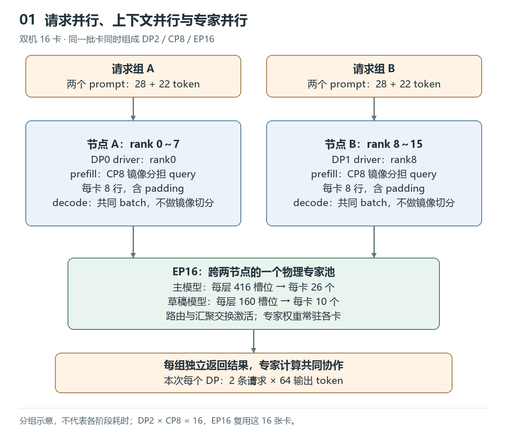
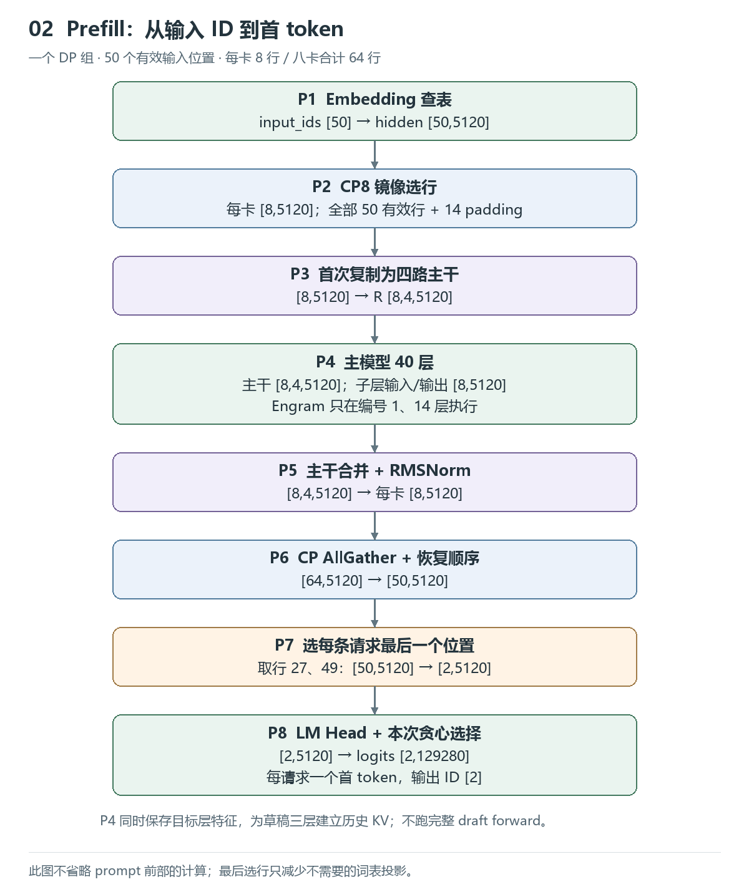
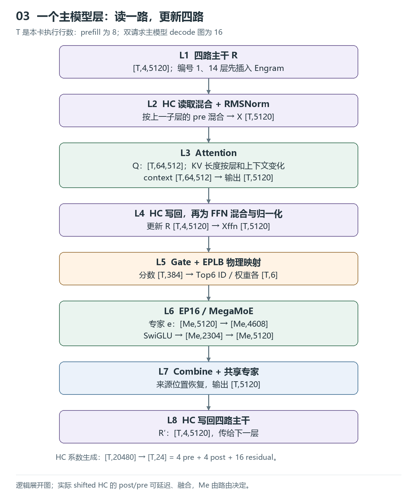
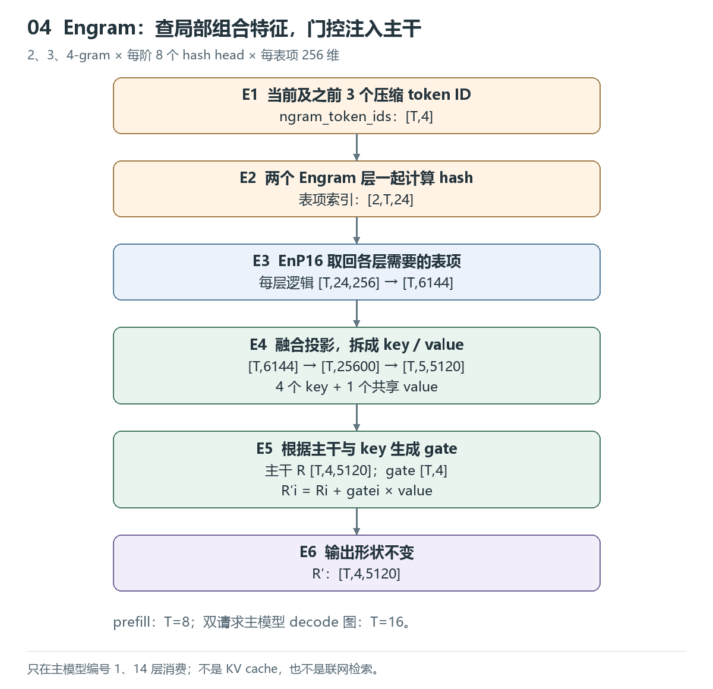
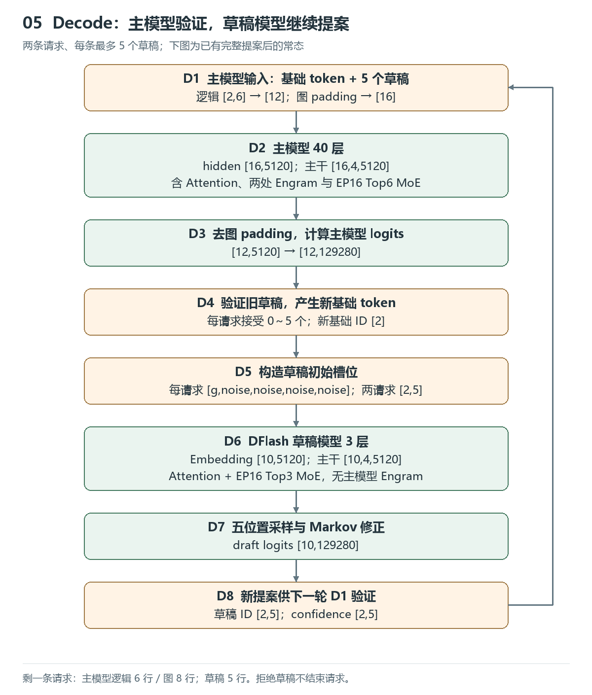

# 沿着 Shape 看懂 DeepInfer：Prefill、CP8 与投机 Decode

本文从一次双机 16 卡推理出发，沿输入、主模型、Engram 和草稿模型追踪张量变化。重点是解释“哪个维度为什么改变”，而不是逐个阅读底层 kernel。

模型为 DeepSeek-V4.1-Flash-1017，主模型 **40 层**，DFlash 草稿模型 **3 层**。主仓库固定到 `553741557a57df44a46fb3ab72b6aafeaf945337`，采集日期为 2026-10-27，本文整理于 2026-10-28。

**证据口径：** 请求长度、输出 token 数和事件次数来自实际采集；本文的中间 shape 由该版本源码、模型配置与图大小对应关系推导，未逐张量导出。所有图均为逻辑流程图，不按实测时长或内存地址绘制。本次完成了生成与 trace 检查，未做完整模型精度评测或无 profiler 的性能对比。

## 1. 先统一请求、位置与卡的概念

硬件为两台机器、每台 8 张 Ascend950DT。DP0 使用 rank0～7，DP1 使用 rank8～15；各组 CP8，全部 16 卡共同组成 EP16。它们复用同一批卡，不是 `DP × CP × EP` 张卡。

本次采用自然路由、开启 EPLB，固定 `NextN=5`、关闭 MTP 变长验证；单个 DP 的请求容量为 4，上下文上限 32768，prefill batch 上限 4096。它们是本例的运行设置，不代表最少卡数或最优并行配置。

DP（数据并行）分配不同请求组；CP（上下文并行）在 prefill 中分配每条请求的 query 位置；EP（专家并行）分配物理专家及其任务。两组 DP 共享专家池，不是两份独立完整模型。

本次每个 DP 都提交了以下两条 prompt，先分别预热，再采集完整生成：

| 请求 | 输入文本 | 输入 token | 输出 token |
|---|---|---:|---:|
| A | 请逐步解释大型语言模型推理中 prefill 和 decode 阶段分别计算什么，KV cache 如何参与。答案： | 28 | 64 |
| B | 请用具体例子解释混合专家模型的路由、专家并行、dispatch 和 combine。答案： | 22 | 64 |

每个 DP 有 50 个输入 token、128 个输出 token；两个 DP 共执行 4 次请求，输出 256 token。相同 prompt 在两个 DP 上生成的 token ID 一致。`max_tokens=64, ignore_eos=True` 用于固定采集长度，生成结束符也不会提前停止；这不代表回答质量已经验证。

| 符号 | 本次取值 | 含义 |
|---|---:|---|
| H | 5120 | 单路 hidden 的特征维度 |
| m | 4 | 超连接主干路数 |
| V | 129280 | 词表大小 |
| I | 2304 | 专家 SwiGLU 后的中间维度 |
| D | 5 | 每轮草稿 token 数，不是草稿层数 |
| T | 随阶段变化 | 本卡计算的张量行数，可能包含 padding |
| M_e | 由路由决定 | 某个物理专家收到的行数 |

`launch_forward_N2_B12` 中，N 对应源码 `num_reqs`，B 对应 `total_q`。它表示 **2 条请求、12 个逻辑 query 位置**，不是 12 条请求，也不是已经输出了 12 个 token。实际图执行行数还可能更大。

## 2. Prefill：50 个输入位置怎样变成每卡 8 行

先看一个 DP 组。Embedding 为每个 token ID 查询一个 H 维向量：

`input_ids [50] → embedding [50,5120]`

### 2.1 CP8 按每条请求分别镜像分块

对长度为 L 的序列，先分成 `2C=16` 块，每块长度为：

$$
p(L)=\left\lceil\frac{L}{2C}\right\rceil,\qquad C=8.
$$

CP rank r 负责块 r 和块 `15-r`。这样把靠前、靠后的 query 配在一起，缓解因果 Attention 的负载差异。实际模型还有滑动窗口与稀疏选择，不能据此认为各卡工作量严格相等。

本次 `p(28)=p(22)=2`，每卡从每条请求拿 4 个位置，合计 8 行。下面的位置编号在每条请求内从 0 开始，`—` 为 padding。

| CP rank | 请求 A 的 4 个位置 | 请求 B 的 4 个位置 | 有效行 / 分配行 |
|---:|---|---|---:|
| 0 | 0, 1, —, — | 0, 1, —, — | 4 / 8 |
| 1 | 2, 3, —, — | 2, 3, —, — | 4 / 8 |
| 2 | 4, 5, 26, 27 | 4, 5, —, — | 6 / 8 |
| 3 | 6, 7, 24, 25 | 6, 7, —, — | 6 / 8 |
| 4 | 8, 9, 22, 23 | 8, 9, —, — | 6 / 8 |
| 5 | 10, 11, 20, 21 | 10, 11, 20, 21 | 8 / 8 |
| 6 | 12, 13, 18, 19 | 12, 13, 18, 19 | 8 / 8 |
| 7 | 14, 15, 16, 17 | 14, 15, 16, 17 | 8 / 8 |

八卡合计 64 行，其中 50 行有效、14 行 padding。CP 拆的是负责计算的 query，不是切成八段互不联系的文本；各卡仍需要组内交换所需 KV 等数据。

### 2.2 从 Embedding 到第一个输出 token

| 步骤 | 输入 → 输出 | 为什么变化 |
|---|---|---|
| Embedding | `[50] → [50,H]` | 查 token 向量表 |
| CP 镜像选行 | `[50,H] → 每卡[8,H]` | 分配 query，保留 padding |
| 首次扩展主干 | `[8,H] → [8,4,H]` | 每个向量复制四份，不是升维 GEMM |
| 主模型 40 层 | 四路主干保持 `[8,4,H]` | 子层读一路、计算一次，再更新四路 |
| 最终主干合并、RMSNorm | `[8,4,H] → [8,H]` | 动态加权合并四路 |
| CP 汇聚、恢复顺序 | `[64,H] → [50,H]` | 去 padding，恢复原序列顺序 |
| 每条请求选最后一行 | `[50,H] → [2,H]` | 选扁平行号 27、49，预测 prompt 后的 token |
| LM Head | `[2,H] → [2,V]` | `logits = hidden × W_headᵀ` |
| 本次贪心选择 | `[2,V] → [2]` | 温度为 0，每请求输出一个首 token |

“选最后一行”只省去不需要的词表投影，不是只计算最后一个 prompt token。前面的输入位置已经参与 prefill，并建立 KV cache。投机 decode 需要多个位置的分布，不能照搬“每请求只选最后一行”。

## 3. 一层主模型：四路主干、Attention 与 MegaMoE

这一节用 T 表示本卡行数：本次 prefill 为 8；双请求稳定 decode 的主模型图为 16；单请求图为 8。表中的矩阵使用数学上的输入维×输出维写法，源码权重常按其转置存放。量化和分块布局不改变这里的逻辑特征维度。

### 3.1 四路主干怎样读写

初始化是 `R[t,i,d]=X[t,d]`，所以四路最初相同。后续不同的写入、混合系数让它们积累不同的历史组合。Attention 与 MoE 各执行一次，不是四次。

四路展平为 `[T,20480]`，经过归一化与训练得到的投影，产生 `[T,24]` 分数：

$$
z=\frac{\operatorname{flatten}(R)W_{\mathrm{mix}}^{\mathsf T}}
{\sqrt{\operatorname{mean}(\operatorname{flatten}(R)^2)+\epsilon}}.
$$

24 个数分为 4 个 pre、4 个 post、16 个 residual 分数。scale/base 调整后，pre 经 sigmoid 加 epsilon，post 经 sigmoid 和输出缩放；residual 经 Sinkhorn 归一化形成 4×4 矩阵 C。pre 不要求四项之和为 1。

本次是 **shifted HC**，读取与系数生成错开一个子层：

$$
x_t=\operatorname{RMSNorm}\left(\sum_i a^{\mathrm{prev}}_{t,i}R_{t,i}\right),\qquad u_t=F(x_t),
$$

$$
R'_{t,i}=\sum_j C_{t,ij}R_{t,j}+b_{t,i}u_t.
$$

当前 R 生成的 pre 留给下一子层，b、C 控制本次写回。这里把 C 的索引定义为“输出路 i 读取输入路 j”；kernel 的存储方向需按源码对照。实际 post 可能延迟到相邻子层并融合执行。

例如四路最初都是 `[1,0]`，本次结果为 `[0,1]`，若 `C=I`、`b=[1,0.5,0.2,0.1]`，更新后四路为 `[1,1]、[1,0.5]、[1,0.2]、[1,0.1]`。它们保留了不同更新强度的版本；下一子层再选择读取组合。C 则允许旧信息在各路间直接交换，不必先经过新的 Attention/MoE。

### 3.2 Attention 的主要 shape

本模型有 64 个 query head，每 head 512 维；共享 KV 向量是 512 维，其中包含 64 维 RoPE 部分。不是每个 head 分别保存一份完整 KV。

| 计算 | 输入 → 输出逻辑 shape | 说明 |
|---|---|---|
| Q 降维 | `[T,5120] → [T,1280]` | `Q_a = X W_qa` |
| Q 展开 | `[T,1280] → [T,64,512]` | 归一化、投影、reshape，并做对应 RoPE/量化 |
| SWA KV 投影 | `[T,5120] → [T,1,512]` | 生成局部窗口 KV |
| Prefill CP 交换 | 局部 KV → 本组 KV | 本次汇聚后有效 SWA KV 为 `[50,1,512]` |
| 压缩 KV 源层 | C2 初始输入得到 `[25,1,512]`；C1 为 `[50,1,512]` | 分别对应 2:1 与 1:1 位置压缩 |
| 索引 Q，适用的源层 | `[T,1280] → [T,32,128]` | 给历史位置评分；不是 MoE gate |
| 索引 K | 共享 KV → `[Nkv,128]` | 存入或读取索引缓存 |
| 选历史位置 | 分数 → `[T,512]` 索引 | 不足项为无效索引；部分层还使用 `[T,2048]` 候选块，块大小 8 |
| 主 Attention | Q 与允许访问的 KV → `[T,64,512]` | 按窗口、索引、因果 mask、sink 计算 |
| 分组输出投影 | `[T,8,4096] → [T,8,1024]` | 将 64 个 head 分为 8 组投影 |
| 最终输出投影 | `[T,8192] → [T,5120]` | 回到单路 hidden |

Nkv 随序列长度、历史上下文和压缩比例改变。层编号 0、1 为非压缩 SWA；2～19 使用 C2，20～39 使用 C1。主 KV 源层为 2、8、14、20，后续共享消费者复用相应 KV；索引源也有独立分组，不能把每层都画成重新生成全部 KV 和索引。

核心计算可写为：

$$
s_{t,h,j}=\frac{\langle q_{t,h},kv_j\rangle}{\sqrt{512}},\qquad
c_{t,h}=\sum_{j\in\mathcal S_t}\alpha_{t,h,j}kv_j.
$$

集合 S_t 由窗口、稀疏选择与 mask 决定，alpha 按模型的 sink 等规则归一化。该公式解释计算含义，不表示实现分配了一个完整稠密 score 矩阵。

### 3.3 Gate 与专家计算

主模型 gate 的流程是：

$$
z=XW_g,\quad s_e=\sqrt{\operatorname{softplus}(z_e)},\quad
\mathcal E=\operatorname{Top6}(s+\mathrm{bias}),\quad
w_e=1.5\frac{s_e}{\sum_{j\in\mathcal E}s_j}.
$$

校正 bias 用于排名，最终权重用未加 bias 的选中分数归一化。随后 EPLB 将 384 个逻辑专家映射到 416 个物理槽位，每卡每层 26 个。共享专家单独参与，不占 Top6 名额。

| 步骤 | 输入 → 输出 |
|---|---|
| Gate 投影 | `[T,5120] × [5120,384] → [T,384]` |
| Top6 与物理映射 | 专家 ID `[T,6]`、权重 `[T,6]` |
| EP16 分发到专家 e | `[M_e,5120]` |
| Gate/up 合并 GEMM | `[M_e,5120] → [M_e,4608]` |
| 拆成两路、带模型 clamp 的 SwiGLU | 两个 `[M_e,2304] → [M_e,2304]` |
| Down GEMM | `[M_e,2304] → [M_e,5120]` |
| Combine 与共享专家 | 恢复来源行序并加权为 `[T,5120]` |

$$
y_t=F_{\mathrm{shared}}(x_t)+\sum_{e\in\mathcal E_t}w_{t,e}F_e(x_t).
$$

M_e 取决于全部 EP rank 的有效路由和 padding 处理，不能用平均值代替。本次未采集逐专家接收直方图。MegaMoE 将分发、两次 GEMM、激活与汇聚融合，trace 中不会自然出现五个独立阶段。

HBM 中路由专家是按 MegaMoE 分块重排的 packed FP4；取块后在 UB 展开为 FP8 NZ，再送往 L1/L0/Cube。共享专家 FP8 权重另有预排 NZ 路径。因此“FP4/FP8”与“ND/NZ”应分别讨论，不能把全模型笼统称为 ND。

## 4. Engram：按局部 token 组合查表，再门控注入主干

Engram 只出现在主模型编号 1、14，即第 2、15 层。prefill 与 decode 都会执行这两处模块；草稿三层不含它们。

它对每个位置准备当前及之前三个压缩 token ID `[T,4]`。2、3、4-gram 各有 8 个 hash head，所以每 token 每 Engram 层取 `3×8=24` 个表项；每项 256 维。这里的 EnP16 指 Engram 表并行：大表按 16 个 rank 分片，查询可以取回其他卡上的表项。

| 步骤 | Shape |
|---|---|
| n-gram token 窗口 | `[T,4]` |
| 两个 Engram 层一起计算 hash | `[2,T,24]` |
| 每层在 EnP16 中取回表项 | 逻辑 `[T,24,256]` |
| 拼接作为投影输入 | 每层 `[T,6144]`，量化实现另携带 scale |
| 融合投影 | `[T,6144] → [T,25600] → [T,5,5120]` |
| 拆分 | 4 路 key `[T,4,5120]`；共享 value `[T,5120]` |
| 门控融合 | 主干 `[T,4,5120] → [T,4,5120]` |

对每个 token 的第 i 路：

$$
z_i=\frac{\langle\operatorname{RMSNorm}_{w_h}(R_i),\operatorname{RMSNorm}_{w_e}(k_i)\rangle}{\sqrt{5120}},
\quad g_i=\sigma(\operatorname{signed\_sqrt}(z_i)),\quad R'_i=R_i+g_iv.
$$

signed-sqrt 带数值 clamp。它引入的是训练得到的局部组合特征，不是请求增长的 KV cache，也不是联网检索。查询只取所需表项，不搬整张表。两个层的 fetch 可提前一起发起，执行到相应层再消费结果。

代入本次行数：prefill 每卡的窗口、投影结果分别为 `[8,4]、[8,5,5120]`；双请求主模型 decode 图为 `[16,4]、[16,5,5120]`。这些形状包含对应 padding。

## 5. Decode：主模型验证 6 个位置，草稿模型产生 5 个候选

### 5.1 为什么主模型 12 行，草稿模型 10 行

两条请求都已有完整提案时，每条主模型输入为 `[g,d1,d2,d3,d4,d5]`，g 是当前基础 token，d 是待验证草稿：逻辑上 `2×6=12` 行。

主模型预捕获图大小为 `1,2,4,8,16,24`，选择能容纳输入的最小图：B12 选 16 行图；剩一条请求的 B6 选 8 行图。图 padding 与 prefill 的 CP padding 是两件事。

| 阶段 | 两条请求 | 一条请求 |
|---|---|---|
| 主模型逻辑输入 | `[2,6] → [12]` | `[1,6] → [6]` |
| 主模型图输入 | `[16]` | `[8]` |
| Embedding / 四路主干 | `[16,H] / [16,4,H]` | `[8,H] / [8,4,H]` |
| 主模型 40 层后单路输出 | `[16,H]` | `[8,H]` |
| 采样选行、去图 padding | `[12,H]` | `[6,H]` |
| LM Head 的完整词表 logits | `[12,V]` | `[6,V]` |
| 主模型验证后的新基础 token | `[2]` | `[1]` |
| 草稿初始槽位 | `[2,5]` | `[1,5]` |
| 草稿 Embedding | `[10,H]` | `[5,H]` |
| 草稿 3 层后的 hidden | `[10,H]` | `[5,H]` |
| 草稿完整词表 logits | `[10,V]` | `[5,V]` |
| 新草稿 ID、confidence | 各 `[2,5]` | 各 `[1,5]` |

刚从 prefill 转入时，提案槽位尚需初始化，不能假设第一轮已含五个有效草稿。表格描述有完整提案后的常态形状；有效采样行、接受长度仍按元数据处理。

主模型每轮还在编号 37、38、39 处取主干特征：各对 4 路求均值得到 `[T,H]`，拼成 `[T,15360]`，投影到 `[T,H]`，再产生 `[T,3,512]`，写入三个草稿层的历史 KV。prefill 时 CP 汇聚、恢复顺序后写入本组历史位置。这一步包含在主模型 forward 内，**不是再跑一次完整的草稿三层**。

### 5.2 草稿输入为什么是“基础 token＋noise”

每条请求先构造 `[g,noise,noise,noise,noise]`，noise 是配置的专用 token，而非每轮随机数。两条请求展开为 10 个 ID，查表得到 `[10,H]`，一次通过三层草稿模型。草稿 Attention 读取主模型特征形成的历史缓存和当前草稿位置。

草稿模型每层有 128 个逻辑专家、Top3；EPLB 后 160 个物理槽位、每卡每层 10 个。Gate 为 `[T_d,128] → [T_d,3]`，其中双请求 T_d=10。专家内部仍为 `H → 2I → I → H`，单路计算、四路主干更新。

随后五个位置做采样，并包含本模型的低秩 Markov 修正：

$$
L_j=h_jW_{\mathrm{head}}^{\mathsf T}+E_{\mathrm{markov}}[\mathrm{previous\ token}]W_{\mathrm{markov}}.
$$

双请求每个采样位置的修正为 `[2] → [2,256] → [2,V]`；confidence head 结合 hidden 与 Markov 特征，生成各位置的接受率预测。最终每请求产生五个候选。**不是把三层草稿模型完整运行五遍。** 本次还使用采样 TopK=4096，草稿保存的 logprobs 与词表索引各为 `[2,5,4096]`。

主模型下一轮把 g 与这五个候选一起验证。草稿被拒绝不表示回答不相关，也不会因此结束请求：主模型给出替代 token，之后继续提案。confidence 是提案相关预测，不是事实正确率或语义相关性判定。

### 5.3 CP8 在 decode 中没有进行什么

该版本的镜像选行只在 prefill 执行。decode 将共同 batch 元数据广播给 CP 组，Q 投影用复制权重，Attention 路径没有按 CP rank 切 head 或历史 KV；由源码可判断，同组存在复制的 Attention 工作。它不是把 B12 除以 8 分给每卡。

但本次仅采集 rank0、rank8，二者属于不同 CP 组。单卡 trace 可见完整 64-head Attention，**没有同组八 rank 的时间线和输入/KV 比对，不能把“八卡同时重复”写成已完成的直接实测，也不能换算成八倍可得加速**。

作为对照，Attention DP 可以让各 rank 处理不同请求；TP 切分 head/投影；DCP 可以保持相同 query，但读取不同的历史 KV 分片，再按 softmax 统计量合并。相同 query 本身不足以证明冗余。框架、模型与硬件支持需要另行验证，不能把其他框架参数直接套到这里。

## 6. 把 shape 与这次 trace 对上

下面次数均针对一个 driver trace，另一个 DP 结果相同：

| 上层事件 | 次数 | 含义 |
|---|---:|---|
| `launch_forward_N2_B50` | 1 | 两请求 prefill，CP 后每卡 8 行 |
| `launch_forward_N2_B12` | 22 | 双请求 decode，主模型 16 行图 |
| `launch_forward_N1_B6` | 11 | 单请求 decode，主模型 8 行图 |
| `launch_forward_N1_B1` | 37 | 本次的占位 forward，使用 1 行图 |

也就是一次真实 prefill、33 轮真实 decode，另有 37 次占位。占位会产生真实设备任务，不是空事件；没有用户输出，不计为真实请求生成。B1 本身只表示一个输入位置，不能在其他用例中仅凭名字认定占位。

主模型 MegaMoE 事件数为 `40×(1+22+11+37)=2840`；草稿为 `3×(22+11+37)=210`。它们包括占位执行，不能当成有效请求的 decode 次数。

在 MindStudio Insight 中，先找上述主模型 forward，再看 verification、DFlash 与 NPU 轨道。CPU 的 launch 表示提交，不等于设备完成；ZOS decode 常在提交本轮 forward 后，处理上一轮采样结果。两个节点的时间线未经时钟校验也不宜直接拼接。

这次只有短文本小 batch。CP 的长上下文收益、真实逐专家 M_e 分布和更优并行配置，均不能从本例直接得出。

## 源码与延伸阅读

源码链接固定到本次版本；不发布机器地址、访问资料和原始采集文件。

- [DeepInfer 主模型与 CP、Engram 调用](https://github.com/deepseek-ai/DeepInfer/blob/553741557a57df44a46fb3ab72b6aafeaf945337/deepinfer/model_executor/models/deepseek.py)
- [镜像 CP 的参考实现](https://github.com/deepseek-ai/DeepInfer/blob/553741557a57df44a46fb3ab72b6aafeaf945337/deepinfer/model_executor/layers/tilelang_ops/prepare_cp_mirror.py)
- [Attention 与共享 KV](https://github.com/deepseek-ai/DeepInfer/blob/553741557a57df44a46fb3ab72b6aafeaf945337/deepinfer/model_executor/models/v4_modules/attn.py)
- [HC 读写与系数生成](https://github.com/deepseek-ai/DeepInfer/blob/553741557a57df44a46fb3ab72b6aafeaf945337/deepinfer/model_executor/models/v4_modules/hc.py)
- [Engram](https://github.com/deepseek-ai/DeepInfer/blob/553741557a57df44a46fb3ab72b6aafeaf945337/deepinfer/model_executor/models/v4_modules/engram.py)
- [MoE Gate、权重适配与 MegaMoE 调用](https://github.com/deepseek-ai/DeepInfer/blob/553741557a57df44a46fb3ab72b6aafeaf945337/deepinfer/model_executor/models/v4_modules/mlp.py)
- [DFlash](https://github.com/deepseek-ai/DeepInfer/blob/553741557a57df44a46fb3ab72b6aafeaf945337/deepinfer/model_executor/models/mtp/dflash.py)
- [图捕获、固定大小与 replay](https://github.com/deepseek-ai/DeepInfer/blob/553741557a57df44a46fb3ab72b6aafeaf945337/deepinfer/worker/cuda_graph_runner.py)
- [vLLM：Attention DP/TP 与 EP 的组合](https://docs.vllm.ai/en/latest/serving/expert_parallel_deployment/)
- [vLLM：Prefill CP 与 Decode CP](https://docs.vllm.ai/en/latest/serving/context_parallel_deployment/)
- [SGLang：DCP 的 KV 分片与部分结果合并](https://github.com/sgl-project/sglang/blob/main/docs/docs/advanced_features/dcp.mdx)
