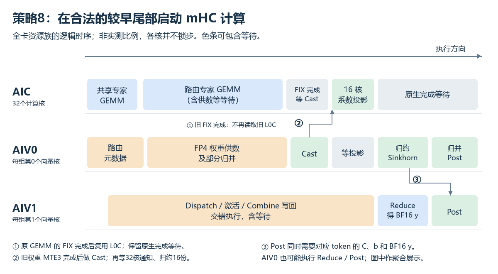
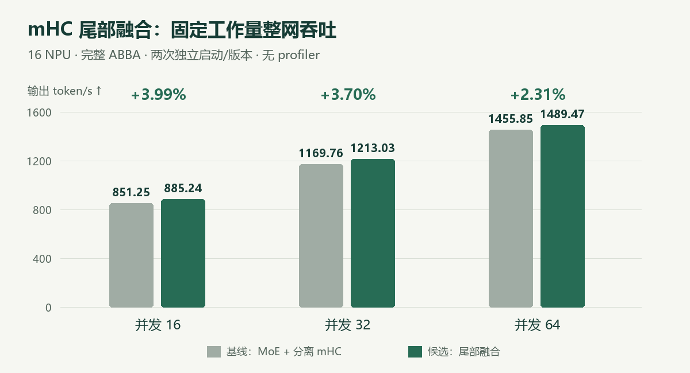
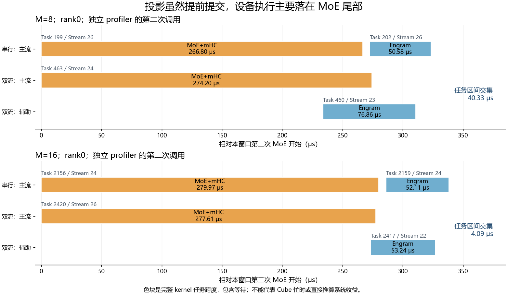

# DeepInfer系统级优化探索

更新：2026-11-17。汇总本聊天截至当前已留存的实验；本次只整理和发布，不代表新完成了NPU测试。

**我们在做系统与算子协同优化：从推理引擎的数据依赖发现机会，再通过跨算子融合或跨流调度缩短完整执行路径。** mHC方案已经修改MegaMoE内部流水；Engram方案目前只调整引擎调度，尚未写入MegaMoE原生kernel。

| 方向 | 当前最强证据 | 结论 |
|---|---|---|
| mHC系数＋Post尾部融合 | 完整整网ABBA，24个正式窗口 | 本组闭环吞吐提高 **2.31%～3.99%** |
| Engram投影双流重叠 | 片段筛选＋整网A1/B1/B2 | 片段降时约1.86%～3.60%；整网增量接近持平，未建立明确收益 |
| 数学改写，提前确定TopK | 公式推导、CPU数学用例与反例 | 尚未完成真实NPU提前路由，没有性能结论 |

## 一、背景：优化的是完整路径

主干残差为 `R[M,4,5120]`。mHC把四路读成 `x[M,5120]`，Attention或MoE计算一次，再写回四路。M是当前rank设备图的行数，可能含padding，不等于整机请求数，也不等于每个专家收到的token数。

我们关心的主线是：

```text
Attention输出 → mHC写回 → 四路读出 → RMSNorm → Router/TopK
                                                ↓
                             Dispatch → 专家FFN → Combine/Reduce
                                                ↓
                                      mHC Post → 下一子层
```

MegaMoE把通信和专家计算做成流水，但启动元数据、跨卡到达差异和最后的归并可能留下等待。目标是把无冲突的计算安排进这些等待区间。不能只看MegaMoE一个kernel变快：融合后它承担更多工作，自己的Duration甚至可能增加。

需要区分三个完成边界：**单算子**回答kernel机制；**完整片段**要求MoE输出、四路写回及消费者需要的结果全部就绪；**整网**还包含调度、Attention、草稿模型、权重轮转和请求排队。三种收益不能相加。

## 二、已验证：mHC系数与Post融合

### 2.1 为什么能重叠

我们研究的V4.1-Flash使用shifted mHC。当前MoE读出使用前一子层留下的pre；从当前残差R生成的新pre、post、mix不决定当前TopK，因而系数生成可以延后。Post仍依赖MoE结果，必须等对应token的结果和系数都就绪。

系数链为：`Flatten [M,20480] → 投影 [M,24] → RMS归一化 → 拆分4+4+16 → Sinkhorn`。旧教学D02样本四个系数kernel累计18.866 μs，MegaMoE完整kernel为223.728 μs；前者不是保证可隐藏的时间，后者也不是纯计算或纯通信时间。[原始逐算子入口](https://zhaoyuhsin.github.io/downloads/deepinfer-inference-guide-20261102-operators.html#task-21677)



图是逻辑流水，不按实测时间比例绘制。最终策略在原GEMM的FIX阶段不再读取旧L0C后，复用计算资源执行系数投影；归约和Sinkhorn由向量侧接续，MoE收尾通信继续推进。Post在对应结果齐备后执行。保留原投影分块、归约与舍入顺序，以及R的生命周期；并没有删除完成等待。

这是从系统依赖发现机会、落在原生kernel中的跨算子融合。当前只覆盖**主模型decode、M≤16**；prefill、草稿和大M走原路径。实验候选默认关闭。

### 2.2 从片段到整网，收益逐级验证

| 验证层次 | 已完成结果 | 适用边界 |
|---|---|---|
| EP16合成完整设备片段 | M8/M16两次独立启动，延迟降低4.86%～5.17% | 无timer性能轮；不包含共同的读出、Norm和Gate |
| 真实L00/L14/L39输入与模型权重 | 两次独立启动，各16rank×9用例逐位通过；多数片段降时约1%～3% | 同层连续8次热回放，不能代替整网40层权重轮转 |
| 固定请求整网 | 下表吞吐提高2.31%～3.99% | 含引擎调度、主/草稿模型及完整层执行 |

收益衡量的完成边界不同，不把片段延迟下降百分数直接叫作系统吞吐提高。

### 2.3 吞吐：完整ABBA有正收益

16张Ascend 950 NPU、EP16/CP1；A是原MegaMoE＋分离mHC，B是融合方案。在同一对节点按A1→B1→B2→A2四次独立初始化，每个并发点各测两遍，共24个正式窗口。每个版本每点有四个窗口，但只有两次独立启动。



| 全局最大在途请求 | 基线A 输出token/s | 融合B 输出token/s | 吞吐提高 |
|---:|---:|---:|---:|
| 16 | 851.25 | 885.24 | +3.99% |
| 32 | 1169.76 | 1213.03 | +3.70% |
| 64 | 1455.85 | 1489.47 | +2.31% |

每格为该版本四个窗口TPS的算术均值。两次B实例均值都高于两次A；A2相对A1漂移−0.33%～−0.73%，B2相对B1为−0.01%～+0.06%。证据支持本组闭环正收益，尚不足以证明所有业务、硬件或长期统计显著。

### 2.4 延迟：改善并不覆盖每个指标

以下均为“基线A → 融合B”。完成时间是四个窗口真实完成秒数的均值，与“先平均TPS再取倒数”略有差异。

| 并发 | 固定工作完成时间 s | 平均TTFT ms | 平均TPOT ms/token |
|---:|---:|---:|---:|
| 16 | 50.151 → 48.225 | 1590.80 → 1529.16 | 6.184 → 5.951 |
| 32 | 36.496 → 35.194 | 2115.90 → 2039.79 | 6.709 → 6.493 |
| 64 | 29.324 → 28.662 | 3066.53 → 3019.43 | 7.631 → 7.643 |

| 并发 | 窗口P99 TTFT均值 ms | 窗口P99 TPOT均值 ms/token |
|---:|---:|---:|
| 16 | 9898.54 → 9462.69 | 21.560 → 20.486 |
| 32 | 12721.21 → 12214.86 | 23.466 → 22.470 |
| 64 | 14414.80 → 14148.59 | 26.013 → 25.607 |

TTFT从请求实际提交到引擎起算，**不含闭环准入前等待**；TPOT为每请求`(末token时间−首token时间)/(输出token数−1)`，每窗仅206条多token请求参与。表中P99先在各窗口计算，再平均，**不是把全部请求合并后的总体P99，也不是逐token间隔P99**。

并发64平均TPOT从7.631到7.643 ms，约回退0.15%；吞吐增加不意味着每个请求延迟都降低。DFlash可一次接受多个token，TPOT也不等于一次decode forward耗时。

### 2.5 Trace验证了什么

性能测量结束后，另采四实例×rank0/rank2共八份128步trace。每份有1次主模型prefill、127次主模型decode。候选中`40层×127轮=5080`次主模型MoE采用融合；四个独立系数kernel及Post各减少5080次。40次主模型prefill MoE和381次草稿MoE保留原路径。

全16rank、40层、127轮decode的Top6路由计数守恒通过。但A/B诊断窗口覆盖的全局query为8010/9162，并非同一请求片段，不能逐kernel相减作收益。Trace负责确认融合实际发生和观察流水；正式吞吐来自无profiler窗口。

## 三、没有明确整网增益：Engram重叠与提前路由

### 3.1 Engram：有独立计算，但资源并不独立

Engram查表由token ID决定，投影可在门控消费前准备。投影为`[M,6144] × [6144,25600] → [M,5,5120]`，五份向量是四路key和共享value。FP8权重本体约150 MiB，M16算量约5.03 GFLOPs；有数据独立性不代表有空闲带宽或计算资源。

片段筛选从输入与路由已就绪开始，到四路MoE写回和Engram投影都完成为止。原mHC融合已包含在基线中，门控不在该片段内。

| 片段负载 | M | 串行中位数 μs | 双流中位数 μs | 延迟降低 |
|---|---:|---:|---:|---:|
| 全行有效合成，独立启动1 | 8 | 331.25 | 321.38 | 2.98% |
| 同配置独立启动2 | 8 | 329.67 | 317.81 | 3.60% |
| 全行有效合成，独立启动1 | 16 | 343.46 | 336.41 | 2.05% |
| 同配置独立启动2 | 16 | 343.40 | 337.00 | 1.86% |
| 按旧trace接收直方图构造，一次启动 | 16 | 266.06 | 259.60 | 2.43% |

每个样本先取16rank完整设备片段时长的最大值，再求中位数；性能轮无timer、无profiler。直方图构造只匹配行数与专家接收计数，不是原激活、原权重、原路由边的完整回放；前三次有效运行中BF16结果逐位相同，FP32系数为无容差相等检查，未区分正负零。



这是独立profiler的示例调用，各窗口分别对齐自己的MoE起点。M16投影主要落在尾部，任务区间交集仅4.09 μs；M8虽有40.33 μs交集，两个kernel自身也可能变长。区间交集不等于省时，更不能当作Cube忙时。

### 3.2 接入整网后，新增收益接近持平

整网候选在L00/L13的FFN Norm后、router Gate前提交辅助流投影，L01/L14门控前等待；数学和原投影模块不变，仅主模型decode M≤16启用。**两边都有mHC融合，这里只测Engram的增量。** 该放置点与片段筛选不同，还可能与router竞争资源。

| 并发 | A1 token/s | B1 token/s | B2 token/s | 两次B均值相对A1 |
|---:|---:|---:|---:|---:|
| 16 | 877.65 | 879.87 | 880.14 | +0.27% |
| 32 | 1207.30 | 1206.03 | 1206.28 | -0.10% |
| 64 | 1484.04 | 1479.14 | 1480.10 | -0.30% |

三次独立启动、18个正式窗口完成远端回执核对，完整输出ID、实际容量和专家布局相同。但A2未验收、原始账本未完整取回复核，TTFT/TPOT及本轮整网诊断trace待补。表中是部分结果，不是完整ABBA。

当前没有建立明确的新增整网收益。不能把mHC的3.99%与Engram片段的3.60%相加，也不能拿不同日期或节点的绝对TPS横向拼接。另一组早期mHC单对A/B曾观察到+0.35%、+0.23%、−1.06%，同样提醒我们收益依赖测试条件。

### 3.3 提前TopK：数学候选，尚未产生NPU性能数据

shifted mHC可将MoE归一化前输入展开为`x = r_eff + alpha·A·W1·W2`，于是router线性部分可重排成`q = r_eff·Q + alpha·A·P`，其中`Q = diag(gamma)·Wg`、`P = W1·W2·Q`。残差项和动态混合系数必须保留。

实际选择比较的是`sqrt(softplus(q/rho(x))) + 专家校正bias`。不同专家的bias破坏了“公共正缩放总不影响TopK”的简化；归一化尺度、BF16舍入、FP8量化也需按真实实现验证。仅实数结合律成立，不代表专家ID或最终token逐位一致。

CSA后直接计算A·P的算量约为原gate的6.4倍，另需残差分支；从第一次输出投影U后开始约1.6倍，仍非免费。原输出投影要生成真实专家输入，不能删除。现阶段只有CPU数学验证及反例，没有精确提前路由的NPU实现和整网收益。[完整数学与trace成本分析](https://zhaoyuhsin.github.io/downloads/megamoe-math-overlap-20261113.html)

## 四、如何理解结论，以及下一步

### 4.1 本轮系统指标的适用范围

固定256条公开ShareGPT请求，平均输入272.70 token、最长3961；平均输出166.76、最长794。启用自然EOS且保留原回答长度对应的输出上限：113条自然结束，143条到达上限，不是全部自然结束，也不是4K上下文稳态业务。每窗共42691个输出token。

TPS=`42691 ÷ max_rank(最后输出相对时间)`，包含完整工作量在引擎中的排队；直接调用Engine，不包含HTTP、客户端网络和分词。A/B实际KV容量统一260000块，专家布局固定，使用原模型权重和自然router；本实验没有验证EPLB动态重排收益。

mHC四实例完整输出ID一致、24窗零JIT并通过原始账本复算。Engram三实例目前只是远端回执通过，证据等级不同。正式性能关闭profiler/timer，调试trace单独采集；周期资源监测未检出正式窗口争用，但不能证明采样间隙绝对独占。

### 4.2 在线SLO仍未验收

mHC另做了Poisson 4/7 req/s、15秒预热＋45秒测量的稳定到达率实验，A1/B1/B2完成；A2在基线路径发生Gloo包长断言，整实例失败，不能拼接其部分窗口补成ABBA。

| 到达率 req/s | A1 / B1 / B2 输出token/s | A1 / B1 / B2 实验goodput req/s |
|---:|---:|---:|
| 4 | 637.14 / 636.24 / 637.02 | 3.244 / 3.244 / 3.267 |
| 7 | 1176.76 / 1173.43 / 1171.69 | 5.044 / 5.122 / 5.178 |

此处goodput是满足TTFT≤2秒、请求平均TPOT≤50 ms的到达cohort请求数÷45秒，仅为实验门槛；它不是官方服务SLO。缺少完整A2，不能把小幅goodput变化宣称为稳定在线收益。到达率限制下TPS相近，也不能独立证明容量优化无效。

### 4.3 后续应做有区分力的验证

1. **保留mHC已验收结果，扩大代表性。** 用长上下文、混合长度及更多独立运行验证覆盖范围；修复在线基线通信问题后，再做完整在线对照。
2. **Engram先解释近持平。** 如能取回A2和账本，先补审计；另采同工作量诊断，对照“Gate前提交”和“TopK后提交”，区分router竞争与尾部执行不足。不能直接把更复杂原生融合当成收益保证。
3. **提前路由先过精度与成本筛选。** 在真实输入上检查含bias的TopK和路由权重，再测完整路由前缀；有可靠提前量后才考虑发布通信元数据。

目前可以保留的结论是：**mHC跨算子尾部融合在一组完整闭环实验中带来约2%～4%吞吐改善；Engram的片段正收益尚未转化为明确整网增益；提前路由仍需验证。** 三个候选保持各自证据边界，不累加，不默认扩大到Pro的非shifted mHC。

### 阅读与数据

- [从一句话到一句话：DeepInfer全流程与Trace图解](https://zhaoyuhsin.github.io/downloads/deepinfer-inference-guide-20261102.html)
- [MegaMoE头尾还能融合什么：数学等价与成本分析](https://zhaoyuhsin.github.io/downloads/megamoe-math-overlap-20261113.html)
- [本页可公开结果摘要 JSON](results-summary.json) · [表格 CSV](results-summary.csv)

公开附件只含文章、配图和聚合指标；不含原始请求文本、token账本、机器访问资料或内部日志。摘要保留来源文件SHA-256，便于核对本地证据身份，不代表原始证据已公开或第三方独立复现。
