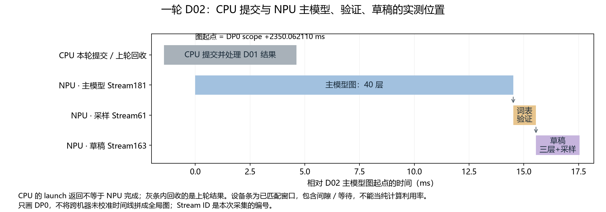
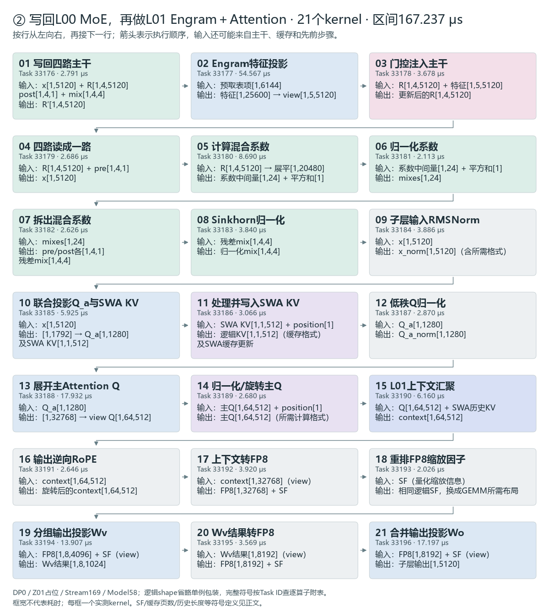
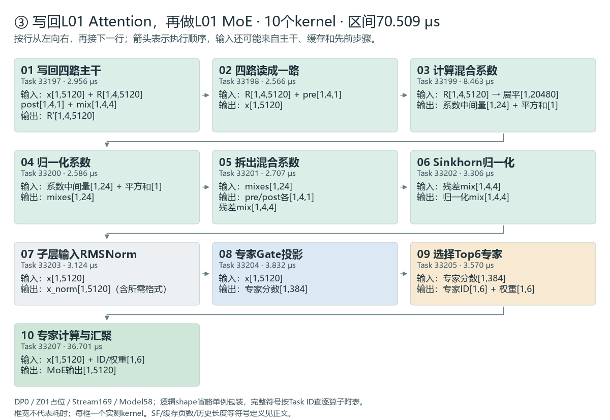
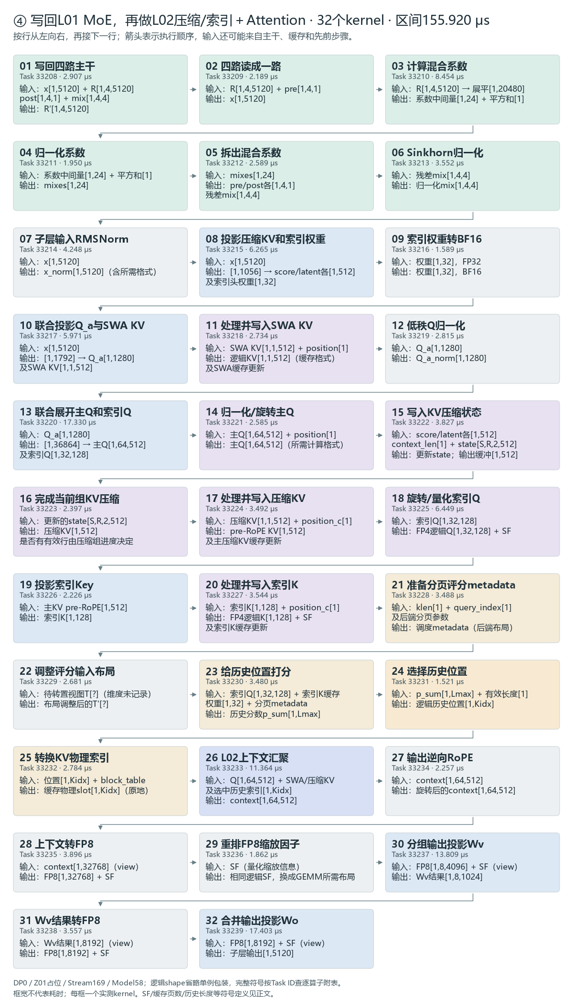

# 从 Token 到 Token：一步步看懂 DeepInfer

这篇文章按“请求 → 主模型 → 草稿模型 → 算子”展开。读完后，先能讲清一个token怎样产生，再用trace核对每一步。

**建议分三遍读。** 第一遍顺着七步讲解走，暂时跳过“看一下trace”；第二遍看四段流程图和次数表；第三遍打开trace，做四处定位核对。无需一开始就记住所有Task ID。

本文沿用同一份采集：每路DP（数据并行）处理两条请求，输入共50个token；主模型40层，DFlash草稿模型3层，每轮最多提出5个候选。下文默认讲DP0的 `continuous-dp0.json`，不把两路DP混在一起计数。

| 先记住四个词 | 本文中的意思 |
| --- | --- |
| token | 分词后的一个编号，不一定对应一个汉字或单词 |
| prefill / decode | 先处理输入上下文；随后逐轮生成答案 |
| forward | 一个batch完整经过主模型或草稿模型一次 |
| kernel / 设备图 | kernel是NPU上的一项实际任务；设备图把一串任务预先录下，后续可直接重放 |

## 先看全局：71次forward在忙什么

一轮推理的分工是：**forward计算主模型特征，sample确定输出token，post_process收集结果并更新请求状态。** ZOS通过重叠CPU与设备工作减少调度空隙：提交本轮forward后，先回收上一轮结果，因此CPU时间线的实际顺序常是“本轮forward → 上轮post_process → 本轮sample”；prefill会再当场回收本轮结果。

这份DP0 trace的71次 `launch_forward` 都是主模型调用，按顺序分成五段：

| 总序号 | 完整事件名 | 次数 | 在做什么 |
| --- | --- | ---: | --- |
| 01～36 | `deepinfer:launch_forward_N1_B1` | 36 | 开头占位，不产生真实请求输出 |
| 37 | `deepinfer:launch_forward_N2_B50` | 1 | 两请求28+22个输入token，共同prefill |
| 38～59 | `deepinfer:launch_forward_N2_B12` | 22 | 两请求各有基础token+5个候选槽，共12个位置，主模型decode |
| 60～70 | `deepinfer:launch_forward_N1_B6` | 11 | A退出后，只给B的6个位置做主模型decode |
| 71 | `deepinfer:launch_forward_N1_B1` | 1 | 末尾占位，不产生真实请求输出 |

N是请求槽位数，B是本轮逻辑输入token数。prefill后利用KV缓存，不再重算整个输入；decode一次可能接受多个候选，所以forward次数不等于输出token数。占位也执行模型，但单独记账。

prefill这次逐步提交模型运算，CPU条长153.372 ms；decode主要提交已录制设备图的重放，CPU条通常只有约130～190 μs，NPU主模型窗口仍约13～15 ms。草稿模型在后面的 `deepinfer:launch_sample` 路径运行，不包含在这71次主模型forward计数里。

先看这五段即可；需要逐条对trace时，打开[71次forward完整清单](71次主模型Forward-按时间顺序看Trace.md)，每次都有CPU起止时间、CPU耗时和对应设备窗口。

### 打开trace时，再看这段定位说明

本文使用 `continuous-dp0.json`：CPU线程698287，NPU进程715046336。所有 **+ms** 从 `capture:real_requests_prefill_through_completion` 起点计；若工具以文件最早事件归零，表中时间再加 **10.275189 ms**。

搜索同名事件后，再核对 **Stream、起止时间、Duration（持续时间）、Task ID**。图重放可能复用Task ID，所以不能只看名字或编号。CPU条和NPU条上下排列，也不代表严格的父子嵌套：CPU返回时，设备任务可能还在执行。

## 第一步：把文字变成向量

分词把文字变成 token ID。Embedding 按每个 ID 查出一个5120维向量，50个 token 得到 `[50,5120]`。此时还没有生成答案，只是准备好了输入。

接着 CP8（8路上下文并行）分配工作。本例经过逐序列镜像切分和 padding，每卡分到8行；rank0其中4行来自真实输入，另4行用于补齐。**50是整个请求批次的输入数，8是本卡接下来计算的行数。**

这些向量会逐层更新；KV cache 保存 Attention 需要的历史信息，后续生成可以直接读取，省去重复计算整段输入。

### 看一下 trace ①：从153 ms的大范围找到入口

先搜全名 **`deepinfer:launch_forward_N2_B50`**：CPU线程698287，**+1302.471390～1455.843050 ms，持续153.371660 ms**。Duration 约153 ms 就匹配上了；这是一批两条请求、50个输入 token 的主模型 prefill 提交过程。

它持续期间，NPU 逐步执行入口准备、40层主模型、草稿历史 KV 准备和输出恢复。关联的 kernel 分布在 **Stream61（1467条）和 Stream24（48条 CP AllGather）**。按每条 kernel 的 Duration 求和，MegaMoE 40次共 **6.146 ms**，Attention 核心40次共 **0.709 ms**，mHC六类 kernel 共 **2.020 ms**，CP通信/屏障共 **0.643 ms**，其他任务共 **5.029 ms**，合计 **14.546 ms**。

**153 ms 是 CPU 区间长度，14.546 ms 是关联设备 kernel 时长之和。** 它们不能相减后直接认定为某一种开销；任务之间还存在空隙，CPU提交和同步会影响时间线，单凭这两个数无法逐项归因。这也不是首 token 的完整端到端时延，后面还有 LM Head 与采样。

现在只看入口：以这条 CPU 事件左边界为零，向右 **0.809576 ms**，在 Stream61 放大到约 **0.05～0.10 ms** 的视野。应找到：

| 完整事件名（可复制搜索） | +起止时间 ms | 耗时 μs | Stream / Task ID | 在做什么 |
| --- | --- | ---: | --- | --- |
| `_gather_kernel` | 1303.280966～1303.286958 | 5.992 | 61 / 218110 | Embedding：50个 token ID 查成50行5120维向量 |
| `_prepare_cp_mirror_kernel` | 1303.286980～1303.296934 | 9.954 | 61 / 218111 | 准备 CP mirror 索引和布局；后续选出本卡的8行 |

第一条距 CPU 起点 **0.809576 ms**，第二条距起点 **0.815590 ms**，它们首尾几乎相接。两条分别只有约6和10 μs，在153 ms视野下很难显示文字标签。

**核对到这里即可：** CPU Duration约153.372 ms；Stream61上 Task218110 → 218111，耗时5.992 → 9.954 μs。它们是大段计算的入口，不是两个覆盖整段 prefill 的大算子。

## 第二步：看懂一层，再重复40层

进入第一层时，每个5120维向量先复制四份，形成四路主干；此后各层持续更新这四份状态。一层的计算主线是：

```text
四路主干 → mHC读出一路 → Attention → 写回四路
         → mHC读出一路 → Gate + MegaMoE → 写回四路
```

### mHC：决定从哪里读，往哪里写

四路主干是四份持续更新的特征。mHC 根据当前特征计算混合系数，决定怎样组合成一路输入、怎样把子层输出写回四路，以及旧信息怎样在各路间交换。

所以，一层只有**一次 Attention、一次 MegaMoE**；四路主干不会让它们各跑四遍。围绕 Attention、MoE 各有一组 mHC，一层共两组。

本模型的部分混合系数传给下一子层，写回也可能延后。因此 trace 中会看到上一子层的 `mhc_post_fwd_asc_kernel`，接着是下一子层的读出与系数计算。

相邻两次post通常只推进一个子层，Attention、MoE交替，不能直接把它们当成重复的完整层。以2.825 μs的post为起点，可打开[四个连续post间区间的逐算子解释](四段mhc_post之间-逐算子读Trace.md)：从Stream169的Task33165开始，四段共73个kernel，逐条列出全名、起止时间、耗时和作用。

### Attention：让当前位置读取上下文

先把输入投影成 Q 和 KV。Q 用来查询，KV 提供可读取的上下文；一部分层还会压缩 KV、选择历史位置，共享层可以复用源层的数据。

接着计算 Q 与允许访问的 K 的匹配分数，归一化后对 V 加权求和，再经过输出投影，回到5120维。途中还有 Norm、RoPE 和量化，分别用于调整数值尺度、编码位置、转换计算或存储精度。

这些步骤可能融合。例如，第一层的 Q 降维和 SWA（滑动窗口 Attention）KV 投影共用一次 GEMM，输出1792维，再拆成1280与512；Norm、RoPE、量化和 KV 写入也可能合在一个 kernel 里。

### Gate 和 MegaMoE：让选中的专家处理特征

Attention 结果写回主干后，mHC 再读出一路交给 MoE。Gate 对384个逻辑专家打分，选择6个并给出权重；EPLB 提供的映射将它们对应到物理槽位。

接下来是你熟悉的 MegaMoE：分发输入，执行专家的两次 GEMM 和中间激活，再加权汇聚，并加入共享专家路径。结果回到5120维，写回主干，进入下一层。

### 看一下 trace ②：在同一次 prefill 中认出第一层

仍用上面的 `deepinfer:launch_forward_N2_B50` 定位。Stream61 的第一层，从第一次 mHC 读出到 MegaMoE 结束是 **+1303.962413～1309.517126 ms**，跨度约 **5.554714 ms**。这段还穿插投影、Norm、RoPE、缓存处理与 CP 通信；下面只挑能认出层骨架的事件，不能将这几行耗时相加当作整层时延。

| 完整事件名（可复制搜索） | +起止时间 ms | 耗时 μs | Stream / Task ID | 在做什么 |
| --- | --- | ---: | --- | --- |
| `mhc_pre_apply_mix_fwd_asc_kernel` | 1303.962413～1303.965345 | 2.932 | 61 / 218126 | mHC把四路主干读成一路，供 Attention 使用 |

随后有系数计算和 Attention 的输入投影。Attention 核心全名是：

**Attention核心：读取上下文并加权汇聚**

```text
_ZN6ascend7prefill10sparse_fwd22sparse_attn_fwd_kernelINS1_6KernelIXtlNS1_6ConfigEL17SparseAttnFwdMode0ELj64ELj640ELb1EEEEEEEvNT_6ParamsENS7_9AuxParamsE
```

Stream61 / Task ID **218167**；**+1307.395092～1307.408969 ms**，耗时 **13.877 μs**。

输出投影后，回到这些短名称：

| 完整事件名（可复制搜索） | +起止时间 ms | 耗时 μs | Stream / Task ID | 在做什么 |
| --- | --- | ---: | --- | --- |
| `mhc_post_fwd_asc_kernel` | 1308.175549～1308.179298 | 3.749 | 61 / 218174 | mHC写回 Attention 结果 |
| `mhc_pre_apply_mix_fwd_asc_kernel` | 1308.303706～1308.306799 | 3.093 | 61 / 218175 | 下一组mHC读出 MoE 输入 |
| `moe_topk_gate_forward_kernel_asc_kernel` | 1309.251357～1309.257037 | 5.680 | 61 / 218183 | Gate投影之后，挑出Top6专家及权重 |

再找到本层 MegaMoE 的完整名称：

**MegaMoE：分发、专家计算与汇聚**

```text
_ZN9deep_gemm8mega_moe13mega_moe_implILj16ELj416ELj1ELj512ELj6ELj5120ELj2304EEEvPu6__bf16PiPKhPKsS5_S7_S5_S7_S5_S7_jfNS_6layout9SymBufferILj256EEE
```

Stream61 / Task ID **218185**；**+1309.349722～1309.517126 ms**，耗时 **167.405 μs**。

**核对到这里即可：** 同一条Stream61上依次出现 mHC读出 → Attention核心 → mHC写回/下一次读出 → Top6 → MegaMoE。第一层 Attention 核心约13.877 μs，MegaMoE约167.405 μs；5.555 ms的观察窗口还包含其他任务和任务间空隙。

## 第三步：两处 Engram 给主干补充特征

Engram 位于主模型第2、15层，也就是从0编号的 L01、L14。它根据附近的 token 组合计算 hash，查训练得到的表项，投影后形成特征，再用门控系数注入四路主干。

注入之后，本层仍执行 Attention 和 MoE。

实现上，两层需要的表项在模型开头统一预取。因此 trace 中是 **一次 hash、一次 fetch，随后两次 Engram gate 应用**。查表提前发生，消费发生在对应层，两者不必挨在一起。

想核对两次“消费”时，看同名事件的以下两个位置即可；耗时只指 gate kernel，不含前面的投影：

| 完整事件名（可复制搜索） | +起止时间 ms | 耗时 μs | Stream / Task ID | 在做什么 |
| --- | --- | ---: | --- | --- |
| `engram_gate_fwd_kernel_asc_kernel` | 1309.714912～1309.719369 | 4.457 | 61 / 218188 | L01：将预取、投影后的Engram特征注入主干 |
| `engram_gate_fwd_kernel_asc_kernel` | 1357.622210～1357.625842 | 3.632 | 61 / 218805 | L14：第二次Engram注入 |

现在可以记住：主模型走40层，每层有 Attention、MegaMoE 和两组 mHC；其中两层额外注入 Engram。

## 第四步：产生第一个答案 token

主模型在末三层的 Attention 输入处，各提取一份四路主干的均值特征。三份特征拼接后，经过投影与归一化，生成三个草稿层需要的历史 KV。主模型每次 prefill、decode 都会执行这条路径。

**为草稿写历史 KV，不等于运行草稿三层。** 此时没有执行完整的草稿 Attention 和 MegaMoE。三处提取特征的完整名相同，靠时间和Task区分：

| 完整事件名（可复制搜索） | +起止时间 ms | 耗时 μs | Stream / Task ID | 在做什么 |
| --- | --- | ---: | --- | --- |
| `_dflash_input_store_ascend_kernel` | 1441.335761～1441.339107 | 3.346 | 61 / 219893 | L37的Attention输入特征，供草稿历史KV使用 |
| `_dflash_input_store_ascend_kernel` | 1446.083873～1446.086680 | 2.807 | 61 / 219938 | L38的Attention输入特征，供草稿历史KV使用 |
| `_dflash_input_store_ascend_kernel` | 1450.534484～1450.537426 | 2.942 | 61 / 219985 | L39的Attention输入特征，供草稿历史KV使用 |

随后草稿历史KV准备分布在 **+1453.230621～1455.087977 ms**，跨度1.857356 ms；相关19个kernel累计125.139 μs，包含投影、Norm、三层缓存写入及CP交换。这个跨度不是一个kernel的Duration。

主模型随后补齐末层写回，把四路主干合并为一路，做输出 Norm。Prefill 下还要通过 CP 汇聚、去 padding，恢复50个输入位置的输出。

接着，每条请求各选最后一个有效位置，得到两个5120维向量。LM Head 把它们投影成词表分数，再采样，得到两条请求各自的首 token。

每请求只选最后一行，是因为前面的输入已经参与计算并建立上下文；整次 prefill 仍计算了全部输入位置。

在trace上，首 token 的设备采样段落在 Stream61 的 **+1458.382582～1458.938071 ms**，跨度0.555489 ms，晚于前面的 CPU forward 结束。先选两行，再执行词表投影：

**LM Head：两个5120维向量投影成词表分数**

```text
_ZN9deep_gemm14bf16_gemm_implILNS_5MajorE0ELS1_0ELj0ELj129280ELj5120ELj16ELj512ELj128ELj16ELj256ELj64ELj3ELj2ELj16ELj32EL22asc_load_l2_cache_mode0ELS2_4EL23asc_store_l2_cache_mode4ELb0ELNS_8GemmTypeE0EfNS_8epilogue9operators8IdentityELj256ELb1ELb0ELb0EEEvNS_6gm_ptrIu6__bf16XT_EEENS8_Iu6__bf16XT0_EEENS8_IT19_LS1_0EEEjjjPijNS5_4ArgsE
```

Stream61 / Task ID **220106**；**+1458.453571～1458.848168 ms**，耗时 **394.597 μs**。

随后 `aclnnTopk_TopkV2AiCoreForDavid_TopKV2` 在 **+1458.848190～1458.928047 ms**，耗时79.857 μs，Task220107；`_fused_sample_kernel` 在 **+1458.930142～1458.938071 ms**，耗时7.929 μs，Task220109。后者才选出两个首 token。

## 第五步：主模型检查一串候选

有了完整草稿提案后，每条请求的主模型输入形如：

```text
g, d1, d2, d3, d4, d5
```

`g` 是已经产生、这轮送进主模型的基础 token，`d1～d5` 是上一轮草稿提出的候选。第一次进入 decode 时提案还需初始化，不能把五个槽位都当成已有的有效草稿。

两条请求共12个逻辑位置，本次选择16行图执行。它们仍经过主模型40层；Attention 读取历史 KV，并处理当前输入，末尾也更新草稿历史 KV。

这次不能每请求只对最后一行做 LM Head：主模型需要各位置的词表分布，逐个判断候选前缀能否接受。

例如，接受 `a、b`，到 `c` 首次拒绝，由主模型给出替代 token `r`。假设未遇结束或输出上限：

```text
本轮输入：g, a, b, c, d, e
本轮新输出：a, b, r
下一轮基础 token：r
```

检查6个逻辑位置，可能只新增3个输出。这个例子中，新增有效主模型 KV 对应 `g、a、b`；`r` 自己的主模型 KV 通常要在下一轮计算。未接受的草稿不能继续作为正确历史使用。

## 第六步：草稿走三层，提出下一组候选

验证得到新基础 token 后，草稿为每条请求建立五槽输入：

```text
新基础 token, noise, noise, noise, noise
```

noise 是配置的专用 token。两条请求展开为10行，查 embedding 后，一次通过草稿3层。每层仍有 Attention、MegaMoE 和两组 mHC，没有 Engram；Attention 使用主模型特征形成的历史缓存，以及本轮草稿位置的 KV。

三层结束后做末端主干合并、Norm，再用一次 LM Head 处理这10行。随后针对五个位置，分别进行 Markov 词表修正、confidence 计算和采样。

Markov 修正让前一个采样 token 参与后一个位置的词表分数计算；confidence 估计候选被主模型接受的概率，不是答案事实正确率。

最后保存候选及相关分布，交给下一轮主模型验证。**五个候选对应五个采样位置，不是把三层模型完整运行五遍。**

### 看一下 trace ③：把主模型、验证、草稿接起来

搜全名 **`deepinfer:launch_forward_N2_B12`**，找到 **+2349.943770～2350.119020 ms** 这一条，CPU线程698287，持续 **175.250 μs**，将这一轮记作 D02。用时间和耗时定位，不依赖搜索结果的排列顺序。

这次 CPU 很快提交图就返回。主模型设备图在 **Stream181，Model ID 62**，窗口 **+2350.062110～2364.579766 ms**，持续 **14.517656 ms**。里面仍是40层，实际 kernel 累计13.227858 ms；它并不是175 μs跑完40层。

主模型结束后，去 **Stream61** 看验证段：**+2364.743061～2365.618229 ms**，跨度 **0.875168 ms**。先去图padding、做主模型 LM Head，再挑词表候选、采样和统计接受前缀。LM Head 全名与第四步相同，这里的Task ID是239377，**+2364.747249～2365.165064 ms，417.815 μs**。

| 完整事件名（可复制搜索） | +起止时间 ms | 耗时 μs | Stream / Task ID | 在做什么 |
| --- | --- | ---: | --- | --- |
| `aclnnTopk_TopkV2AiCoreForDavid_TopKV2` | 2365.173453～2365.574444 | 400.991 | 61 / 239380 | 选词表TopK：400.991 μs是本段的大头之一 |
| `_get_accept_result_kernel` | 2365.598386～2365.601912 | 3.526 | 61 / 239385 | 统计本轮接受的候选前缀 |
| `_finalize_verification_kernel` | 2365.606233～2365.607412 | 1.179 | 61 / 239387 | 整理验证结果 |
| `_finalize_verification_kernel_1` | 2365.607434～2365.614370 | 6.936 | 61 / 239388 | 验证结果的第二部分整理 |
| `_copy_dflash_decode_input_kernel` | 2365.614393～2365.618229 | 3.836 | 61 / 239389 | 准备接下来草稿图所需的输入 |

然后去 **Stream163，Model ID 56** 看草稿图。图窗口 **+2365.618300～2367.608871 ms**，持续 **1.990571 ms**；第一条实际kernel从+2365.780215 ms开始。三层草稿中，MegaMoE全名如下（三次完全相同）：

```text
_ZN9deep_gemm8mega_moe13mega_moe_implILj16ELj160ELj1ELj512ELj3ELj5120ELj2304EEEvPu6__bf16PiPKhPKsS5_S7_S5_S7_S5_S7_jfNS_6layout9SymBufferILj256EEE
```

| 草稿层（从0编号） | +起止时间 ms | 耗时 μs | Task ID（均在Stream163） |
| --- | --- | ---: | --- |
| 0 | 2365.966723～2366.075276 | 108.553 | 35079 |
| 1 | 2366.232587～2366.327355 | 94.768 | 35108 |
| 2 | 2366.485644～2366.583874 | 98.230 | 35137 |

三层后还有 LM Head、五个位置的修正和采样，均计在上面的1.991 ms草稿图窗口里。**核对到这里即可：** 175 μs的CPU提交 → Stream181上14.518 ms主模型 → Stream61上0.875 ms词表/验证 → Stream163上1.991 ms草稿图。各窗口间可能有间隔，不能机械相加当作整轮端到端时延。

## 第七步：CPU 可能正在回收上一轮结果

CPU 提交计算后，NPU 可以继续异步执行。DeepInfer 的 ZOS 调度会利用这段时间：提交当前轮主模型，再处理上一轮结果，随后提交当前轮的验证与草稿任务。

所以，看到 `deepinfer:build_request_outputs` 时，要先问“它属于哪一轮”。CPU 已经提交 D02，不代表它正在返回 D02 的结果。



灰条包含本轮 CPU 提交和上轮结果回收；蓝、黄、紫条分别是本轮主模型、词表与验证、草稿图的设备窗口。条内可能包含等待，不能据此计算纯计算利用率。

### 看一下 trace ④：分清结果归属

搜全名 **`deepinfer:build_request_outputs`**，在CPU线程698287选 **+2350.801730～2350.838990 ms** 这一条，持续 **37.260 μs**。它比本轮 `deepinfer:launch_forward_N2_B12` 起点晚 **0.857960 ms**。

横向对照：D02主模型的Stream181设备图此时还在途，要到 **+2364.579766 ms** 才结束。因此，这条CPU事件是在组装上一轮D01输出。它的37.260 μs是CPU组装结果耗时，不是模型生成token的耗时。

**核对到这里即可：** 这条短CPU事件与当前主模型设备图在时间上重叠；CPU处理的是上轮结果。

<!-- mhc-flowcharts:start -->

## 再放大：四段逐算子流程图

前面已经看过请求如何经历forward、sample和结果回收。现在缩到**同一个主模型forward内部**：以Stream169的post Task33165为起点，展开四个相邻post区间。它们是 **MoE → 带Engram的Attention → MoE → 带KV压缩/索引的Attention**，跨L00～L02；不是四次完整模型推理，也不是四个完整层。


**先读图例。** 这段是Z01占位执行，逻辑行数为1；图中的耗时来自这段trace，不能代替真实请求性能。所有图都按执行顺序排列，每框一条kernel，标出短名称、Task ID、Duration及主要输入/输出；完整kernel全名保留在[逐算子附表](四段mhc_post之间-逐算子读Trace.md)。图可打开原图放大。

shape是固定源码接口推导的**逻辑维度**，不是逐张量实测：省略mHC外层的单例包装，`view`只是改视图、不新增kernel，权重常量没有逐项列出。FP4仍按逻辑元素数标shape；实际存储会打包并带缩放信息。

| 图中符号 | 含义 |
| --- | --- |
| `R[1,4,5120]`、`x[1,5120]` | 四路残差主干、一次子层的一路特征 |
| `pre/post[1,4,1]`、`mix[1,4,4]` | 四路读出/写回系数、残差路间混合矩阵 |
| `SF` | FP8/FP4缩放因子；不同kernel可能要求不同打包/布局，未在trace记录的物理维度不补数字 |
| `Lmax`、`Kidx` | 索引评分缓冲的历史容量、配置的历史TopK宽度；有效历史可能小于容量，不能从kernel模板数字直接推断 |
| `state[S,R,2,512]` | KV压缩状态：S个状态槽、R个环形位置、score/latent两份512维数据；S/R容量未随trace记录 |
| `metadata`、KV缓存、`T[?]` | 分页调度信息及历史状态。metadata物理布局依赖后端，缓存容量依赖运行配置；Task33229转置的具体输入维度未记录，用T[?]明确保留未知项 |

箭头表示**提交后的实际执行顺序**，不表示上一框输出是下一框的全部输入。例如Engram投影读取预取表项，系数GEMM读取四路主干，Attention同时消费先前准备的Q和KV。


### ① 写回L00 Attention，再做L00 MoE

① 先写回上一段Attention，再准备并执行L00 MoE。10条kernel，区间68.381 μs；post本身2.825 μs，专家计算由后面的MegaMoE完成。


### ② 写回L00 MoE，再做L01 Engram＋Attention

② 先写回L00 MoE，再注入Engram，接着运行L01 Attention。21条kernel，区间167.237 μs；Engram投影单独54.567 μs。



### ③ 写回L01 Attention，再做L01 MoE

③ L01 MoE与第一段骨架相同，但输入内容、层参数与实测耗时不同。10条kernel，区间70.509 μs；不能把同名kernel当成同一次事件。



### ④ 写回L01 MoE，再做L02压缩/索引＋Attention

④ L02 Attention增加了主KV压缩、索引Q/K准备、历史评分、历史TopK与地址转换。32条kernel，区间155.920 μs；不是“多执行了一遍Attention”。



### 把这些kernel归成十类

同样的GEMM实现可用于Q投影、Gate、Engram和输出投影，**要结合shape和位置识别作用**，不能只看名字里有没有`gemm`。下表数量只覆盖上面73条kernel，不是整个模型总数。

| 类别 | 这四段的条数 | 作用与识别方式 |
| --- | ---: | --- |
| mHC | 24 | 管理四路主干的读出、写回与混合系数；包含系数GEMM、reduce、split、Sinkhorn，并非每条都是一次独立mHC子层。 |
| Norm | 6 | 调整特征数值尺度；既有5120维子层输入，也有1280维低秩Q，shape能帮助区分。 |
| 投影GEMM | 13 | 改变特征空间：Gate、Q_a/Q_b、Engram、索引K、Wv/Wo；输入输出维度说明它投影的对象。 |
| 选择TopK | 3 | MoE Top6选专家；索引TopK选历史位置。二者对象不同，都不是本段里的词表采样。 |
| MegaMoE | 2 | 执行路由专家分发、专家计算、汇聚及共享专家路径；内部子阶段没有在这份普通kernel trace中独立计时。 |
| Attention核心 | 2 | 真正读取上下文并对Value加权汇聚；前面的投影/缓存/索引都是其准备工作。 |
| Engram注入 | 1 | 将已经预取并投影的表项特征门控注入主干；查表与投影另有各自任务。 |
| KV处理 | 9 | 本图合并归类Norm/RoPE/量化/写缓存融合kernel及压缩状态kernel；名字相同可处理不同Q/KV，未必每次都写缓存。 |
| 格式/布局 | 10 | RoPE、FP8转换、SF重排、Cast、Transpose；有的改变数值、有的只改存储表示，不能笼统当成一次特征投影。 |
| 索引评分/地址 | 3 | 准备分页metadata、为历史位置评分、将逻辑位置变成缓存地址；服务于后续主Attention。 |

两段MoE的顺序基本一致；两段Attention的配置不同，所以任务种类和数量变化。更多kernel也不保证更慢：第四段32条，却比第二段21条更短，因为没有第二段的Engram投影。

这里只安排一个核对：找到Task33165后，按图中Task ID顺序对照；五个post边界为33165、33176、33197、33208、33240。每段包含左侧post，不包含右侧下一条post。

[73条kernel的shape与耗时CSV](data/mhc-four-segments-shapes.csv)保留了图中全部标注。
<!-- mhc-flowcharts:end -->

## 用两张表记住次数

先记单次完整 forward。次数按**一个 batch 经过模型一次**计，不乘请求数、head数或主干路数。

| 一次完整 forward | Attention | MegaMoE | Engram层应用 | mHC逻辑组 |
| --- | ---: | ---: | ---: | ---: |
| 主模型 prefill / decode | 40 | 40 | 2 | 80 |
| 草稿三层生成 | 3 | 3 | 0 | 6 |

mHC一组按一个子层的读取、系数计算与写回计；另有一次初始四路扩展和一次最终读出。所以主模型的 `mhc_pre_apply_mix_fwd_asc_kernel` 实际为81条，草稿为7条，不能直接用它代替80组、6组。

再记这次完整 trace，以下均为**每个 driver**，即每个 DP 中负责提交和收集结果的进程：

| 模型 | 真实prefill | 非占位decode | 占位 | 完整forward合计 |
| --- | ---: | ---: | ---: | ---: |
| 主模型 | 1 | 33 | 37 | 71 |
| 草稿三层生成 | 0 | 33 | 37 | 70 |

占位也执行设备任务，但单独列出，不算真实请求的生成轮。草稿历史 KV 的初始化已包含在主模型prefill里，作为缓存准备，不计入草稿完整prefill。

两表相乘即可得到总数。例如，主模型含占位的 MegaMoE 是 `71×40=2840` 次，草稿是 `70×3=210` 次；排除占位则为1360、99次。其余模块可按同样的方法计算。

每请求64个输出也不意味着64次 forward。按输出记录汇总，A为 `1个首token + 21轮基础输出 + 42个接受草稿 = 64`，B为 `1+32+31=64`。它们共享batch，ZOS还可能产生末尾在途计算，不能把请求输出轮数直接相加当作模型调用数。

## 合上文章，按这两条线复述

```text
首 token：
Embedding → CP分行 → Engram预取 → 主模型40层
→ 草稿历史KV → 主干读出/Norm → CP恢复 → 每请求末位置 → LM Head/采样

后续 token：
基础token+旧候选 → 主模型40层 → LM Head/验证 → 接受前缀+新基础token
→ 草稿三层一次 → LM Head → 五个位置修正/采样 → 保存候选 → 下一轮
```

复述“主模型40层”时，再展开为：**指定层注入 Engram；每层走 mHC—Attention—mHC—Gate/MegaMoE。** 用两张次数表核对，就能发现自己是否混淆了四路主干、五个候选和模型调用次数。

---

**时间与证据。** 本文时间保留到微秒以下的小数是为了核对事件，不代表测量有同等物理精度。图窗口、首尾kernel跨度、kernel时长之和和CPU区间是不同口径；文中已分别标明。层号、shape及部分逻辑对应由固定源码推导，事件时间和次数来自两份driver trace；没有逐张量或逐请求完成标签。

两个driver（rank0、rank8）的计数相同；其余14个rank没有独立trace，本文不提供全16卡的实测总账。

需要逐条核对时，查看[71次forward完整清单](71次主模型Forward-按时间顺序看Trace.md)、[四段逐算子附表](四段mhc_post之间-逐算子读Trace.md)及[shape与耗时CSV](data/mhc-four-segments-shapes.csv)。原始trace和采集记录保留在本地。

采集日期为2026-10-27，源码固定在提交 `553741557a57df44a46fb3ab72b6aafeaf945337`。此次只调整讲解与呈现，没有新增NPU实验。
