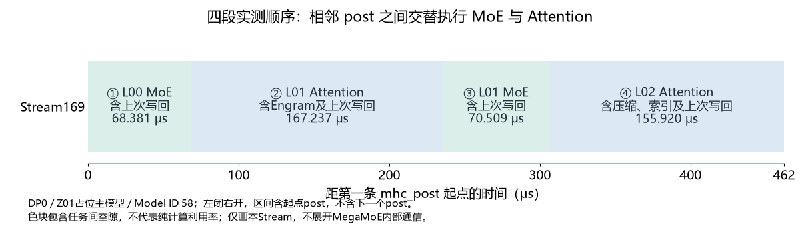

# 四个mhc_post间区间：逐算子读懂一次主模型执行

先纠正一个容易误读的地方：**相邻两次 `mhc_post_fwd_asc_kernel` 之间，通常只推进一个子层，不是完整一层。** 每层有Attention和MoE两个子层，所以post间区间会交替出现两种骨架；Engram、KV压缩和稀疏索引又会让部分Attention区间变长或多出算子。

## 就选截图附近这四段

下面以DP0第一条post为起点： **Stream169 / Model ID 58 / Task ID 33165 / 2.825 μs**，下面选择以它为起点的四个连续区间。核对时同时匹配这四项；查看器的光标读数不一定是事件起点。

这段属于71次清单里的 **#01 / Z01：`deepinfer:launch_forward_N1_B1`**，是占位主模型执行。可以学习主模型路径和层间差异，但其单行占位负载的耗时不能代表真实双请求decode。

打开 `continuous-dp0.json`，CPU线程698287，NPU进程715046336。在Stream169定位Task33165；其起点为 **DP0 scope +6.174221 ms**。下表+ms仍以 `capture:real_requests_prefill_through_completion` 起点为零；如果查看器原点不同，先用Task、Stream和Duration找到它，再把这个post的起点当作局部t=0。不要根据光标时间倒推统一偏移。



每段都包含左边的post，不包含右边下一条post。左边post写回的是**上一子层**，接着才准备、运行**当前子层**：

```text
post写回L00 Attention → L00 MoE
post写回L00 MoE      → L01 Engram + Attention
post写回L01 Attention → L01 MoE
post写回L01 MoE      → L02 KV压缩/索引 + Attention
```

因此，下面四段合计是两次MoE、两次Attention，跨L00～L02，不是四次完整模型推理，也不是四个完整层。


| 段 | +起止时间 ms | 局部t范围 μs | 区间长度 μs | kernel条数 | kernel累计 μs | 空隙 μs |
| --- | --- | --- | ---: | ---: | ---: | ---: |
| 1 | 6.174221～6.242602 | 0.000～68.381 | 68.381 | 10 | 67.683 | 0.698 |
| 2 | 6.242602～6.409839 | 68.381～235.618 | 167.237 | 21 | 166.775 | 0.462 |
| 3 | 6.409839～6.480348 | 235.618～306.127 | 70.509 | 10 | 69.811 | 0.698 |
| 4 | 6.480348～6.636268 | 306.127～462.047 | 155.920 | 32 | 155.215 | 0.705 |

空隙=区间长度−本Stream所列kernel的Duration之和；只描述这里的时间覆盖，不将空隙归因为某种等待。以下表格逐行按实际执行顺序排列，完整符号可复制搜索，所有事件都在Stream169。

## ① 写回L00 Attention，再做L00 MoE

先把L00的Attention输出写回四路主干，再读出一路，算MoE所需混合系数和输入Norm；Gate投影到384个逻辑专家并选Top6，MegaMoE执行专家计算。下一条post才负责写回这个MoE输出。

起点post Task **33165**，终点是下一条post Task **33176** 的开始；后者不计入本表。

| Task ID | 完整算子名 | +起止时间 ms | 耗时 μs | 在做什么 |
| ---: | --- | --- | ---: | --- |
| 33165 | `mhc_post_fwd_asc_kernel` | 6.174221～6.177046 | 2.825 | 将L00 Attention的输出写回四路主干；开启本次观察的第一段 |
| 33166 | `mhc_pre_apply_mix_fwd_asc_kernel` | 6.177068～6.179545 | 2.477 | 用传入的混合系数，把四路主干读成一路[1,5120]，供当前子层使用 |
| 33167 | `tf32_hc_prenorm_gemm_kernel_kernel` | 6.179567～6.187862 | 8.295 | 从四路主干计算混合系数的中间结果；不是Attention投影 |
| 33168 | `mhc_reduce_partials_and_rmsnorm_fwd_asc_kernel` | 6.187884～6.190268 | 2.384 | 合并系数计算的分块结果，并结合RMS归一化 |
| 33169 | `mhc_pre_split_mixes_fwd_simd_mhc4_asc_kernel` | 6.190290～6.192865 | 2.575 | 拆出读出、写回、残差路间混合等系数，并应用对应参数 |
| 33170 | `mhc_sinkhorn_fwd_asc_kernel` | 6.192887～6.196694 | 3.807 | 迭代归一化4×4残差混合矩阵，约束四路之间的混合 |
| 33171 | `_norm_kernel` | 6.196716～6.200749 | 4.033 | 对子层的一路输入做RMSNorm，按配置准备后续计算的数据格式 |
| 33172 | `_ZN9deep_gemm14bf16_gemm_implILNS_5MajorE0ELS1_0ELj0ELj384ELj5120ELj16ELj16ELj2048ELj16ELj16ELj1024ELj5ELj2ELj1ELj32EL22asc_load_l2_cache_mode0ELS2_4EL23asc_store_l2_cache_mode4ELb0ELNS_8GemmTypeE0EfNS_8epilogue9operators8IdentityELj256ELb1ELb1ELb0EEEvNS_6gm_ptrIu6__bf16XT_EEENS8_Iu6__bf16XT0_EEENS8_IT19_LS1_0EEEjjjPijNS5_4ArgsE` | 6.200772～6.204837 | 4.065 | Gate GEMM：[1,5120]投影到[1,384]，计算逻辑专家分数 |
| 33173 | `moe_topk_gate_forward_kernel_asc_kernel` | 6.204859～6.208617 | 3.758 | 从384个逻辑专家中选Top6，得到专家ID与权重；不是选词表token |
| 33175 | `_ZN9deep_gemm8mega_moe13mega_moe_implILj16ELj416ELj1ELj512ELj6ELj5120ELj2304EEEvPu6__bf16PiPKhPKsS5_S7_S5_S7_S5_S7_jfNS_6layout9SymBufferILj256EEE` | 6.209116～6.242580 | 33.464 | MegaMoE：Top6路由的分发、两次专家GEMM、中间激活、汇聚及共享专家路径 |

这一段只有10条kernel。耗时较长的是MegaMoE的33.464 μs；最开头的post只占2.825 μs，它本身并不执行专家计算。

## ② 写回L00 MoE，再做L01 Engram＋Attention

先写回L00 MoE。进入L01时额外消费已预取的Engram特征：先投影，再门控注入主干，然后才做mHC读出、Attention投影、核心计算及输出投影。本段没有再做一次Engram hash/fetch。

起点post Task **33176**，终点是下一条post Task **33197** 的开始；后者不计入本表。

| Task ID | 完整算子名 | +起止时间 ms | 耗时 μs | 在做什么 |
| ---: | --- | --- | ---: | --- |
| 33176 | `mhc_post_fwd_asc_kernel` | 6.242602～6.245393 | 2.791 | 将L00 MoE的输出写回四路主干 |
| 33177 | `_ZN9deep_gemm13fp8_gemm_implILNS_5MajorE0ELS1_0ELj0ELj25600ELj6144ELj16ELj416ELj256ELj16ELj208ELj128ELj4ELj2ELj11ELj2ELj4ELj32EL22asc_load_l2_cache_mode0ELS2_4EL23asc_store_l2_cache_mode4ELb0ELNS_8GemmTypeE0Eu9__fp8e4m3u6__bf16NS_8epilogue9operators8IdentityELj256ELb0ELb1EEEvNS_6gm_ptrIT21_XT_EEENS8_IS9_XT0_EEEPsSC_NS8_IT22_LS1_0EEEjjjPijNS5_4ArgsE` | 6.245415～6.299982 | 54.567 | Engram投影：6144维表项特征投影到25600=5×5120维，再交给gate注入 |
| 33178 | `engram_gate_fwd_kernel_asc_kernel` | 6.300004～6.303682 | 3.678 | 根据门控把Engram投影特征注入四路主干 |
| 33179 | `mhc_pre_apply_mix_fwd_asc_kernel` | 6.303704～6.306390 | 2.686 | 用传入的混合系数，把四路主干读成一路[1,5120]，供当前子层使用 |
| 33180 | `tf32_hc_prenorm_gemm_kernel_kernel` | 6.306412～6.315102 | 8.690 | 从四路主干计算混合系数的中间结果；不是Attention投影 |
| 33181 | `mhc_reduce_partials_and_rmsnorm_fwd_asc_kernel` | 6.315124～6.317237 | 2.113 | 合并系数计算的分块结果，并结合RMS归一化 |
| 33182 | `mhc_pre_split_mixes_fwd_simd_mhc4_asc_kernel` | 6.317259～6.319885 | 2.626 | 拆出读出、写回、残差路间混合等系数，并应用对应参数 |
| 33183 | `mhc_sinkhorn_fwd_asc_kernel` | 6.319907～6.323747 | 3.840 | 迭代归一化4×4残差混合矩阵，约束四路之间的混合 |
| 33184 | `_norm_kernel` | 6.323769～6.327655 | 3.886 | 对子层的一路输入做RMSNorm，按配置准备后续计算的数据格式 |
| 33185 | `_ZN9deep_gemm13fp8_gemm_implILNS_5MajorE0ELS1_0ELj0ELj1792ELj5120ELj16ELj64ELj512ELj16ELj64ELj256ELj4ELj2ELj10ELj2ELj1ELj32EL22asc_load_l2_cache_mode0ELS2_4EL23asc_store_l2_cache_mode4ELb0ELNS_8GemmTypeE0Eu9__fp8e4m3u6__bf16NS_8epilogue9operators8IdentityELj256ELb1ELb1EEEvNS_6gm_ptrIT21_XT_EEENS8_IS9_XT0_EEEPsSC_NS8_IT22_LS1_0EEEjjjPijNS5_4ArgsE` | 6.327677～6.333602 | 5.925 | 联合投影：5120维输入得到1280维低秩Q＋512维滑动窗口KV，共1792维 |
| 33186 | `_fused_norm_rope_hadamard_cast_store_kvcache_kernel` | 6.333624～6.336690 | 3.066 | 处理滑动窗口KV：按配置做Norm、RoPE、格式转换及缓存写入 |
| 33187 | `_norm_kernel` | 6.336712～6.339582 | 2.870 | 归一化1280维低秩Q，供Q_b投影使用 |
| 33188 | `_ZN9deep_gemm13fp8_gemm_implILNS_5MajorE0ELS1_0ELj0ELj32768ELj1280ELj16ELj512ELj256ELj16ELj256ELj128ELj3ELj2ELj5ELj2ELj4ELj32EL22asc_load_l2_cache_mode0ELS2_4EL23asc_store_l2_cache_mode4ELb0ELNS_8GemmTypeE0Eu9__fp8e4m3u6__bf16NS_8epilogue9operators8IdentityELj256ELb1ELb1EEEvNS_6gm_ptrIT21_XT_EEENS8_IS9_XT0_EEEPsSC_NS8_IT22_LS1_0EEEjjjPijNS5_4ArgsE` | 6.339604～6.357536 | 17.932 | Q_b投影：1280维低秩Q展开为64×512=32768维主Attention Query |
| 33189 | `_fused_norm_rope_hadamard_cast_store_kvcache_kernel` | 6.357558～6.360238 | 2.680 | 处理主Attention的Q：按配置做Q归一化、RoPE及格式转换 |
| 33190 | `_ZN6ascend7prefill10sparse_fwd22sparse_attn_fwd_kernelINS1_6KernelIXtlNS1_6ConfigEL17SparseAttnFwdMode1ELj64ELj640ELb1EEEEEEEvNT_6ParamsENS7_9AuxParamsE` | 6.360260～6.366420 | 6.160 | L01 Attention核心：用Query读取允许访问的上下文，并对Value加权汇聚 |
| 33191 | `_rope_kernel_kernel` | 6.366442～6.369088 | 2.646 | 对Attention输出的旋转维做逆向RoPE，随后进入输出投影 |
| 33192 | `per_token_cast_kernel_kernel` | 6.369110～6.373030 | 3.920 | 把Attention上下文逐token转换为FP8及缩放因子，供分组输出投影使用 |
| 33193 | `_ZN9deep_gemm12transform_sfILb0ELNS_5MajorE0ELj128ELj128ELNS_8GemmTypeE3ELj64ELj256ELj1EL22asc_load_l2_cache_mode4EL23asc_store_l2_cache_mode0EEEvNS_6gm_ptrINSt11conditionalIXT_EjtE4typeEXT0_EEEPtPijjjjjj` | 6.373052～6.375078 | 2.026 | 把FP8缩放因子SF重排为分组GEMM需要的布局；不做一次新的特征投影 |
| 33194 | `_ZN9deep_gemm13fp8_gemm_implILNS_5MajorE0ELS1_0ELj0ELj1024ELj4096ELj16ELj256ELj512ELj16ELj256ELj128ELj3ELj2ELj8ELj2ELj1ELj32EL22asc_load_l2_cache_mode0ELS2_4EL23asc_store_l2_cache_mode4ELb0ELNS_8GemmTypeE3Eu9__fp8e4m3u6__bf16NS_8epilogue9operators8IdentityELj256ELb0ELb0EEEvNS_6gm_ptrIT21_XT_EEENS8_IS9_XT0_EEEPsSC_NS8_IT22_LS1_0EEEjjjPijNS5_4ArgsE` | 6.375100～6.389007 | 13.907 | 分组输出投影Wv：每组4096维上下文投影到1024维，8组共8192维 |
| 33195 | `per_token_cast_kernel_kernel` | 6.389029～6.392598 | 3.569 | 把分组输出投影结果转换为最终输出投影需要的FP8格式 |
| 33196 | `_ZN9deep_gemm13fp8_gemm_implILNS_5MajorE0ELS1_0ELj0ELj5120ELj8192ELj16ELj160ELj256ELj16ELj160ELj128ELj4ELj2ELj32ELj2ELj1ELj32EL22asc_load_l2_cache_mode0ELS2_4EL23asc_store_l2_cache_mode4ELb0ELNS_8GemmTypeE0Eu9__fp8e4m3u6__bf16NS_8epilogue9operators8IdentityELj256ELb1ELb1EEEvNS_6gm_ptrIT21_XT_EEENS8_IS9_XT0_EEEPsSC_NS8_IT22_LS1_0EEEjjjPijNS5_4ArgsE` | 6.392620～6.409817 | 17.197 | 最终输出投影Wo：8192维合并投影回5120维主干宽度 |

这一段有21条kernel。Engram投影单独用了54.567 μs，随后才进入Attention路径；Q_b、Wv和Wo又是不同的GEMM。不要把所有名字含 `deep_gemm` 的条都认成MegaMoE。

## ③ 写回L01 Attention，再做L01 MoE

与第一段属于同一类MoE子层路径，作用相同，参数和输入内容属于L01；这次各kernel的Duration与L00略有不同。

起点post Task **33197**，终点是下一条post Task **33208** 的开始；后者不计入本表。

| Task ID | 完整算子名 | +起止时间 ms | 耗时 μs | 在做什么 |
| ---: | --- | --- | ---: | --- |
| 33197 | `mhc_post_fwd_asc_kernel` | 6.409839～6.412795 | 2.956 | 将L01 Attention的输出写回四路主干 |
| 33198 | `mhc_pre_apply_mix_fwd_asc_kernel` | 6.412817～6.415383 | 2.566 | 用传入的混合系数，把四路主干读成一路[1,5120]，供当前子层使用 |
| 33199 | `tf32_hc_prenorm_gemm_kernel_kernel` | 6.415405～6.423868 | 8.463 | 从四路主干计算混合系数的中间结果；不是Attention投影 |
| 33200 | `mhc_reduce_partials_and_rmsnorm_fwd_asc_kernel` | 6.423890～6.426476 | 2.586 | 合并系数计算的分块结果，并结合RMS归一化 |
| 33201 | `mhc_pre_split_mixes_fwd_simd_mhc4_asc_kernel` | 6.426498～6.429205 | 2.707 | 拆出读出、写回、残差路间混合等系数，并应用对应参数 |
| 33202 | `mhc_sinkhorn_fwd_asc_kernel` | 6.429227～6.432533 | 3.306 | 迭代归一化4×4残差混合矩阵，约束四路之间的混合 |
| 33203 | `_norm_kernel` | 6.432555～6.435679 | 3.124 | 对子层的一路输入做RMSNorm，按配置准备后续计算的数据格式 |
| 33204 | `_ZN9deep_gemm14bf16_gemm_implILNS_5MajorE0ELS1_0ELj0ELj384ELj5120ELj16ELj16ELj2048ELj16ELj16ELj1024ELj5ELj2ELj1ELj32EL22asc_load_l2_cache_mode0ELS2_4EL23asc_store_l2_cache_mode4ELb0ELNS_8GemmTypeE0EfNS_8epilogue9operators8IdentityELj256ELb1ELb1ELb0EEEvNS_6gm_ptrIu6__bf16XT_EEENS8_Iu6__bf16XT0_EEENS8_IT19_LS1_0EEEjjjPijNS5_4ArgsE` | 6.435701～6.439533 | 3.832 | Gate GEMM：[1,5120]投影到[1,384]，计算逻辑专家分数 |
| 33205 | `moe_topk_gate_forward_kernel_asc_kernel` | 6.439555～6.443125 | 3.570 | 从384个逻辑专家中选Top6，得到专家ID与权重；不是选词表token |
| 33207 | `_ZN9deep_gemm8mega_moe13mega_moe_implILj16ELj416ELj1ELj512ELj6ELj5120ELj2304EEEvPu6__bf16PiPKhPKsS5_S7_S5_S7_S5_S7_jfNS_6layout9SymBufferILj256EEE` | 6.443625～6.480326 | 36.701 | MegaMoE：Top6路由的分发、两次专家GEMM、中间激活、汇聚及共享专家路径 |

这一段同样10条kernel，顺序与第一段一致；MegaMoE为36.701 μs。两次时长差异是测量事实，但这份普通kernel trace不能继续定位其内部Dispatch/GEMM/Combine各贡献多少。

## ④ 写回L01 MoE，再做L02压缩/索引＋Attention

本层Attention除滑动窗口路径，还生成、压缩主KV，并通过索引器为历史位置评分、做TopK和地址转换，再执行Attention核心。这里的TopK选历史位置，第二、四段的Attention不是相同配置的机械重复。

起点post Task **33208**，终点是下一条post Task **33240** 的开始；后者不计入本表。

| Task ID | 完整算子名 | +起止时间 ms | 耗时 μs | 在做什么 |
| ---: | --- | --- | ---: | --- |
| 33208 | `mhc_post_fwd_asc_kernel` | 6.480348～6.483255 | 2.907 | 将L01 MoE的输出写回四路主干 |
| 33209 | `mhc_pre_apply_mix_fwd_asc_kernel` | 6.483277～6.485466 | 2.189 | 用传入的混合系数，把四路主干读成一路[1,5120]，供当前子层使用 |
| 33210 | `tf32_hc_prenorm_gemm_kernel_kernel` | 6.485488～6.493942 | 8.454 | 从四路主干计算混合系数的中间结果；不是Attention投影 |
| 33211 | `mhc_reduce_partials_and_rmsnorm_fwd_asc_kernel` | 6.493964～6.495914 | 1.950 | 合并系数计算的分块结果，并结合RMS归一化 |
| 33212 | `mhc_pre_split_mixes_fwd_simd_mhc4_asc_kernel` | 6.495936～6.498525 | 2.589 | 拆出读出、写回、残差路间混合等系数，并应用对应参数 |
| 33213 | `mhc_sinkhorn_fwd_asc_kernel` | 6.498547～6.502099 | 3.552 | 迭代归一化4×4残差混合矩阵，约束四路之间的混合 |
| 33214 | `_norm_kernel` | 6.502121～6.506369 | 4.248 | 对子层的一路输入做RMSNorm，按配置准备后续计算的数据格式 |
| 33215 | `_ZN9deep_gemm14bf16_gemm_implILNS_5MajorE0ELS1_0ELj0ELj1056ELj5120ELj16ELj48ELj256ELj16ELj48ELj128ELj8ELj2ELj1ELj32EL22asc_load_l2_cache_mode0ELS2_4EL23asc_store_l2_cache_mode4ELb0ELNS_8GemmTypeE0EfNS_8epilogue9operators8IdentityELj256ELb1ELb1ELb0EEEvNS_6gm_ptrIu6__bf16XT_EEENS8_Iu6__bf16XT0_EEENS8_IT19_LS1_0EEEjjjPijNS5_4ArgsE` | 6.506391～6.512656 | 6.265 | 从当前输入联合投影主KV压缩所需分量与索引头权重，共1056维 |
| 33216 | `aclnnInplaceCopy_CastAiCore_Cast` | 6.512678～6.514267 | 1.589 | 将索引头权重分量转换为BF16，供后续索引评分使用 |
| 33217 | `_ZN9deep_gemm13fp8_gemm_implILNS_5MajorE0ELS1_0ELj0ELj1792ELj5120ELj16ELj64ELj512ELj16ELj64ELj256ELj4ELj2ELj10ELj2ELj1ELj32EL22asc_load_l2_cache_mode0ELS2_4EL23asc_store_l2_cache_mode4ELb0ELNS_8GemmTypeE0Eu9__fp8e4m3u6__bf16NS_8epilogue9operators8IdentityELj256ELb1ELb1EEEvNS_6gm_ptrIT21_XT_EEENS8_IS9_XT0_EEEPsSC_NS8_IT22_LS1_0EEEjjjPijNS5_4ArgsE` | 6.514289～6.520260 | 5.971 | 联合投影：5120维输入得到1280维低秩Q＋512维滑动窗口KV，共1792维 |
| 33218 | `_fused_norm_rope_hadamard_cast_store_kvcache_kernel` | 6.520282～6.523016 | 2.734 | 处理滑动窗口KV：按配置做Norm、RoPE、格式转换及缓存写入 |
| 33219 | `_norm_kernel` | 6.523038～6.525853 | 2.815 | 归一化1280维低秩Q，供主Attention与索引Query联合投影使用 |
| 33220 | `_ZN9deep_gemm13fp8_gemm_implILNS_5MajorE0ELS1_0ELj0ELj36864ELj1280ELj16ELj384ELj256ELj16ELj192ELj128ELj4ELj2ELj5ELj2ELj6ELj32EL22asc_load_l2_cache_mode0ELS2_4EL23asc_store_l2_cache_mode4ELb0ELNS_8GemmTypeE0Eu9__fp8e4m3u6__bf16NS_8epilogue9operators8IdentityELj256ELb1ELb1EEEvNS_6gm_ptrIT21_XT_EEENS8_IS9_XT0_EEEPsSC_NS8_IT22_LS1_0EEEjjjPijNS5_4ArgsE` | 6.525875～6.543205 | 17.330 | 联合Q_b投影：主Attention Query 32768维＋索引Query 4096维，共36864维 |
| 33221 | `_fused_norm_rope_hadamard_cast_store_kvcache_kernel` | 6.543228～6.545813 | 2.585 | 处理主Attention的Q：按配置做Q归一化、RoPE及格式转换 |
| 33222 | `_compress_and_update_state_decode_kernel` | 6.545835～6.549662 | 3.827 | 压缩本轮主KV并更新跨步压缩状态，第一段kernel |
| 33223 | `_compress_and_update_state_decode_kernel_1` | 6.549684～6.552081 | 2.397 | 同一次KV压缩/状态更新的后续kernel，不是第二次完整Attention |
| 33224 | `_fused_norm_rope_hadamard_cast_store_kvcache_kernel` | 6.552103～6.555595 | 3.492 | 对压缩主KV做Norm、RoPE和缓存格式转换/写入，并保留索引器需要的pre-RoPE值 |
| 33225 | `_fused_norm_rope_hadamard_cast_store_kvcache_kernel` | 6.555617～6.562066 | 6.449 | 对索引器Query做RoPE及低比特格式转换，为历史评分准备Query |
| 33226 | `_ZN9deep_gemm14bf16_gemm_implILNS_5MajorE0ELS1_0ELj0ELj128ELj512ELj16ELj16ELj512ELj16ELj16ELj256ELj8ELj2ELj1ELj32EL22asc_load_l2_cache_mode0ELS2_4EL23asc_store_l2_cache_mode4ELb0ELNS_8GemmTypeE0Eu6__bf16NS_8epilogue9operators8IdentityELj256ELb1ELb1ELb0EEEvNS_6gm_ptrIu6__bf16XT_EEENS8_Iu6__bf16XT0_EEENS8_IT19_LS1_0EEEjjjPijNS5_4ArgsE` | 6.562088～6.564314 | 2.226 | 索引Key投影KProject：主压缩KV的512维pre-RoPE特征投影到128维索引Key |
| 33227 | `_fused_norm_rope_hadamard_cast_store_kvcache_kernel` | 6.564336～6.567880 | 3.544 | 对投影后的索引Key做Norm、RoPE、量化并写入索引缓存 |
| 33228 | `_ZN9deep_gemm35paged_mqa_logits_metadata_simt_implILj512ELj2ELj32EEEvjPjS1_S1_` | 6.567902～6.571390 | 3.488 | 准备分页MQA索引评分的调度元数据；不是Attention结果 |
| 33229 | `aclnnInplaceCopy_TransposeAiCore_Transpose` | 6.571412～6.574093 | 2.681 | 为分页索引评分调整输入布局；不是新的数学投影 |
| 33230 | `_ZN9deep_gemm21paged_mqa_logits_implILb1ELj32ELj128ELj64ELj512ELj64ELj2ELj2ELj4ELj3ELj3ELb0EEEvjjmNS_6gm_ptrIhLNS_5MajorE0EEEPsS3_NS1_Iu6__bf16LS2_0EEES5_PjS6_S6_S6_` | 6.574115～6.577595 | 3.480 | 索引器分页MQA评分：计算当前Query对历史压缩位置的相关性分数 |
| 33231 | `_ZN18topk_select_ascend18topk_select_kernelIXtlNS_6ConfigELj512ELb1ELb1EEEEEv14TopkSelectArgs` | 6.577617～6.579138 | 1.521 | 索引TopK：选择要交给主Attention的历史位置；不是MoE专家Top6 |
| 33232 | `_convert_kv_index_kernel` | 6.579160～6.581944 | 2.784 | 把选中的历史位置转换为主Attention可使用的KV索引/缓存地址 |
| 33233 | `_ZN6ascend7prefill10sparse_fwd22sparse_attn_fwd_kernelINS1_6KernelIXtlNS1_6ConfigEL17SparseAttnFwdMode1ELj64ELj640ELb1EL9ModelType0ELS6_1EEEEEEEvNT_6ParamsENS8_9AuxParamsE` | 6.581966～6.593330 | 11.364 | L02 Attention核心：结合滑动窗口及压缩/筛选的历史KV，生成上下文 |
| 33234 | `_rope_kernel_kernel` | 6.593352～6.595609 | 2.257 | 对Attention输出的旋转维做逆向RoPE，随后进入输出投影 |
| 33235 | `per_token_cast_kernel_kernel` | 6.595631～6.599527 | 3.896 | 把Attention上下文逐token转换为FP8及缩放因子，供分组输出投影使用 |
| 33236 | `_ZN9deep_gemm12transform_sfILb0ELNS_5MajorE0ELj128ELj128ELNS_8GemmTypeE3ELj64ELj256ELj1EL22asc_load_l2_cache_mode4EL23asc_store_l2_cache_mode0EEEvNS_6gm_ptrINSt11conditionalIXT_EjtE4typeEXT0_EEEPtPijjjjjj` | 6.599549～6.601411 | 1.862 | 把FP8缩放因子SF重排为分组GEMM需要的布局；不做一次新的特征投影 |
| 33237 | `_ZN9deep_gemm13fp8_gemm_implILNS_5MajorE0ELS1_0ELj0ELj1024ELj4096ELj16ELj256ELj512ELj16ELj256ELj128ELj3ELj2ELj8ELj2ELj1ELj32EL22asc_load_l2_cache_mode0ELS2_4EL23asc_store_l2_cache_mode4ELb0ELNS_8GemmTypeE3Eu9__fp8e4m3u6__bf16NS_8epilogue9operators8IdentityELj256ELb0ELb0EEEvNS_6gm_ptrIT21_XT_EEENS8_IS9_XT0_EEEPsSC_NS8_IT22_LS1_0EEEjjjPijNS5_4ArgsE` | 6.601433～6.615242 | 13.809 | 分组输出投影Wv：每组4096维上下文投影到1024维，8组共8192维 |
| 33238 | `per_token_cast_kernel_kernel` | 6.615264～6.618821 | 3.557 | 把分组输出投影结果转换为最终输出投影需要的FP8格式 |
| 33239 | `_ZN9deep_gemm13fp8_gemm_implILNS_5MajorE0ELS1_0ELj0ELj5120ELj8192ELj16ELj160ELj256ELj16ELj160ELj128ELj4ELj2ELj32ELj2ELj1ELj32EL22asc_load_l2_cache_mode0ELS2_4EL23asc_store_l2_cache_mode4ELb0ELNS_8GemmTypeE0Eu9__fp8e4m3u6__bf16NS_8epilogue9operators8IdentityELj256ELb1ELb1EEEvNS_6gm_ptrIT21_XT_EEENS8_IS9_XT0_EEEPsSC_NS8_IT22_LS1_0EEEjjjPijNS5_4ArgsE` | 6.618843～6.636246 | 17.403 | 最终输出投影Wo：8192维合并投影回5120维主干宽度 |

这一段有32条kernel，比第二段多，但总区间155.920 μs反而小于第二段167.237 μs，因为它没有那次54.567 μs的Engram投影。这里索引TopK选的是历史位置，MoE Top6选的是专家，二者不能混淆。

## 为什么同名算子附近的顺序不同

1. **post是边界，不是层号。** 它将上一子层的一路输出和残差按混合系数写回四路主干；下一段可能准备MoE，也可能准备下一层Attention。
2. **mHC部分系数跨子层传递。** 本版本shifted路径先应用传入的读出系数，再计算要保存的系数。因此pre-apply出现在系数GEMM之前，并不表示数据依赖反了。
3. **层的功能不同。** L01额外插入Engram；L02额外压缩KV、准备索引Query/Key、评分、选历史位置。只有属于同一类子层、相同配置的区间才适合直接比较顺序。
4. **kernel名称可能是通用实现名。** 同名融合kernel在不同Task中分别处理SWA KV、主Q、压缩KV、索引Q/K，启用的Norm、RoPE、量化、写缓存选项也可能不同。表中的角色依据固定源码调用顺序推导；trace没有逐张量标签。Attention符号里含`prefill`的命名空间，也不代表这段实际在做prefill。

## 只做一次小核对

在Stream169搜索全名 `mhc_post_fwd_asc_kernel`，核对Task33165的Duration为2.825 μs。再依次找Task33176、33197、33208、33240：五个post框出四段，起点间距依次约 **68.381、167.237、70.509、155.920 μs**。

先认出第一、三段末尾的MegaMoE，再认出第二段的Engram、第四段的索引TopK。能指出这四个区别，再按表逐行看其他kernel即可。

[返回七步主手册](DeepInfer从Token到Token-逐步Trace对照与次数账本.md)；[73个算子的完整CSV](data/mhc-four-segments-shapes.csv)包含局部偏移、精确时间和解释；右侧终止post Task33240只作边界，不计入73条。

来源为DP0的Z01主模型片段，层号由固定源码与执行顺序对应；事件与时长直接来自trace。源码重点是`hc.py`的`_hc_fused_post_pre`/`_hc_pre`、`decoder_layer.py`的Engram钩子、`attn.py`的投影与压缩路径、`index_attn.py`的索引Q/K准备和TopK。版本553741557a57df44a46fb3ab72b6aafeaf945337；无新增NPU实验。
