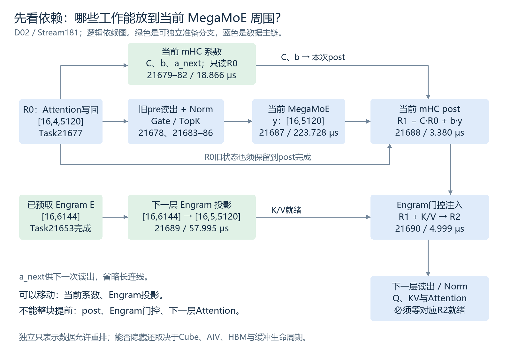
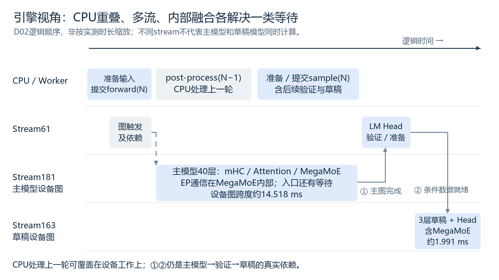
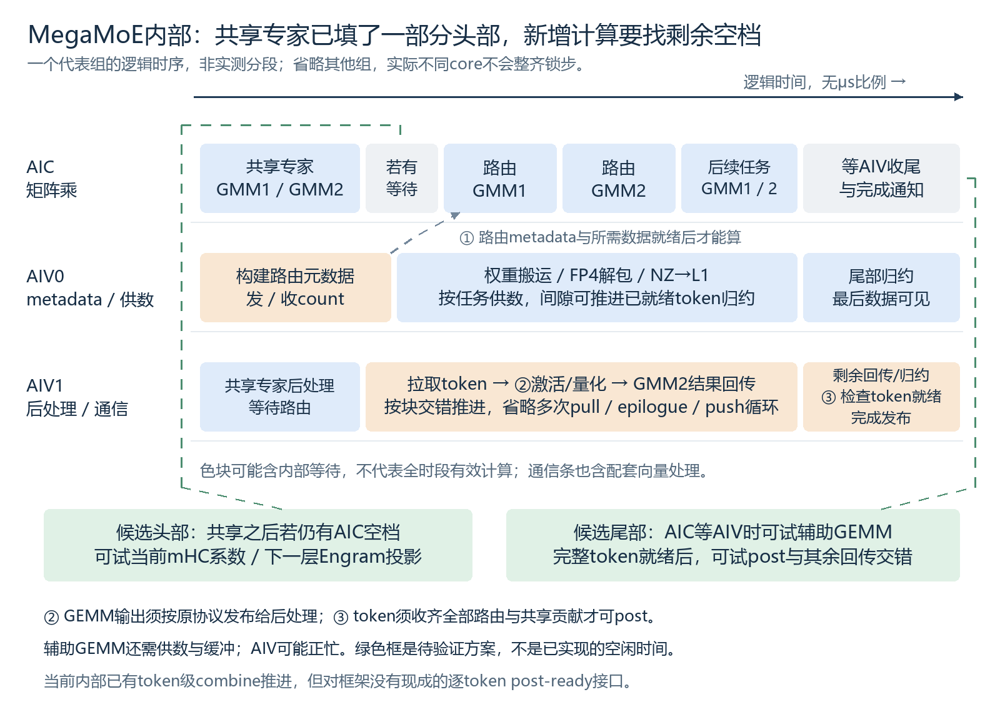

# MegaMoE通信头尾还能放什么计算：从算子依赖到推理引擎流水

2026-11-06。面向熟悉MegaMoE、正在阅读DeepInfer trace的同事。本文分析固定版本的昇腾实现，提出候选调度方案；没有修改模型或kernel，没有新增NPU实验。

## 一、问题：不能只问“哪个算子能融合”，要问“哪段资源空档能填什么”

设想是：MegaMoE中间的专家计算足以覆盖大部分通信，只剩启动和收尾两段暴露通信。把周边原本串行的计算放入这两个窗口，就可能缩短整层时间。

这个方向合理，但本次trace只能证明完整MegaMoE的Duration，不能直接证明它已经compute-bound、头尾各有多少纯通信时间。长条内部也有权重供数、格式转换、同步、路由不均衡。本文将“主体计算覆盖通信、存在头尾空档”作为待验证的工作假设。

**结论先说：优先研究当前mHC系数生成的延后、Engram投影的提前，以及token就绪后post的渐进消费。Gate和下一层Attention不能整块随意搬动。** 是否更快，要看全层关键路径，不看新kernel里塞了多少计算。

### 1.1 看一次真实调用，先把外围账本摆清楚

基线：DeepInfer `553741557a57df44a46fb3ab72b6aafeaf945337`；DeepGEMM-Ascend `3a35326271b069b8b5bf1a754435acd6cc91575b`。模型为V4.1-Flash，主模型40层、H=5120，mHC四路；DP2/CP8/EP16，DSpark最大5候选。本例为D02主模型，Stream181 / Model62，12个逻辑位置补齐为M=16。

Trace文件为`20261106_deepinfer_dp2_cp8_ep16_trace_continuous-dp0.json`，原名`continuous-dp0.json`。本次CPU范围名是`deepinfer:launch_forward_N2_B12`；同名调用会重复，用下面Task21687的时间定位这一轮。

所有`+ms`均相对`capture:real_requests_prefill_through_completion`起点。若查看器以文件最早事件为零点，加10.275189 ms。层号是源码与顺序重建，原始trace没有层ID。

| Task | 操作 | 区间+ms | Duration |
| --- | --- | --- | ---: |
| 21677～21678 | 上一Attention的mHC写回、当前MoE读出 | 2351.496606～2351.504242 | 两kernel共7.614 μs |
| 21679～21682 | 当前MoE的mHC系数投影、归一化、拆分、Sinkhorn | 2351.504264～2351.523196 | 共18.866 μs |
| 21683～21686 | 输入Norm、Gate、TopK、工作区清理 | 2351.523218～2351.542444 | 共19.160 μs |
| **21687** | **MegaMoE，含内部计算/通信/等待** | **2351.542466～2351.766194** | **223.728 μs** |
| 21688 | MoE的mHC post写回 | 2351.766216～2351.769596 | 3.380 μs |
| **21689** | **L01 Engram投影** | **2351.769618～2351.827613** | **57.995 μs** |
| 21690 | Engram门控注入 | 2351.827635～2351.832634 | 4.999 μs |
| 21691～21696 | L01 mHC读出、系数处理和Norm | 2351.832656～2351.865415 | 共32.649 μs |
| 21697～21707 | L01 Q/KV投影、SWA Attention、输出投影等 | 2351.865437～2351.958283 | 共92.625 μs |

区间长度与任务累计不是同一口径；分组Duration只加所列设备任务，含21686的`MEMSET_ASYNC`，微小任务间隙另算。完整名字、逐任务shape见[公开逐算子附录](https://zhaoyuhsin.github.io/downloads/deepinfer-inference-guide-20261102-operators.html#task-21677)，本地[逐任务数据](data/d02-neighbors.csv)保留21651～21751的完整名称和原始精度时间。shape由固定源码重建，并非profiler全部直接记录。

### 1.2 头尾不是一块免费资源

即使某时段以通信为关键路径，也不代表所有计算资源都空闲。要区分三类“通信”：

- **跨设备传输**：dispatch、结果返回、CP汇聚、Engram查表。
- **片内供数**：HBM→UB/L1、FP4解包、L1→Cube等；不是网络通信，却会占内存通路、向量核和缓冲。
- **控制与等待**：count交换、Event/Notify、barrier、可见性发布；有的等待计算，有的等待远端，不应全部计为通信字节时间。

MegaMoE的共享专家本来就不需要等待路由token收齐，源码优先安排共享GMM1/GMM2。因此启动段可能已有计算在覆盖通信，新增任务只能利用剩余空档。尾部的AIV也可能在处理结果、回传和归约，不是“Cube闲了，整个设备都闲了”。

## 二、数据依赖：独立任务可以重排，相关任务也能局部流水



图中是数据依赖，不是实测时间。蓝色为必须先生产数据的主链；绿色为可独立准备的分支；箭头不表示传输耗时。

### 2.1 用同一套符号描述当前层与下一层

令R0是Task21677写回后的四路状态，y是当前MegaMoE输出，E是Task21653已经预取的下一层Engram特征：

```python
# M=16, r=4, H=5120；伪代码只表达逻辑依赖
R0 = attention_post(...)                      # [M,4,H]
x = read_with_previous_pre(R0)                # [M,H]
C, b, a_next = generate_mhc_coefficients(R0)   # [M,4,4], [M,4], [M,4]
xn = rmsnorm_and_cast(x)
ids, weights = gate_and_topk(xn)
y = mega_moe(xn, ids, weights)                # [M,H]
R1 = C @ R0 + b[..., None] * y[:, None, :]     # [M,4,H]
kv_engram = project(E)                        # [M,5,H]，不依赖y或R1
R2 = engram_gate(R1, kv_engram)                # 必须使用更新后的R1
x_next = read_with_previous_pre(R2, a_next)
qkv_next = attention_projection(norm(x_next)) # 依赖当前MoE输出
```

`C @ R0`是每token的4×4残差混合；`generate_mhc_coefficients`里的大投影是`[M,20480] × [20480,24]`，两者不能混为一谈。当前post已将残差混合与写回融合为一个约3.38 μs的kernel。

### 2.2 哪些能搬到当前MegaMoE的头尾？

| 候选 | 与当前MegaMoE的依赖 | 最早可执行时刻 | 是否适合头尾窗口 |
| --- | --- | --- | --- |
| **当前层系数生成21679～21682** | 只读R0，不需要当前y；MoE的输入读出使用上一子层生成的pre | R0完成后 | **可延后**；只需赶在本层post使用前完成 |
| **下一层Engram投影21689** | 只读已取回的E，不需要当前y | Engram fetch完成后 | **可提前**；只需赶在Engram门控前完成 |
| post中的旧状态项`C @ R0` | 不需要y，但需要C | 系数就绪后 | 可预算；额外中间缓冲与读写可能抵消收益 |
| **完整post21688** | 需要本token完整的y及C、b | 本token的所有路由与共享贡献完成后 | 不能移到头部；可研究尾部逐token消费 |
| Engram门控21690 | 需要R1及Engram投影 | post与投影均完成后 | 只能随已就绪token推进，不能整块提前 |
| 下一层mHC系数21692～21695 | 需要Engram更新后的R2 | R2完成后 | **不能当成当前层的独立旁路** |
| 当前层Gate/TopK | dispatch需要它产出的专家ID和权重 | xn就绪后 | 不能整体后移到当前dispatch之后；分块生产是另一项协议改造 |
| 下一层Q/KV和Attention | 需要当前y经过写回、注入、读出后的x_next | 对应输入就绪后 | 不能整块塞进当前头部；细粒度流水另论 |

**独立任务能提前做；有依赖的任务也能在其所需数据局部就绪后做。** 判断条件不是“是否完全无依赖”，而是“所消费粒度的数据是否已完整、可见且不会被覆盖”。

无依赖只说明数据上允许重排，仍要满足资源和同步条件。例如Engram投影与MegaMoE没有输出依赖，但二者都用Cube和HBM；把它放到专家GEMM最忙的时候，可能只是让两个GEMM互相抢资源。

### 2.3 一个重要边界：收到部分专家结果，不等于token输出就绪

对于token t：

```text
该token选中的全部路由专家贡献 + 共享专家贡献
                      ↓ 全部到达、归约完成
                   完整y[t]
                      ↓
                   post[t]
```

某个专家的GMM2结束、某张卡完成回传，都不足以证明y[t]完整。本文建议的尾部post必须接在真实的token完成条件之后，不能仅凭“尾部开始了”就消费。某个token完成也不要求全batch所有token完成，这才是细粒度尾部流水的机会。

## 三、当前怎样掩盖：引擎、多流、融合kernel是三个层次



本图是逻辑顺序，不按时长缩放。主模型与草稿串行有数据依赖，位于不同stream不等于同时计算。

### 3.1 从请求到下一轮，哪些是计算、哪些是通信？

| 阶段 | 主要计算/内存操作 | 主要通信/同步 | 当前组织方式 |
| --- | --- | --- | --- |
| 调度与输入准备 | CPU排队、元数据、图输入更新 | 组级投票、CP输入广播、H2D | CPU与设备异步推进；元数据依赖仍需等待 |
| Embedding、Engram准备 | Gather、hash | Engram分片表项fetch | hash/fetch提前发起，后面到注入层才投影和门控；不等于fetch没有代价 |
| 每层mHC/Norm | 系数投影、归约、Sinkhorn、残差混合、量化 | 通常不是网络collective | NPU路径在本例中仍为多个kernel，主计算流顺序执行 |
| Attention输入与KV | Q/KV投影、RoPE、压缩、索引 | Prefill CP汇聚、必要barrier | 先发起部分KV通信，再进行Q计算，到消费者处等待；能否形成实测重叠取决于执行节奏 |
| Attention及输出 | SWA/稀疏Attention、输出投影、量化 | 读取本请求KV；本例decode不把每层Attention当成TP collective | 多数为本流计算与访存，不能统称通信 |
| Gate与MegaMoE | Gate、TopK、专家GMM1/激活/GMM2 | EP dispatch、结果回传、合并 | Gate/TopK在kernel外；MegaMoE内部多角色流水 |
| LM Head、验证 | 词表投影、采样、接受判断 | 必要的CP/采样数据广播、结果D2H | 主图完成后衔接到采样流 |
| DSpark草稿 | 3层草稿、LM Head、Markov顺序修正 | 草稿MoE内部EP，输入广播 | 自己的捕获图；依赖主模型验证/条件数据 |
| post-process与EPLB | CPU请求状态更新；周期性布局规划/权重搬运 | 输出同步；EPLB统计与权重交换 | CPU处理上一轮输出与当前forward交错；EPLB重排可成为额外长尾 |

这里的“通信”包含控制与数据两类，不能将Event WAIT或MODEL_WAIT_COMPLETE直接换算成链路传输时间。当前trace仅覆盖两个CP driver进程的设备视角，不是16卡全部核心的内部计时。

### 3.2 当前多流：Prefill的CP通信与Q计算

固定代码的Attention路径先发起`all_gather`，返回等待句柄，再计算Q，后面消费KV时才等待。这是可形成通信/计算重叠的组织方式；CP session中的缓冲有生命周期，不能跨下一次复用随意保留。

本次P01，主要计算在Stream61；L00 KV AllGather在Stream24，Task218152，+1306.374299 ms起、10.744 μs。L00 Q_b投影Task218155在约+1306.654 ms才开始，因此**这两个特定任务并没有形成时间重叠**。代码允许异步推进，不代表这份小负载eager trace已经充分利用重叠。

### 3.3 当前融合：MegaMoE内部不依赖多条框架stream

本实现以AIC负责矩阵乘，AIV0主要负责metadata和权重供数，AIV1主要负责epilogue及通信，尾部归约可由向量角色协作推进。32个AIC逻辑组和相应向量角色并不保证锁步，图中只画代表关系。



图中的头尾宽度、核心错位和候选槽位都是示意，**不是Task21687的内部实测分段**。AIC条中的共享任务表明头部并非天然全空；图没有给候选任务声明已实现的时间窗口。

现有代码已经做了三类覆盖：

1. 共享专家先计算，在路由metadata尚未完全就绪时提供独立工作。
2. GMM1/GMM2按任务推进，权重搬运、反量化、激活与回传交错，不是全阶段串行。
3. 条件满足时在push/pull、供数等循环中推进已就绪token的combine reduce，提前消化尾段，而非全部留到最后。

本次主模型接口容量为512行，`512×(6+1)×5120×2`为35 MiB，超过源码32 MiB阈值，启用了该版本的重叠reduce分支。这里用的是**编译容量**，不是实际16行；不能凭小batch就断言尾部归约完全串行。

### 3.4 当前CPU与NPU重叠：ZOS

CPU先提交forward(N)，随后处理上一轮结果post(N−1)，再准备并提交本轮采样。它隐藏的是部分CPU工作，不是把当前层缺失的专家结果“等没了”。

D02主图Stream181 / Model62为+2350.062110～2364.579766 ms，14.518 ms；主图结束至草稿开始的衔接区间为1.039 ms，其中Stream61相关kernel累计0.875 ms；草稿图Stream163 / Model56为+2365.618300～2367.608871 ms，约1.991 ms。它们构成请求级依赖链，不能因为stream不同就宣称主草稿并发。

主图入口约1.23 ms的Event/Notify等待在MegaMoE之外，不能把它当作Task21687可填充的通信头。相同地，P01的eager提交空隙和EPLB的数百毫秒重排也不是本项kernel头尾优化能直接消除的时间。

### 3.5 Prefill与decode：同样的MoE依赖，不同的优化重点

Prefill处理本轮输入的多位置，Attention还涉及CP汇聚；decode的主模型在验证候选位置，随后生成下一轮草稿。本次小请求prefill走eager，decode走固定规模设备图回放。回放减少CPU逐kernel提交负担，但不会消除设备侧的数据依赖和通信。

因此，prefill首先要分清CPU提交空隙、CP等待与真实计算；decode则更适合进一步查看设备图内连续执行的层间依赖。本文的两个可移动分支来自D02，依赖判断可复用，耗时和实际可隐藏比例都必须按各自M、路由和阶段重新测量。

## 四、三种改法：先证明有空档，再决定放在哪一层

### 4.1 候选A：将当前mHC系数生成从输入主链移出

当前是`读出 → 系数生成 → Norm → Gate → MegaMoE`。shifted mHC允许`读出 → Norm → Gate → MegaMoE`与`系数生成`分支，最终在post汇合。

```text
入口R0
 ├─ 旧pre读出 → Norm/Gate → MegaMoE ─┐
 └─ 系数投影/归一化/Sinkhorn ────────┤
                                    ↓
                                   post
```

这一点依赖本例启用的`hc_shifted`：若改成输入读出也使用本次新系数的非shifted版本，系数生成就是MoE输入的前置条件，不能照搬后移方案。

可以先做框架级双流原型，最少移动任务，保留MegaMoE；但先确认运行时允许这类kernel共驻。系数缓冲在post使用前必须就绪，不能被下一层复用。源码中的AIC执行完GEMM后仍在kernel内等AIV完成，**AIC在等待，不等于另一条stream能使用这段AIC时间**。若外部kernel不能共驻，应评估把系数投影tile纳入MegaMoE内部调度，剩余向量处理安排在确实可用的AIV时隙。

18.866 μs中，投影并统计平方和占9.561 μs，后面归约、拆分、Sinkhorn三个向量kernel共9.305 μs。因此不能只找到Cube空档，就认定整条系数分支都有地方放。

不能把整个18.866 μs先算成收益。TF32系数投影与FP8/FP4专家计算的布局、资源和模式切换不同，增加的供数或同步可能损害原流水。这里只是从依赖上证实“允许重排”。

### 4.2 候选B：把下一层Engram投影提到本层MegaMoE头尾

Engram特征E在Task21653已经fetch完成，投影21689无需等待y。因此它是本例最清楚的可提前大投影：`[16,6144] × [6144,25600]`，输出约0.819 MB的BF16特征供门控使用。

适合先尝试只提前一层的投影，避免同时预投影所有Engram层。只读E和常量权重，写独立结果缓冲，到Task21690前汇合。收益风险主要是Cube、HBM带宽、缓存污染与缓冲存活时间，而非数据正确性本身。

**多流和融合进MegaMoE不是同一件事：** 多流先证明该任务与MegaMoE共同运行是否值得；融合后才能明确给内部空闲AIC分配辅助tile，但需要新增参数、调度类别、供数布局和完成发布，不能把原GEMM入口直接嵌进去就称为融合。

只在L01、L14存在Engram，因此即使有效，也不能按40层外推收益。57.995 μs只是被搬动任务的基线Duration，不是已找到的通信空档长度。

### 4.3 候选C：在尾部逐token完成post，而非等待整个kernel返回

`C @ R0`可以提前准备，`b*y`必须等待y。比完全预算更直接的思路，是在combine reduce产出一个完整y[t]后，立即执行该token的post，让它与其他token尚未完成的通信交错。

```python
# 概念协议，不是当前源码可直接调用的API
pending = set(local_tokens)
while pending:
    for token in tuple(pending):
        if not all_required_contributions_visible(token):
            continue
        y = reduce_all_contributions(token)
        y = preserve_original_bf16_rounding(y)
        # b[token]: [4]；y: [H]；显式广播为[4,H]
        R_next[token] = residual_mix(C[token], R0[token]) + b[token, :, None] * y[None, :]
        publish_post_complete(token)  # 若后面存在细粒度消费者
        pending.remove(token)
```

当前kernel内部有token级reduce推进，但**对外接口仍是整个kernel结束后消费结果**，没有一个框架可直接等待的逐tokenpost完成接口。不能把概念协议写成已实现机制。

每token完整post不依赖其他token，但如果只就绪一个H维tile，接着做RMSNorm、Engram门控或下一层系数投影，可能还需等待同token其他H片段的归约。不能用“一个tile就绪”替代“整个token可继续下一层”。

风险：AIV本来在处理push/pull/归约，增加post可能拖慢通信；新输出和原residual不能发生读写覆盖；缓冲ready/释放需带正确epoch；保持BF16舍入、累加顺序与模型误差要求。若还要融合下一层读出/Norm，必须先明确完整隐藏维的完成边界。

本次post只有3.380 μs。单独取消边界的收益通常小；其意义主要是作为更长的`post→下一步读出/Norm`细粒度流水的起点，而不是为了把3 μs算子名字并入MegaMoE。

### 4.4 需要先画清楚的资源与缓冲契约

| 缓冲 | 生产者 → 消费者 | 必要完成条件 | 复用边界 |
| --- | --- | --- | --- |
| xn、专家ID/权重 | Norm/TopK → MegaMoE dispatch | 有效行、scale、索引都写完 | dispatch最后一次读取完成后；不能只等CPU提交返回 |
| C、b、a_next | mHC系数分支 → 当前post及下一读出 | 系数计算和写入对消费者可见 | 所有消费者读完后 |
| E | Engram fetch → 提前投影 | 当前层需要的表项完整到达 | 投影读取完成后，不能越过fetch缓冲复用 |
| Engram投影结果 | 辅助GEMM → 门控 | 所需K/V完整，格式正确 | 门控最后读取后 |
| y或其内部贡献缓冲 | 远端专家/共享专家 → reduce/post | 所选专家与共享贡献完整、发布可见 | reduce/post最后读取后 |
| R0 | 当前读出/系数/post → R1 | 每个读者所需数据存活 | 不能一边原地更新一边让系数GEMM读旧R0 |

当前Norm量化和TopK已可直接写MegaMoE输入缓冲，因此不能再把“删除一次不存在的普通拷贝”计为收益。调度移动还需检查捕获图的输入地址与事件依赖，不只检查Python引用。

## 五、如何判断有没有收益：测窗口，不从条宽猜

### 5.1 一个保守的收益账本

令X是原本串行的外围任务，W是它确实能使用的通信空档，δ是新增争用、调度、模式切换和同步开销。理想化地：

```text
净节省 ≈ 实际被隐藏的X时间 − δ
实际被隐藏时间 ≤ min(X可搬动部分, 满足依赖与资源条件的W)
```

这里W不是“所有通信时间之和”，也不是223.728 μs减去某个理论GEMM时间。头尾跨不同资源，且不同core进度不同，不能把所有核的等待累计相加。

增加一个长GEMM有可能让MegaMoE自身Duration变长，但整个`外围前置→MegaMoE→后处理`更短；也可能新融合kernel看起来更忙，整层反而更慢。验收看完整层、完整主模型和请求级延迟。

### 5.2 最小且有区分力的实验顺序

| 实验 | 只改变什么 | 要回答的问题 |
| --- | --- | --- |
| 基线内部时序 | 独立采样head、shared/routed GEMM、push/reduce与完成边界 | 头尾暴露的究竟是通信、供数还是不均衡？哪个资源真空闲？ |
| A：双流移动mHC系数 | 先确认共驻，再移动系数分支 | 能否实际并发？会不会延迟post？若无法共驻，不将串行结果当作内部融合无效的证据 |
| B：提前Engram投影 | 一次只移动这一项 | 58 μs能隐藏多少？是否拖慢专家GEMM或通信？ |
| C：内部插入辅助任务 | 只接入已通过A/B证明有价值的工作 | 内部调度是否比外部双流更稳定，新增协议代价多少？ |
| D：尾部post消费 | 保持同样路由与数值要求 | 有用的ready粒度是什么，AIV争用是否超过节省？ |

先使用本次M=16、EP16复现，再覆盖单请求图M=8、更多请求和更大prefill。记录实际有效行与图padding容量，使用真实路由，不把均匀路由当收益证明。后续扩大EP时重新验证碎片、通信拓扑和尾部，不外推EP16结果。

普通性能测量关闭额外timer，另采内部流水定位；报告rank-max、rank均值及具体口径，不能只取最快rank。正确性覆盖空专家、尾块、共享专家、EPLB布局变化、Engram层与非Engram层，以及捕获图反复回放。涉及精细ready发布时再采用低开销内部计时，不为测量额外增加全卡barrier。

## 六、回到引擎视角：应优先验证什么

这次目标不是继续压低孤立post的3 μs，而是给MegaMoE的一头一尾安排**依赖已满足、使用空闲资源、不会推迟关键消费者**的工作。

1. 当前mHC系数生成：覆盖多数MoE层，优先验证依赖重排和资源争用。
2. 下一层Engram投影：本例依赖最清楚、单次较大，适合作为调度原型；但只有两层适用。
3. 尾部post：单独收益空间小，适合作为更长尾部消费者链的接口探索。

引擎已有CPU/NPU异步、CP多流和MegaMoE内部融合三种覆盖方式，但它们掩盖不同的开销。多一个stream不等于多一份硬件资源；融合成一个kernel也不等于通信尾巴消失。应当先找到真实空档，再挑选满足依赖的工作，最后判断放在框架调度还是内部kernel更合适。

### 证据入口

- [DeepInfer固定版本：shifted mHC](https://github.com/deepseek-ai/DeepInfer/blob/553741557a57df44a46fb3ab72b6aafeaf945337/deepinfer/model_executor/models/v4_modules/hc.py)：`_hc_pre`、`_hc_fused_post_pre`。
- [Engram投影与门控](https://github.com/deepseek-ai/DeepInfer/blob/553741557a57df44a46fb3ab72b6aafeaf945337/deepinfer/model_executor/models/v4_modules/engram.py)：`Engram.forward`。
- [Attention的CP交错](https://github.com/deepseek-ai/DeepInfer/blob/553741557a57df44a46fb3ab72b6aafeaf945337/deepinfer/model_executor/models/v4_modules/attn.py)：`_prepare_swa_kv`及`_make_cp_gather_getter`调用。
- [输入缓冲直写](https://github.com/deepseek-ai/DeepInfer/blob/553741557a57df44a46fb3ab72b6aafeaf945337/deepinfer/model_executor/models/v4_modules/mlp.py)：`fused_norm_cast_kwargs`、gate的`out`。
- [CP生命周期](https://github.com/deepseek-ai/DeepInfer/blob/553741557a57df44a46fb3ab72b6aafeaf945337/deepinfer/model_executor/parallel_utils/cp.py)、[ZOS worker](https://github.com/deepseek-ai/DeepInfer/blob/553741557a57df44a46fb3ab72b6aafeaf945337/deepinfer/worker/worker.py)。
- [MegaMoE固定版本流水](https://github.com/deepseek-ai/DeepGEMM-Ascend/blob/3a35326271b069b8b5bf1a754435acd6cc91575b/deep_gemm/include/deep_gemm/mega_moe.hpp)：`aic_gemm_pipeline`、`aiv0_weight_pipeline`、`aiv1_epilogue_comm`、`advance_combine_reduce`。
- [共享专家优先与路由任务调度](https://github.com/deepseek-ai/DeepGEMM-Ascend/blob/3a35326271b069b8b5bf1a754435acd6cc91575b/deep_gemm/include/deep_gemm/scheduler/mega_moe.hpp)。
- [evidence.json](evidence.json)记录源码哈希和trace身份；[d02-neighbors.csv](data/d02-neighbors.csv)包含本段完整kernel符号。图是逻辑示意，表中时间来自既有trace。当前没有头尾分段计时、融合候选或性能收益实测。
