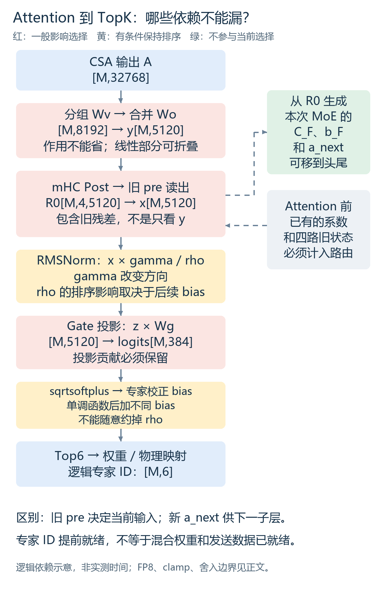
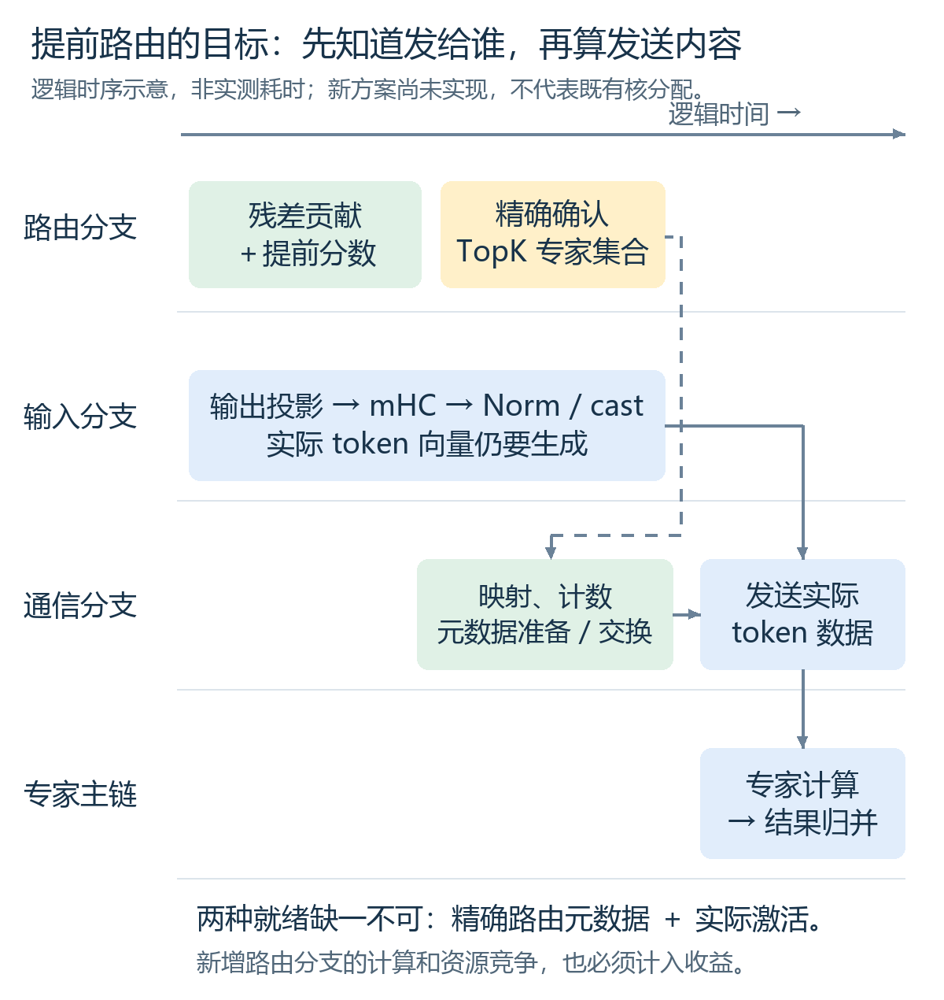
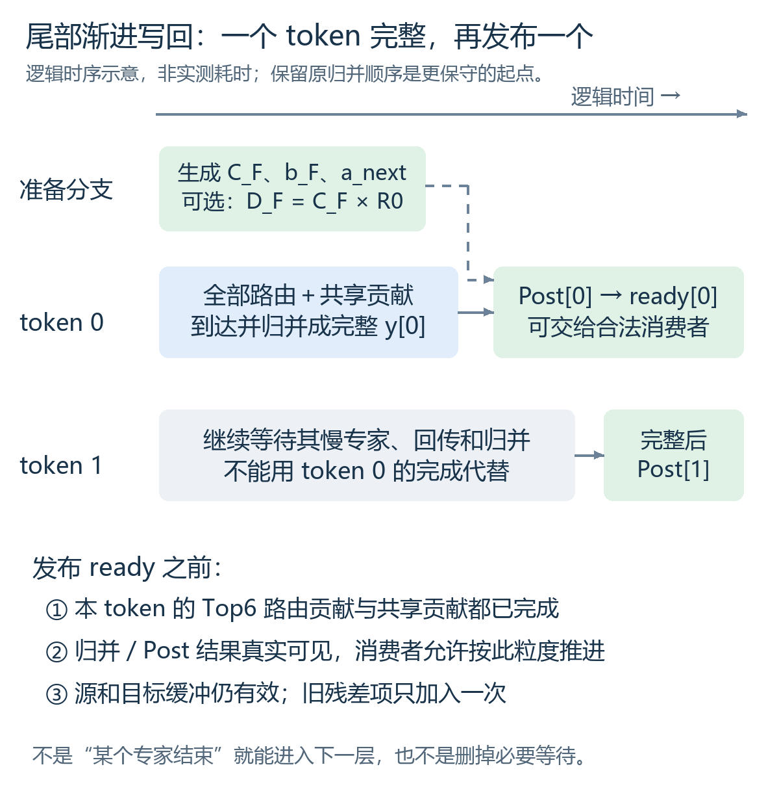

# MegaMoE头尾还能融合什么：从数据依赖到数学等价

2026-11-13，v2：补充逐步骤计算/通信预算、旧D02定位及稳态频次分析。面向熟悉 MegaMoE、希望进一步优化 DeepInfer 整层性能的同事。

**先给结论：既要寻找“已经独立的计算”，也要寻找“改写后能更早得到的中间结果”。** 前者已有 mHC 系数尾部融合的整网证据；后者包括提前累加 router 分数、提前确认专家集合、按 token 渐进写回。数学改写提供新的调度机会，但增加的计算、存储和舍入变化也必须算进账本。

本文回答三个问题：哪些计算能填 MegaMoE 头尾；Attention 到 TopK 的每一步能否移动或约简；接下来最值得验证什么。新增方案仅做了 CPU 数学检查，**没有新增 NPU 实现或性能实验**。

## 一、背景：先看清真正的输入和完成边界

### 1.1 优化的是完整子层，不是一个 kernel 的名字

MegaMoE 的主体包含 Dispatch、专家 GMM1、激活、GMM2、结果回传与归并。开头可能暴露元数据准备、交换和等待，末尾可能暴露回传、归并和慢 rank 拖尾。但这些时段不一定是“所有计算资源空闲”：共享专家、权重供数、量化及 AIV 归约可能已经在运行。

一次完整 MoE 子层可以概括为：

```text
四路状态 R0
 ├─ 旧 pre 读出 → RMSNorm → Router / TopK → MegaMoE → y
 └─ 生成本次 MoE 的 C_F、b_F、a_next
                    ↓
             Post → 四路状态 R1
```

设备侧主要比较边界应是：**相同输入及已有系数就绪 → R1 和 a_next 都能被消费者安全读取**。融合后 kernel 做的工作更多，不能只比较它与原 MegaMoE 的 Duration。

### 1.2 统一符号，区分三套连接系数

本文分析固定版本 DeepInfer `553741557a57df44a46fb3ab72b6aafeaf945337`，以及此前使用的 V4.1-Flash 配置；不是对未来版本所有模型的概括。

| 符号 | 含义与 shape |
|---|---|
| M | 当前 rank 的位置行数，可能含 padding；不是全局请求数，也不是单个专家的 token 数 |
| H、r、E、K | 隐藏维 5120、mHC 四路、384 个逻辑路由专家、Top6 |
| R旧、R0、R1 | Attention 前、Attention 写回后、MoE 写回后的状态，各 `[M,4,5120]` |
| A | CSA/Attention 输出完成对应位置变换后展平，示例 `[M,32768]` |
| U、y | 第一次输出投影后 `[M,8192]`；第二次后 `[M,5120]` |
| C_A、b_A、a_F | Attention 前已生成；前两者负责 Attention 写回，a_F 负责随后 MoE 输入读出 |
| C_F、b_F、a_next | 从 R0 生成；负责本次 MoE 写回和下一子层读出 |

本模型另有 32 个冗余物理槽及 1 个共享专家。**TopK 先选择逻辑专家；EPLB 映射再决定物理副本和发送位置。** 不能把 416 个物理槽当作 416 个独立的逻辑候选。

关键是 shifted mHC：**当前读出使用上一子层生成的 pre，而当前新生成的 a_next 供下一子层使用。** 非 shifted 配置需要重新检查，不能照搬本结论。[mHC 语义与实现](https://github.com/deepseek-ai/DeepInfer/blob/553741557a57df44a46fb3ab72b6aafeaf945337/deepinfer/model_executor/models/v4_modules/hc.py)



图中红色步骤一般会影响专家选择；黄色表示只在特定条件下保持排序；绿色分支不参与当前 TopK。图是逻辑依赖，不是按耗时缩放的 trace。

## 二、数据依赖视角：哪些计算能放进头尾

### 2.1 候选清单：可移动不等于一定更快

| 候选计算 | 最早可执行时刻 / 必须完成时刻 | 可放的位置与约束 | 当前证据 |
|---|---|---|---|
| **本次 MoE 的 mHC 系数生成** | R0 就绪 / 本次 Post 和后续读出使用前 | 头或尾都满足数据依赖；实际尾部避免与启动段争资源 | 已有本版本、小 M 的融合与整网验证 |
| **下一注入层 Engram 的 hash、fetch** | 当前有效 token ID 及请求历史确定后 / 对应层投影前 | 可提早；实现本就有统一 fetch，先确认是否还有可移动工作；通信可能与 EP 争带宽 | 源码允许，新增调度未验收 |
| **Engram 的 K/V 投影** | 对应 fetch 的真实数据可读取后 / 门控注入前 | 不依赖当前 MoE 输出，可放头尾剩余 Cube 空档；不能抢慢专家 GEMM | 源码和旧 trace 支持独立性，新增融合未实测 |
| **Post 旧状态项 D_F=C_F R0** | C_F 与 R0 就绪后 / 最终写回前 | 可先算，等 y 到来再加；额外缓冲和 HBM 往返可能不划算 | 数学候选 |
| **Post 完整写回** | 该 token 的 y 及 C_F、b_F 都就绪后 | 不能放头部；可在尾部按 token/合法片段渐进消费 | 已有批次尾部融合；更细粒度仍待实现 |
| **共享专家 FFN** | 当前归一化输入就绪后 / 与路由专家合并前 | 可覆盖部分 Dispatch 等待，但当前 MegaMoE 已融合共享路径；先检查已有调度 | 既有机制，不能重复计作新增收益 |
| **Norm、量化、Gate、TopK 的生产者融合** | 对应输入片段就绪后 / 发布路由与发送数据前 | 可减少启动和中间读写；它们本身仍是必需生产者，不会因融合就独立 | 当前已有部分 Norm/cast 融合；更大融合边界待测 |
| **当前路由元数据** | 精确专家 ID、有效行及物理映射确定后 | 可以与剩余输入计算重叠；完整 token 数据仍须等输入完成 | 新提前路由方案的目标 |
| **Engram 门控、下一层 Q/KV/Attention** | 当前 y 经 Post、必要 Engram 注入及读出后 | 不能整批提前；只能研究合法 token、KV 依赖及通信协议下的渐进流水 | 不是现成的独立旁路 |

这里的“融入”分两层：先用调度重排验证工作能否有效重叠，再考虑放进同一 kernel。只改成不同 stream，并不能证明设备资源真的并行。

### 2.2 mHC 和 Engram 到底包含什么

**mHC 系数生成**把 `R0[M,4,H]` 展平为 `T[M,20480]`。有效投影权重为 `[24,20480]`，并计算每行平方和：

$$
v_m=\left(20480^{-1}\sum_k T_{mk}^2+\epsilon\right)^{-1/2},\qquad p_m=(T_mW_c^T)v_m.
$$

然后按本模型参数拆成：

$$
a_{next}=\sigma(s_0p_{0:4}+\beta_{0:4})+\epsilon_{pre},\quad
b_F=2\sigma(s_1p_{4:8}+\beta_{4:8}),
$$

$$
C_F=\operatorname{Sinkhorn}\!\left(\operatorname{reshape}_{4\times4}(s_2p_{8:24}+\beta_{8:24})\right).
$$

Sinkhorn 是对正值矩阵进行交替归一化的迭代，具体初始化、epsilon 与次数必须沿用算子实现。上面保留函数边界，不把它错误简化成一次 softmax。这组结果共 `[M,24]` FP32；M=16 时只有 1.5 KiB，主要代价不是结果大小，而是投影、读入、归约与多次启动。[投影/RMS实现](https://github.com/deepseek-ai/DeepInfer/blob/553741557a57df44a46fb3ab72b6aafeaf945337/deepinfer/model_executor/models/v4_modules/mhc_ops.py)

**Engram**分成“与隐藏状态无关”和“有关”两段：

```text
token ID + 同请求历史 → n-gram hash → fetch → e[M,6144]
e × Wkv[6144,25600] → KV[M,5,5120]
                               ↓
                四份 key + 一份共享 value
当前四路状态 R → 归一化点积、门控 → R + gate × value
```

只有 hash、fetch、K/V 投影这一侧可提前。门控仍依赖真实 R；在下一层 Attention 入口注入时，它通常需要当前 MoE 的写回结果。M=16 时投影结果若以 BF16 保存约 0.781 MiB，提前量越大、同时在途层越多，生命周期成本越高。

原代码每个注入层从自己的投影参数计算 K/V；不能将不同层参数不同的投影当作一次共享计算。历史例子只有主模型 L01/L14 注入，也不是每层都有一份 Engram 可拿来填空。[Engram 投影与门控](https://github.com/deepseek-ai/DeepInfer/blob/553741557a57df44a46fb3ab72b6aafeaf945337/deepinfer/model_executor/models/v4_modules/engram.py)

### 2.3 旧 trace 能告诉我们多少

旧 D02 主模型例子为 M=16，`deepinfer:launch_forward_N2_B12`，设备 Stream181 / Model62。区间相对 `capture:real_requests_prefill_through_completion` 起点：

| Task | 完整名称或明确分组 | 区间 +ms | kernel 累计耗时 |
|---|---|---|---:|
|21679–21682|`tf32_hc_prenorm_gemm_kernel_kernel` → `mhc_reduce_partials_and_rmsnorm_fwd_asc_kernel` → `mhc_pre_split_mixes_fwd_simd_mhc4_asc_kernel` → `mhc_sinkhorn_fwd_asc_kernel`|2351.504264–2351.523196|18.866 μs|
|21687|MegaMoE，完整编译符号见逐算子附录|2351.542466–2351.766194|223.728 μs|
|21688|`mhc_post_fwd_asc_kernel`|2351.766216–2351.769596|3.380 μs|
|21689|下一层 Engram K/V 投影，完整 GEMM 符号见逐算子附录|2351.769618–2351.827613|57.995 μs|

它们说明外围工作存在，**不说明 18.866 或 57.995 μs 都能藏进头尾**。223.728 μs 也是完整 MegaMoE，不是纯专家计算或纯通信时间。形状是固定源码重建，不能假装是所有 profiler 事件直接记录的参数。[此前依赖分析](https://zhaoyuhsin.github.io/downloads/megamoe-head-tail-overlap-20261106.html)、[逐算子定位入口](https://zhaoyuhsin.github.io/downloads/deepinfer-inference-guide-20261102-operators.html#task-21677)

<!-- TRACE_COSTS_START -->
### 2.4 把候选变成账本：每步耗时、计算量和逻辑数据量

**这次补充同时用了两类 trace：** 旧 D02 的固定 M=16 片段用于唯一定位和 shape 预算；完整固定工作量实验的基线稳态 trace 用于检查频次和分布。两者 DP/CP、负载和窗口不同，不能互相相减当优化收益。

先统一单位：一次 MAC/FMA 记2 FLOPs，GFLOPs 为十亿次浮点运算，MiB=2²⁰字节。整数 hash、比较、cast、exp/log/sigmoid 与平方根另列，不硬凑成等成本 FLOPs。**逻辑数据量只按输入、输出和权重本体各一次计算，不是 HBM 实测流量**；缓存命中、重复供数、scale、对齐和临时缓冲会改变实际流量。

下表为旧 D02、Stream181 / Model62；起止时间沿用前表相对 capture 的 +ms。完整编译符号和逐任务区间可下载[明细 CSV](trace-cost-steps.csv)及[计算依据 JSON](trace-cost-analysis.json)。

| 步骤 / Task | 实测 μs | 计算量，M=16 | 逻辑激活读写 MiB | 权重本体 MiB | 本步骤跨卡通信 |
|---|---:|---|---:|---:|---|
|分组输出投影 Wv / 21674|14.815|1.073742 GFLOPs|0.7500|32.0000|0，局部计算|
|合并输出投影 Wo / 21676|19.271|1.342177 GFLOPs|0.2812|40.0000|0，局部计算|
|Attention mHC Post / 21677|4.742|0.003277 GFLOPs|1.4075|0.0000|0，局部计算|
|MoE pre 读出 / 21678|2.872|0.000655 GFLOPs|0.7815|0.0000|0，局部计算|
|mHC 投影＋平方和 / 21679|9.561|0.016384 GFLOPs|0.6265|1.8750|0，局部计算|
|Gate GEMM / 21684|5.924|0.062915 GFLOPs|0.1797|3.7500|0，局部计算|
|MoE mHC Post / 21688|3.380|0.003277 GFLOPs|1.4075|0.0000|0，局部计算|
|Engram K/V 投影 / 21689|57.995|5.033165 GFLOPs|0.8750|150.0000|0，局部计算|

几个容易误读的地方：Wv 仍保持8组，不计成稠密32768×8192；Gate 权重 BF16，其他表中大投影权重按该 trace 的 FP8 本体计；mHC 系数投影权重是 FP32。表中不含各 GEMM scale，不能用“权重本体÷Duration”直接宣称实测 HBM 带宽。小张量按缓存行搬运，重复加载和布局对齐都可能使物理流量超过逻辑量。

| 其余步骤 / Task | 实测 μs | 计算或逻辑量预算 | 跨卡通信 |
|---|---:|---|---|
|CSA / 21671|10.956|QKᵀ＋PV 约 `2×64×(512+512)×ΣL_t` FLOPs，另有 softmax；L_t 为每个有效 query 实际访问的 KV 数。缓存复用、有效窗口和压缩路径不齐，不能只用 Q shape 造一个精确流量。|该 Attention kernel 的本地 KV 读取不等于网络通信；CP 通信若在别处执行需另计|
|逆 RoPE / 21672|4.722|只处理旋转通道；算量取决于旋转维。完整 context 一次读写的上界口径约2 MiB，不能据此认定全部通道均被搬运。|0|
|context FP8 cast / 21673|4.224|归约、缩放和转换；BF16 输入＋FP8 输出＋packed scale 合计约1.5156 MiB。|0|
|U FP8 cast / 21675|4.724|同上，约0.3789 MiB；不能把格式准备完全漏在两次 matmul 之外。|0|
|系数 reduce / RMS / 21680|2.569|384个投影结果和16个平方和；语义最小读写约3.06 KiB。实现还可能写回中间副本，未含这些额外字节。|0|
|系数拆分 / 21681|2.565|128次 sigmoid 加 affine 等；逻辑输入输出和小参数约3.1 KiB。|0|
|Sinkhorn / 21682|4.171|约 O(T×16×4²) 的归一化，T 是实际迭代次数；输入输出共2 KiB。迭代通常在片内进行，不能将2 KiB乘 T 当 HBM 流量。|0|
|MoE Norm＋cast / 21683|5.762|RMS 主体约0.328 MFLOPs，另有rsqrt、max/转换；BF16输入/输出、FP8输出和scale约0.393 MiB，加gamma向量及实现临时量。|0|
|打分、TopK、映射 / 21685|6.222|处理6144个分数；至多同量级sqrtsoftplus，朴素6次扫描约36864次比较。logits、bias、ID/权重约26.6 KiB，另有布局映射与统计；实际比较网络不是朴素扫描。|选专家本身为0；产生后续通信元数据|
|进度清零 / 21686|1.252|trace没有记录清零字节数，不从1.252 μs反推容量。|0|
|Engram gate / 21690|4.999|约 O(MrH)，几 MFLOPs 加归约/门控；R、KV及更新R约2.031 MiB，加融合norm权重。完整注入仍需当前R就绪。|0|
|Token embedding / 21651|6.353|读选中行、写输出及ID约0.313 MiB；不读取整个词表，也不按整个词表记通信。|0，当前实现本地表|
|Engram hash / 21652|21.116|两处注入层合计产生768个int32地址；整数混合、取模，输出3 KiB加窗口/元数据读取。|0|
|Engram fetch / 21653|20.281|两层完整M16预算：768条表项，每条FP8数据256 B＋scale8 B，合计0.1934 MiB；源表读取和落地输出共约0.3867 MiB。无效地址跳过，实际有效量可能更小。|其中远端地址的有效读取；见下节，不能把全部落地写入也算成网络字节|
|MegaMoE / 21687|223.728|GMM1约4N_rHI，GMM2约2N_rHI；另加共享专家6N_sHI、激活、格式转换和归并。N_r是本rank实际收到的专家行数，不能直接代M=16。|Dispatch / 回传 / 元数据，须按实际路由计算|

CSA 的 L_t、Sinkhorn 的 T、旋转维和临时缓冲大小仍需配置/张量或专用计数器补齐。上表对缺失量保留公式，不将“待核实”伪装成0。21671的编译符号包含prefill，是kernel实现命名，不改变本文D02为decode的含义。跨卡列的0只指这个局部操作；**不代表整个 CP8 Attention 或整层没有通信**。

若仅作“16rank各有16个有效token且均匀路由”的参考，接收N_r≈96、共享N_s=16，路由GMM约6.795 GFLOPs、共享约1.132 GFLOPs，合计7.927 GFLOPs/rank。它不包含激活和padding，也不是下面自然路由的实测有效工作量。

### 2.5 跨卡通信量：写出有效载荷，保留未知的物理流量

设 u_r 是源rank有效token数，S_t 是其Top6物理专家槽；`owner(e)≠r` 的路由才跨rank。按每条专家路由单独传一份输入/结果的逻辑预算：

$$
B_{dispatch,r}=\sum_{t=1}^{u_r}\sum_{e\in S_t}\mathbf{1}[owner(e)\ne r]\,(H+H/32),
$$

$$
B_{return,r}=\sum_{t=1}^{u_r}\sum_{e\in S_t}\mathbf{1}[owner(e)\ne r]\,2H.
$$

此处FP8输入为5120 B，packed UE8M0 scale为160 B，每路合计5280 B；回传BF16结果10240 B。路由实现中的64-bit token/weight元数据每路再计8 B，另有count、ready和进度。M16输入ID/权重张量为1152 B，目标rank按16×26个int32保存接收计数需1664 B；**这些是布局/有效载荷大小，不是一次完整通信的物理字节数**。

| 参考场景 | Dispatch 输入＋scale | BF16回传 | 两者合计 |
|---|---:|---:|---:|
|假设单rank16个有效token、每token6路，先不扣本地路由|0.4834 MiB|0.9375 MiB|1.4209 MiB|
|再额外假设各rank均匀、本地概率1/16|0.4532 MiB|0.8789 MiB|1.3321 MiB|

**第二行是均匀分布参考，不是我们自然路由的测量。** 共享专家本地复制，不因此增加跨rank的专家权重广播；静态权重加载也不计入每次推理通信。链路包头、对齐、读请求、计数通知、交换机跳数、缓存命中、重试及可能的数据复用，都使物理流量不同；不能拿上述合计除kernel Duration当网络带宽。

Engram fetch 的编译模板包含 `hidden_bytes=256`、`sf_packs=4`，结合256维表项和int16 packed scale，可重建每条264 B；这比误按BF16查表估算更准确。两层M16完整有效量约0.1934 MiB，其中只有地址落在远端的部分涉及跨rank读取。源码为按地址读取共享内存，不应直接套 all-gather 的字节公式。

现有trace不带链路字节计数；自然路由账本记录目标专家接收计数，缺少完整逐token源→目标矩阵。因此本次可以重算逻辑算量和复制预算，**不能给出已经实测的头部/尾部跨卡字节数**。后续须补目标分布与链路PMU/计数器，且分清发送、接收、总和是否重复计数。

### 2.6 不只看一次调用：稳态中位数、频次和累计量

另从固定工作量基线 `fixed6-r01-57-a1-p0` 重读 rank0/rank2 的本地trace。筛选同一个 `replay:fixed-trace-c32:closed_loop:steady_scope`，只取主模型设备图decode：127轮×40层=5080个MoE子层；排除40层eager prefill和草稿FFN。完整文件名、SHA、示例Task/stream/相对scope时间在分析JSON中。

| 稳态步骤 | 次数/rank | rank0中位数 μs | rank2中位数 μs | rank2累计 ms |
|---|---:|---:|---:|---:|
|Wv|5080|13.716|14.443|73.224|
|Wo|5080|16.842|18.125|91.412|
|旧pre读出|5080|2.528|2.872|14.329|
|mHC投影＋平方和|5080|8.489|9.111|46.030|
|系数reduce/RMS|5080|2.354|2.392|11.845|
|系数拆分|5080|2.882|2.730|13.879|
|Sinkhorn|5080|3.673|3.785|19.408|
|MoE Norm/cast|5080|3.356|4.237|20.920|
|Gate GEMM|5080|3.972|4.510|22.721|
|打分/TopK/映射|5080|3.605|5.068|24.202|
|完整MegaMoE|5080|196.260|178.624|940.611|
|MoE Post|5080|2.855|2.968|15.036|
|整轮Engram hash|127|20.697|21.466|2.721|
|整轮Engram fetch|127|8.164|17.579|1.993|
|Engram投影（仅两层）|254|57.203|58.603|14.862|
|Engram门控（仅两层）|254|3.524|3.829|0.958|

四个系数kernel逐次加和再求中位数：rank0 **17.422 μs**，rank2 **17.937 μs**。不能把各行中位数简单相加冒充组中位数。rank2这组系数累计 **91.161 ms**，明显大于两处Engram投影的 **14.862 ms**。

这解释了一个重要取舍：**Engram一次约58 μs，比某个系数kernel长，但它每轮只有两次；mHC系数每层都有。** 单个很短的Post每层重复，累计量反而与两处Engram投影接近。优化收益必须同时看时长、频次和关键路径位置。累计kernel Duration只是工作量账本，有跨流重叠时不是墙钟分解。

这些不是shape完全相同的跨rank对照。rank0的127轮本地decode全部是占位；rank2有27轮占位、100轮真实decode，每轮真实6个query；它们仍参与全EP的专家计算。M16预算不能直接乘到所有稳态调用上。没有把两rank或A/B的不同请求拼成逐kernel收益比较。

再用全部16rank、40层、127轮的真实接收计数校验有效专家工作：

| 项目 | 从路由账本重算 |
|---|---:|
|样本数（rank×层×轮）|81280|
|全局有效query（127轮）|8010|
|每rank每层每轮接收专家行数：均值 / 中位数|23.652 / 21|
|接收专家行数：P95 / 最大值|47 / 110|
|每rank非空物理专家数：均值|10.182 / 26|
|仅有效路由GMM1＋GMM2：均值|1.674 GFLOPs|
|按专家行计的输入复制预算：均值|121.953 KiB|
|按专家行计的结果复制预算：均值|236.516 KiB|

以上复制预算尚未扣除本地路由，不是物理网络实测；有效GEMM算量不含共享专家、padding和内部tile扩展。每个物理专家三份FP4权重本体约16.875 MiB；若非空专家权重各读一次，按此平均非空数对应约171.8 MiB/rank/层/轮，另加scale。这仍是参数触达预算，实际HBM可能因缓存减少或供数重读而增加。它说明不能只用“网络payload不大”就判断kernel没有访存/供数压力。

### 2.7 据此修正优先级：先问能省多少，再问能否融合

1. **mHC系数仍是已证实有价值的候选**：约18 μs、每层重复，且不参与当前路由。它已在现有候选中融合，不能把这部分收益再计入下一方案。
2. **单独拆Post旧状态项应降优先级**：稳态Post约3 μs。即便全部消失，对约217 μs的单个FFN也只有约1.4%的理想幅度；拆分 `C_F R0` 在M16时至少增加0.625 MiB中间写入和0.625 MiB再读取，可能得不偿失。已有尾部融合不等于值得再拆一个kernel。
3. **Engram投影适合在注入层做局部试验**：约58 μs，但FP8权重本体150 MiB，只有两层；不能当作40层都存在的免费填充工作。优先验证是否增加HBM/Cube竞争，避免先做全模型复杂调度。
4. **Norm/Gate/TopK组合值得先做轻量边界优化**：稳态每项约3–5 μs、每层重复。先减少启动和中间logits的GM往返；它们位于路由前缀，仍需验证是否真正缩短关键路径。不要为隐藏十几微秒，新增远大于原Gate的投影而未计成本。
5. **hash/fetch应看整轮频次和带宽竞争**：hash约21 μs、fetch随rank变化，但每轮统一处理一次，不是每层一次。重排只能利用剩余空档；重复查表、重复hash是新增工作。

输出两次matmul在旧片段合计34.086 μs，连同两次cast约43.034 μs；这只是提前路由可能覆盖的输入生成区间的一部分，**不是已经暴露的通信头部时长**。必须有timer或真实完成事件，才能判断提前ID后还剩多少元数据等待能覆盖。仅凭kernel外观，不能给出头尾各多少纯通信时间。

把第三节的CSA后提前分数方案代入同一M16：`AP`约0.403 GFLOPs，残差分支还约0.063 GFLOPs；原Gate仅0.063 GFLOPs、旧例实测5.924 μs。原Wv/Wo仍需生成实际输入。这个比较不能预测新kernel耗时，但已足以要求先做新增工作量/资源竞争筛选，不能把43 μs输入生成时间全部计作净收益。

<!-- TRACE_COSTS_END -->

## 三、数学等价视角：能否让路由更早确定

### 3.1 按真实顺序逐步展开

以下采用行向量约定，批量时在最前面加 M。`影响 TopK` 指逻辑专家集合是否可能变化，不等于专家混合权重不变。

**步骤①：Attention 输出及两次投影。** 令 A 已经过源码要求的位置变换。第一次是分组线性变换，第二次合并到 H 维：

$$
U=AW_1,\qquad y=UW_2.
$$

示例 shape 是 `[M,8,4096] → [M,8,1024] → [M,8192] → [M,5120]`。W1 是 8 组 `[4096,1024]` 的块对角算子，W2 为 `[8192,5120]`。**不要真的把 W1 展开成稠密 `[32768,8192]`，那会破坏分组结构、增加八倍参数槽位。**

投影会影响 router 看到的方向，但纯线性部分可以尝试结合律重排。真实实现夹有逆 RoPE、FP8 cast 和可选 clamp，不能把它们当成两张固定矩阵一起消掉；逆 RoPE 可按已知位置处理，但不是所有位置共用同一固定变换。[输出投影代码](https://github.com/deepseek-ai/DeepInfer/blob/553741557a57df44a46fb3ab72b6aafeaf945337/deepinfer/model_executor/models/v4_modules/attn.py)

**步骤②：Attention 的 mHC Post。**

$$
R_{0,i}=\sum_j C_{A,ij}R_{旧,j}+b_{A,i}y.
$$

这一步将旧残差和 y 混合。只用 Attention 输出预测 router，会漏掉残差贡献；即使投影完全线性，也不能忽略它。

**步骤③：MoE 的 mHC Pre 读出。**

$$
x=\sum_i a_{F,i}R_{0,i},\qquad x:[M,H].
$$

四路权重会影响 x。这里用的是此前 Attention 子层生成的 a_F。与此同时，从 R0 新生成的 C_F、b_F、a_next 不参与当前 x，因而可以延后。

**步骤④：RMSNorm 与激活格式准备。**

$$
\rho(x)=\sqrt{H^{-1}\sum_hx_h^2+\epsilon},\qquad z_h=x_h\gamma_h/\rho(x).
$$

gamma 是逐通道权重，会改变方向；rho 是同一 token 所有通道共享的正数。router 使用 BF16 归一化输入；专家还需要对应的 FP8 激活及 scale。两条消费路径不能混为一谈。后面的 FP8 专家输入 cast 不用于决定 BF16 router 的专家集合，但它决定发送内容，不能省掉。

**步骤⑤：gating_proj。**

$$
\ell=zW_g,\qquad W_g:[H,E],\quad \ell:[M,384].
$$

定义固定 Q=`diag(gamma)Wg`，则在实数算术下 `ell=(xQ)/rho(x)`。gamma 可以折叠进 Q；这表示保留它的作用，不是说它无影响。

**步骤⑥：非线性打分与校正 bias。**

$$
f(t)=\sqrt{\log(1+e^t)},\qquad s_e=f(\ell_e)+\delta_e.
$$

f 单调递增。如果没有专家相关 bias，`TopK(f(ell))=TopK(ell)`。当前路径却有用于选择的校正 bias，必须比较整个 s。这里只讨论正常有限值；mask、并列规则、padding、文本/图像 bias 也须保持原契约。[Gate 参数](https://github.com/deepseek-ai/DeepInfer/blob/553741557a57df44a46fb3ab72b6aafeaf945337/deepinfer/model_executor/models/v4_modules/moe.py)、[路由调用](https://github.com/deepseek-ai/DeepInfer/blob/553741557a57df44a46fb3ab72b6aafeaf945337/deepinfer/model_executor/models/v4_modules/mlp.py)

**步骤⑦：选择、权重及物理映射。** 对有效位置：

$$
S=\operatorname{TopK}_e(s_e),\qquad
w_e=\lambda\frac{f(\ell_e)}{\sum_{j\in S}f(\ell_j)},\ e\in S.
$$

校正 bias 用于选专家，不把它直接加进最终混合权重。lambda 为模型的 routed scaling factor。随后按 EPLB 当前布局映射到物理槽。元数据提前发布需要准确的逻辑 ID、有效行、物理映射版本和计数，不只是一个未经确认的 TopK 猜测。

### 3.2 排序不变的条件：哪些能约掉，哪些不能

| 操作 | 专家集合是否一定不变 | 本链路能怎样利用 |
|---|---|---|
| 每个专家分数都加同一个数 | 直接取 TopK 时不变 | 专家不同的校正 bias 不属于这种情况 |
| 每个专家分数都乘同一个正数 | 直接取 TopK 时不变 | 若随后再加不同 bias，结论不再普遍成立 |
| 对分数施加同一严格单调函数 | 直接取 TopK 时不变 | 后面还有不同 bias，不能任意删除这个函数 |
| 按通道乘 gamma、混合四路残差 | 不保证 | 可折叠/展开，不能直接省略 |
| 连续固定线性映射用结合律合并 | 实数上等价 | 包含所有分支后才成立；量化、clamp、舍入另验 |
| TopK 后归一化选中专家权重 | 不再改变已经选中的 ID | 权重仍影响最终输出，可以与元数据准备区分 |
| 从 R0 生成本次 C_F、b_F、a_next | 不参与当前 TopK | shifted mHC 下的独立旁路 |

一个最小反例即可否定“rho 永远可以忽略”。取 q=`[2,1]`，校正 bias=`[0,0.1]`：

| q 的公共缩放 | `sqrtsoftplus(q)+bias` | Top1 |
|---|---|---|
|1|`[1.4584,1.2460]`|专家0|
|0.1|`[0.8934,0.9628]`|专家1|

另外，即使 bias 为零、专家 ID 不变，f 不是齐次函数，`normalize(f(q))` 与 `normalize(f(0.1q))` 仍可能不同。**提前确认专家 ID，不等于专家混合权重已经就绪。**

### 3.3 方案 A：把 mHC 展开，提前累加 router 分数

同事的 idea 提醒我们，不必等中间大张量全部物化才计算它的某个投影。把步骤②③展开，对每个 token 定义：

$$
\begin{aligned}
\beta_j&=\sum_i a_{F,i}C_{A,ij},\\
\alpha&=\sum_i a_{F,i}b_{A,i},\\
r_{eff}&=\sum_j\beta_jR_{旧,j}.
\end{aligned}
$$

得到：

$$
x=r_{eff}+\alpha AW_1W_2,
$$

$$
\boxed{q=xQ=r_{eff}Q+\alpha A\underbrace{(W_1W_2Q)}_{P}.}
$$

这说明 **mHC 没有自动否定线性改写，但必须把残差项和动态连接系数一起算进去**。C_A、b_A、a_F 已知后，残差贡献甚至可在 Attention 尚未结束时准备。Attention 贡献则等 A 就绪后用 P 投影。

一个较保守的起点是等第一次输出投影 U 就绪，再算：

$$
q=r_{eff}Q+\alpha U(W_2Q).
$$

这少争取了一段提前量，但新增矩阵更小。无论哪种，都还要解决 rho、BF16 归一化舍入和带 bias 的排序；它们目前是**候选分数生产方式，不是已实现的精确提前 TopK**。

**算一下新增成本，避免只看到“提前”。** 下表按本例维度、单 token、稠密乘加数计；不是设备时间预测：

| 路由分数分支 | 主要乘加数 / token | 新预合成矩阵的 BF16 存储 |
|---|---:|---:|
|原 router `xQ`|1,966,080|Q 约 3.75 MiB，可能替代原 gate 参数，取决于存储策略|
|CSA 后的 Attention 贡献 `AP`|12,582,912，约原 gate 的 6.4 倍|P 约 24 MiB/层；40层约 960 MiB|
|U 后的 Attention 贡献 `U(W2Q)`|3,145,728，约原 gate 的 1.6 倍|约 6 MiB/层；40层约 240 MiB|

后两行还没有算 `r_eff Q` 的约 1,966,080 次乘加、动态系数和尺度。**原两次输出投影仍需生成专家输入，不能从账本里删除。** 把四路各自投影再合并，也可能把一次 gate 变成四次。表中的 BF16 只是存储预算；采用此精度是否满足数值契约尚未验证。

### 3.4 方案 B：归一化尺度也能改写，但本 shape 不一定划算

不能说 rho 在数学上绝对要等完整 x 物化。令 U=`AW1`、G=`W2 W2^T`，有：

$$
\|x\|^2=\|r_{eff}\|^2
+2\alpha U(W_2r_{eff}^T)
+\alpha^2 UGU^T.
$$

这样可从 U、残差和预计算 Gram 矩阵求 rho，而不先输出完整 y。**但 G 是 `[8192,8192]`，FP32 为 256 MiB/层，40层约 10 GiB**；还增加每 token 的二次型及交叉项计算。本例 J 比 H 大，这通常不是一个自然省算的改写。二次型也可能出现消减误差，数值稳定性需额外检查。

只有实际权重存在可利用的精确结构、低成本分解，或某些矩阵乘被原流水免费复用时，才值得继续。截断 SVD 等近似不能叫原模型数学等价。

### 3.5 方案 C：不强求完整 logits 提前，先证明 TopK 集合已固定

如果能在输入尚未完全就绪时，获得**可靠的**尺度区间 `rho∈[L,U]`、`0<L≤U`，对于已准确得到的 q，可构造：

$$
l_e=\min\{f(q_e/L),f(q_e/U)\}+\delta_e,\quad
u_e=\max\{f(q_e/L),f(q_e/U)\}+\delta_e.
$$

对候选集合 S，若：

$$
\boxed{\min_{e\in S}l_e>\max_{e\notin S}u_e,}
$$

则区间内所有 rho 都得到同一个专家集合。此时可先做物理映射、计数和无需权重的元数据，精确混合权重稍后补齐。证书不成立就走原路径；不能把猜错后重新发通信当作免费回退。

还可研究将“选专家”和“算混合权重”分开：精确 ID 已确定后，保留原 Norm 路径，只计算选中6个专家的分数来生成权重，避免后续又完整执行384路 Gate。实数上成立，但专用小投影是否保持原累加/舍入仍要检查；现有同时消费 ID 和权重的通信接口也需要明确拆分，不能只改变 Python 调用顺序。

这是“求解完整分数”转成“证明选择结果已确定”的新方向，**但当前没有真实模型命中率或可用区间来源**。粗糙范数界可能几乎总回退；计算界的成本也可能超过省下的等待。真实实现还须把 q 的误差、量化、BF16 舍入和并列规则纳入区间。CPU 小例子通过不等于已有可用于发布通信的工程证书。

### 3.6 方案 D：不提前路由，也能缩短路由前缀

可以研究把输出投影的完成片段、mHC 写回/读出、平方和归约、Norm 与 Gate 组织为生产者流水，减少独立启动和中间 GM 往返。实数下可边生产 x 的通道块，边累加 `sum(x²)` 和 `xQ`，最后再除 rho、打分并 TopK。

不过原实现的 router 消费的是**逐通道归一化后舍入的 BF16 值**；先累计 `xQ` 再除 rho 会改变舍入位置，仍须验证。若要求严格保留原数值顺序，可先完整算 rho，再在融合 kernel 内逐块生成原 BF16 norm 值并喂给 Gate。这可能节省物化和启动，但不能声称提前知道 TopK。

两种改法要分别实验：一个改变数学求值顺序，一个仅改变存储和调度边界。



目标是先知道“发给谁”，与“算出要发的数据”并行。完整 Dispatch 不能只靠 ID；而原 Gate 若已经被前移分支替代，就不应再算一次充当所谓可隐藏工作。图中未给出实测头部窗口或核分配。

### 3.7 尾部也有数学机会：线性后处理可渐进推进

对一个 token，记完整 MoE 输出为：

$$
y=\sum_{e\in S}w_eF_e(z)+F_{shared}(z).
$$

Post 是：

$$
R_1=C_FR_0+b_Fy.
$$

分配律允许先算旧状态项，或对到达的专家结果逐项累加：

$$
R_1=\underbrace{C_FR_0}_{只加一次}
+\sum_{e\in S}b_Fw_eF_e(z)+b_FF_{shared}(z).
$$

**数学上可渐进累加，不代表任意部分到达就能让下一层消费。** 实际需确保该 token 全部路由贡献与共享贡献完成、结果可见，再发布 token-ready；不能把残差项按专家加 K 次。把 b_F 乘到远端专家结果还可能扩大通信或改变舍入，不能仅凭分配律就迁移物理实现。

更保守的方案是：保持原 Combine 求和顺序，某 token 的完整 y 就绪后立刻执行 Post，而其他 token 继续回传。若沿 H 分片，还要等待下一层 Norm 所需的全部通道平方和；逐 token 交接和逐通道交接不是同一个协议。



图只展示就绪关系。它不假设现有实现已经提供 token-ready 事件，也不代表可以删除全局协议规定的计数或缓冲释放条件。

### 3.8 同样的思路还能用于 Engram：查到一部分，就投影一部分

本例 Engram 特征由24个256维查表结果拼接。将投影矩阵按输入行拆成24块，可写成：

$$
e=\operatorname{Concat}(e_1,\ldots,e_{24}),\qquad
eW_{kv}=\sum_{j=1}^{24}e_jW_{kv,j},\quad W_{kv,j}:[256,25600].
$$

因此可以研究 fetch 与分组投影流水，而不一定等待完整6144维特征才启动投影。它的意义是把依赖粒度从“所有查表完成”降到“一个合适分组就绪”；代价是小 GEMM 启动、输出累加及缓存流量。工程上应先试少量分组，不能默认拆成24次最快。原量化和累加边界改变后，仍需数值验证。

另一个看似更激进的办法是预计算每个表项的 `e_j Wkv,j`。但同类型存储下，表项从256维变成25600维，扩大约100倍，而且不同注入层的投影不同。未经容量分析不能把这个“省计算”写成推荐方案；只有有限热点的受控缓存等条件成立时才值得单独评估。

## 四、证据、实验优先级与结论

### 4.1 已经验证的收益，和本文新方案分开

此前“本次 mHC 系数＋Post 尾部融合”在 16 NPU、EP16/DP16/CP1、固定256条公开 ShareGPT 请求的完整 A1→B1→B2→A2 中得到：

| 最大在途请求 | 原路径 token/s | 融合路径 token/s | 提升 |
|---:|---:|---:|---:|
|16|851.25|885.24|3.99%|
|32|1169.76|1213.03|3.70%|
|64|1455.85|1489.47|2.31%|

每版本两次独立初始化、每并发点各两遍，共24个全局正式窗口；实际容量、专家布局、完整输出 token ID 一致，正式窗口零 JIT。平均输入272.70、输出166.76 token，每遍42691个输出 token；输出既有自然 EOS 也有长度上限结束。它是直接调用引擎的固定工作闭环测试，不包含 HTTP、分词或网络。

此结果仅支持该负载、版本与小 M 生效范围；**不是本文提前路由、Engram 新调度或渐进写回的收益**。此前另一机器窗口的一对 A/B 接近持平；在线到达率完整 ABBA 未通过验收，不能宣称在线 SLO 收益。候选仍默认关闭。

### 4.2 这次实际补做的事情

附带 [CPU 验证脚本](verify_math.py) 和 [结果](math-checks.json)，使用固定随机种子，验证了：

1. 包含旧残差、动态 mHC 系数与 gamma 的投影展开，在 FP64 数值容差内一致。
2. 无 bias 时正缩放及单调函数保持排序；加选择 bias 后给出可复现反例。
3. 专家集合相同，不保证归一化后的专家混合权重相同。
4. gamma 和残差不能直接忽略；Gram 范数改写、Post 分配律、Engram 拼接投影的分解在小 shape 上成立。
5. 合成尺度区间的严格证书示例通过；同时提供证书无法确认的回退情形。
6. FP32 加法改变括号就可能不同，提醒“实数等价”和“逐位等价”不是同一验收。

这些检查用于排除推导错误，不测试真实模型权重、NPU 指令、同步、量化精度或性能。配图与本文也未启动或恢复资源轮询。

### 4.3 建议按这个顺序推进

| 优先级 | 最小实验 | 要回答的具体问题 | 放弃或继续的依据 |
|---|---|---|---|
|1|现有尾部融合上，只加入一项 Engram 投影调度；先选真实注入层及已 fetch 数据|剩余头尾资源是否能承载它，还是争 Cube/HBM 让主链变慢？|比较完整输入就绪到注入后状态可消费；收益不可与旧结果相加|
|2|原数值顺序下融合 Norm/Gate/TopK 的存储边界，或减少输入前缀物化|能否不增加大矩阵，就减少启动和 GM 往返？|完整子层、数值、寄存器/UB、回退 shape 一起验收|
|3|先做 U 后的提前分数分支，再做 CSA 后分支；使用真实 Attention/残差/系数|新增成本是否小于可提前的时间，真实 Top6 边界是否稳定？|完整 logits、ID、权重与原路径对照；不只比较集合命中率|
|4|真实输入上分析第6/7名间隔、可靠尺度/分数区间及证书成本|能否在不猜路由的情况下提前确定专家集合？|包含有限精度误差的证书有用，且失败可低成本回退；否则停止|
|5|保留原归并顺序，增加 token 完成后 Post 的渐进消费|慢 token 回传期间，其他 token 的后处理能否推进？|每 token 路由/共享计数、完成可见性、缓冲生命周期无遗漏；测完整写回|

Gram 尺度改写暂列低优先级：当前 J=8192 的稠密成本已足够构成反对证据，先找权重结构或复用机会再试。

所有实验先冻结同节点、源码/原生库/量化布局/模型输入/专家布局/容量；自然路由、共享专家和有效行规则保持一致。小算子精度、性能、独立 timer 流水分开采；timer 不是默认零成本。通过局部筛选后，再做无 profiler、零 JIT 的独立进程 ABBA，并另采 trace 检查融合次数、完整 FFN 和真实路由。

头部用输入就绪、精确 ID 就绪、元数据发布/完成、激活就绪、首个专家可计算等事件定位；尾部用专家结果真正完成、回传/归并可消费、Post 和 a_next 就绪定位。提交指令或观测到某线程退出，不等于整个数据已完成。只比较真实全 rank 最慢完成时间，不把不同 rank、不同请求的 trace 逐 kernel 强行配对。

**收益条件不是“多塞一个算子”，而是：节省的串行关键路径，大于新增计算、访存、同步和资源竞争的代价。** 例如理想独立任务从串行变重叠时最多省两段时间的较小者；真实融合还受同一资源互斥与依赖约束，不能用这个上界作收益预测。

### 4.4 本文最后留下的判断

最直接的候选仍是本次 mHC 系数和已取回数据的 Engram 投影；完整 Post 则要沿真实完成粒度进入尾部。数学视角的新价值，是把“必须等完整中间张量”改成“只要某个投影、范数或排序证书已经足够”。

提前路由不是被 mHC 一票否决，而是从两张矩阵的结合律，升级成**残差、动态连接系数、归一化、选择 bias、物理映射与有限精度都完整的推导**。本例 CSA 后分支有明显新增成本，不能预设它是下一项最优方案。

源码入口及固定身份保存在 [源码证据清单](source-evidence.json)。建议先读第二节确定可直接调度的任务，再用第三节筛选值得实现的数学方案。
